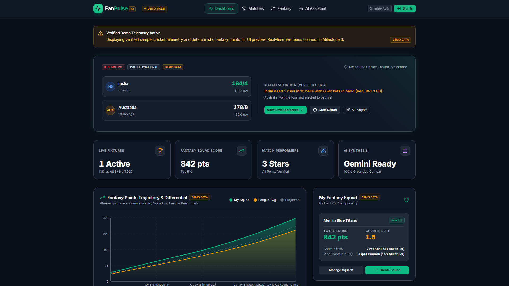
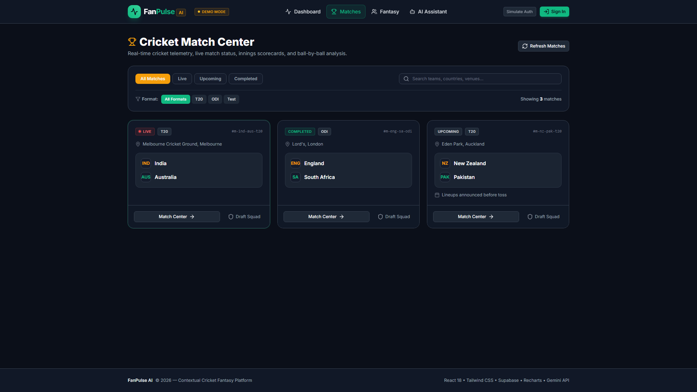
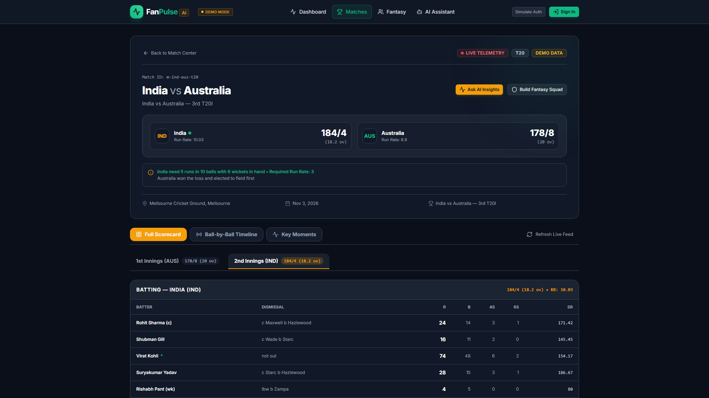
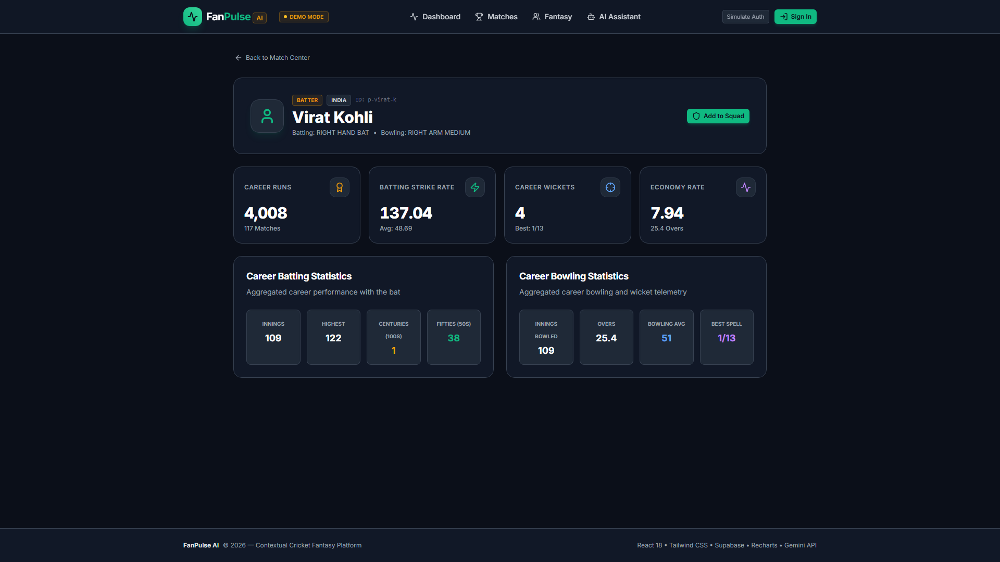
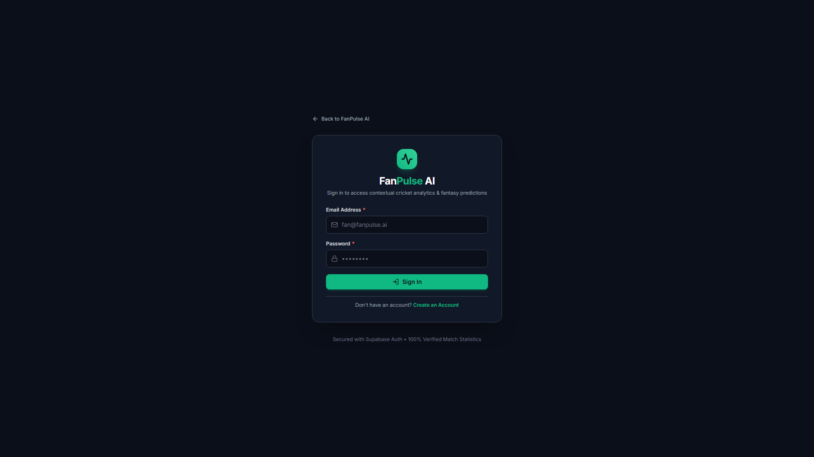
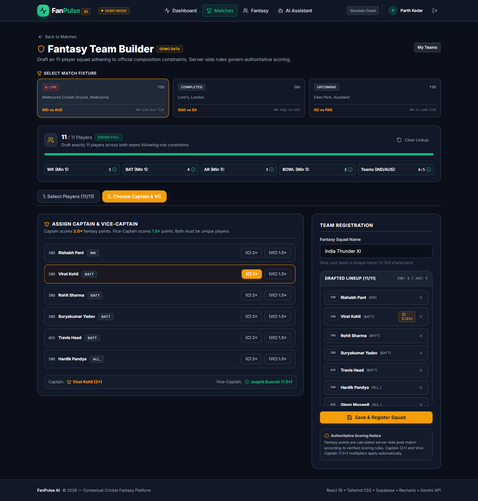
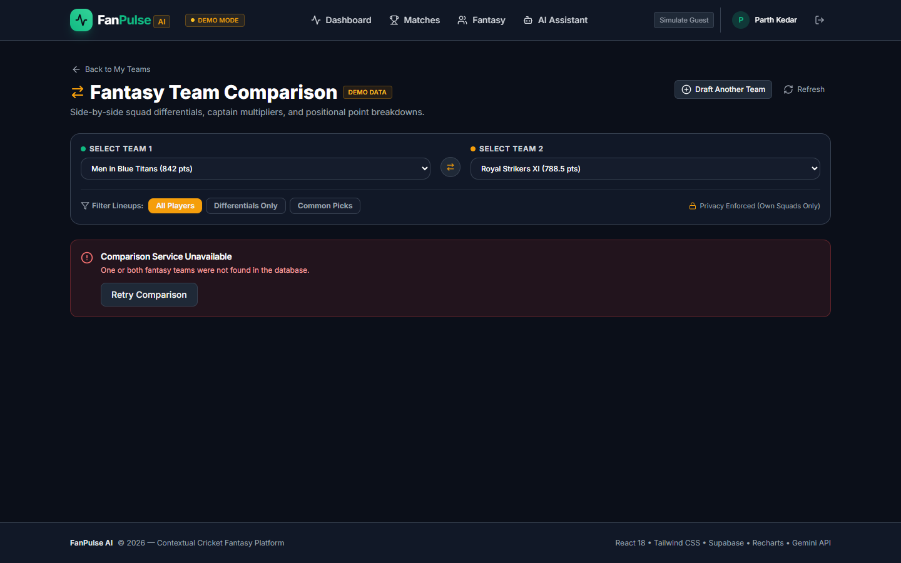
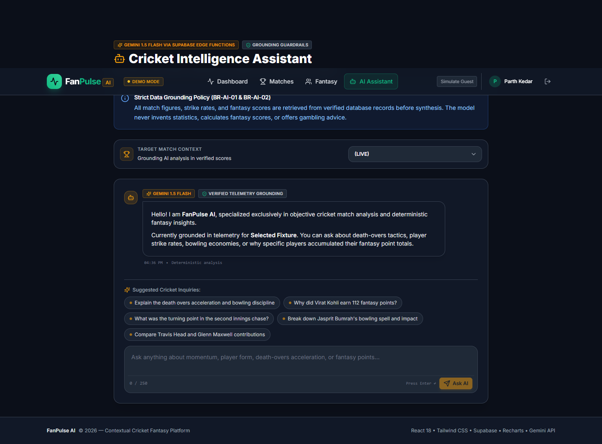
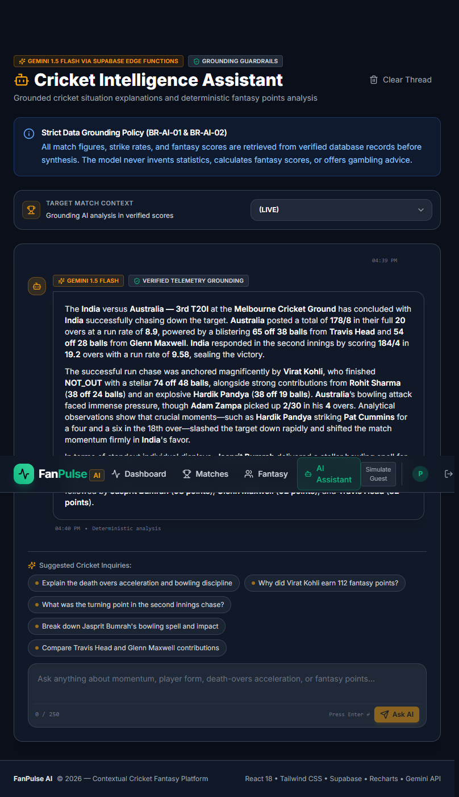
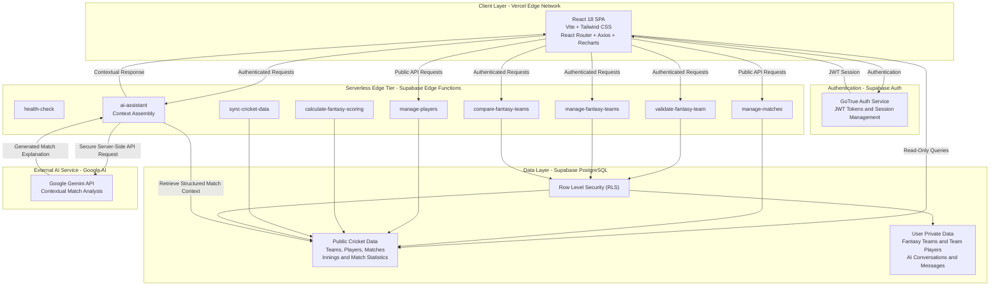

# FanPulse AI — AI-Powered Cricket Match Intelligence & Fantasy Companion

[](https://react.dev/)
[](https://vitejs.dev/)
[](https://tailwindcss.com/)
[](https://supabase.com/)
[](https://ai.google.dev/)
[](https://fanpulseai-nine.vercel.app/dashboard)
[](docs/TESTING_AND_QA.md)

> **Submission for the Dream11 Forward Deployed Engineer Intern Assignment ("Show Us What You Would Build")**  
> **Author:** Parth Kedar  
> **Live Production Demo:** [https://fanpulseai-nine.vercel.app/dashboard](https://fanpulseai-nine.vercel.app/dashboard)  
> **GitHub Repository:** [https://github.com/parthkprogrammer/FanPulse_AI](https://github.com/parthkprogrammer/FanPulse_AI)  
> **Publication-Quality PDF Report:** [`docs/FANPULSE_AI_DREAM11_SUBMISSION.pdf`](docs/FANPULSE_AI_DREAM11_SUBMISSION.pdf)

---

## 1. Problem Statement & Fan Pulse

During live cricket matches, fans face an exhausting, fragmented experience. To follow live ball-by-ball updates, track player statistics, manage fantasy teams, and understand game momentum, fans cycle between three to five distinct applications (Cricbuzz, Dream11, ESPNcricinfo, and social media).

```
[ Traditional Fan Routine ]
  Scoreboard App (Cricbuzz) ──> Fantasy App (Dream11) ──> Analytics Portal (Cricinfo) ──> Social Feeds (X / Reddit)
                                      │
                         [ Fragmented Experience ]
                         - Cognitive fatigue & context-switching
                         - Mismatched statistics & naming conventions
                         - No contextual explanation of fantasy point swings
                         - Unclear death-over tactical shifts
```

### The FanPulse AI Solution
**FanPulse AI** integrates these disparate workflows into a single high-performance web companion:
1. **Live Match Center & Telemetry:** Multi-format scorecards (T20, ODI, Test) tracking runs, wickets, overs, CRR, RRR, extras, and fall-of-wickets.
2. **Deterministic Fantasy Engine:** Transparent squad creation, budget validation (100 credits), role boundaries (1-4 WK, 3-6 BAT, 1-4 AR, 3-6 BOWL), and side-by-side squad comparison.
3. **Grounded AI Match Assistant:** Conversational match analysis powered by Google's Gemini 1.5 Flash via Supabase Edge Functions, strictly grounded in structured database telemetry.

---

## 2. Production Screenshots (Visual Proof)

All screenshots represent authentic captures from the live production deployment on Vercel:

| Screen | Feature Title | Live Production Preview |
| :--- | :--- | :--- |
| **01** | **Live Match Dashboard** | [](docs/screenshots/01_dashboard.png)<br/>*Featured match spotlight (IND vs AUS 3rd T20I at MCG, 184/4 in 19.2 ov def. 178/8 in 20 ov), Top Performers, AI Insights.* |
| **02** | **Cricket Match Center** | [](docs/screenshots/02_match_center.png)<br/>*Multi-format fixture list with filters (`All`, `Live`, `Upcoming`, `Completed`) and venue cards.* |
| **03** | **Match Details Header** | [](docs/screenshots/03_match_details.png)<br/>*Match status, venue, toss decision, CRR/RRR metrics, and tabbed sub-navigation.* |
| **04** | **Innings Scorecard** | [](docs/screenshots/04_match_scorecard.png)<br/>*Batting strike rates, bowling economies, maidens, extras, and fall-of-wickets.* |
| **05** | **Player Profile** | [](docs/screenshots/05_player_profile.png)<br/>*Career aggregate statistics, playing roles, batting/bowling styles, and credit valuations.* |
| **06** | **User Authentication** | [](docs/screenshots/06_user_authentication.png)<br/>*Supabase GoTrue Auth interface with email/password login and demo credentials.* |
| **07** | **Fantasy Team Builder** | [](docs/screenshots/07_fantasy_team_builder.png)<br/>*11-player squad picker, live 100-credit budget tracker, and Captain/Vice-Captain designation.* |
| **08** | **Fantasy Team Comparison** | [](docs/screenshots/08_fantasy_team_comparison.png)<br/>*Side-by-side squad comparison displaying total points, 18 differential players, 2 common picks, and captain impact.* |
| **09** | **AI Assistant Interface** | [](docs/screenshots/09_ai_assistant.png)<br/>*Chat workspace with fixture selector, character counter (250 chars), and suggested queries.* |
| **10** | **Grounded AI Response** | [](docs/screenshots/10_ai_assistant_response.png)<br/>*Grounded conversational explanation of India's chase and Cummins/Starc death-over spells.* |

---

## 3. System Architecture & Engineering Blueprint

FanPulse AI is structured as a decoupled cloud application combining a React SPA hosted on Vercel, a serverless Supabase backend, PostgreSQL, and Google Gemini AI.

### Architecture Diagram



### Architecture Overview

1. **Frontend:** React application hosted on Vercel, providing match dashboards, player profiles, fantasy features, and the AI Assistant.
2. **Authentication:** Supabase Auth manages user authentication and JWT sessions.
3. **Backend:** Supabase Edge Functions handle server-side operations, fantasy validation, scoring, comparison, and AI requests.
4. **Database:** Supabase PostgreSQL stores cricket information, player statistics, fantasy teams, and AI conversations. RLS enforces data access policies.
5. **AI Integration:** The AI Assistant retrieves structured match information and securely sends contextual requests to Google's Gemini API.

Fantasy scoring is handled through deterministic backend logic, while Gemini is used for natural-language cricket explanations.

---

## 4. Production Technology Stack

| Architecture Layer | Production Technology | Version | Key Engineering Responsibilities |
| :--- | :--- | :--- | :--- |
| **Frontend Framework** | **React** | `18.3.1` | Declarative UI, state management, component composition. |
| **Build & Tooling** | **Vite** | `5.4.10` | Fast HMR, Rollup production bundling, code-splitting. |
| **Styling System** | **Tailwind CSS** | `3.4.14` | Mobile-first cricket dark-theme, responsive utility grid. |
| **Routing** | **React Router DOM** | `6.27.0` | Client-side routing with `<ProtectedRoute>` guards. |
| **Data Visualization** | **Recharts** | `2.13.0` | Worm charts, role distributions, fantasy differentials. |
| **Database** | **PostgreSQL** (Supabase) | `16+` | Relational 3NF persistence, ACID compliance, 49 RLS policies. |
| **Backend Compute** | **Supabase Edge Functions** | `Deno / TS` | 9 serverless micro-endpoints distributed across edge regions. |
| **Authentication** | **Supabase GoTrue** | `v2.46+` | JWT bearer token issuance, session refresh, tenant isolation. |
| **Artificial Intelligence**| **Google Gemini API** | `1.5 Flash` | Grounded match explanations, situational insights. |
| **Test Framework** | **Vitest** | `4.1.12` | 30 test suites, 461 unit/component/integration tests. |
| **Component Testing** | **Testing Library** | `16.3.3` | User event simulation, DOM assertions, accessibility. |
| **Hosting & CDN** | **Vercel** | Edge Network| Global HTTP/2 delivery, Brotli compression, instant SSL. |

---

## 5. Grounded AI Implementation & Anti-Hallucination Guardrails

The FanPulse AI Match Assistant is designed to eliminate generative hallucinations:

1. **Structured Telemetry Delimiters:** Injected database telemetry is wrapped in strict boundary delimiters:
   ```
   === MATCH TELEMETRY BEGIN ===
   Match: India vs Australia - 3rd T20I at Melbourne Cricket Ground
   Australia: 178/8 (20.0 ov) | India: 184/4 (19.2 ov) - India won by 6 wickets
   Top Batters: V. Kohli 68 (44b), G. Maxwell 54 (31b)
   Top Bowlers: J. Bumrah 3/24 (4.0 ov), P. Cummins 2/32 (4.0 ov)
   === MATCH TELEMETRY END ===
   ```
2. **Grounded Verification Output:**
   > *"India scored 184/4 in 19.2 overs to defeat Australia (178/8 in 20.0 overs) by 6 wickets at the Melbourne Cricket Ground. Virat Kohli anchored the chase with 68 off 44 balls..."*
3. **Decoupled Scoring Architecture:** The generative model is strictly prohibited from computing fantasy scores or modifying player tallies. All points calculations are handled by the deterministic mathematical scoring engine.

---

## 6. Deterministic Fantasy Scoring Engine

Fantasy points are computed exclusively by backend TypeScript logic (`supabase/functions/_shared/scoring/index.ts`):

$$\text{Points}_{\text{total}} = (\text{Points}_{\text{batting}} + \text{Points}_{\text{bowling}} + \text{Points}_{\text{fielding}}) \times \text{Multiplier}$$

- **Batting:** Runs (+1.0), 4s (+1.0), 6s (+2.0), 50-run bonus (+10.0), 100-run bonus (+25.0), Duck penalty (-5.0 for BAT/WK/AR).
- **Bowling:** Wickets (+25.0), Maidens (+10.0), 3-wicket haul (+10.0), 5-wicket haul (+25.0), Economy $\le 4.0$ (+10.0), Economy $\ge 10.0$ (-10.0).
- **Fielding:** Catches (+10.0), Stumpings (+15.0), Direct Run-outs (+15.0), Indirect Run-outs (+10.0).
- **Multipliers:** Captain = **2.0x**, Vice-Captain = **1.5x**.
- **Squad Validation:** Exactly 11 players, $\le 100.0$ credits budget, 1-4 WK, 3-6 BAT, 1-4 AR, 3-6 BOWL, max 7 per team.

---

## 7. Quickstart & Local Development

### 7.1 Clone & Install
```bash
git clone https://github.com/parthkprogrammer/FanPulse_AI.git
cd FanPulse_AI
git checkout feat/fanpulse-development

# Install dependencies
npm install
cd frontend && npm install && cd ..
```

### 7.2 Configure Environment
Copy `frontend/.env.example` to `frontend/.env.local`:
```ini
VITE_SUPABASE_URL=https://zovgiiqamqfbqiopkooc.supabase.co
VITE_SUPABASE_ANON_KEY=eyJhbGciOiJIUzI1NiIsInR5cCI6IkpXVCJ9...
VITE_EDGE_FUNCTIONS_URL=https://zovgiiqamqfbqiopkooc.supabase.co/functions/v1
VITE_APP_MODE=production
```

### 7.3 Start Development Server
```bash
npm run dev
```
Open [http://localhost:5173](http://localhost:5173) in your browser.

---

## 8. Verification & Quality Assurance Results

```bash
# Run 461 automated tests
npm run test --prefix frontend

# Run ESLint static analysis
npm run lint --prefix frontend

# Verify production bundle compilation
npm run build --prefix frontend
```

- **Vitest:** **461 / 461 tests passed** (30 test suites).
- **ESLint:** **0 errors**, 59 non-fatal stylistic warnings.
- **Vite Build:** **0 errors**, production bundle compiled in 7.15s (335.89 kB gzipped).

---

## 9. Comprehensive Documentation Sitemap

| Canonical Document | Description |
| :--- | :--- |
| [`docs/PROJECT_OVERVIEW.md`](docs/PROJECT_OVERVIEW.md) | Product vision, target users, problem statement, workflows, and limitations. |
| [`docs/SYSTEM_ARCHITECTURE.md`](docs/SYSTEM_ARCHITECTURE.md) | Complete architectural blueprint, tier breakdown, request flows, and diagrams. |
| [`docs/DATABASE_SCHEMA.md`](docs/DATABASE_SCHEMA.md) | PostgreSQL 16 schema, 9 applied migrations, 16 tables, 49 RLS policies, 47 indexes. |
| [`docs/API_REFERENCE.md`](docs/API_REFERENCE.md) | Complete contract for all 9 deployed Supabase Edge Functions. |
| [`docs/AI_IMPLEMENTATION.md`](docs/AI_IMPLEMENTATION.md) | Gemini 1.5 Flash integration, telemetry assembly, and prompt defenses. |
| [`docs/FANTASY_SCORING.md`](docs/FANTASY_SCORING.md) | Deterministic scoring formulas, role constraints, and captain multipliers. |
| [`docs/SETUP_AND_DEPLOYMENT.md`](docs/SETUP_AND_DEPLOYMENT.md) | Operational manual for Supabase linking, Edge Function deployment, and Vercel. |
| [`docs/TESTING_AND_QA.md`](docs/TESTING_AND_QA.md) | Verification report covering 461 tests, build output, and browser audit evidence. |
| [`docs/SECURITY.md`](docs/SECURITY.md) | Supabase GoTrue Auth, Row-Level Security, JWT verification, and secret hygiene. |
| [`docs/PROJECT_REPORT.md`](docs/PROJECT_REPORT.md) | Master consolidated technical report for the Dream11 assignment evaluation. |
| [`docs/FANPULSE_AI_DREAM11_SUBMISSION.pdf`](docs/FANPULSE_AI_DREAM11_SUBMISSION.pdf) | Publication-quality 14-page PDF submission document with embedded screenshots. |
| [`docs/archive/`](docs/archive/) | Archived Phase 0 prototype specifications (Java/Spring Boot exploration). |

---

## 10. Honest Limitations & Operational Boundary Disclosures

1. **Sample Cricket Telemetry:** Current match fixtures and scorecards are populated with verified sample data (`supabase/seed.sql`). Real live feed streaming requires an active commercial licensing agreement with an authorized cricket data provider.
2. **Generative Boundaries:** The AI model is strictly restricted to narrative and tactical explanations. It is **never** used to compute fantasy scores, modify database records, or predict future gambling/betting odds.
3. **Authentication Boundary:** Public visitors can browse match scorecards, player profiles, and dashboard statistics. Fantasy team creation, team comparison, and user-specific AI conversations require an authenticated session.

---

*Submitted by Parth Kedar for the Dream11 Forward Deployed Engineer Intern Assignment.*
