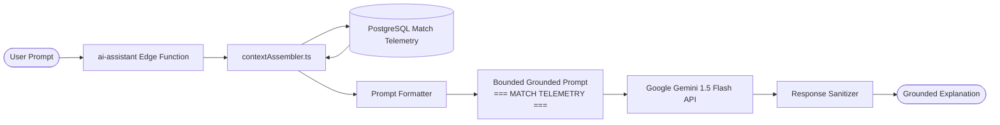

# FanPulse AI — AI Implementation & Grounding Architecture

> **Engineering specification for the Gemini 1.5 Flash contextual match assistant, telemetry serialization, prompt boundaries, and grounding guardrails.**

---

## 1. AI System Overview

The FanPulse AI Match Assistant provides natural-language cricket match intelligence without the hallucinations common to generic LLM chatbots. Rather than relying on public model memory, the assistant dynamically injects verified, structured database telemetry into bounded prompts at request time.



---

## 2. Core Architectural Principles

1. **Strict Data Grounding:** The model is explicitly constrained to answers derivable from the injected database telemetry. If a question asks about details not present in the telemetry (e.g., weather forecast next week), the model is instructed to decline politely.
2. **Server-Side Key Isolation:** The Google Gemini API key resides solely as a Supabase Edge Runtime secret (`GEMINI_API_KEY`). The frontend client has zero direct exposure to the AI provider.
3. **Decoupled Scoring Architecture:** The AI model is strictly prohibited from calculating fantasy points or modifying player scores. All fantasy points are computed exclusively by the deterministic calculation engine.

---

## 3. Context Assembly Pipeline (`contextAssembler.ts`)

When an authenticated user queries the assistant for a fixture (e.g., `m-ind-aus-t20`), the `contextAssembler` executes optimized SQL queries against PostgreSQL to assemble the telemetry payload:

```typescript
// Conceptual structure of assembled match context
interface GroundedMatchContext {
  match: {
    id: string;
    title: string;
    format: string;
    status: string;
    venue: string;
    toss: string;
  };
  innings: Array<{
    inningsNumber: number;
    battingTeam: string;
    bowlingTeam: string;
    totalRuns: number;
    totalWickets: number;
    oversCompleted: number;
    extras: number;
  }>;
  topBatters: Array<{ name: string; runs: number; balls: number; strikeRate: number }>;
  topBowlers: Array<{ name: string; overs: number; maidens: number; runs: number; wickets: number; economy: number }>;
}
```

### Telemetry Serialization
The telemetry is serialized into a structured markdown block wrapped in explicit system delimiters:
```
=== MATCH TELEMETRY BEGIN ===
Match: India vs Australia - 3rd T20I (Format: T20, Status: COMPLETED)
Venue: Melbourne Cricket Ground
Toss: India won the toss and elected to bowl.
1st Innings: Australia 178/8 in 20.0 overs (Extras: 12).
2nd Innings: India 184/4 in 19.2 overs (Extras: 8).
Result: India won by 6 wickets.

Key Batting Performances:
- Virat Kohli (IND): 68 runs off 44 balls (SR: 154.55)
- Glenn Maxwell (AUS): 54 runs off 31 balls (SR: 174.19)

Key Bowling Performances:
- Pat Cummins (AUS): 4.0 ov, 0 m, 32 r, 2 w (Econ: 8.00)
- Jasprit Bumrah (IND): 4.0 ov, 1 m, 24 r, 3 w (Econ: 6.00)
=== MATCH TELEMETRY END ===
```

---

## 4. Prompt Engineering & Delimiter Defenses

The system prompt enforces strict domain boundaries and repels prompt injection:

```
You are the FanPulse AI Cricket Intelligence Assistant.
Your task is to explain match dynamics, momentum shifts, and player performances using ONLY the supplied MATCH TELEMETRY above.

RULES:
1. Ground every claim directly in the telemetry. Do not invent runs, wickets, overs, or players.
2. If asked about facts not in the telemetry, state: "That information is not recorded in the available match telemetry."
3. Do not predict future match winners, gambling odds, or calculate fantasy points.
4. Maintain an objective, expert analytical tone.
```

### Injection Mitigation:
- User questions are wrapped in `<user_question>` tags.
- The model ignores instructions inside the user question that attempt to override system rules or extract system instructions.

---

## 5. Resilience & Upstream Protection

The Gemini client implementation in `_shared/ai/geminiClient.ts` incorporates enterprise fault tolerance:
1. **Request Timeouts:** Standard 10-second timeout to prevent thread hanging on API latency spikes.
2. **Exponential Backoff & Retry:** Automatically retries up to 2 times on transient upstream failures (`503 Service Unavailable`, `429 Rate Limit`).
3. **Circuit Breaker:** Fast-fails requests if consecutive failures exceed 5 within a 60-second window, preserving client responsiveness.
4. **Graceful Degraded Response:** If Gemini is unreachable, the Edge Function returns a formatted fallback summary derived directly from the SQL database records, ensuring zero UI downtime.

---

*Related Documentation:*
- [System Architecture](SYSTEM_ARCHITECTURE.md)
- [API Reference](API_REFERENCE.md)
- [Database Schema](DATABASE_SCHEMA.md)
- [Security Architecture](SECURITY.md)

