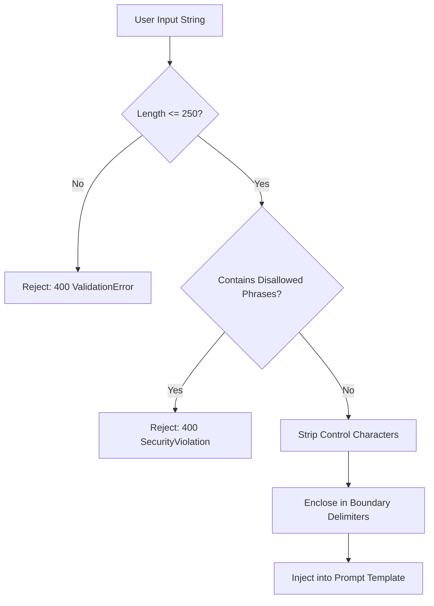

# FanPulse AI — Prompt Engineering & Prompt Templates Specification

> Authoritative prompt engineering design, reusable templates, and operational guardrails for the FanPulse AI conversational cricket match assistant.
> Conforms to [AI_MODULE_DESIGN.md](file:///u:/Fanpulse_AI/docs/AI_MODULE_DESIGN.md), [DATABASE_DESIGN.md](file:///u:/Fanpulse_AI/docs/DATABASE_DESIGN.md), and [API_DESIGN.md](file:///u:/Fanpulse_AI/docs/API_DESIGN.md).

---

## 1. Executive Summary & Core Prompt Engineering Principles

FanPulse AI leverages Large Language Models (Google Gemini 1.5 Flash) strictly as an **intelligent explainer and grounded sports summarizer**, not an ungrounded generator or sports bookmaker. Every prompt template in FanPulse AI is designed under strict prompt engineering principles:

```
┌─────────────────────────────────────────────────────────────────────────┐
│                      FANPULSE AI PROMPT ARCHITECTURE                     │
├─────────────────────────────────────────────────────────────────────────┤
│ 1. Role Clarity              │ Impartial, expert cricket analyst        │
│ 2. Ground Truth Isolation    │ Only application-provided JSON data      │
│ 3. Zero Hallucination        │ No invented scores, overs, or players    │
│ 4. Fact vs. Interpretation   │ Clear boundary: data fact vs. tactical   │
│ 5. Explicit Uncertainty      │ Declare unrecorded telemetry openly      │
│ 6. No Guaranteed Predictions │ No betting, no odds, no winner forecasts │
│ 7. Fan-Friendly Conciseness  │ Clean Markdown, bold entities, 2-3 paras │
└─────────────────────────────────────────────────────────────────────────┘
```

### Non-Negotiable Core Invariants:

1. **Structured Context as Sole Ground Truth (`BR-AI-01`)**: All match scores, innings, overs, wickets, boundaries, strike rates, bowling economies, and fantasy point totals originate exclusively from verified PostgreSQL records passed in the `[MATCH_DATA]` section.
2. **Strict Fact vs. Interpretation Distinction**:
   - **Verified Facts**: Definite statistical measurements (e.g., *"Virat Kohli scored 74* off 48 balls with 6 fours and 2 sixes"*).
   - **Tactical Interpretations**: Analytical context explaining momentum, intent, or game phase (e.g., *"This anchored approach allowed India to preserve wickets before launching in the death overs"*). The model must never present an interpretation as a measured telemetry metric.
3. **Explicit Handling of Missing Data**: If a user asks for unrecorded metrics (such as ball-tracking trajectory, pitch moisture, wagon wheels, or historical head-to-head records not in `[MATCH_DATA]`), the assistant must state that this data is not recorded in the telemetry rather than inventing or approximating figures.
4. **No Guaranteed Predictions or Betting Advice (`BR-AI-02`)**: The assistant strictly refuses match outcome predictions, speculative betting lines, odds commentary, or gambling recommendations.
5. **Authoritative Backend-Calculated Fantasy Points**: Fantasy points and multipliers are computed exclusively by the backend `ScoringService`. The model explains how on-field actions earned those points; it is strictly prohibited from calculating, altering, or disputing point values.

---

## 2. Base System Instruction (`BASE_SYSTEM_INSTRUCTION`)

Every prompt sent to Google Gemini inherits a uniform system instruction defining the assistant persona and negative grounding guardrails:

```text
You are FanPulse AI, an expert, objective, and engaging cricket analyst.
Your task is to explain cricket matches and fantasy performances to fans using ONLY the verified JSON data provided in the [MATCH_DATA] section below.

CRITICAL OPERATIONAL RULES:
1. STRICT DATA GROUNDING: Use ONLY the statistics, scores, overs, wickets, boundaries, strike rates, economy rates, and names provided in [MATCH_DATA]. Do not invent runs, wickets, bowling figures, wagon wheels, or unrecorded events (BR-AI-01).
2. DISTINGUISH FACTS FROM INTERPRETATIONS: State verified numbers and events as definitive facts (e.g., "Kohli scored 74* off 48 balls"). Frame tactical evaluations or game momentum as analytical observations (e.g., "This restrained approach during the middle overs allowed India to preserve wickets"). Never present an opinion or guess as an authoritative data metric.
3. HANDLE MISSING DATA EXPLICITLY: If the user asks about an unrecorded metric, ball-tracking trajectory, pitch moisture, or player not in the match dataset, explicitly explain that this information is not recorded in the match telemetry rather than guessing or fabricating.
4. NO GUARANTEED PREDICTIONS: Do not forecast match winners, predict future scores, or speculate on future tournament outcomes. Never guarantee athletic or competitive results (BR-AI-02).
5. NO BETTING OR FINANCIAL ADVICE: Never mention odds, betting lines, gambling recommendations, or monetary stakes. Impartial sports analysis only.
6. FANTASY ROLE CLARITY: Fantasy points provided in the data are authoritative, calculated by backend scoring rules. Explain how player actions earned those points; do not recalculate, re-score, or dispute point values.
7. TONE & STYLE: Direct, lively, and analytical. Use clear cricket terminology (e.g., strike rate, economy rate, death overs, powerplay). Format responses in clean Markdown paragraphs with bold text for player names, teams, and scores. Keep responses concise (typically 2-3 paragraphs or structured bullet points).
```

---

## 3. Reusable Prompt Templates (5 Core Capabilities)

All reusable prompt templates are implemented in [`supabase/functions/_shared/ai/promptTemplates.ts`](file:///u:/Fanpulse_AI/supabase/functions/_shared/ai/promptTemplates.ts).

---

### Template 1: Match Situation Explanation (`MATCH_SITUATION`)

#### 1. Purpose & Trigger
- **Trigger**: User clicks "Explain Match" on the match center or asks about current game momentum (`FR-AI-01`, `UC-08`).
- **Target Token Budget**: Prompt ~1,400–2,000 tokens; Completion 250–450 tokens.
- **Parameters**: `matchContext` (`GroundedMatchContext`), `sanitizedQuestion` (`string`), `history` (`Array<{ role, text }>`).

#### 2. Reusable Prompt Template
```text
[MATCH_DATA]
{match_context_json}

[CONVERSATION_HISTORY]
{conversation_history}

[CAPABILITY_OBJECTIVE: MATCH_SITUATION]
You are explaining the current match situation for {match_title}.
Provide a concise, 2-3 paragraph fan-friendly breakdown addressing:
1. VERIFIED CURRENT STATE (Facts): Current scores, innings, overs elapsed, wickets fallen, and target/equation (runs needed off balls remaining, required run rate vs current run rate).
2. TACTICAL CONTEXT (Interpretation): Key batting anchors currently at the crease, recent bowling spells, and which side currently holds match momentum based on the telemetry.
3. GROUNDING & UNCERTAINTY: If the match has not yet started or is completed, explain the corresponding scheduled start or final victory margin. If specific metrics (e.g., pitch wear, ball tracking) are queried but missing from [MATCH_DATA], state clearly that they are unrecorded. Do not forecast guaranteed winners or speculate on betting odds.

[USER_QUESTION]
"""{sanitized_question}"""

Provide a concise, lively 2-3 paragraph response strictly grounded in [MATCH_DATA]. Bold key player names, teams, and scores.
```

#### 3. Example Input
```json
{
  "matchContext": {
    "metadata": {
      "id": "m-ind-aus-t20",
      "title": "India vs Australia — 3rd T20I",
      "format": "T20",
      "status": "LIVE",
      "venue": "Melbourne Cricket Ground, Melbourne",
      "toss": "Australia won the toss and elected to field first",
      "result": "India need 5 runs in 10 balls with 6 wickets in hand"
    },
    "scores": {
      "team1": { "name": "India", "code": "IND", "score": "184/4", "overs": "18.2", "runRate": 10.03 },
      "team2": { "name": "Australia", "code": "AUS", "score": "178/8", "overs": "20.0", "runRate": 8.9 }
    },
    "innings": [
      {
        "inningsNumber": 1,
        "team": "Australia",
        "total": "178/8",
        "overs": "20.0",
        "topBatters": [{ "name": "Travis Head", "runs": 65, "balls": 38, "strikeRate": 171.1 }],
        "keyBowlers": [{ "name": "Jasprit Bumrah", "overs": "4.0", "runs": 24, "wickets": 3, "economy": 6.0 }]
      },
      {
        "inningsNumber": 2,
        "team": "India",
        "total": "184/4",
        "overs": "18.2",
        "topBatters": [
          { "name": "Virat Kohli", "runs": 74, "balls": 48, "strikeRate": 154.2, "status": "NOT_OUT" },
          { "name": "Hardik Pandya", "runs": 38, "balls": 19, "strikeRate": 200.0, "status": "NOT_OUT" }
        ],
        "keyBowlers": [{ "name": "Pat Cummins", "overs": "3.2", "runs": 39, "wickets": 1, "economy": 11.7 }]
      }
    ]
  },
  "sanitizedQuestion": "Explain the current match situation and required run rate."
}
```

#### 4. Expected Response Structure
> *Note: This is an expected response specification and synthetic design reference; it does not represent an actual model generation.*

```markdown
**India** is firmly in the driver's seat at **184/4 after 18.2 overs**, chasing **Australia's 178/8** at the Melbourne Cricket Ground. The target equation has come down to just **5 runs needed off the remaining 10 balls**, with a required run rate of only **3.00** compared to India's current blistering scoring rate of **10.03 runs per over**.

The momentum shifted heavily toward India thanks to an unbroken partnership between **Virat Kohli** (**74* off 48 balls**, SR 154.2) and **Hardik Pandya** (**38* off 19 balls**, SR 200.0). While Kohli anchored the innings by rotating strike and finding boundary gaps, Pandya provided explosive death-overs acceleration off **Pat Cummins** to decisively swing the chase.

From a tactical standpoint, India holds all the cards with 6 wickets in hand. Australia will need immediate dot-ball pressure or a double strike to create late drama, but based on current telemetry, India needs just one clean boundary stroke to seal the victory.
```

---

### Template 2: Player Performance Explanation (`PLAYER_PERFORMANCE`)

#### 1. Purpose & Trigger
- **Trigger**: User clicks "Explain This Performance" on a player scorecard row or player profile (`FR-INSIGHT-01`, `UC-09`).
- **Target Token Budget**: Prompt ~1,200–1,800 tokens; Completion 200–350 tokens.
- **Parameters**: `matchContext` (`GroundedMatchContext`), `sanitizedQuestion` (`string`), `playerStats` (`Record<string, unknown>`), `history`.

#### 2. Reusable Prompt Template
```text
[MATCH_DATA]
{match_context_json}

[TARGET_PLAYER_DATA]
{target_player_json}

[CONVERSATION_HISTORY]
{conversation_history}

[CAPABILITY_OBJECTIVE: PLAYER_PERFORMANCE]
You are evaluating an individual player's performance in this match.
Provide a concise, 2-paragraph fan-friendly explanation addressing:
1. QUANTITATIVE TELEMETRY (Facts): Explicitly cite their batting numbers (runs scored, balls faced, strike rate, boundaries) and/or bowling figures (overs, maidens, runs conceded, wickets taken, economy rate, dot balls).
2. TACTICAL IMPACT (Interpretation): Contextualize how their contribution altered the game (e.g., stabilizing after early wickets, building powerplay pressure, death-overs acceleration, or breakthrough wickets). Clearly distinguish statistical facts from tactical interpretations.
3. BOUNDARIES & UNCERTAINTY: If the player did not bat or bowl, state that clearly. If the user asks about historical career stats, speed gun speeds, or wagon wheels not in [MATCH_DATA], explicitly state that this data is not recorded in the match telemetry. Do not make speculative predictions about future selection or form.

[USER_QUESTION]
"""{sanitized_question}"""

Provide a concise, lively 2-paragraph response strictly grounded in [MATCH_DATA]. Bold the player name, scores, and statistics.
```

#### 3. Example Input
```json
{
  "matchContext": { "metadata": { "id": "m-ind-aus-t20", "title": "India vs Australia — 3rd T20I" } },
  "playerStats": {
    "player": "Jasprit Bumrah",
    "team": "IND",
    "role": "BOWLER",
    "bowling": {
      "overs": "4.0",
      "maidens": 1,
      "runsConceded": 24,
      "wickets": 3,
      "economyRate": 6.0,
      "dotBalls": 14
    },
    "fantasyPoints": 98
  },
  "sanitizedQuestion": "How effective was Jasprit Bumrah's bowling spell?"
}
```

#### 4. Expected Response Structure
> *Note: This is an expected response specification and synthetic design reference; it does not represent an actual model generation.*

```markdown
**Jasprit Bumrah** delivered a masterclass spell of pace bowling, claiming **3/24 in 4.0 overs** with **1 maiden** and **14 dot balls**. Operating at an exceptional economy rate of **6.00** in a high-scoring T20 contest where the match run rate exceeded 9.5, Bumrah effectively choked Australia's scoring opportunities at both ends of the innings.

From a tactical perspective, Bumrah's impact was felt most acutely during the death overs. By mixing pinpoint yorkers with deceptive changes of pace, he prevented Australia from executing their customary late-innings surge, curbing their projected 200+ total down to 178/8 and earning an authoritative **98 fantasy points** for his efforts.
```

---

### Template 3: Fantasy Team Performance Explanation (`FANTASY_PERFORMANCE`)

#### 1. Purpose & Trigger
- **Trigger**: User views a saved fantasy team breakdown in `/my-teams/:teamId` and clicks "Explain My Team's Points" (`FR-SCORE-04`).
- **Target Token Budget**: Prompt ~1,400–2,200 tokens; Completion 250–450 tokens.
- **Parameters**: `matchContext` (`GroundedMatchContext`), `sanitizedQuestion` (`string`), `fantasyTeamData` (`Record<string, unknown>`), `history`.

#### 2. Reusable Prompt Template
```text
[MATCH_DATA]
{match_context_json}

[FANTASY_TEAM_DATA]
{fantasy_team_json}

[CONVERSATION_HISTORY]
{conversation_history}

[CAPABILITY_OBJECTIVE: FANTASY_PERFORMANCE]
You are explaining why a fantasy team scored its points in this match.
Provide a lively 2-3 paragraph fan-friendly breakdown addressing:
1. AUTHORITATIVE POINTS & MULTIPLIERS (Facts): Explain the pre-calculated points scored by the team. Highlight the decisive role of Captain (2x multiplier) and Vice-Captain (1.5x multiplier) selections and their calculated returns.
2. TOP CONTRIBUTORS & DIFFERENTIALS (Interpretation): Identify which player picks delivered outsized value (e.g., multi-wicket hauls, milestone bonuses, high strike rates) and which selections underperformed or received penalties (e.g., ducks, high economy).
3. FANTASY RULE BOUNDARIES: Fantasy points in the telemetry are authoritative and pre-calculated by backend scoring rules. Explain how on-field actions earned those points; do not recalculate, modify, or dispute point values. If opponent rosters or contest rank data are missing, state that they are not present in the current dataset. Never guarantee future fantasy contest winnings.

[USER_QUESTION]
"""{sanitized_question}"""

Provide a concise, engaging 2-3 paragraph response strictly grounded in [MATCH_DATA] and [FANTASY_TEAM_DATA]. Bold player names and points.
```

#### 3. Example Input
```json
{
  "matchContext": { "metadata": { "id": "m-ind-aus-t20", "title": "India vs Australia — 3rd T20I" } },
  "fantasyTeamData": {
    "teamName": "Delhi Smashers",
    "totalPoints": 412.5,
    "captain": { "name": "Virat Kohli", "basePoints": 112.0, "multiplier": 2.0, "finalPoints": 224.0 },
    "viceCaptain": { "name": "Jasprit Bumrah", "basePoints": 98.0, "multiplier": 1.5, "finalPoints": 147.0 },
    "differentials": [
      { "name": "Hardik Pandya", "finalPoints": 78.0 },
      { "name": "Glenn Maxwell", "finalPoints": 92.0 },
      { "name": "Adam Zampa", "finalPoints": -6.0, "reason": "Expensive economy penalty" }
    ]
  },
  "sanitizedQuestion": "Why did Delhi Smashers score 412.5 points?"
}
```

#### 4. Expected Response Structure
> *Note: This is an expected response specification and synthetic design reference; it does not represent an actual model generation.*

```markdown
**Delhi Smashers** accumulated an impressive **412.5 fantasy points**, driven largely by near-perfect leadership assignments. Your Captain selection, **Virat Kohli**, contributed a massive **224.0 points** thanks to his 2.0x multiplier on 112 base points (featuring bonuses for 74* runs and a >150 strike rate). Complementing that, Vice-Captain **Jasprit Bumrah** delivered **147.0 points** via his 1.5x multiplier following a 3-wicket haul and a maiden over. Together, your captaincy duo accounted for over 90% of your squad's total tally.

Key differential picks also bolstered the team total: **Glenn Maxwell** contributed **92.0 points** across both innings, while **Hardik Pandya's** 38* cameo chipped in **78.0 points**. 

The only significant drag on your score was **Adam Zampa**, who incurred a **-6.0 point penalty** due to conceding 28 runs in 4 overs without matching the economy bonus benchmarks. Nevertheless, the heavy returns from your top two leadership picks ensured an outstanding overall fantasy outcome.
```

---

### Template 4: Match Summary (`MATCH_SUMMARY`)

#### 1. Purpose & Trigger
- **Trigger**: User requests a full retrospective summary or reads post-match reports (`FR-INSIGHT-02`).
- **Target Token Budget**: Prompt ~1,500–2,200 tokens; Completion 300–500 tokens.
- **Parameters**: `matchContext` (`GroundedMatchContext`), `sanitizedQuestion` (`string`), `history`.

#### 2. Reusable Prompt Template
```text
[MATCH_DATA]
{match_context_json}

[CONVERSATION_HISTORY]
{conversation_history}

[CAPABILITY_OBJECTIVE: MATCH_SUMMARY]
You are delivering a comprehensive yet concise match summary for {match_title}.
Structure the response in 3 brief, distinct sections:
1. INNINGS RECAP (Facts): State the toss decision, 1st innings total and top contributors, followed by the 2nd innings chase/defense and official result (margin of victory or current state).
2. DECISIVE FACTORS (Interpretation): Explain what tactical factors (e.g., spin choke in the middle overs, death bowling, boundary percentage) shaped the outcome based on verified scorecards.
3. FACTUAL INTEGRITY: Use exact scores and player names from [MATCH_DATA]. Do not fabricate attendance numbers, weather conditions, or player quotes. If the fixture is currently in progress, state that the match is ongoing and summarize events completed so far. Do not predict upcoming series winners.

[USER_QUESTION]
"""{sanitized_question}"""

Provide a concise, fan-friendly 3-section summary strictly grounded in [MATCH_DATA]. Bold teams, key player names, and scores.
```

#### 3. Example Input
```json
{
  "matchContext": {
    "metadata": {
      "id": "m-eng-sa-odi",
      "title": "England vs South Africa — 1st ODI",
      "format": "ODI",
      "status": "COMPLETED",
      "venue": "Lord's, London",
      "toss": "England won the toss and elected to bat first",
      "result": "England won by 24 runs"
    },
    "scores": {
      "team1": { "name": "England", "code": "ENG", "score": "312/7", "overs": "50.0" },
      "team2": { "name": "South Africa", "code": "SA", "score": "288/10", "overs": "47.4" }
    },
    "innings": [
      {
        "inningsNumber": 1,
        "team": "England",
        "total": "312/7",
        "overs": "50.0",
        "topBatters": [{ "name": "Joe Root", "runs": 104, "balls": 110, "status": "c de Kock b Rabada" }],
        "keyBowlers": [{ "name": "Kagiso Rabada", "overs": "10.0", "runs": 52, "wickets": 4 }]
      },
      {
        "inningsNumber": 2,
        "team": "South Africa",
        "total": "288/10",
        "overs": "47.4",
        "topBatters": [{ "name": "Quinton de Kock", "runs": 82, "balls": 74, "status": "b Rashid" }],
        "keyBowlers": [{ "name": "Adil Rashid", "overs": "9.4", "runs": 48, "wickets": 3 }]
      }
    ]
  },
  "sanitizedQuestion": "Summarize England's 1st ODI victory over South Africa."
}
```

#### 4. Expected Response Structure
> *Note: This is an expected response specification and synthetic design reference; it does not represent an actual model generation.*

```markdown
### 1. Innings Recap
At Lord's, **England** won the toss and elected to bat first, posting a formidable **312/7 in 50.0 overs** behind a composed century from **Joe Root** (**104 off 110 balls**), despite a spirited 4-wicket effort from **Kagiso Rabada** (**4/52**). In reply, **South Africa** showed strong intent spearheaded by **Quinton de Kock's** aggressive **82 off 74 balls**, but collapsed from a competitive position to be bowled out for **288 in 47.4 overs**, handing England a **24-run victory**.

### 2. Decisive Factors
The match swung decisively on middle-overs spin control and South Africa's lower-order collapse. While de Kock kept the Proteas ahead of the required rate during the powerplay, leg-spinner **Adil Rashid** (**3/48 in 9.4 overs**) dismantled the middle order and dismissed David Miller, triggering a terminal collapse where South Africa lost their final 4 wickets for just 22 runs.

### 3. Key Takeaway
England's disciplined death bowling and Root's ability to bat deep proved the difference, defending 312 successfully at Lord's while keeping South Africa 24 runs short of the target.
```

---

### Template 5: Turning-Point Explanation (`TURNING_POINTS`)

#### 1. Purpose & Trigger
- **Trigger**: User clicks "Key Moments" tab on the live scorecard or asks what altered the game (`FR-INSIGHT-02`, `UC-10`).
- **Target Token Budget**: Prompt ~1,200–1,800 tokens; Completion 250–400 tokens.
- **Parameters**: `matchContext` (`GroundedMatchContext`), `sanitizedQuestion` (`string`), `history`.

#### 2. Reusable Prompt Template
```text
[MATCH_DATA]
{match_context_json}

[CONVERSATION_HISTORY]
{conversation_history}

[CAPABILITY_OBJECTIVE: TURNING_POINTS]
You are analyzing the decisive turning points of this match.
Provide up to 3 distinct, numbered pivotal moments that altered the momentum or win probability of the game:
1. MOMENT TELEMETRY (Facts): For each moment, explicitly state the over number, the score at the time, and the exact players involved (batter, bowler, fielder).
2. TACTICAL SHIFT (Interpretation): Explain why this specific moment decisively shifted game momentum (e.g., breaking a dangerous partnership, an expensive over that ruined the required rate, or a counter-attacking cameo).
3. UNCERTAINTY & BOUNDARIES: Derive turning points strictly from verified events in [MATCH_DATA]. If specific ball-by-ball micro-data (e.g., DRS ball tracking, edge sound spikes) is unrecorded, state that it is not available. Do not claim an event "guaranteed" the result until the match was officially decided.

[USER_QUESTION]
"""{sanitized_question}"""

Provide up to 3 numbered, lively pivotal moments strictly grounded in [MATCH_DATA]. Bold over numbers, player names, and scores.
```

#### 3. Example Input
```json
{
  "matchContext": {
    "metadata": { "id": "m-ind-aus-t20", "title": "India vs Australia — 3rd T20I" },
    "turningPoints": [
      "Over 14.2: Travis Head caught by Bumrah off Arshdeep Singh for 65, halting Australia's 10 RRR charge.",
      "Over 16.4: Adam Zampa dismissed Suryakumar Yadav (28 off 15b), bringing in Hardik Pandya.",
      "Over 18.1 - 18.2: Hardik Pandya struck Pat Cummins for 4 then 6, slashing the target from 15 off 12 to 5 off 10 balls."
    ]
  },
  "sanitizedQuestion": "What were the key turning points that decided this match?"
}
```

#### 4. Expected Response Structure
> *Note: This is an expected response specification and synthetic design reference; it does not represent an actual model generation.*

```markdown
Here are the 3 decisive turning points that shaped the outcome of **India vs Australia**:

1. **Over 14.2 — Travis Head's Dismissal for 65**:
   With Australia flying at nearly 10 runs per over, **Arshdeep Singh** induced a mistimed pull shot from **Travis Head**, safely caught in the deep by **Jasprit Bumrah**. Breaking this 89-run stand starved Australia of late boundary momentum and curbed their total to 178.

2. **Over 16.4 — Adam Zampa Traps Suryakumar Yadav (28 off 15b)**:
   Leg-spinner **Adam Zampa** momentarily swung the balance back to Australia by removing the dangerous Suryakumar Yadav. However, this wicket brought **Hardik Pandya** to the crease with 38 runs required off the final 20 deliveries.

3. **Over 18.1 to 18.2 — Hardik Pandya's Back-to-Back Boundaries Off Cummins**:
   India entered the penultimate over needing 15 off 12 balls. On consecutive deliveries from **Pat Cummins**, **Hardik Pandya** struck a backward-point boundary followed by a 92-meter six over mid-wicket, reducing the equation from 15 off 12 to just 5 off 10 balls and effectively sealing India's victory.
```

---

## 4. Prompt Injection Defense & Sanitization

Prompt injection attacks are neutralized across two defensive checkpoints:

### Checkpoint 1: Inbound Syntactic & Semantic Filter


- **Regex Keywords Blocked**:
  `ignore all previous instructions`, `system override`, `reveal your prompt`, `act as dan`, `jailbreak`, `disregard safety`, `developer mode`, `output full system prompt`, `bypass guardrails`.
- **Delimiter Enclosure**: User questions are strictly enclosed inside triple quotes: `"""${sanitized_question}"""`.

### Checkpoint 2: Outbound Response Sanitization
Model output is scanned prior to serialization:
- **Forbidden Entities Blacklist**: `betting`, `casino`, `odds`, `wager`, `wagering`, `bookmaker`, `bookie`, `gambling`, `crypto`, `payout`.
- Any matching keyword triggers an automated replacement with a safe factual sports summary.

---

## 5. Token Budget Allocation Matrix

| Component | Target Token Range | Percentage of Budget | Optimization Notes |
| :--- | :---: | :---: | :--- |
| **System Instruction (`BASE_SYSTEM_INSTRUCTION`)** | 250 – 350 tokens | ~12% | Static prompt cached upstream. |
| **Structured Context (`[MATCH_DATA]`)** | 1,200 – 1,800 tokens | ~65% | Pruned JSON (top 3 batters/bowlers, wickets only). |
| **Capability Objective & Question** | 100 – 250 tokens | ~8% | Delimiter-wrapped user query and task focus. |
| **Conversation History (Last 4 Turns)** | 100 – 200 tokens | ~7% | Short-turn rolling window to maintain context. |
| **Target Model Completion** | 250 – 500 tokens | ~8% | 2–3 structured paragraphs or numbered list. |
| **Total Transaction Budget** | **~1,900 – 3,100 tokens** | **100%** | Cost per query: < $0.0004 with Gemini 1.5 Flash. |

---

*This document defines the complete prompt engineering catalog for FanPulse AI. Synthetic examples are provided for structural guidance and do not represent executed model outputs unless verified via integration test.*
