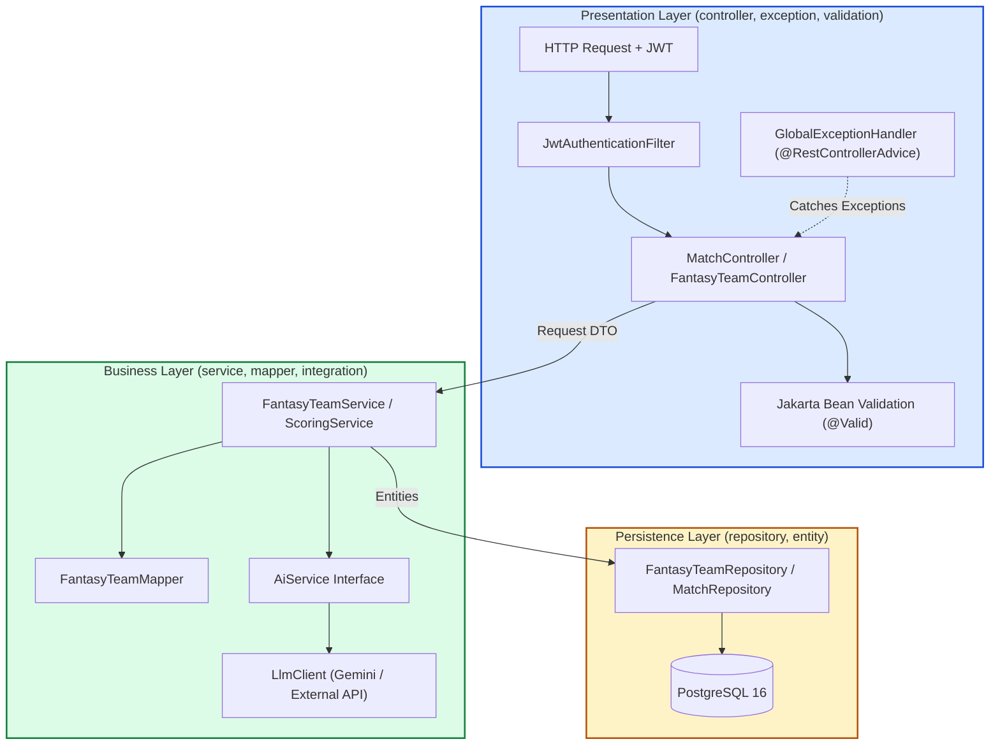
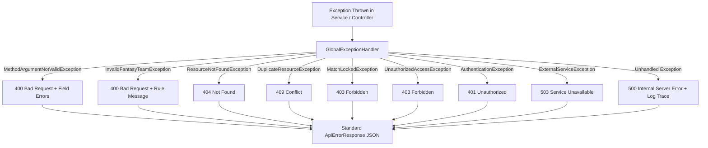
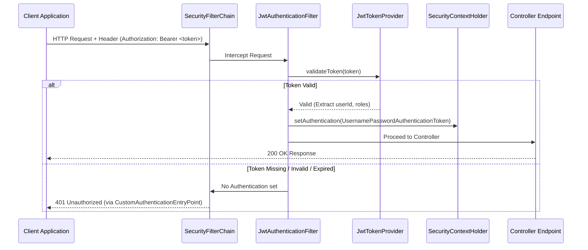
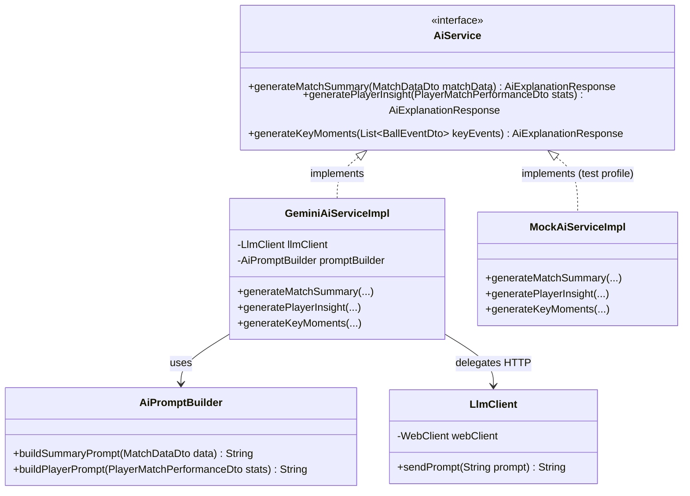

# FanPulse AI — Backend Layered Architecture Specification

> Enterprise Spring Boot architecture, package design, layer responsibilities, and SOLID design principles.
> Derived from [PROJECT_VISION.md](file:///U:/Fanpulse_AI/docs/PROJECT_VISION.md), [REQUIREMENTS.md](file:///U:/Fanpulse_AI/docs/REQUIREMENTS.md), [SYSTEM_ARCHITECTURE.md](file:///U:/Fanpulse_AI/docs/SYSTEM_ARCHITECTURE.md), [DATABASE_DESIGN.md](file:///U:/Fanpulse_AI/docs/DATABASE_DESIGN.md), and [API_DESIGN.md](file:///U:/Fanpulse_AI/docs/API_DESIGN.md).

---

## 1. Architectural Overview & Design Philosophy

The FanPulse AI backend is structured as an **Enterprise Layered Monolith** (Clean Layered Architecture) implemented in **Java 21 LTS** with **Spring Boot 3.3.5**. It enforces strict unidirectional dependency flow:

```
[ HTTP Request ]
       ↓
[ Controller Layer ]  ──(DTOs)──→  [ Validation Layer ]
       ↓
[ Service Layer ]     ──(DTOs / Domain Logic)──→  [ Mapper Layer ]
       ↓
[ Repository Layer ]  ──(JPA Entities)──→  [ Database / PostgreSQL ]
```

### Core Design Tenets:
1. **Strict Layer Decoupling:** Controllers never interact directly with repositories or entities. Services never expose raw JPA entities to controllers.
2. **Immutability via Java 21 Records:** Request and Response DTOs are declared as Java 21 `record` types, guaranteeing immutability, thread-safety, and concise syntax.
3. **Configuration-Driven Business Logic:** Complex cricket fantasy scoring algorithms (`ScoringService`) run as deterministic, side-effect-free calculations governed by configuration rules.
4. **Isolated Integration Boundaries:** External network boundaries (LLM APIs and future live cricket data feeds) are isolated behind strict Java interfaces (`AiService`, `LiveMatchDataProvider`) following the Dependency Inversion Principle.
5. **Fail-Fast Declarative Validation:** Input structures are validated at the edge using Jakarta Bean Validation before any business transaction begins.

---

## 2. Package Structure

The backend application root is `com.fanpulse`. The package layout follows a clean, functional layered decomposition with domain-aligned sub-packages where appropriate:

```
backend/src/main/java/com/fanpulse/
│
├── FanPulseApplication.java             # Spring Boot Application bootstrap entry point
│
├── config/                              # Spring framework bean configurations
│   ├── AppConfig.java                   # General application beans (Clock, ObjectMapper)
│   ├── CorsConfig.java                  # Cross-Origin Resource Sharing policy
│   ├── JpaAuditConfig.java              # JPA Auditing (@EnableJpaAuditing) for timestamps
│   ├── SecurityConfig.java              # Spring Security filter chain & password encoders
│   └── WebClientConfig.java             # HTTP client configurations for external APIs
│
├── controller/                          # REST API endpoint handlers (@RestController)
│   ├── AuthController.java              # /api/v1/auth/**
│   ├── UserController.java              # /api/v1/users/**
│   ├── MatchController.java             # /api/v1/matches/**
│   ├── PlayerController.java            # /api/v1/players/**
│   ├── FantasyTeamController.java       # /api/v1/fantasy-teams/**
│   ├── ScoringController.java           # /api/v1/scoring/**
│   ├── ComparisonController.java        # /api/v1/fantasy-teams/compare
│   └── AiController.java                # /api/v1/ai/**
│
├── service/                             # Business logic interfaces & implementations
│   ├── AuthService.java                 # Authentication & token orchestration
│   ├── UserService.java                 # User profile & account management
│   ├── MatchService.java                # Match fixtures, scorecards, and innings
│   ├── PlayerService.java               # Player registry, career & match stats
│   ├── FantasyTeamService.java          # Lineup validation & CRUD operations
│   ├── ScoringService.java              # Fantasy scoring engine & calculation
│   ├── ComparisonService.java           # Side-by-side team analysis & differential logic
│   └── impl/                            # Service interface implementations
│       ├── AuthServiceImpl.java
│       ├── UserServiceImpl.java
│       ├── MatchServiceImpl.java
│       ├── PlayerServiceImpl.java
│       ├── FantasyTeamServiceImpl.java
│       ├── ScoringServiceImpl.java
│       └── ComparisonServiceImpl.java
│
├── repository/                          # Spring Data JPA interfaces
│   ├── UserRepository.java              # User queries (findByEmail)
│   ├── RoleRepository.java              # Role lookups (findByName)
│   ├── MatchRepository.java             # Match filtering by status and format
│   ├── MatchInningsRepository.java      # Innings retrieval
│   ├── BallEventRepository.java         # Delivery-by-delivery timeline queries
│   ├── TeamRepository.java              # Team master data lookups
│   ├── PlayerRepository.java            # Player queries & role/country filters
│   ├── MatchRosterRepository.java       # Official squad & Playing XI queries
│   ├── PlayerMatchStatisticsRepository.java # Match stats aggregation
│   ├── FantasyTeamRepository.java       # User fantasy team lookups & match checks
│   ├── FantasyTeamPlayerRepository.java # Lineup junction queries
│   ├── FantasyPlayerPointsRepository.java # Player fantasy points persistence
│   └── ScoringRuleRepository.java       # Dynamic scoring configuration rules
│
├── entity/                              # Relational database entities (@Entity)
│   ├── BaseAuditableEntity.java         # MappedSuperclass (createdAt, updatedAt)
│   ├── User.java                        # User credentials, display name, roles
│   ├── Role.java                        # Authorization role (ROLE_USER, ROLE_ADMIN)
│   ├── Team.java                        # Real-world team (code, country, logo)
│   ├── Player.java                      # Player profile, style, role
│   ├── Match.java                       # Fixture, format, status, venue, results
│   ├── MatchRoster.java                 # Playing XI and squad link
│   ├── MatchInnings.java                # Innings totals, overs, wickets
│   ├── BallEvent.java                   # Individual ball delivery records
│   ├── PlayerMatchStatistics.java       # Single match performance metrics
│   ├── FantasyTeam.java                 # User fantasy squad, captain, VC, total points
│   ├── FantasyTeamPlayer.java           # Lineup association
│   ├── FantasyPlayerPoints.java         # Calculated points per player per team
│   ├── ScoringRule.java                 # Configurable scoring points table
│   ├── AiConversation.java              # User AI session
│   └── AiMessage.java                   # Prompt & response records with data snapshot
│
├── dto/                                 # Data Transfer Objects (Immutable Java 21 records)
│   ├── request/                         # Incoming payload records
│   │   ├── RegisterRequest.java
│   │   ├── LoginRequest.java
│   │   ├── UpdateProfileRequest.java
│   │   ├── CreateFantasyTeamRequest.java
│   │   ├── UpdateFantasyTeamRequest.java
│   │   ├── AssignTeamRolesRequest.java
│   │   ├── AiMatchSummaryRequest.java
│   │   ├── AiPlayerInsightRequest.java
│   │   └── AiKeyMomentsRequest.java
│   └── response/                        # Outgoing response records
│       ├── AuthResponse.java
│       ├── UserProfileResponse.java
│       ├── MatchSummaryResponse.java
│       ├── MatchDetailResponse.java
│       ├── ScorecardResponse.java
│       ├── BallEventResponse.java
│       ├── PlayerSummaryResponse.java
│       ├── PlayerDetailResponse.java
│       ├── PlayerMatchPerformanceResponse.java
│       ├── FantasyTeamSummaryResponse.java
│       ├── FantasyTeamDetailResponse.java
│       ├── TeamPointsResponse.java
│       ├── ScoringRuleResponse.java
│       ├── TeamComparisonResponse.java
│       ├── AiExplanationResponse.java
│       ├── PageResponse.java            # Standard generic pagination wrapper
│       └── ApiErrorResponse.java        # Standard error envelope
│
├── mapper/                              # Entity-to-DTO and DTO-to-Entity converters
│   ├── UserMapper.java
│   ├── MatchMapper.java
│   ├── ScorecardMapper.java
│   ├── PlayerMapper.java
│   ├── FantasyTeamMapper.java
│   └── ScoringMapper.java
│
├── security/                            # Spring Security & JWT components
│   ├── JwtTokenProvider.java            # Token generation, signature parsing, claims
│   ├── JwtAuthenticationFilter.java     # OncePerRequestFilter for Bearer token extraction
│   ├── UserPrincipal.java               # Custom UserDetails implementation
│   ├── CustomUserDetailsService.java    # Loads user by username (email) from DB
│   ├── CustomAuthenticationEntryPoint.java # Emits 401 Unauthorized JSON envelope
│   └── CustomAccessDeniedHandler.java   # Emits 403 Forbidden JSON envelope
│
├── exception/                           # Domain exceptions & centralized handling
│   ├── GlobalExceptionHandler.java      # @RestControllerAdvice
│   ├── ResourceNotFoundException.java   # 404 Not Found
│   ├── DuplicateResourceException.java  # 409 Conflict (e.g. duplicate email)
│   ├── BusinessRuleException.java       # 400 Bad Request base
│   ├── InvalidFantasyTeamException.java # 400 Bad Request (composition violation)
│   ├── MatchLockedException.java        # 403 Forbidden (modifying active/finished match)
│   ├── UnauthorizedAccessException.java # 403 Forbidden (cross-user data tampering)
│   └── ExternalServiceException.java    # 503 Service Unavailable (LLM / API failures)
│
├── validation/                          # Custom Jakarta validation annotations & validators
│   ├── ValidFantasyTeam.java            # Annotation for team composition validation
│   ├── ValidFantasyTeamValidator.java   # ConstraintValidator implementation
│   ├── DifferentPlayers.java            # Annotation for Captain != Vice-Captain
│   └── DifferentPlayersValidator.java   # ConstraintValidator implementation
│
├── integration/                         # External 3rd-party services & APIs
│   ├── ai/                              # LLM client integration
│   │   ├── AiService.java               # Core abstraction interface (FR-AI-05)
│   │   ├── AiPromptBuilder.java         # Structured JSON context formatter
│   │   ├── LlmClient.java               # HTTP communication with LLM provider
│   │   └── impl/
│   │       ├── GeminiAiServiceImpl.java # Concrete Gemini implementation
│   │       └── MockAiServiceImpl.java   # Offline mock for deterministic tests
│   └── cricket/                         # External live data integration (Phase 2)
│       ├── LiveMatchDataProvider.java   # Future external API abstraction
│       └── CricketDataMapper.java       # 3rd-party feed to internal entity converter
│
└── scheduler/                           # Automated background jobs & tasks
    ├── MatchStatusScheduler.java        # Periodic match lifecycle transitions
    └── ScoringSyncScheduler.java        # Periodic fantasy point synchronization
```

---

## 3. Package Responsibilities

| Package | Primary Responsibility | Allowed Incoming Dependencies | Allowed Outgoing Dependencies |
|---|---|---|---|
| `config` | Bootstraps Spring application beans, security filters, CORS policies, and connection pools. | Spring Boot runtime | `security`, `service` |
| `controller`| Exposes HTTP endpoints, consumes request DTOs, validates input syntax, delegates to services, returns `ResponseEntity<T>`. | External HTTP Clients | `service`, `dto` |
| `service` | Executes core business rules, coordinates transactions (`@Transactional`), manages validation, constructs domain workflows. | `controller`, `scheduler` | `repository`, `entity`, `dto`, `mapper`, `integration`, `exception` |
| `repository`| Queries and persists relational data via Spring Data JPA interfaces; translates database exceptions. | `service`, `security` | `entity` |
| `entity` | Represents relational schema tables and column mappings in PostgreSQL. | `repository`, `mapper`, `service` | None (pure domain data models) |
| `dto` | Immutable data carriers between client and server; prevents internal entity leaks. | `controller`, `service`, `mapper` | None (pure contracts) |
| `mapper` | Bidirectional conversion between JPA entities and DTO records. | `service` | `entity`, `dto` |
| `security` | Authenticates JWT credentials, populates `SecurityContext`, enforces role authorization. | `config`, Spring Security Filter Chain | `repository`, `dto`, `exception` |
| `exception`| Intercepts all runtime exceptions globally, translates errors into standard RFC-compliant JSON responses. | Spring MVC Dispatcher | `dto.response` |
| `validation`| Implements declarative Jakarta Bean Validation annotations for composite validation rules. | `dto`, Spring Validation | None |
| `integration`| Encapsulates third-party network communications (LLM APIs, external sports feeds); shields domain from external schema changes. | `service` | `dto`, `exception` |
| `scheduler`| Executes scheduled background jobs (`@Scheduled`) for data synchronization and lifecycle updates. | Spring Task Executor | `service` |

---

## 4. Deep-Dive Layer Architecture



### 4.1 Controller Layer

* **Role:** Serves as the HTTP translation boundary.
* **Core Responsibilities:**
  * Maps incoming HTTP verbs (`GET`, `POST`, `PUT`, `DELETE`, `PATCH`) to clean URL routes.
  * Validates syntactic correctness of request payloads via `@Valid` / `@Validated`.
  * Extracts user principal identity (`@AuthenticationPrincipal UserPrincipal principal`) from the `SecurityContext`.
  * Delegates business logic execution immediately to the appropriate service interface.
  * Translates service outputs into appropriate HTTP status codes (`200 OK`, `201 Created`, `204 No Content`).
* **Design Prohibitions:**
  * Controllers **MUST NEVER** access Repository interfaces directly (`NFR-MAINT-02`).
  * Controllers **MUST NEVER** execute database transactions or business rule checks.
  * Controllers **MUST NEVER** accept or return JPA `@Entity` objects directly.

---

### 4.2 Service Layer

* **Role:** The heartbeat of the application; encapsulates all domain rules and business workflows.
* **Core Responsibilities:**
  * Implements domain logic: Fantasy team composition checks (`BR-TEAM-*`), fantasy scoring algorithms (`BR-SCORE-*`), and match status locks (`BR-MATCH-*`).
  * Enforces database transaction boundaries using Spring's `@Transactional`:
    * Read-only methods: `@Transactional(readOnly = true)` for query optimization and dirty-check suppression.
    * Mutating methods: `@Transactional(rollbackFor = Exception.class)` guaranteeing atomic commits (`NFR-REL-02`).
  * Orchestrates interactions between repositories, mappers, and external integrations.
  * Throws domain-specific exceptions (e.g. `InvalidFantasyTeamException`, `MatchLockedException`) upon rule violations.

---

### 4.3 Repository Layer

* **Role:** Data access abstraction utilizing Spring Data JPA.
* **Core Responsibilities:**
  * Defines repository interfaces extending `JpaRepository<Entity, ID>` and `JpaSpecificationExecutor<Entity>`.
  * Leverages query derivation for standard lookups (`findByEmail`, `findByMatchIdAndStatus`).
  * Implements optimized JPQL queries with explicit `JOIN FETCH` directives to prevent notorious N+1 query performance problems when retrieving match rosters and innings.
  * Supports database-level pagination through `Pageable` parameters.

---

### 4.4 Entity Layer

* **Role:** Object-Relational Mapping (ORM) representing PostgreSQL tables.
* **Core Responsibilities:**
  * Maps database columns to Java types via Jakarta Persistence annotations (`@Entity`, `@Table`, `@Id`, `@Column`).
  * Extends `BaseAuditableEntity` for automatic population of `createdAt` and `updatedAt` timestamps via Spring Data JPA Auditing.
  * Strictly adopts `FetchType.LAZY` for all `@ManyToOne` and `@OneToMany` relationships to avoid accidental full-graph eager loading.
  * Avoids bidirectional reference loops in `toString()`, `equals()`, and `hashCode()` by excluding collection relationships.

---

### 4.5 DTO Layer

* **Role:** Data contracts for API boundaries.
* **Core Responsibilities:**
  * Implemented using **Java 21 `record`** classes (`public record CreateFantasyTeamRequest(...)`).
  * Provides immutable, thread-safe carrier objects with compiler-generated accessors, `equals()`, and `hashCode()`.
  * Enforces structural validation using Jakarta Bean Validation constraints (`@NotNull`, `@Size`, `@Pattern`).
  * Encapsulates data exposed over REST, shielding sensitive database fields (such as `passwordHash` or soft-delete flags) from leaking to frontend clients.

---

### 4.6 Mapper Layer

* **Role:** Clean decoupling between internal JPA entity models and external DTO records.
* **Core Responsibilities:**
  * Provides stateless, null-safe transformation methods (`toDto(Entity)`, `toEntity(CreateRequest)`).
  * Encapsulates collection mappings, nested object transformations (e.g., mapping `Innings` entities into `InningsSummary` DTOs), and calculated values.
  * Ensures that modifying database entity structures does not break frontend API contracts, and vice versa.

---

## 5. Global Exception Handling Architecture

All exceptions thrown across the application propagate to a centralized `@RestControllerAdvice` component (`GlobalExceptionHandler`). This ensures the API never leaks unformatted stack traces or internal database schemas to clients (`NFR-REL-03`).



### Exception-to-HTTP Status Code Mapping

| Exception Class | Trigger Condition | HTTP Status | Log Severity |
|---|---|:---:|:---:|
| `MethodArgumentNotValidException` | DTO `@Valid` annotation failure (e.g. blank email) | `400 Bad Request` | `WARN` |
| `InvalidFantasyTeamException` | Team composition rule broken (e.g., `< 11` players, missing role) | `400 Bad Request` | `WARN` |
| `ResourceNotFoundException` | Target Match, Player, or Fantasy Team ID not in database | `404 Not Found` | `INFO` |
| `DuplicateResourceException` | Email address already taken during registration | `409 Conflict` | `INFO` |
| `MatchLockedException` | Attempting to create/edit team after match status is no longer `UPCOMING` | `403 Forbidden` | `WARN` |
| `UnauthorizedAccessException` | User attempting to inspect, edit, or delete another user's fantasy team | `403 Forbidden` | `SECURITY WARN` |
| `BadCredentialsException` | Invalid email or password during login | `401 Unauthorized` | `INFO` |
| `ExternalServiceException` | LLM API provider timeout or HTTP 5xx failure | `503 Service Unavailable`| `ERROR` |
| `Exception` (Catch-all) | Unexpected runtime bugs or unhandled database connection failures | `500 Internal Server Error`| `ERROR (Full Stack)` |

---

## 6. Validation Architecture

Validation operates across two distinct, complementary tiers:

```
Tier 1: Syntactic Validation  ───>  Controller Edge (Jakarta Bean Validation on DTOs)
Tier 2: Semantic Validation   ───>  Service Layer (Domain Rules & Business State Checks)
```

### 6.1 Syntactic Validation (DTO Layer)
* Uses standard declarative annotations:
  * `@NotBlank(message = "Display name is required")`
  * `@Email(message = "Valid email format required")`
  * `@Size(min = 11, max = 11, message = "Team must have exactly 11 players")`
* Uses custom composite annotations:
  * `@DifferentPlayers`: Validates that `captainPlayerId` does not match `viceCaptainPlayerId` directly on the request DTO before reaching the service.

### 6.2 Semantic Validation (Service Layer)
* Validates rules that depend on relational database state:
  * Verifying all 11 selected player IDs are actively registered in `match_rosters` for that specific fixture (`BR-TEAM-05`).
  * Verifying the lineup has at least 1 player from each competing nation/franchise (`BR-TEAM-02`).
  * Checking that the match status is currently `UPCOMING` (`BR-MATCH-02`).

---

## 7. Security Architecture

### 7.1 Security Filter Chain Configuration

The backend adopts a **Stateless JWT Security Model** powered by Spring Security 6:



### 7.2 Core Security Design Decisions
1. **Stateless Session Management:** Configured via `.sessionManagement(session -> session.sessionCreationPolicy(SessionCreationPolicy.STATELESS))`. No `HttpSession` or server-side session cookies are created, enabling zero-friction horizontal scaling (`NFR-SCALE-01`).
2. **CSRF Disabled for Stateless APIs:** Cross-Site Request Forgery protection is safely disabled (`csrf.disable()`) because authentication relies exclusively on Bearer headers in `Authorization`, not ambient browser session cookies.
3. **CORS Policy:** Strict origin control (`http://localhost:3000` in development; explicit production domain in production) allowing only `GET`, `POST`, `PUT`, `DELETE`, `PATCH`, `OPTIONS`.
4. **Password Hashing:** Passwords hashed with `BCryptPasswordEncoder(12)` incorporating salted work-factor 12 hashing (`NFR-SEC-01`).
5. **Endpoint Authorization Matrix:**
   * Public: `/api/v1/auth/**`, `/api/v1/matches/**`, `/api/v1/players/**`, `/api/v1/scoring-rules`.
   * Authenticated (`ROLE_USER` or `ROLE_ADMIN`): `/api/v1/users/me`, `/api/v1/fantasy-teams/**`, `/api/v1/ai/**`.
   * Admin-Only (`ROLE_ADMIN`): `/api/v1/matches/*/scoring/calculate`, match/player administration endpoints.

---

## 8. External API Integration Architecture

### 8.1 LLM Integration Subsystem (AI Explanations)

The AI module is decoupled from specific vendors (Gemini, OpenAI, Anthropic) via the **Dependency Inversion Principle**:



#### Key Design Patterns:
* **Interface Abstraction (`AiService`):** The `AiController` only injects `AiService`. The concrete provider is swapped via Spring profile or configuration property (`fanpulse.ai.provider=gemini`).
* **Prompt Grounding Builder (`AiPromptBuilder`):** Serializes relational match stats into compact, factual JSON representations, explicitly prompting the LLM: *"Explain this match situation using ONLY the provided data. Do not make predictions. Do not provide betting advice."* (`BR-AI-01`, `BR-AI-02`).
* **Resilient HTTP Client (`LlmClient`):** Uses Spring WebClient with hard connection timeouts (5s) and read timeouts (15s). Catches external timeouts and wraps them in `ExternalServiceException`, enabling the system to return an HTTP 503 fallback message without crashing surrounding operations (`FR-AI-04`, `NFR-REL-01`).
* **Deterministic Offline Testing (`MockAiServiceImpl`):** Test environments automatically activate `MockAiServiceImpl`, returning canned natural-language summaries without incurring token costs or relying on external networks.

---

## 9. Scheduler Architecture

The `scheduler` package hosts background tasks triggered via Spring's `@Scheduled` annotation (enabled via `@EnableScheduling` in `AppConfig`):

* **`MatchStatusScheduler`:**
  * Runs every 60 seconds.
  * Checks for upcoming matches whose `matchDate <= CURRENT_TIMESTAMP` and transitions their status to `IN_PROGRESS`.
  * Automatically sets `is_locked = TRUE` on all associated `fantasy_teams` (`BR-MATCH-02`, `BR-TEAM-06`).
* **`ScoringSyncScheduler`:**
  * Runs every 2 minutes during active matches.
  * Periodically invokes `ScoringService.calculatePointsForMatch(matchId)` to ensure fantasy points reflect latest match statistics.
* **Idempotency Guarantee:** All scheduler operations are fully idempotent. Re-running a scoring calculation against unchanged match data produces identical point results (`NFR-DATA-02`).

---

## 10. SOLID Principles Application Matrix

| Principle | Architectural Implementation in FanPulse AI Backend |
|---|---|
| **Single Responsibility Principle (SRP)** | • **Controllers** only handle HTTP protocol concerns and DTO validation.<br>• **Services** only execute business rules (e.g. `FantasyTeamService` only validates and stores lineups; `ScoringService` only calculates points).<br>• **Mappers** only handle object translation.<br>• **Repositories** only interact with PostgreSQL tables. |
| **Open/Closed Principle (OCP)** | • The scoring engine evaluates a list of `ScoringRule` objects dynamically loaded from the database; adding a new rule (e.g., "Hat-trick Bonus") requires a database row insertion without modifying the scoring Java source code.<br>• `AiService` is open for extension (new LLM providers can be added) without modifying existing controllers. |
| **Liskov Substitution Principle (LSP)** | • `MockAiServiceImpl` can replace `GeminiAiServiceImpl` anywhere in the application (including integration test suites) without altering program correctness or breaking controller expectations. |
| **Interface Segregation Principle (ISP)** | • Repository interfaces extend focused Spring Data sub-interfaces (`JpaRepository`, `JpaSpecificationExecutor`).<br>• Services define lean, domain-specific interfaces (`AuthService`, `MatchService`, `ScoringService`) rather than a single monolithic `CricketService`. |
| **Dependency Inversion Principle (DIP)** | • High-level modules (`AiController`, `MatchService`) never depend on low-level third-party client libraries. They depend exclusively on high-level abstractions (`AiService`, `MatchRepository`). Spring's Inversion of Control (IoC) container injects the concrete implementations at runtime. |

---

*This specification completes the backend architecture and package design for FanPulse AI. No Java implementation code has been generated.*

