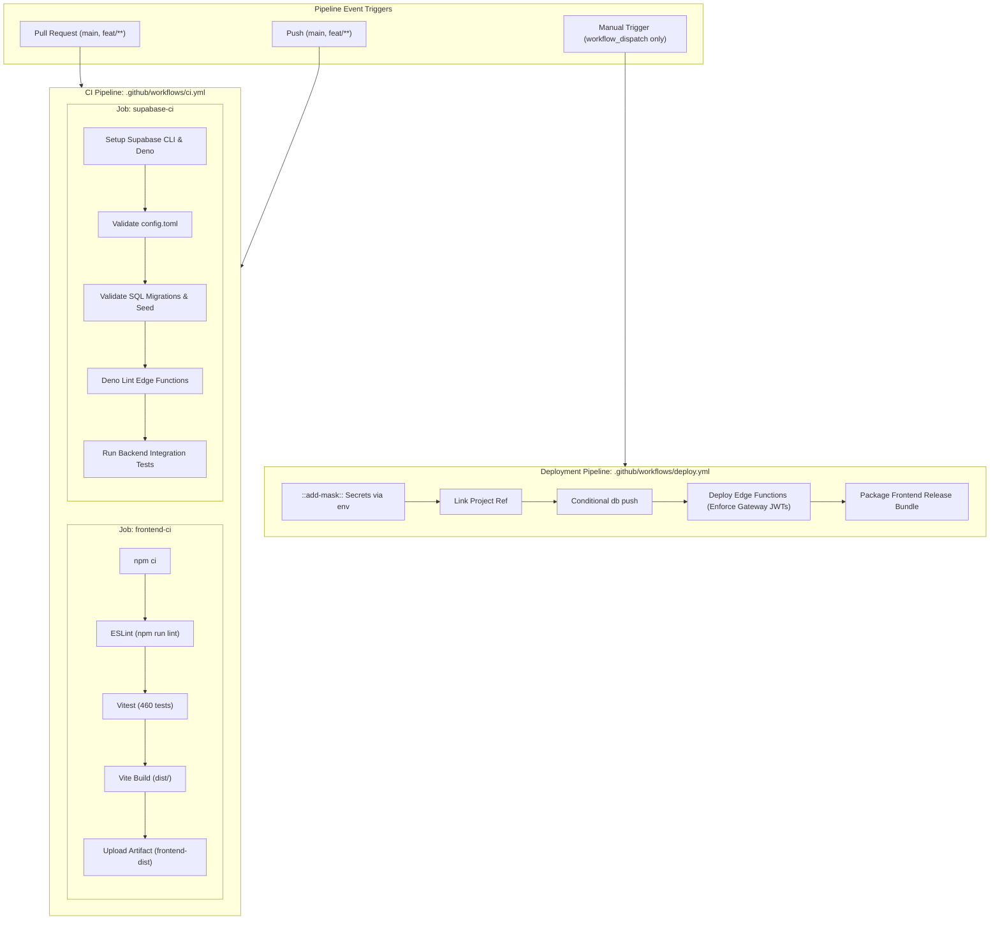

# FanPulse AI — CI/CD Pipeline & GitHub Actions Guide

**Document Version:** 1.1.0  
**Date:** 2026-11-03  
**Role:** Senior DevOps / CI/CD Engineer  
**Approved Architecture:** React + Vite SPA, Supabase CLI, PostgreSQL 17, Deno Edge Functions  
**Workflows Directory:** [`.github/workflows/`](file:///u:/Fanpulse_AI/.github/workflows/)

---

## 1. CI/CD Architecture & Separation Strategy

FanPulse AI implements a modern, secure, and cost-free CI/CD strategy using **GitHub Actions**.

### Strict DevOps Principles:
1. **Separation of Concerns:** CI validation ([`ci.yml`](file:///u:/Fanpulse_AI/.github/workflows/ci.yml)) is strictly separated from Deployment operations ([`deploy.yml`](file:///u:/Fanpulse_AI/.github/workflows/deploy.yml)).
2. **Automated Quality Gating:** Every Pull Request and commit to `main` or `feat/**` automatically triggers full frontend linting, unit/component tests, Vite production builds, Supabase config validation, SQL migration validation, and backend integration test suites.
3. **Zero Secret Leaks:** All deployment credentials and tokens are managed via GitHub Secrets and masked at runtime using `::add-mask::`. No credentials or passwords are ever printed in workflow logs.
4. **No Paid Resources:** All CI jobs run within standard GitHub-hosted `ubuntu-latest` runners without third-party paid infrastructure.
5. **No Automatic Release Deployments:** Deployment is strictly opt-in via manual `workflow_dispatch`. Publishing a tag or drafting a release does NOT trigger automatic deployments.
6. **Enforced Gateway JWT Verification:** Production deployments enforce Supabase Kong API Gateway JWT signature verification on all protected Edge Functions; `--no-verify-jwt` is restricted exclusively to public unauthenticated diagnostic probes.



---

## 2. Workflow Specifications

### 2.1 Continuous Integration Workflow ([`.github/workflows/ci.yml`](file:///u:/Fanpulse_AI/.github/workflows/ci.yml))

| Attribute | Specification |
|:---|:---|
| **File Path** | `.github/workflows/ci.yml` |
| **Triggers** | `push` and `pull_request` on branches `main` and `feat/**` |
| **Concurrency** | Grouped by workflow and branch ref; cancels in-progress redundant runs |
| **Runner OS** | `ubuntu-latest` |
| **Node Version** | `20.x` with automatic npm dependency caching |
| **Deno Version** | `2.x` for Edge Function verification |
| **Supabase CLI** | Official `supabase/setup-cli@v1` |

#### Frontend Job (`frontend-ci`):
1. **Checkout Code:** Retrieves repository tree via `actions/checkout@v4`.
2. **Install Dependencies:** Executes clean, deterministic `npm ci` in `frontend/`.
3. **Lint:** Runs ESLint (`npm run lint`) to detect unused variables, broken syntax, or unhandled errors.
4. **Automated Tests:** Executes all 30 Vitest suites (460 unit, integration, and UI tests).
5. **Production Build:** Builds minified static bundle via `npm run build`.
6. **Artifact Storage:** Uploads `frontend/dist/` as a temporary build artifact for 7 days.

#### Supabase Job (`supabase-ci`):
1. **Configuration Validation:** Verifies syntax of `supabase/config.toml` and confirms registration of all 9 Edge Functions.
2. **Database Migrations Validation:** Validates sequential timestamp ordering (`YYYYMMDDHHMMSS`), naming conventions, and presence of `supabase/seed.sql`.
3. **Edge Functions Lint:** Validates TypeScript syntax across `supabase/functions/` using Deno.
4. **Backend Integration Tests:** Executes real-module integration tests (`sqlMigrations.test.js`, `databaseRelationships.test.js`, `backendArchitecture.test.js`, `backendEdgeFunctionsQA.test.js`, `finalIntegrationVerification.test.js`).

---

### 2.2 Deployment Workflow ([`.github/workflows/deploy.yml`](file:///u:/Fanpulse_AI/.github/workflows/deploy.yml))

| Attribute | Specification |
|:---|:---|
| **File Path** | `.github/workflows/deploy.yml` |
| **Triggers** | `workflow_dispatch` (strictly manual trigger; no automatic release triggers) |
| **Parameters** | `target_environment` (`preview`, `production`), `deploy_database` (bool), `deploy_functions` (bool), `deploy_frontend` (bool) |
| **Security & Secrets** | Secrets passed via `env:` mapping and masked with `::add-mask::`; zero credential exposure in logs |
| **Gateway JWT Verification** | Protected functions enforce Supabase Gateway JWT verification; only public probes use `--no-verify-jwt` |

#### Deployable Actions:
1. **Database Migrations:** Executes `supabase db push --include-all` only when `deploy_database: true`.
2. **Secrets Sync:** Injects `GEMINI_API_KEY` securely into Supabase Vault using `supabase secrets set`.
3. **Edge Functions Deployment:** Deploys Edge Functions with appropriate JWT security levels:
   - **Public Probes (`--no-verify-jwt`):** `health-check`, `validate-fantasy-team`, `compare-fantasy-teams`
   - **Protected Functions (Enforce Gateway JWTs):** `manage-fantasy-teams`, `manage-matches`, `manage-players`, `calculate-fantasy-scoring`, `sync-cricket-data`, `ai-assistant`
4. **Frontend Release Package:** Builds and packages minified production assets into a downloadable release archive.

---

## 3. GitHub Secrets Configuration Table

To configure deployment secrets in GitHub:
Navigate to **GitHub Repository &rarr; Settings &rarr; Secrets and variables &rarr; Actions**:

| Secret Name | Required By | Scope | Description |
|:---|:---:|:---:|:---|
| **`SUPABASE_ACCESS_TOKEN`** | Deploy | Sensitive | Personal access token from Supabase account dashboard |
| **`SUPABASE_PROJECT_ID`** | Deploy | Sensitive | 20-character reference ID of target Supabase project |
| **`SUPABASE_DB_PASSWORD`** | Deploy | Sensitive | Database root password for remote DDL migration push |
| **`GEMINI_API_KEY`** | Deploy | Sensitive | Google Gemini API key deployed to Supabase Vault |
| **`VITE_SUPABASE_URL`** | Build/Deploy | Public Client | Production or preview Supabase URL |
| **`VITE_SUPABASE_ANON_KEY`** | Build/Deploy | Public Client | Public client anonymous key |
| **`VITE_API_BASE_URL`** | Build/Deploy | Public Client | Edge Functions base URL (`/functions/v1`) |

> [!CAUTION]
> Never store `SUPABASE_SERVICE_ROLE_KEY` or `GEMINI_API_KEY` in frontend secrets or repository variables. They must only be used in serverless backend contexts.

---

## 4. How to Verify Workflow Execution in GitHub Actions

### Step-by-Step UI Verification Guide:

1. **Access the Actions Tab:**
   - In your GitHub repository, click on the **Actions** tab in the top navigation bar.
2. **Locate the Workflow Run:**
   - Under **All workflows**, select **FanPulse AI — Continuous Integration**.
   - You will see the list of runs corresponding to your commits and pull requests.
3. **Inspect Job Status:**
   - A **Green checkmark (✓)** indicates both `frontend-ci` and `supabase-ci` passed.
   - A **Red cross (✗)** indicates a failure in linting, tests, build, or migration validation.
   - Click on the run to view the summary page.
4. **Drill Down into Steps:**
   - Click on either `Frontend (Lint, Test & Build)` or `Supabase (Migrations, Config & Edge Functions)`.
   - Expand individual step logs (e.g. `Run ESLint Code Quality Check`, `Run Vitest Unit & Component Tests`).
5. **Inspect Artifacts:**
   - On the workflow run summary page, scroll to the **Artifacts** section.
   - Download `frontend-dist` to verify compiled JavaScript, CSS, and HTML assets.

---

## 5. Local Pre-Commit Validation Runbook

Developers should run the CI steps locally before creating a pull request to ensure immediate pipeline passes:

```bash
# 1. Run ESLint code quality check
npm run lint

# 2. Run all Vitest automated test suites
npm run test

# 3. Build Vite production bundle
npm run build

# 4. Verify Supabase migrations & configuration
npx vitest run src/test/sqlMigrations.test.js src/test/finalIntegrationVerification.test.js
```
