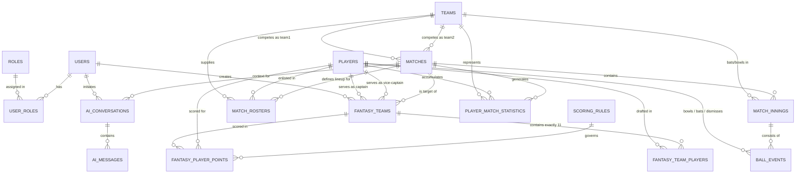

# FanPulse AI — Relational Database Design Specification

> Architecture, normalization analysis, and schema specification for PostgreSQL 16+.
> Derived from [PROJECT_VISION.md](file:///U:/Fanpulse_AI/docs/PROJECT_VISION.md), [REQUIREMENTS.md](file:///U:/Fanpulse_AI/docs/REQUIREMENTS.md), and [SYSTEM_ARCHITECTURE.md](file:///U:/Fanpulse_AI/docs/SYSTEM_ARCHITECTURE.md).

---

## 1. Executive Summary & Design Principles

The FanPulse AI database layer is designed as a fully normalized (3NF/BCNF) relational schema on **PostgreSQL 16**. It is engineered to deliver:

1. **Strict Data Integrity:** Domain constraints, composite unique indexes, and foreign keys guarantee that fantasy rules (`BR-TEAM-*`, `BR-SCORE-*`) are validated at the persistence layer as well as the application layer.
2. **Deterministic Fantasy Scoring:** Scores are derived directly from immutable match statistics and configuration-driven scoring rules (`scoring_rules`), guaranteeing 100% repeatability (`NFR-DATA-02`).
3. **Decoupled AI Architecture:** AI conversation storage is fully isolated from transactional match and scoring tables. PostgreSQL role-level security (RLS) and database privileges ensure the AI sub-system has strict read-only access to match and fantasy data, preventing any unauthorized modification of fantasy points or scores.
4. **Auditability & Traceability:** All records maintain precise UTC timestamps (`TIMESTAMPTZ`), and point calculations record transparent JSON-based audit breakdowns.

---

## 2. Entity-Relationship (ER) Diagram



---

## 3. Detailed Table Specifications

### 3.1 `roles`
Stores standard user authorization roles.

| Column | Data Type | Nullable | Default | Description |
|---|---|---|---|---|
| `id` | `SMALLINT GENERATED ALWAYS AS IDENTITY` | NO | Generated | Primary key. |
| `name` | `VARCHAR(30)` | NO | None | Unique role name (`ROLE_USER`, `ROLE_ADMIN`). |
| `description` | `VARCHAR(255)` | YES | NULL | Human-readable role description. |
| `created_at` | `TIMESTAMPTZ` | NO | `CURRENT_TIMESTAMP` | Record creation timestamp. |

* **Primary Key:** `PRIMARY KEY (id)`
* **Unique Constraints:** `UNIQUE (name)`
* **Foreign Keys:** None.
* **Indexes:**
  * `uk_roles_name` on `name` (B-tree, unique).
* **Relationships:**
  * One-to-Many with `user_roles`.

---

### 3.2 `users`
Stores registered user accounts, encrypted credentials, and profile settings.

| Column | Data Type | Nullable | Default | Description |
|---|---|---|---|---|
| `id` | `BIGINT GENERATED ALWAYS AS IDENTITY` | NO | Generated | Primary key. |
| `email` | `VARCHAR(255)` | NO | None | User's verified email address; login identifier. |
| `password_hash` | `VARCHAR(255)` | NO | None | BCrypt salted password hash (work factor >= 10). |
| `display_name` | `VARCHAR(100)` | NO | None | Fan screen name displayed in UI. |
| `is_active` | `BOOLEAN` | NO | `TRUE` | Soft deactivation flag. |
| `created_at` | `TIMESTAMPTZ` | NO | `CURRENT_TIMESTAMP` | Account registration timestamp. |
| `updated_at` | `TIMESTAMPTZ` | NO | `CURRENT_TIMESTAMP` | Last profile update timestamp. |

* **Primary Key:** `PRIMARY KEY (id)`
* **Unique Constraints:** `UNIQUE (email)`
* **Foreign Keys:** None.
* **Indexes:**
  * `uk_users_email` on `email` (B-tree, unique).
  * `idx_users_is_active` on `is_active` (B-tree) WHERE `is_active = TRUE`.
* **Relationships:**
  * One-to-Many with `user_roles`.
  * One-to-Many with `fantasy_teams`.
  * One-to-Many with `ai_conversations`.

---

### 3.3 `user_roles`
Junction table mapping users to roles (Many-to-Many).

| Column | Data Type | Nullable | Default | Description |
|---|---|---|---|---|
| `user_id` | `BIGINT` | NO | None | Foreign key to `users.id`. |
| `role_id` | `SMALLINT` | NO | None | Foreign key to `roles.id`. |
| `assigned_at` | `TIMESTAMPTZ` | NO | `CURRENT_TIMESTAMP` | Role assignment timestamp. |

* **Primary Key:** `PRIMARY KEY (user_id, role_id)`
* **Foreign Keys:**
  * `fk_user_roles_user` FOREIGN KEY (`user_id`) REFERENCES `users(id)` ON DELETE CASCADE
  * `fk_user_roles_role` FOREIGN KEY (`role_id`) REFERENCES `roles(id)` ON DELETE RESTRICT
* **Indexes:**
  * `idx_user_roles_role_id` on `role_id` (B-tree).
* **Relationships:**
  * Join table connecting `users` and `roles`.

---

### 3.4 `teams`
Stores national cricket teams, franchise clubs, and domestic sides.

| Column | Data Type | Nullable | Default | Description |
|---|---|---|---|---|
| `id` | `BIGINT GENERATED ALWAYS AS IDENTITY` | NO | Generated | Primary key. |
| `name` | `VARCHAR(100)` | NO | None | Full team name (e.g., "India", "Australia"). |
| `short_name` | `VARCHAR(30)` | NO | None | Short name (e.g., "Mumbai Indians"). |
| `code` | `VARCHAR(10)` | NO | None | 3-letter uppercase country/franchise code (e.g., "IND", "AUS"). |
| `country` | `VARCHAR(100)` | NO | None | Home country or governing board jurisdiction. |
| `logo_url` | `VARCHAR(500)` | YES | NULL | CDN URL for team emblem/crest. |
| `created_at` | `TIMESTAMPTZ` | NO | `CURRENT_TIMESTAMP` | Record creation timestamp. |

* **Primary Key:** `PRIMARY KEY (id)`
* **Unique Constraints:** `UNIQUE (name)`, `UNIQUE (code)`
* **Foreign Keys:** None.
* **Indexes:**
  * `uk_teams_code` on `code` (B-tree, unique).
* **Relationships:**
  * One-to-Many with `matches` (as `team1_id`, `team2_id`, `winning_team_id`).
  * One-to-Many with `match_rosters`.
  * One-to-Many with `match_innings`.

---

### 3.5 `players`
Stores cricket athlete master profiles.

| Column | Data Type | Nullable | Default | Description |
|---|---|---|---|---|
| `id` | `BIGINT GENERATED ALWAYS AS IDENTITY` | NO | Generated | Primary key. |
| `name` | `VARCHAR(100)` | NO | None | Full player name (e.g., "Virat Kohli"). |
| `short_name` | `VARCHAR(50)` | NO | None | Scorecard abbreviation (e.g., "V Kohli"). |
| `country` | `VARCHAR(100)` | NO | None | Primary nationality / representative nation. |
| `primary_role` | `VARCHAR(30)` | NO | None | Role: `BATTER`, `BOWLER`, `ALL_ROUNDER`, `WICKET_KEEPER`. |
| `batting_style` | `VARCHAR(50)` | YES | NULL | `RIGHT_HAND_BAT`, `LEFT_HAND_BAT`. |
| `bowling_style` | `VARCHAR(50)` | YES | NULL | `RIGHT_ARM_FAST`, `SLOW_LEFT_ARM_ORTHODOX`, etc. |
| `image_url` | `VARCHAR(500)` | YES | NULL | Profile image link. |
| `created_at` | `TIMESTAMPTZ` | NO | `CURRENT_TIMESTAMP` | Record creation timestamp. |
| `updated_at` | `TIMESTAMPTZ` | NO | `CURRENT_TIMESTAMP` | Profile update timestamp. |

* **Primary Key:** `PRIMARY KEY (id)`
* **Check Constraints:**
  * `chk_player_role` CHECK (`primary_role` IN ('BATTER', 'BOWLER', 'ALL_ROUNDER', 'WICKET_KEEPER'))
* **Indexes:**
  * `idx_players_country_role` on `(country, primary_role)` (B-tree) for `FR-STATS-05` filtering.
  * `idx_players_name` on `name` (B-tree).
* **Relationships:**
  * One-to-Many with `match_rosters`.
  * One-to-Many with `player_match_statistics`.
  * One-to-Many with `fantasy_team_players`.

---

### 3.6 `matches`
Stores cricket fixtures, status, format, and final results.

| Column | Data Type | Nullable | Default | Description |
|---|---|---|---|---|
| `id` | `BIGINT GENERATED ALWAYS AS IDENTITY` | NO | Generated | Primary key. |
| `team1_id` | `BIGINT` | NO | None | First competing team. |
| `team2_id` | `BIGINT` | NO | None | Second competing team. |
| `format` | `VARCHAR(20)` | NO | None | Match format: `TEST`, `ODI`, `T20`. |
| `status` | `VARCHAR(20)` | NO | `'UPCOMING'` | Lifecycle state: `UPCOMING`, `IN_PROGRESS`, `COMPLETED`, `ABANDONED`. |
| `venue` | `VARCHAR(200)` | NO | None | Stadium / venue name and location. |
| `match_date` | `TIMESTAMPTZ` | NO | None | Scheduled start date and time (UTC). |
| `toss_winner_team_id` | `BIGINT` | YES | NULL | Team that won the coin toss. |
| `toss_decision` | `VARCHAR(10)` | YES | NULL | `BAT` or `BOWL`. |
| `winning_team_id` | `BIGINT` | YES | NULL | Winner of the match (NULL if tied/draw/in-progress). |
| `result_type` | `VARCHAR(30)` | YES | NULL | `NORMAL`, `TIE`, `NO_RESULT`, `SUPER_OVER`. |
| `win_margin` | `INTEGER` | YES | NULL | Margin (runs, wickets, or balls remaining). |
| `win_margin_type` | `VARCHAR(20)` | YES | NULL | `RUNS`, `WICKETS`. |
| `result_summary` | `VARCHAR(255)` | YES | NULL | Plaintext summary (e.g., "India won by 6 wickets"). |
| `created_at` | `TIMESTAMPTZ` | NO | `CURRENT_TIMESTAMP` | Record creation timestamp. |
| `updated_at` | `TIMESTAMPTZ` | NO | `CURRENT_TIMESTAMP` | Record update timestamp. |

* **Primary Key:** `PRIMARY KEY (id)`
* **Check Constraints:**
  * `chk_matches_teams_diff` CHECK (`team1_id <> team2_id`)
  * `chk_matches_format` CHECK (`format` IN ('TEST', 'ODI', 'T20'))
  * `chk_matches_status` CHECK (`status` IN ('UPCOMING', 'IN_PROGRESS', 'COMPLETED', 'ABANDONED'))
  * `chk_matches_toss_decision` CHECK (`toss_decision` IS NULL OR `toss_decision` IN ('BAT', 'BOWL'))
* **Foreign Keys:**
  * `fk_matches_team1` FOREIGN KEY (`team1_id`) REFERENCES `teams(id)` ON DELETE RESTRICT
  * `fk_matches_team2` FOREIGN KEY (`team2_id`) REFERENCES `teams(id)` ON DELETE RESTRICT
  * `fk_matches_toss_team` FOREIGN KEY (`toss_winner_team_id`) REFERENCES `teams(id)` ON DELETE SET NULL
  * `fk_matches_win_team` FOREIGN KEY (`winning_team_id`) REFERENCES `teams(id)` ON DELETE SET NULL
* **Indexes:**
  * `idx_matches_status_date` on `(status, match_date)` (B-tree) supporting `FR-MATCH-03`.
  * `idx_matches_teams` on `(team1_id, team2_id)` (B-tree).
* **Relationships:**
  * One-to-Many with `match_rosters`.
  * One-to-Many with `match_innings`.
  * One-to-Many with `player_match_statistics`.
  * One-to-Many with `fantasy_teams`.
  * One-to-Many with `ai_conversations`.

---

### 3.7 `match_rosters`
*Additional Entity:* Connects matches, teams, and players to establish the official squad and Playing XI for a fixture (`BR-TEAM-05`).

| Column | Data Type | Nullable | Default | Description |
|---|---|---|---|---|
| `id` | `BIGINT GENERATED ALWAYS AS IDENTITY` | NO | Generated | Primary key. |
| `match_id` | `BIGINT` | NO | None | Foreign key to `matches.id`. |
| `team_id` | `BIGINT` | NO | None | Foreign key to `teams.id`. |
| `player_id` | `BIGINT` | NO | None | Foreign key to `players.id`. |
| `is_playing_xi` | `BOOLEAN` | NO | `TRUE` | Whether player is in starting XI or bench/substitute. |
| `is_captain` | `BOOLEAN` | NO | `FALSE` | Real-life team captain indicator. |
| `is_wicket_keeper`| `BOOLEAN` | NO | `FALSE` | Designated wicket-keeper in lineup. |

* **Primary Key:** `PRIMARY KEY (id)`
* **Unique Constraints:** `UNIQUE (match_id, player_id)`
* **Foreign Keys:**
  * `fk_roster_match` FOREIGN KEY (`match_id`) REFERENCES `matches(id)` ON DELETE CASCADE
  * `fk_roster_team` FOREIGN KEY (`team_id`) REFERENCES `teams(id)` ON DELETE RESTRICT
  * `fk_roster_player` FOREIGN KEY (`player_id`) REFERENCES `players(id)` ON DELETE RESTRICT
* **Indexes:**
  * `idx_roster_match_team` on `(match_id, team_id)` (B-tree).
  * `idx_roster_player` on `player_id` (B-tree).
* **Relationships:**
  * Many-to-One with `matches`, `teams`, `players`.

---

### 3.8 `match_innings`
Stores each innings breakdown within a match.

| Column | Data Type | Nullable | Default | Description |
|---|---|---|---|---|
| `id` | `BIGINT GENERATED ALWAYS AS IDENTITY` | NO | Generated | Primary key. |
| `match_id` | `BIGINT` | NO | None | Foreign key to `matches.id`. |
| `innings_number` | `SMALLINT` | NO | None | 1 to 4 (Tests can have up to 4; T20/ODI have 1 or 2). |
| `batting_team_id` | `BIGINT` | NO | None | Team currently batting. |
| `bowling_team_id` | `BIGINT` | NO | None | Team currently fielding/bowling. |
| `total_runs` | `INTEGER` | NO | 0 | Total runs accumulated by batting team. |
| `total_wickets` | `SMALLINT` | NO | 0 | Wickets lost (0 to 10). |
| `overs_completed` | `NUMERIC(4, 1)` | NO | 0.0 | Overs bowled (e.g., 19.4). |
| `extras` | `INTEGER` | NO | 0 | Total extras (byes, leg-byes, wides, no-balls). |
| `is_declared` | `BOOLEAN` | NO | `FALSE` | Inning declared by captain (Test matches). |
| `is_completed` | `BOOLEAN` | NO | `FALSE` | Inning completed flag. |
| `created_at` | `TIMESTAMPTZ` | NO | `CURRENT_TIMESTAMP` | Record creation timestamp. |

* **Primary Key:** `PRIMARY KEY (id)`
* **Unique Constraints:** `UNIQUE (match_id, innings_number)`
* **Check Constraints:**
  * `chk_innings_teams_diff` CHECK (`batting_team_id <> bowling_team_id`)
  * `chk_innings_wickets` CHECK (`total_wickets >= 0 AND total_wickets <= 10`)
* **Foreign Keys:**
  * `fk_innings_match` FOREIGN KEY (`match_id`) REFERENCES `matches(id)` ON DELETE CASCADE
  * `fk_innings_bat_team` FOREIGN KEY (`batting_team_id`) REFERENCES `teams(id)` ON DELETE RESTRICT
  * `fk_innings_bowl_team` FOREIGN KEY (`bowling_team_id`) REFERENCES `teams(id)` ON DELETE RESTRICT
* **Indexes:**
  * `idx_innings_match` on `match_id` (B-tree).
* **Relationships:**
  * One-to-Many with `ball_events`.

---

### 3.9 `ball_events`
Stores granular, ball-by-ball delivery event data for live tracking, commentary, and derived statistics.

| Column | Data Type | Nullable | Default | Description |
|---|---|---|---|---|
| `id` | `BIGINT GENERATED ALWAYS AS IDENTITY` | NO | Generated | Primary key. |
| `innings_id` | `BIGINT` | NO | None | Foreign key to `match_innings.id`. |
| `over_number` | `SMALLINT` | NO | None | Over counter (0-indexed or 1-indexed, typically 1–50). |
| `ball_number` | `SMALLINT` | NO | None | Delivery sequence within over (includes wides/no-balls). |
| `legal_ball_number` | `SMALLINT` | NO | None | Legal ball counter (1 to 6). |
| `bowler_player_id` | `BIGINT` | NO | None | Player bowling the delivery. |
| `batter_player_id` | `BIGINT` | NO | None | Player facing the delivery on strike. |
| `non_striker_player_id`| `BIGINT` | NO | None | Player at non-striker end. |
| `runs_batter` | `SMALLINT` | NO | 0 | Runs scored off the bat (0, 1, 2, 3, 4, 5, 6). |
| `runs_extras` | `SMALLINT` | NO | 0 | Extra runs (wides, no-balls, byes, leg-byes, penalty). |
| `extra_type` | `VARCHAR(20)` | YES | NULL | `WIDE`, `NO_BALL`, `BYE`, `LEG_BYE`, `PENALTY`. |
| `is_wicket` | `BOOLEAN` | NO | `FALSE` | Dismissal flag on this delivery. |
| `dismissal_type` | `VARCHAR(30)` | YES | NULL | `BOWLED`, `CAUGHT`, `LBW`, `RUN_OUT`, `STUMPED`, `HIT_WICKET`. |
| `dismissed_player_id` | `BIGINT` | YES | NULL | Player who got out. |
| `assisting_player_id` | `BIGINT` | YES | NULL | Catcher, stumper, or run-out fielder. |
| `is_boundary_four` | `BOOLEAN` | NO | `FALSE` | Explicit 4 boundary hit. |
| `is_boundary_six` | `BOOLEAN` | NO | `FALSE` | Explicit 6 boundary hit. |
| `commentary_text` | `TEXT` | YES | NULL | Ball commentary note. |
| `created_at` | `TIMESTAMPTZ` | NO | `CURRENT_TIMESTAMP` | Event timestamp. |

* **Primary Key:** `PRIMARY KEY (id)`
* **Foreign Keys:**
  * `fk_balls_innings` FOREIGN KEY (`innings_id`) REFERENCES `match_innings(id)` ON DELETE CASCADE
  * `fk_balls_bowler` FOREIGN KEY (`bowler_player_id`) REFERENCES `players(id)` ON DELETE RESTRICT
  * `fk_balls_batter` FOREIGN KEY (`batter_player_id`) REFERENCES `players(id)` ON DELETE RESTRICT
  * `fk_balls_non_striker` FOREIGN KEY (`non_striker_player_id`) REFERENCES `players(id)` ON DELETE RESTRICT
  * `fk_balls_dismissed` FOREIGN KEY (`dismissed_player_id`) REFERENCES `players(id)` ON DELETE RESTRICT
  * `fk_balls_assisting` FOREIGN KEY (`assisting_player_id`) REFERENCES `players(id)` ON DELETE RESTRICT
* **Indexes:**
  * `idx_balls_innings_over` on `(innings_id, over_number, ball_number)` (B-tree).
  * `idx_balls_bowler` on `bowler_player_id` (B-tree).
  * `idx_balls_batter` on `batter_player_id` (B-tree).
* **Relationships:**
  * Many-to-One with `match_innings`.

---

### 3.10 `player_match_statistics`
Stores consolidated batting, bowling, and fielding performance metrics for a player in a specific match. Single source of truth for the fantasy scoring engine (`FR-STATS-04`, `FR-SCORE-01`).

| Column | Data Type | Nullable | Default | Description |
|---|---|---|---|---|
| `id` | `BIGINT GENERATED ALWAYS AS IDENTITY` | NO | Generated | Primary key. |
| `match_id` | `BIGINT` | NO | None | Foreign key to `matches.id`. |
| `player_id` | `BIGINT` | NO | None | Foreign key to `players.id`. |
| `team_id` | `BIGINT` | NO | None | Foreign key to `teams.id`. |
| `runs_scored` | `INTEGER` | NO | 0 | Total runs made with the bat. |
| `balls_faced` | `INTEGER` | NO | 0 | Legal deliveries faced. |
| `fours` | `INTEGER` | NO | 0 | Boundaries (4s) hit. |
| `sixes` | `INTEGER` | NO | 0 | Boundaries (6s) hit. |
| `strike_rate` | `NUMERIC(6, 2)` | YES | NULL | (Runs / Balls) * 100. |
| `is_out` | `BOOLEAN` | NO | `FALSE` | Dismissed indicator. |
| `dismissal_type` | `VARCHAR(30)` | YES | NULL | `BOWLED`, `CAUGHT`, `LBW`, `RUN_OUT`, `STUMPED`, `NOT_OUT`. |
| `overs_bowled` | `NUMERIC(4, 1)` | NO | 0.0 | Overs delivered (e.g. 4.0). |
| `maidens` | `INTEGER` | NO | 0 | Maiden overs bowled. |
| `runs_conceded` | `INTEGER` | NO | 0 | Runs conceded by bowler. |
| `wickets_taken` | `INTEGER` | NO | 0 | Wickets credited to bowler (excludes run outs). |
| `economy_rate` | `NUMERIC(5, 2)` | YES | NULL | Runs conceded per over. |
| `catches` | `INTEGER` | NO | 0 | Fielding catches taken. |
| `run_outs_direct` | `INTEGER` | NO | 0 | Direct hit run-outs. |
| `run_outs_indirect`| `INTEGER` | NO | 0 | Indirect run-outs. |
| `stumpings` | `INTEGER` | NO | 0 | Stumpings executed by wicket-keeper. |
| `created_at` | `TIMESTAMPTZ` | NO | `CURRENT_TIMESTAMP` | Record creation timestamp. |
| `updated_at` | `TIMESTAMPTZ` | NO | `CURRENT_TIMESTAMP` | Last updated timestamp. |

* **Primary Key:** `PRIMARY KEY (id)`
* **Unique Constraints:** `UNIQUE (match_id, player_id)`
* **Foreign Keys:**
  * `fk_stats_match` FOREIGN KEY (`match_id`) REFERENCES `matches(id)` ON DELETE CASCADE
  * `fk_stats_player` FOREIGN KEY (`player_id`) REFERENCES `players(id)` ON DELETE RESTRICT
  * `fk_stats_team` FOREIGN KEY (`team_id`) REFERENCES `teams(id)` ON DELETE RESTRICT
* **Indexes:**
  * `idx_stats_player_match` on `(player_id, match_id)` (B-tree).
  * `idx_stats_match` on `match_id` (B-tree).
* **Relationships:**
  * Input entity for `fantasy_player_points`.

---

### 3.11 `scoring_rules`
Stores the configuration-driven fantasy points ruleset (`BR-SCORE-*`).

| Column | Data Type | Nullable | Default | Description |
|---|---|---|---|---|
| `id` | `BIGINT GENERATED ALWAYS AS IDENTITY` | NO | Generated | Primary key. |
| `format` | `VARCHAR(20)` | NO | `'ALL'` | Match format applicability: `ALL`, `T20`, `ODI`, `TEST`. |
| `rule_category` | `VARCHAR(30)` | NO | None | `BATTING`, `BOWLING`, `FIELDING`, `BONUS`, `PENALTY`. |
| `event_key` | `VARCHAR(50)` | NO | None | Unique key (`RUN_SCORED`, `BOUNDARY_FOUR`, `WICKET_TAKEN`, `DUCK`). |
| `event_name` | `VARCHAR(100)` | NO | None | Human-readable label (e.g., "Run Scored", "Half Century Bonus"). |
| `points_value` | `NUMERIC(5, 1)` | NO | None | Points awarded or deducted (+1.0, +25.0, -5.0). |
| `condition_threshold` | `NUMERIC(6, 2)` | YES | NULL | Threshold value (e.g., 50.0 for half-century, 4.0 for economy bonus). |
| `description` | `VARCHAR(255)` | YES | NULL | Explanation of conditions for applying the rule. |
| `is_active` | `BOOLEAN` | NO | `TRUE` | Whether this rule is currently evaluated. |
| `created_at` | `TIMESTAMPTZ` | NO | `CURRENT_TIMESTAMP` | Record creation timestamp. |
| `updated_at` | `TIMESTAMPTZ` | NO | `CURRENT_TIMESTAMP` | Rule update timestamp. |

* **Primary Key:** `PRIMARY KEY (id)`
* **Unique Constraints:** `UNIQUE (format, event_key)`
* **Check Constraints:**
  * `chk_rules_format` CHECK (`format` IN ('ALL', 'T20', 'ODI', 'TEST'))
  * `chk_rules_category` CHECK (`rule_category` IN ('BATTING', 'BOWLING', 'FIELDING', 'BONUS', 'PENALTY'))
* **Indexes:**
  * `idx_rules_format_active` on `(format, is_active)` (B-tree).
* **Relationships:**
  * Evaluated by backend `ScoringService` to calculate `fantasy_player_points`.

---

### 3.12 `fantasy_teams`
Stores user-created fantasy squads for a specific match fixture.

| Column | Data Type | Nullable | Default | Description |
|---|---|---|---|---|
| `id` | `BIGINT GENERATED ALWAYS AS IDENTITY` | NO | Generated | Primary key. |
| `user_id` | `BIGINT` | NO | None | Foreign key to `users.id` (Owner). |
| `match_id` | `BIGINT` | NO | None | Foreign key to `matches.id`. |
| `team_name` | `VARCHAR(100)` | NO | None | User's custom team name (`FR-FANTASY-06`). |
| `captain_player_id` | `BIGINT` | NO | None | Foreign key to `players.id` (Earns 2.0x multiplier). |
| `vice_captain_player_id`| `BIGINT`| NO | None | Foreign key to `players.id` (Earns 1.5x multiplier). |
| `total_points` | `NUMERIC(7, 2)` | NO | 0.00 | Calculated sum of all player points in squad. |
| `is_locked` | `BOOLEAN` | NO | `FALSE` | Locked when match status transitions to `IN_PROGRESS`. |
| `created_at` | `TIMESTAMPTZ` | NO | `CURRENT_TIMESTAMP` | Team creation timestamp. |
| `updated_at` | `TIMESTAMPTZ` | NO | `CURRENT_TIMESTAMP` | Lineup edit timestamp. |

* **Primary Key:** `PRIMARY KEY (id)`
* **Check Constraints:**
  * `chk_captain_diff_vice_captain` CHECK (`captain_player_id <> vice_captain_player_id`)
* **Foreign Keys:**
  * `fk_fantasy_teams_user` FOREIGN KEY (`user_id`) REFERENCES `users(id)` ON DELETE CASCADE
  * `fk_fantasy_teams_match` FOREIGN KEY (`match_id`) REFERENCES `matches(id)` ON DELETE CASCADE
  * `fk_fantasy_teams_captain` FOREIGN KEY (`captain_player_id`) REFERENCES `players(id)` ON DELETE RESTRICT
  * `fk_fantasy_teams_vice_captain` FOREIGN KEY (`vice_captain_player_id`) REFERENCES `players(id)` ON DELETE RESTRICT
* **Indexes:**
  * `idx_fantasy_teams_user` on `user_id` (B-tree) for `FR-FANTASY-07`.
  * `idx_fantasy_teams_match_user` on `(match_id, user_id)` (B-tree).
* **Relationships:**
  * One-to-Many with `fantasy_team_players` (strictly 11 rows).
  * One-to-Many with `fantasy_player_points`.

---

### 3.13 `fantasy_team_players`
Stores player lineup composition for a user's fantasy team. Enforces exactly 11 players per team and prohibits duplicates.

| Column | Data Type | Nullable | Default | Description |
|---|---|---|---|---|
| `id` | `BIGINT GENERATED ALWAYS AS IDENTITY` | NO | Generated | Primary key. |
| `fantasy_team_id` | `BIGINT` | NO | None | Foreign key to `fantasy_teams.id`. |
| `player_id` | `BIGINT` | NO | None | Foreign key to `players.id`. |
| `match_id` | `BIGINT` | NO | None | Redundant match foreign key to enforce match roster consistency. |
| `selected_role` | `VARCHAR(30)` | NO | None | Snapshot of player role at draft time. |
| `created_at` | `TIMESTAMPTZ` | NO | `CURRENT_TIMESTAMP` | Record creation timestamp. |

* **Primary Key:** `PRIMARY KEY (id)`
* **Unique Constraints:** `UNIQUE (fantasy_team_id, player_id)` — *Enforces duplicate player prohibition in one fantasy team.*
* **Foreign Keys:**
  * `fk_ft_players_team` FOREIGN KEY (`fantasy_team_id`) REFERENCES `fantasy_teams(id)` ON DELETE CASCADE
  * `fk_ft_players_player` FOREIGN KEY (`player_id`) REFERENCES `players(id)` ON DELETE RESTRICT
  * `fk_ft_players_match_roster` FOREIGN KEY (`match_id`, `player_id`) REFERENCES `match_rosters(match_id, player_id)` ON DELETE RESTRICT
* **Indexes:**
  * `idx_ft_players_team` on `fantasy_team_id` (B-tree).
  * `idx_ft_players_player` on `player_id` (B-tree).
* **Relationships:**
  * Belongs to `fantasy_teams`.

---

### 3.14 `fantasy_player_points`
Stores calculated breakdown points per player in a fantasy team for a match.

| Column | Data Type | Nullable | Default | Description |
|---|---|---|---|---|
| `id` | `BIGINT GENERATED ALWAYS AS IDENTITY` | NO | Generated | Primary key. |
| `fantasy_team_id` | `BIGINT` | NO | None | Foreign key to `fantasy_teams.id`. |
| `player_id` | `BIGINT` | NO | None | Foreign key to `players.id`. |
| `match_id` | `BIGINT` | NO | None | Foreign key to `matches.id`. |
| `base_points` | `NUMERIC(6, 2)` | NO | 0.00 | Sum of points from batting, bowling, fielding rules. |
| `multiplier` | `NUMERIC(3, 1)` | NO | 1.0 | 2.0 for Captain, 1.5 for Vice-Captain, 1.0 for others. |
| `final_points` | `NUMERIC(6, 2)` | NO | 0.00 | `base_points * multiplier`. |
| `breakdown_json` | `JSONB` | NO | `'{}'` | Detailed JSON log of rules applied (for UI audit). |
| `calculated_at` | `TIMESTAMPTZ` | NO | `CURRENT_TIMESTAMP` | Computation timestamp. |

* **Primary Key:** `PRIMARY KEY (id)`
* **Unique Constraints:** `UNIQUE (fantasy_team_id, player_id)`
* **Check Constraints:**
  * `chk_points_multiplier` CHECK (`multiplier` IN (1.0, 1.5, 2.0))
* **Foreign Keys:**
  * `fk_fpp_team` FOREIGN KEY (`fantasy_team_id`) REFERENCES `fantasy_teams(id)` ON DELETE CASCADE
  * `fk_fpp_player` FOREIGN KEY (`player_id`) REFERENCES `players(id)` ON DELETE RESTRICT
  * `fk_fpp_match` FOREIGN KEY (`match_id`) REFERENCES `matches(id)` ON DELETE CASCADE
* **Indexes:**
  * `idx_fpp_team` on `fantasy_team_id` (B-tree).
  * `idx_fpp_player_match` on `(player_id, match_id)` (B-tree).
* **Relationships:**
  * Many-to-One with `fantasy_teams`, `players`, `matches`.

---

### 3.15 `ai_conversations`
Stores user-initiated AI match explanation sessions (`FR-AI-01`, `FR-INSIGHT-01`, `FR-INSIGHT-02`).

| Column | Data Type | Nullable | Default | Description |
|---|---|---|---|---|
| `id` | `BIGINT GENERATED ALWAYS AS IDENTITY` | NO | Generated | Primary key. |
| `user_id` | `BIGINT` | NO | None | Foreign key to `users.id`. |
| `match_id` | `BIGINT` | NO | None | Foreign key to `matches.id`. |
| `conversation_type` | `VARCHAR(30)` | NO | None | `MATCH_SUMMARY`, `PLAYER_INSIGHT`, `KEY_MOMENTS`. |
| `title` | `VARCHAR(150)` | NO | None | Summary header (e.g., "IND vs AUS 2nd Innings Summary"). |
| `created_at` | `TIMESTAMPTZ` | NO | `CURRENT_TIMESTAMP` | Conversation start timestamp. |
| `updated_at` | `TIMESTAMPTZ` | NO | `CURRENT_TIMESTAMP` | Last interaction timestamp. |

* **Primary Key:** `PRIMARY KEY (id)`
* **Check Constraints:**
  * `chk_conv_type` CHECK (`conversation_type` IN ('MATCH_SUMMARY', 'PLAYER_INSIGHT', 'KEY_MOMENTS'))
* **Foreign Keys:**
  * `fk_ai_conv_user` FOREIGN KEY (`user_id`) REFERENCES `users(id)` ON DELETE CASCADE
  * `fk_ai_conv_match` FOREIGN KEY (`match_id`) REFERENCES `matches(id)` ON DELETE CASCADE
* **Indexes:**
  * `idx_ai_conv_user_match` on `(user_id, match_id)` (B-tree).
* **Relationships:**
  * One-to-Many with `ai_messages`.

---

### 3.16 `ai_messages`
Stores individual conversation prompts, LLM responses, and the exact structured match data context passed to the AI (`FR-AI-06`).

| Column | Data Type | Nullable | Default | Description |
|---|---|---|---|---|
| `id` | `BIGINT GENERATED ALWAYS AS IDENTITY` | NO | Generated | Primary key. |
| `conversation_id` | `BIGINT` | NO | None | Foreign key to `ai_conversations.id`. |
| `sender_role` | `VARCHAR(20)` | NO | None | `USER` or `ASSISTANT`. |
| `message_text` | `TEXT` | NO | None | Prompt or AI-generated narrative response. |
| `data_context_snapshot` | `JSONB` | YES | NULL | Exact match/player data snapshot provided to LLM. |
| `token_count` | `INTEGER` | YES | NULL | Total tokens consumed. |
| `response_time_ms`| `INTEGER` | YES | NULL | Generation latency in milliseconds. |
| `created_at` | `TIMESTAMPTZ` | NO | `CURRENT_TIMESTAMP` | Message timestamp. |

* **Primary Key:** `PRIMARY KEY (id)`
* **Check Constraints:**
  * `chk_msg_sender` CHECK (`sender_role` IN ('USER', 'ASSISTANT'))
* **Foreign Keys:**
  * `fk_ai_msg_conv` FOREIGN KEY (`conversation_id`) REFERENCES `ai_conversations(id)` ON DELETE CASCADE
* **Indexes:**
  * `idx_ai_msg_conv_created` on `(conversation_id, created_at ASC)` (B-tree).
* **Relationships:**
  * Many-to-One with `ai_conversations`.

---

## 4. Entity Relationships Categorization

### 4.1 One-to-One Relationships
* `matches` (Completed) ↔ Winning Innings / Result Details (modeled as self-contained nullable fields on `matches` to prevent unnecessary table joins).
* `fantasy_teams` ↔ Captain (`captain_player_id`) and Vice-Captain (`vice_captain_player_id`) — Each fantasy team designates exactly one captain and one vice-captain from the `players` table.

### 4.2 One-to-Many Relationships
* `users` → `fantasy_teams` (1:N): A user can create multiple fantasy teams (`FR-FANTASY-11`).
* `users` → `ai_conversations` (1:N): A user can hold multiple AI chat/explanation sessions.
* `matches` → `match_innings` (1:N): A match contains 1 to 4 innings.
* `matches` → `match_rosters` (1:N): A match defines active rosters for both competing teams.
* `matches` → `fantasy_teams` (1:N): A match can have multiple fantasy teams created by various fans.
* `match_innings` → `ball_events` (1:N): An inning contains hundreds of discrete ball delivery records.
* `fantasy_teams` → `fantasy_team_players` (1:11): Each fantasy team contains exactly 11 drafted player entries.
* `fantasy_teams` → `fantasy_player_points` (1:11): Each fantasy team tracks calculated point records for each of its 11 players.
* `ai_conversations` → `ai_messages` (1:N): A conversation consists of ordered user prompts and assistant explanations.

### 4.3 Many-to-Many Relationships (Junction Tables)
* **Users & Roles:** Managed by `user_roles` (`user_id` + `role_id`).
* **Matches & Players:** Managed by `match_rosters` (`match_id` + `player_id`).
* **Fantasy Teams & Players:** Managed by `fantasy_team_players` (`fantasy_team_id` + `player_id`).

---

## 5. Normalization & Design Decisions

### 5.1 Normalization Analysis
* **First Normal Form (1NF):** All tables have a primary key, all columns hold atomic values, and no repeating groups exist. (JSONB in `fantasy_player_points` and `ai_messages` is strictly utilized for append-only audit logs and snapshot payloads, not core query criteria).
* **Second Normal Form (2NF):** Every non-key attribute is fully functionally dependent on the primary key. In composite junction tables (`user_roles`, `fantasy_team_players`), attributes describe the relationship itself.
* **Third Normal Form (3NF):** No transitive dependencies exist. Player demographic attributes (e.g. nationality, batting style) reside in `players`, not duplicated inside `match_rosters` or `player_match_statistics`. Team names reside in `teams`, not in `matches`.
* **Boyce-Codd Normal Form (BCNF):** For every functional dependency $X \rightarrow Y$, $X$ is a superkey.

### 5.2 Controlled Denormalization & Trade-Offs

| Table | Denormalized Column | Source of Truth | Justification & Safeguard |
|---|---|---|---|
| `fantasy_teams` | `total_points` | `SUM(final_points)` from `fantasy_player_points` | **High-Frequency Read Optimization:** Displaying team lists on the user dashboard (`/my-teams`) should not perform multi-table aggregation across 11 player point records per team. The column is updated atomically inside the scoring transaction. |
| `fantasy_player_points` | `final_points` | `base_points * multiplier` | Computed column stored for fast sorting and side-by-side comparison queries. |
| `player_match_statistics` | `strike_rate`, `economy_rate` | Calculated from runs, balls, and overs | Cached for instant scorecard retrieval without recalculating floating-point math on every page visit. |

---

## 6. Critical Data Integrity Rules & PostgreSQL Enforcement

### 6.1 Users Own Their Fantasy Teams
* Enforced via `users.id` foreign key on `fantasy_teams(user_id)`.
* Application layer filters queries strictly by authenticated `user_id` from JWT `SecurityContext` (`NFR-SEC-03`).

### 6.2 Fantasy Teams Belong to a Single Match
* Enforced via `matches.id` foreign key on `fantasy_teams(match_id)`.
* Teams cannot span multiple matches.

### 6.3 Duplicate Players Prohibited in a Fantasy Team
* **Database Constraint:** `UNIQUE (fantasy_team_id, player_id)` in `fantasy_team_players`.
* Any attempt to insert the same player twice into a single fantasy team throws a unique constraint violation error (SQLState `23505`), preventing duplicate rosters.

### 6.4 Captain and Vice-Captain Must Be Different
* **Database Constraint:** `CHECK (captain_player_id <> vice_captain_player_id)` in `fantasy_teams`.
* Both players must also exist in the `fantasy_team_players` child roster for that team (validated via trigger and service layer).

### 6.5 Exactly 11 Players per Team
* Enforced at the service layer prior to transaction commit, and guarded by a PostgreSQL deferred constraint trigger:

```sql
CREATE OR REPLACE FUNCTION check_fantasy_team_player_count()
RETURNS TRIGGER AS $$
BEGIN
    IF (SELECT COUNT(*) FROM fantasy_team_players WHERE fantasy_team_id = NEW.fantasy_team_id) > 11 THEN
        RAISE EXCEPTION 'Fantasy team cannot exceed 11 players.';
    END IF;
    RETURN NEW;
END;
$$ LANGUAGE plpgsql;

CREATE TRIGGER trg_check_fantasy_team_size
AFTER INSERT OR UPDATE ON fantasy_team_players
FOR EACH ROW EXECUTE FUNCTION check_fantasy_team_player_count();
```

### 6.6 Players Must Belong to the Match Roster
* Enforced by composite foreign key on `fantasy_team_players`:
  `FOREIGN KEY (match_id, player_id) REFERENCES match_rosters(match_id, player_id)`.

### 6.7 Configuration-Driven Fantasy Scoring
* The `scoring_rules` table holds format-specific point multipliers and bonus values. The backend `ScoringService` queries `scoring_rules WHERE is_active = TRUE` to execute scoring calculations. Point values can be updated via administrative SQL/APIs without modifying Java code.

### 6.8 Strict AI Read-Only Boundary
* To guarantee that AI cannot modify match scores, player stats, or fantasy points:
  1. The AI module interacts with database tables exclusively through a dedicated PostgreSQL database user (`fanpulse_ai_user`) in production.
  2. The `fanpulse_ai_user` is granted `SELECT` only on cricket, user, and fantasy tables, and `INSERT/SELECT` only on `ai_conversations` and `ai_messages`:

```sql
-- Security Hardening: AI Service Database Role
CREATE ROLE fanpulse_ai_user WITH LOGIN PASSWORD 'strong_ai_password';

-- Read-Only grants on domain entities
GRANT SELECT ON matches, match_innings, ball_events, teams, players, 
                match_rosters, player_match_statistics, fantasy_teams, 
                fantasy_team_players, fantasy_player_points, scoring_rules 
TO fanpulse_ai_user;

-- Read/Write grants ONLY on AI conversation tables
GRANT SELECT, INSERT, UPDATE ON ai_conversations TO fanpulse_ai_user;
GRANT SELECT, INSERT ON ai_messages TO fanpulse_ai_user;
```

---

## 7. Example SQL Queries

### 7.1 Match Scorecard Query
Pulls innings overview, batting scores, and bowling figures for a specific match.

```sql
-- 1. Innings Overview
SELECT 
    mi.innings_number,
    t_bat.short_name AS batting_team,
    t_bowl.short_name AS bowling_team,
    mi.total_runs,
    mi.total_wickets,
    mi.overs_completed,
    mi.extras
FROM match_innings mi
JOIN teams t_bat ON mi.batting_team_id = t_bat.id
JOIN teams t_bowl ON mi.bowling_team_id = t_bowl.id
WHERE mi.match_id = 101
ORDER BY mi.innings_number ASC;

-- 2. Batting Scorecard
SELECT 
    p.name AS player_name,
    pms.runs_scored,
    pms.balls_faced,
    pms.fours,
    pms.sixes,
    pms.strike_rate,
    pms.is_out,
    pms.dismissal_type
FROM player_match_statistics pms
JOIN players p ON pms.player_id = p.id
WHERE pms.match_id = 101 AND pms.balls_faced > 0
ORDER BY pms.runs_scored DESC;

-- 3. Bowling Figures
SELECT 
    p.name AS bowler_name,
    pms.overs_bowled,
    pms.maidens,
    pms.runs_conceded,
    pms.wickets_taken,
    pms.economy_rate
FROM player_match_statistics pms
JOIN players p ON pms.player_id = p.id
WHERE pms.match_id = 101 AND pms.overs_bowled > 0.0
ORDER BY pms.wickets_taken DESC, pms.economy_rate ASC;
```

---

### 7.2 Fantasy Points Calculation Query
Demonstrates how the backend scoring engine evaluates a player's points by joining match statistics with `scoring_rules`.

```sql
WITH MatchStats AS (
    SELECT 
        pms.player_id,
        pms.match_id,
        pms.runs_scored,
        pms.fours,
        pms.sixes,
        pms.wickets_taken,
        pms.maidens,
        pms.catches,
        pms.stumpings,
        pms.is_out
    FROM player_match_statistics pms
    WHERE pms.match_id = 101
),
CalculatedPoints AS (
    SELECT 
        ms.player_id,
        ms.match_id,
        -- Batting points
        (ms.runs_scored * (SELECT points_value FROM scoring_rules WHERE event_key = 'RUN_SCORED' AND format = 'ALL'))
        + (ms.fours * (SELECT points_value FROM scoring_rules WHERE event_key = 'BOUNDARY_FOUR' AND format = 'ALL'))
        + (ms.sixes * (SELECT points_value FROM scoring_rules WHERE event_key = 'BOUNDARY_SIX' AND format = 'ALL'))
        + (CASE WHEN ms.runs_scored >= 100 THEN (SELECT points_value FROM scoring_rules WHERE event_key = 'CENTURY_BONUS' AND format = 'ALL')
                WHEN ms.runs_scored >= 50 THEN (SELECT points_value FROM scoring_rules WHERE event_key = 'HALF_CENTURY_BONUS' AND format = 'ALL')
                ELSE 0 END)
        + (CASE WHEN ms.runs_scored = 0 AND ms.is_out = TRUE THEN (SELECT points_value FROM scoring_rules WHERE event_key = 'DUCK_PENALTY' AND format = 'ALL')
                ELSE 0 END)
        -- Bowling points
        + (ms.wickets_taken * (SELECT points_value FROM scoring_rules WHERE event_key = 'WICKET_TAKEN' AND format = 'ALL'))
        + (ms.maidens * (SELECT points_value FROM scoring_rules WHERE event_key = 'MAIDEN_OVER' AND format = 'ALL'))
        -- Fielding points
        + (ms.catches * (SELECT points_value FROM scoring_rules WHERE event_key = 'CATCH_TAKEN' AND format = 'ALL'))
        + (ms.stumpings * (SELECT points_value FROM scoring_rules WHERE event_key = 'STUMPING' AND format = 'ALL'))
        AS computed_base_points
    FROM MatchStats ms
)
SELECT 
    ftp.fantasy_team_id,
    cp.player_id,
    p.name AS player_name,
    cp.computed_base_points,
    CASE 
        WHEN ft.captain_player_id = cp.player_id THEN 2.0
        WHEN ft.vice_captain_player_id = cp.player_id THEN 1.5
        ELSE 1.0 
    END AS multiplier,
    (cp.computed_base_points * 
     CASE 
        WHEN ft.captain_player_id = cp.player_id THEN 2.0
        WHEN ft.vice_captain_player_id = cp.player_id THEN 1.5
        ELSE 1.0 
     END) AS final_points
FROM fantasy_team_players ftp
JOIN fantasy_teams ft ON ftp.fantasy_team_id = ft.id
JOIN CalculatedPoints cp ON ftp.player_id = cp.player_id AND ftp.match_id = cp.match_id
JOIN players p ON cp.player_id = p.id
WHERE ftp.fantasy_team_id = 501;
```

---

### 7.3 Side-by-Side Fantasy Team Comparison Query (`FR-COMPARE-01`, `03`)
Compares two fantasy teams for the same match, identifying shared versus differing players and scoring deltas.

```sql
SELECT 
    COALESCE(t1.player_id, t2.player_id) AS player_id,
    COALESCE(t1.player_name, t2.player_name) AS player_name,
    COALESCE(t1.primary_role, t2.primary_role) AS role,
    t1.final_points AS team_1_points,
    t2.final_points AS team_2_points,
    (COALESCE(t1.final_points, 0) - COALESCE(t2.final_points, 0)) AS points_difference,
    CASE 
        WHEN t1.player_id IS NOT NULL AND t2.player_id IS NOT NULL THEN 'COMMON'
        WHEN t1.player_id IS NOT NULL THEN 'TEAM_1_EXCLUSIVE'
        ELSE 'TEAM_2_EXCLUSIVE'
    END AS selection_status
FROM (
    -- Team 1 Lineup and Points
    SELECT 
        ftp.player_id,
        p.name AS player_name,
        p.primary_role,
        fpp.final_points
    FROM fantasy_team_players ftp
    JOIN players p ON ftp.player_id = p.id
    LEFT JOIN fantasy_player_points fpp ON ftp.fantasy_team_id = fpp.fantasy_team_id AND ftp.player_id = fpp.player_id
    WHERE ftp.fantasy_team_id = 501
) t1
FULL OUTER JOIN (
    -- Team 2 Lineup and Points
    SELECT 
        ftp.player_id,
        p.name AS player_name,
        p.primary_role,
        fpp.final_points
    FROM fantasy_team_players ftp
    JOIN players p ON ftp.player_id = p.id
    LEFT JOIN fantasy_player_points fpp ON ftp.fantasy_team_id = fpp.fantasy_team_id AND ftp.player_id = fpp.player_id
    WHERE ftp.fantasy_team_id = 502
) t2 ON t1.player_id = t2.player_id
ORDER BY selection_status DESC, points_difference DESC;
```

---

### 7.4 Structured Match Context Extractor for AI Prompts (`FR-AI-02`)
Extracts a structured JSON context payload directly from PostgreSQL for injection into the `AiPromptBuilder`.

```sql
SELECT json_build_object(
    'matchId', m.id,
    'format', m.format,
    'venue', m.venue,
    'status', m.status,
    'resultSummary', m.result_summary,
    'teams', json_build_object(
        'team1', t1.name,
        'team2', t2.name
    ),
    'innings', (
        SELECT json_agg(json_build_object(
            'inningsNumber', mi.innings_number,
            'battingTeam', tb.name,
            'totalRuns', mi.total_runs,
            'wickets', mi.total_wickets,
            'overs', mi.overs_completed
        ) ORDER BY mi.innings_number)
        FROM match_innings mi
        JOIN teams tb ON mi.batting_team_id = tb.id
        WHERE mi.match_id = m.id
    ),
    'topBatters', (
        SELECT json_agg(json_build_object(
            'player', p.name,
            'runs', pms.runs_scored,
            'balls', pms.balls_faced,
            'fours', pms.fours,
            'sixes', pms.sixes
        ) ORDER BY pms.runs_scored DESC)
        FROM player_match_statistics pms
        JOIN players p ON pms.player_id = p.id
        WHERE pms.match_id = m.id AND pms.runs_scored > 30
    ),
    'topBowlers', (
        SELECT json_agg(json_build_object(
            'player', p.name,
            'overs', pms.overs_bowled,
            'wickets', pms.wickets_taken,
            'runsConceded', pms.runs_conceded,
            'economy', pms.economy_rate
        ) ORDER BY pms.wickets_taken DESC)
        FROM player_match_statistics pms
        JOIN players p ON pms.player_id = p.id
        WHERE pms.match_id = m.id AND pms.wickets_taken > 1
    )
) AS ai_context_payload
FROM matches m
JOIN teams t1 ON m.team1_id = t1.id
JOIN teams t2 ON m.team2_id = t2.id
WHERE m.id = 101;
```

---

## 8. Summary of Database Specifications

| Table Name | Cardinality Estimate (MVP) | Storage Class | Key Constraints |
|---|---|---|---|
| `roles` | 2 rows | Static Master | Unique name |
| `users` | 100–10,000 rows | Core Transactional | Unique email, BCrypt hash |
| `user_roles` | 100–10,000 rows | Junction | Composite PK |
| `teams` | 20–50 rows | Static Master | Unique code, unique name |
| `players` | 200–500 rows | Master Data | Role check constraint |
| `matches` | 10–100 rows (MVP seeds) | Core Transactional | Status, format check constraints |
| `match_rosters` | 220–2,200 rows | Junction / Lineup | Unique (match_id, player_id) |
| `match_innings` | 20–200 rows | Match Detail | Unique (match_id, innings_number) |
| `ball_events` | 2,500–50,000 rows | Granular Timeseries | Foreign key cascade on innings |
| `player_match_statistics` | 220–2,200 rows | Performance Aggregates | Unique (match_id, player_id) |
| `scoring_rules` | 20–30 rows | Config Master | Unique (format, event_key) |
| `fantasy_teams` | 100–5,000 rows | User Generated | Captain <> Vice-Captain check |
| `fantasy_team_players` | 1,100–55,000 rows | Lineup Junction | Unique (fantasy_team_id, player_id) |
| `fantasy_player_points`| 1,100–55,000 rows | Derived Scoring | Multiplier in (1.0, 1.5, 2.0) |
| `ai_conversations` | 50–2,000 rows | Analytical Session | Foreign key cascade on user/match |
| `ai_messages` | 100–10,000 rows | Conversational Text | Role in ('USER', 'ASSISTANT') |

* This completes the database design specification for FanPulse AI. The schema is normalized, performance-indexed, and ready to be implemented via Flyway migration scripts in subsequent phases.

