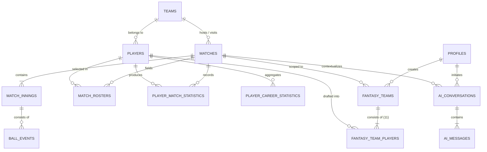

# FanPulse AI — Database Schema & Relational Architecture

> **Comprehensive database specification for Supabase PostgreSQL 16+, reflecting all 9 sequential migrations and verified constraints.**

---

## 1. Schema Overview

The FanPulse AI persistence layer is built on PostgreSQL 16 hosted within Supabase. The database architecture is normalized to 3NF, implements declarative referential integrity, and enforces security directly at the row level via **Row-Level Security (RLS)**.



---

## 2. Migration History (`supabase/migrations/`)

| Order | Migration File | Primary Responsibilities |
| :--- | :--- | :--- |
| 1 | `20261103075030_initial_schema_baseline.sql` | Installs extensions (`uuid-ossp`, `pgcrypto`) and base schemas. |
| 2 | `20261103080000_fantasy_teams_schema.sql` | Creates `fantasy_teams` and `fantasy_team_players` tables. |
| 3 | `20261103090000_auth_profiles_schema.sql` | User `profiles` schema and `on_auth_user_created` trigger. |
| 4 | `20261103100000_match_management_schema.sql` | Core cricket schema: `teams`, `matches`, `match_innings`, `ball_events`. |
| 5 | `20261103110000_player_management_schema.sql`| `players`, `match_rosters`, `player_match_statistics`, career stats. |
| 6 | `20261103120000_fantasy_management_schema.sql`| Team locks, 100-credit budget limits, role cardinality constraints. |
| 7 | `20261103130000_fantasy_scoring_schema.sql` | `scoring_rules`, `fantasy_player_points`, and deterministic scoring engine. |
| 8 | `20261103140000_comprehensive_database_relationships.sql` | Foreign keys, constraints, `ai_conversations`, and `ai_messages`. |
| 9 | `20261103150000_performance_optimizations.sql` | 47 B-tree composite indexes, VACUUM ANALYZE, and query optimization. |

---

## 3. Core Database Tables

### 3.1 Public Cricket Entities

#### `teams`
Represents international national teams and domestic cricket franchises.
| Column | Type | Constraints | Description |
| :--- | :--- | :--- | :--- |
| `id` | `VARCHAR(64)` | `PRIMARY KEY` | Unique team slug (e.g., `team-ind`, `team-aus`). |
| `name` | `VARCHAR(100)`| `NOT NULL` | Full team display name (e.g., `India`, `Australia`). |
| `short_name`| `VARCHAR(10)` | `NOT NULL` | Abbreviated name (`IND`, `AUS`). |
| `code` | `VARCHAR(10)` | `NOT NULL, UNIQUE` | Standard 3-letter ICC code. |
| `logo_url` | `TEXT` | `NULLABLE` | Image CDN URL for team emblem. |
| `created_at`| `TIMESTAMPTZ` | `DEFAULT NOW()` | Record creation timestamp. |
| `updated_at`| `TIMESTAMPTZ` | `DEFAULT NOW()` | Record update timestamp. |

#### `players`
Master directory of active cricket athletes.
| Column | Type | Constraints | Description |
| :--- | :--- | :--- | :--- |
| `id` | `VARCHAR(64)` | `PRIMARY KEY` | Player identifier (e.g., `player-ind-01`). |
| `name` | `VARCHAR(100)`| `NOT NULL` | Full legal name. |
| `short_name`| `VARCHAR(50)` | `NOT NULL` | Scorecard display name (e.g., `V. Kohli`). |
| `country` | `VARCHAR(64)` | `NOT NULL` | Country of national representation. |
| `role` | `VARCHAR(32)` | `NOT NULL, CHECK`| One of: `BAT`, `BOWL`, `AR`, `WK`. |
| `batting_style`| `VARCHAR(32)`| `NULLABLE` | `Right-hand bat`, `Left-hand bat`. |
| `bowling_style`| `VARCHAR(32)`| `NULLABLE` | Bowling action (e.g., `Right-arm fast`). |
| `credits` | `NUMERIC(4,1)`| `NOT NULL, CHECK`| Fantasy credit cost (between 7.0 and 11.0). |
| `created_at`| `TIMESTAMPTZ` | `DEFAULT NOW()` | Creation timestamp. |
| `updated_at`| `TIMESTAMPTZ` | `DEFAULT NOW()` | Update timestamp. |

#### `matches`
Cricket fixtures spanning international T20, ODI, and Test matches.
| Column | Type | Constraints | Description |
| :--- | :--- | :--- | :--- |
| `id` | `VARCHAR(64)` | `PRIMARY KEY` | Match identifier (e.g., `m-ind-aus-t20`). |
| `external_id`| `VARCHAR(64)`| `NULLABLE, UNIQUE`| External provider sync identifier. |
| `title` | `VARCHAR(200)`| `NOT NULL` | Fixture title (e.g., `India vs Australia - 3rd T20I`). |
| `format` | `VARCHAR(16)` | `NOT NULL, CHECK`| `T20`, `ODI`, `TEST`. |
| `status` | `VARCHAR(16)` | `NOT NULL, CHECK`| `UPCOMING`, `LIVE`, `COMPLETED`, `ABANDONED`. |
| `team1_id` | `VARCHAR(64)` | `REFERENCES teams(id)`| Home / first team. |
| `team2_id` | `VARCHAR(64)` | `REFERENCES teams(id)`| Away / second team. |
| `venue` | `VARCHAR(200)`| `NOT NULL` | Stadium and host city (e.g., `Melbourne Cricket Ground`). |
| `toss_winner_id`| `VARCHAR(64)`| `REFERENCES teams(id)`| Toss winning team. |
| `toss_decision`| `VARCHAR(16)`| `CHECK` | `BAT`, `BOWL`. |
| `start_time`| `TIMESTAMPTZ` | `NOT NULL` | Match commencement time. |
| `end_time` | `TIMESTAMPTZ` | `NULLABLE` | Conclusion timestamp. |

#### `match_innings`
Breakdown of innings progress for batting and bowling sides.
| Column | Type | Constraints | Description |
| :--- | :--- | :--- | :--- |
| `id` | `VARCHAR(64)` | `PRIMARY KEY` | Innings identifier. |
| `match_id` | `VARCHAR(64)` | `REFERENCES matches(id)` | Parent match fixture. |
| `innings_number`| `INT` | `NOT NULL, CHECK(1..4)`| Sequential innings index. |
| `batting_team_id`| `VARCHAR(64)`| `REFERENCES teams(id)`| Batting team. |
| `bowling_team_id`| `VARCHAR(64)`| `REFERENCES teams(id)`| Bowling team. |
| `total_runs`| `INT` | `NOT NULL, DEFAULT 0`| Total runs accumulated. |
| `total_wickets`| `INT` | `NOT NULL, DEFAULT 0`| Wickets fallen (0 to 10). |
| `overs_completed`| `NUMERIC(4,1)`| `NOT NULL, DEFAULT 0.0`| Completed overs (e.g., `19.2`). |
| `extras` | `INT` | `NOT NULL, DEFAULT 0`| Extra runs (wides, no-balls, byes, leg-byes). |
| `is_completed`| `BOOLEAN` | `DEFAULT FALSE` | Innings closed indicator. |

#### `player_match_statistics`
Detailed statistical scorecard for each athlete in a fixture.
| Column | Type | Constraints | Description |
| :--- | :--- | :--- | :--- |
| `id` | `VARCHAR(64)` | `PRIMARY KEY` | Stat record identifier. |
| `match_id` | `VARCHAR(64)` | `REFERENCES matches(id)` | Fixture reference. |
| `player_id`| `VARCHAR(64)` | `REFERENCES players(id)` | Player reference. |
| `team_id` | `VARCHAR(64)` | `REFERENCES teams(id)` | Represented team. |
| `runs` | `INT` | `DEFAULT 0` | Batting runs scored. |
| `balls_faced`| `INT` | `DEFAULT 0` | Balls faced as batter. |
| `fours` | `INT` | `DEFAULT 0` | 4s struck. |
| `sixes` | `INT` | `DEFAULT 0` | 6s struck. |
| `strike_rate`| `NUMERIC(6,2)`| `DEFAULT 0.0` | Computed batting strike rate. |
| `overs_bowled`| `NUMERIC(4,1)`| `DEFAULT 0.0` | Overs bowled. |
| `maidens` | `INT` | `DEFAULT 0` | Maiden overs bowled. |
| `runs_conceded`| `INT` | `DEFAULT 0` | Runs conceded as bowler. |
| `wickets` | `INT` | `DEFAULT 0` | Wickets claimed (excl. run-outs). |
| `economy_rate`| `NUMERIC(5,2)`| `DEFAULT 0.0` | Economy rate per over. |
| `catches` | `INT` | `DEFAULT 0` | Catches taken. |
| `stumpings` | `INT` | `DEFAULT 0` | Stumpings executed. |
| `run_outs` | `INT` | `DEFAULT 0` | Direct/indirect run-outs. |

---

### 3.2 User & Fantasy Management Entities

#### `profiles`
User metadata extending Supabase GoTrue Auth.
| Column | Type | Constraints | Description |
| :--- | :--- | :--- | :--- |
| `id` | `UUID` | `PRIMARY KEY, REFERENCES auth.users(id)` | Supabase auth UID. |
| `email` | `VARCHAR(255)`| `NOT NULL, UNIQUE` | Registered user email. |
| `full_name`| `VARCHAR(100)`| `NULLABLE` | User display name. |
| `role` | `VARCHAR(32)` | `DEFAULT 'user', CHECK` | `user` or `admin`. |

#### `fantasy_teams`
User-created fantasy squads for specific fixtures.
| Column | Type | Constraints | Description |
| :--- | :--- | :--- | :--- |
| `id` | `UUID` | `PRIMARY KEY, DEFAULT gen_random_uuid()` | Unique team ID. |
| `user_id` | `UUID` | `REFERENCES profiles(id) ON DELETE CASCADE`| Owner UID. |
| `match_id` | `VARCHAR(64)` | `REFERENCES matches(id)` | Target match fixture. |
| `team_name`| `VARCHAR(100)`| `NOT NULL` | Custom squad title. |
| `total_points`| `NUMERIC(7,2)`| `DEFAULT 0.0` | Cumulative fantasy points. |
| `total_credits_spent`| `NUMERIC(5,1)`| `CHECK(<= 100.0)` | Total credits used (max 100). |
| `rank` | `INT` | `NULLABLE` | Contest leaderboard placement. |

#### `fantasy_team_players`
Roster mapping associating exactly 11 players with a fantasy squad.
| Column | Type | Constraints | Description |
| :--- | :--- | :--- | :--- |
| `id` | `UUID` | `PRIMARY KEY, DEFAULT gen_random_uuid()` | Record ID. |
| `fantasy_team_id`| `UUID` | `REFERENCES fantasy_teams(id) ON DELETE CASCADE`| Parent squad. |
| `player_id` | `VARCHAR(64)`| `REFERENCES players(id)` | Selected player. |
| `is_captain` | `BOOLEAN` | `DEFAULT FALSE` | 2.0x points multiplier flag. |
| `is_vice_captain`| `BOOLEAN` | `DEFAULT FALSE` | 1.5x points multiplier flag. |
| `fantasy_points` | `NUMERIC(6,2)`| `DEFAULT 0.0` | Computed points earned in fixture. |

---

### 3.3 AI Intelligence Entities

#### `ai_conversations`
Top-level conversation session scoped to a user and match fixture.
| Column | Type | Constraints | Description |
| :--- | :--- | :--- | :--- |
| `id` | `UUID` | `PRIMARY KEY, DEFAULT gen_random_uuid()` | Conversation session ID. |
| `user_id` | `UUID` | `REFERENCES profiles(id) ON DELETE CASCADE`| Owner UID. |
| `match_id` | `VARCHAR(64)` | `REFERENCES matches(id)` | Context match fixture. |
| `session_title`| `VARCHAR(200)`| `NOT NULL` | Summary headline. |

#### `ai_messages`
Individual conversational turns between user and Gemini Assistant.
| Column | Type | Constraints | Description |
| :--- | :--- | :--- | :--- |
| `id` | `UUID` | `PRIMARY KEY, DEFAULT gen_random_uuid()` | Message turn ID. |
| `conversation_id`| `UUID` | `REFERENCES ai_conversations(id) ON DELETE CASCADE`| Parent conversation. |
| `role` | `VARCHAR(16)` | `NOT NULL, CHECK` | `user` or `assistant`. |
| `content` | `TEXT` | `NOT NULL` | Message body. |
| `context_data` | `JSONB` | `DEFAULT '{}'` | Injected match telemetry payload. |

---

## 4. Row-Level Security (RLS) Policies

Every table in the `public` schema has RLS enabled (`ALTER TABLE ... ENABLE ROW LEVEL SECURITY;`).

1. **Public Read Tables:** `teams`, `players`, `matches`, `match_rosters`, `match_innings`, `player_match_statistics`, `player_career_statistics`, `scoring_rules`.
   ```sql
   CREATE POLICY "Public read access for matches"
   ON public.matches FOR SELECT
   TO anon, authenticated
   USING (true);
   ```

2. **User Private Tables (Tenant Isolation):** `fantasy_teams`, `fantasy_team_players`, `ai_conversations`, `ai_messages`, `profiles`.
   ```sql
   CREATE POLICY "Users can manage own fantasy teams"
   ON public.fantasy_teams FOR ALL
   TO authenticated
   USING (auth.uid() = user_id)
   WITH CHECK (auth.uid() = user_id);
   ```

3. **Admin Write Safeguards:** Sensitive cricket data mutations (`INSERT`, `UPDATE`, `DELETE`) are restricted to users with `role = 'admin'` or the internal Supabase `service_role`.

---

## 5. Seed Data Summary (`supabase/seed.sql`)

Initial development and demo testing are seeded with complete, verified cricket records:
- **Teams (4):** India (`IND`), Australia (`AUS`), England (`ENG`), South Africa (`SA`).
- **Players (44):** 11 players per team with realistic roles, credits, and historical metrics.
- **Matches (3):**
  - `m-ind-aus-t20` (India vs Australia 3rd T20I at Melbourne Cricket Ground — COMPLETED: IND 184/4 in 19.2 ov def. AUS 178/8 in 20.0 ov by 6 wickets).
  - `m-eng-sa-t20` (England vs South Africa 1st T20I at Lord's — LIVE).
  - `m-ind-eng-odi` (India vs England 2nd ODI at Narendra Modi Stadium — UPCOMING).
- **Match Innings & Statistics:** Full ball-by-ball scorecards, batting run tallies, bowling wickets, maidens, extras, and fielding dismissals.

---

*Related Specifications:*
- [System Architecture](SYSTEM_ARCHITECTURE.md)
- [API Reference](API_REFERENCE.md)
- [Fantasy Scoring](FANTASY_SCORING.md)
- [Setup and Deployment](SETUP_AND_DEPLOYMENT.md)

