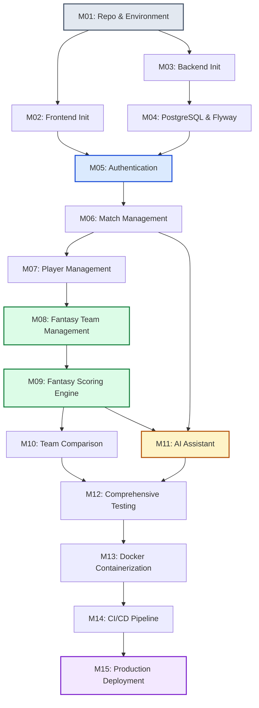

# FanPulse AI — Development Roadmap & Implementation Plan

> Comprehensive execution roadmap, milestone breakdown, dependency chains, and testing requirements for the FanPulse AI MVP.
> Derived from [PROJECT_VISION.md](file:///U:/Fanpulse_AI/docs/PROJECT_VISION.md), [REQUIREMENTS.md](file:///U:/Fanpulse_AI/docs/REQUIREMENTS.md), [SYSTEM_ARCHITECTURE.md](file:///U:/Fanpulse_AI/docs/SYSTEM_ARCHITECTURE.md), [TECHNOLOGY_STACK.md](file:///U:/Fanpulse_AI/docs/TECHNOLOGY_STACK.md), [DATABASE_DESIGN.md](file:///U:/Fanpulse_AI/docs/DATABASE_DESIGN.md), [API_DESIGN.md](file:///u:/Fanpulse_AI/docs/API_REFERENCE.md), [FRONTEND_DESIGN.md](file:///U:/Fanpulse_AI/docs/FRONTEND_DESIGN.md), and [AI_MODULE_DESIGN.md](file:///u:/Fanpulse_AI/docs/AI_IMPLEMENTATION.md).
> [!NOTE]
> **Roadmap Architectural Transition:** This roadmap outlines the initial engineering plan. In Phase 2, backend services transitioned to **Supabase Edge Functions (Deno / TypeScript)** and **Supabase PostgreSQL** in place of standalone Java containers, successfully delivering all MVP milestones serverlessly. (See [docs/SYSTEM_ARCHITECTURE.md](SYSTEM_ARCHITECTURE.md) and [docs/PROJECT_REPORT.md](PROJECT_REPORT.md)).


---

## 1. Executive Roadmap & Milestone Sequence

The FanPulse AI MVP implementation is organized into **15 sequential, incremental milestones** designed to deliver a fully functional, test-covered, containerized application with minimal friction:



---

## 2. Detailed Milestone Specifications

---

### Milestone 1: Repository and Environment Setup

* **Git Branch Suggestion:** `chore/repo-and-env-setup`
* **Dependencies:** None.

#### 1. Objective
Establish the project workspace, root directory structure, Git version control standards, code quality configurations, and local developer prerequisites.

#### 2. Tasks
1. Initialize standard project directory structure: `/frontend`, `/backend`, `/docs`, `.github/workflows`.
2. Configure top-level `.gitignore` covering Node (`node_modules`, `dist`), Java Maven (`target`, `.m2`), IDE artifacts (`.idea`, `.vscode`), and environment secrets (`.env`, `*.local`).
3. Create root `.editorconfig` enforcing UTF-8, LF line endings, 2-space indents for JSON/TS/YAML, and 4-space indents for Java.
4. Establish branch protection rules and PR review guidelines in `CONTRIBUTING.md`.
5. Verify Java 21 LTS, Node.js 20 LTS, Maven 3.9+, and Docker environments.

#### 3. Deliverables
* Root directory tree with `/frontend` and `/backend` placeholders.
* Comprehensive root `.gitignore`.
* `.editorconfig` and `CONTRIBUTING.md`.

#### 4. Acceptance Criteria
* Clean git clone runs without tracking OS or IDE specific temporary files.
* Repository passes pre-commit formatting checks.

#### 5. Testing Requirements
* Verify git status remains clean across Windows, macOS, and Linux checkouts.

---

### Milestone 2: Frontend Initialization

* **Git Branch Suggestion:** `feat/frontend-init`
* **Dependencies:** Milestone 1.

#### 1. Objective
Scaffold the React 18 Single Page Application using Vite, TypeScript, and Tailwind CSS, establishing root layouts, routing shells, and Redux Toolkit state stores.

#### 2. Tasks
1. Initialize Vite project with React and TypeScript template in `/frontend`.
2. Install and configure core frontend dependencies: `react-router-dom`, `@reduxjs/toolkit`, `react-redux`, `axios`, `react-hook-form`, `zod`, `@hookform/resolvers`, `lucide-react`.
3. Configure `tailwind.config.js` with the brand color palette (`bg-pitch-dark`, `primary-accent`, `secondary-gold`, etc.) and typography from [FRONTEND_DESIGN.md §1](file:///U:/Fanpulse_AI/docs/FRONTEND_DESIGN.md#L10).
4. Configure Redux store with placeholder slices: `authSlice`, `matchSlice`, `fantasySlice`, `uiSlice`.
5. Set up Axios base client (`apiClient.ts`) with Bearer token request interceptor and error response handler.
6. Build base layout shells: `MainLayout` (Navbar + Footer), `AuthLayout`, and `AdminLayout`.
7. Configure React Router with route definitions and route guards (`ProtectedRoute`, `PublicRoute`, `AdminRoute`).
8. Implement core atomic UI components in `src/components/common/`: `Button`, `Input`, `Card`, `Badge`, `Spinner`, `AlertBanner`.

#### 3. Deliverables
* Fully configured `/frontend` module building cleanly with `npm run build`.
* Interactive Tailwind design system with global dark theme.
* Route skeleton displaying placeholder pages for all 12 planned views.

#### 4. Acceptance Criteria
* `npm run dev` boots the dev server in < 500ms with working HMR.
* `npm run build` outputs a minified, tree-shaken static bundle without TypeScript errors.
* Navigation between routes functions seamlessly with correct layout rendering.

#### 5. Testing Requirements
* Configure Vitest and React Testing Library in `vite.config.ts`.
* Unit test: Verify `Button` and `Card` components render accessible text and handle click events.
* Unit test: Verify `authSlice` reducer handles login and logout actions cleanly.

---

### Milestone 3: Backend Initialization

* **Git Branch Suggestion:** `feat/backend-init`
* **Dependencies:** Milestone 1.

#### 1. Objective
Bootstrap the Spring Boot 3.3.x backend application on Java 21, establishing Maven dependencies, package conventions, base entities, and centralized exception handling.

#### 2. Tasks
1. Initialize Maven project with `spring-boot-starter-parent` (3.3.5) and Java 21 in `/backend/pom.xml`.
2. Configure Maven dependencies: `spring-boot-starter-web`, `spring-boot-starter-data-jpa`, `spring-boot-starter-security`, `spring-boot-starter-validation`, `postgresql`, `flyway-core`, `flyway-database-postgresql`, `jjwt-api`, `lombok` (optional/compile-only), `spring-boot-starter-test`.
3. Establish package structure according to [BACKEND_DESIGN.md §2](file:///U:/Fanpulse_AI/docs/SYSTEM_ARCHITECTURE.md#L25): `config`, `controller`, `service`, `repository`, `entity`, `dto`, `mapper`, `security`, `exception`, `validation`, `integration`, `scheduler`.
4. Implement `BaseAuditableEntity` with JPA Auditing for `createdAt` and `updatedAt`.
5. Implement `GlobalExceptionHandler` (`@RestControllerAdvice`) returning standardized `ApiErrorResponse` JSON envelopes (`NFR-REL-03`).
6. Implement custom base runtime exceptions: `ResourceNotFoundException`, `DuplicateResourceException`, `BusinessRuleException`.
7. Create Health Check controller endpoint: `GET /api/v1/health` returning system timestamp and status.

#### 3. Deliverables
* Compiling `/backend` module building with `./mvnw clean package`.
* Standardized `GlobalExceptionHandler` handling 400, 404, 500 scenarios.
* Working `GET /api/v1/health` endpoint.

#### 4. Acceptance Criteria
* Application starts up locally on port 8080 without bean configuration errors.
* Accessing invalid routes or throwing runtime exceptions produces standardized `ApiErrorResponse` envelopes.

#### 5. Testing Requirements
* JUnit 5 test verifying Spring `ApplicationContext` loads cleanly.
* MockMvc test verifying `GET /api/v1/health` returns HTTP 200 with JSON payload.

---

### Milestone 4: PostgreSQL Integration & Migrations

* **Git Branch Suggestion:** `feat/postgresql-and-flyway`
* **Dependencies:** Milestone 3.

#### 1. Objective
Connect the Spring Boot application to a local PostgreSQL 16 database, execute Flyway schema migrations, and establish JPA repositories and initial seed data.

#### 2. Tasks
1. Configure `application-dev.yml` with PostgreSQL JDBC connection properties and HikariCP connection pool settings.
2. Author Flyway migration script `V1__initial_schema.sql` creating all 16 tables, primary keys, foreign keys, and check constraints according to [DATABASE_DESIGN.md §3](file:///U:/Fanpulse_AI/docs/DATABASE_DESIGN.md#L45).
3. Author Flyway migration script `V2__seed_sample_data.sql` populating static roles (`ROLE_USER`, `ROLE_ADMIN`), master teams (India, Australia, England), player profiles, and sample scoring rules (`FR-MATCH-06`).
4. Implement JPA entity classes in `entity/`: `User`, `Role`, `Team`, `Player`, `Match`, `MatchInnings`, `MatchRoster`, `BallEvent`, `PlayerMatchStatistics`, `ScoringRule`, `FantasyTeam`, `FantasyTeamPlayer`, `FantasyPlayerPoints`, `AiConversation`, `AiMessage`.
5. Implement Spring Data JPA repository interfaces in `repository/` extending `JpaRepository`.
6. Configure Testcontainers for automated PostgreSQL integration testing.

#### 3. Deliverables
* Versioned Flyway SQL migration scripts (`V1` and `V2`).
* Complete JPA entity layer matching PostgreSQL 16 schema.
* Operational Spring Data JPA repository layer.

#### 4. Acceptance Criteria
* Starting backend application executes Flyway migrations without SQL syntax errors.
* `flyway_schema_history` table records successful migration execution.
* Repositories successfully read seeded team and player records.

#### 5. Testing Requirements
* Integration test with Testcontainers: Spin up PostgreSQL 16, run Flyway migrations, and assert that sample teams and players are queryable.

---

### Milestone 5: Authentication & Security Subsystem

* **Git Branch Suggestion:** `feat/auth-subsystem`
* **Dependencies:** Milestones 2, 4.

#### 1. Objective
Implement end-to-end user registration, BCrypt password hashing, stateless JWT authentication, role-based route protection, and frontend login/register pages.

#### 2. Tasks
1. Implement `JwtTokenProvider` to generate and validate HMAC-SHA256 signed JWT tokens (`NFR-SEC-01`, `06`).
2. Implement `JwtAuthenticationFilter` reading `Authorization: Bearer <token>` and setting the `SecurityContext`.
3. Configure `SecurityConfig` with stateless session management, BCrypt password encoder (work factor 12), and endpoint authorization rules.
4. Implement `AuthService` and `AuthController` with endpoints:
   * `POST /api/v1/auth/register` (`FR-AUTH-01`, `02`)
   * `POST /api/v1/auth/login` (`FR-AUTH-03`, `04`)
   * `POST /api/v1/auth/logout` (`FR-AUTH-06`)
   * `GET /api/v1/users/me` and `PUT /api/v1/users/me` (`FR-AUTH-08`)
5. Develop Frontend `LoginPage` and `RegisterPage` with React Hook Form and Zod validation schemas.
6. Connect frontend auth flow: dispatch login action, store token in Redux + `localStorage`, enforce `ProtectedRoute` redirection.

#### 3. Deliverables
* Secure Spring Security stateless JWT authentication layer.
* Working `/api/v1/auth/**` and `/api/v1/users/me` REST endpoints.
* Frontend `LoginPage`, `RegisterPage`, and `UserProfilePage`.

#### 4. Acceptance Criteria
* User can register with email and password; duplicate emails return HTTP 409 (`AC-AUTH-01`, `02`).
* Passwords are saved as BCrypt hashes in PostgreSQL; no plaintext storage (`NFR-SEC-01`).
* Login returns valid JWT; accessing protected endpoints without token returns HTTP 401 (`AC-AUTH-04`).
* Frontend successfully stores session and redirects unauthenticated users to `/login`.

#### 5. Testing Requirements
* Unit test: `AuthServiceImplTest` verifying registration, duplicate email rejection, and password matching using Mockito.
* Integration test: `AuthControllerIT` testing `/register` and `/login` endpoints with valid and invalid payloads.
* Frontend component test: `LoginPage.test.tsx` verifying inline validation errors and successful form dispatch.

---

### Milestone 6: Match Management Subsystem

* **Git Branch Suggestion:** `feat/match-management`
* **Dependencies:** Milestones 4, 5.

#### 1. Objective
Implement match listing, status filtering, match details, and full 2-innings scorecards with delivery streams, connecting backend controllers to frontend views.

#### 2. Tasks
1. Implement `MatchService` and `MatchRepository` queries for status/format filtering (`FR-MATCH-01`, `03`).
2. Implement `MatchController` endpoints according to [API_DESIGN.md §3](file:///u:/Fanpulse_AI/docs/API_REFERENCE.md#L145):
   * `GET /api/v1/matches` (paginated, filterable)
   * `GET /api/v1/matches/{id}`
   * `GET /api/v1/matches/{id}/scorecard` (`FR-MATCH-02`)
   * `GET /api/v1/matches/{id}/innings/{num}/balls`
3. Implement `MatchMapper` and `ScorecardMapper` converting entities to clean DTOs.
4. Develop Frontend `MatchCenterPage` (`/matches`) with status pills (`ALL`, `LIVE`, `UPCOMING`, `COMPLETED`) and format filters (`T20`, `ODI`, `TEST`).
5. Develop Frontend `MatchDetailsPage` (`/matches/:matchId`) featuring:
   * Match overview banner with live score and toss result.
   * Innings 1 and Innings 2 batting and bowling scorecard tables.
   * Ball-by-ball delivery log feed.
6. Build Dashboard featured match hero widget on `DashboardPage` (`/`).

#### 3. Deliverables
* Complete match management backend API suite.
* Frontend `MatchCenterPage`, `MatchDetailsPage`, and Dashboard match widgets.

#### 4. Acceptance Criteria
* Match list endpoint returns sample matches; filtering by "COMPLETED" returns only completed fixtures (`AC-MATCH-01`, `03`).
* Match scorecard accurately reflects batting runs, strike rates, wickets, and bowling economies (`AC-MATCH-02`).
* Frontend renders scorecards cleanly across mobile, tablet, and desktop viewports (`NFR-USE-01`).

#### 5. Testing Requirements
* Unit test: `MatchServiceImplTest` verifying filtering and DTO mapping.
* Integration test: `MatchControllerIT` asserting correct JSON structure for match detail and scorecard.
* Frontend component test: `MatchCenterPage.test.tsx` verifying filter pills trigger API re-fetch.

---

### Milestone 7: Player Management & Statistics Subsystem

* **Git Branch Suggestion:** `feat/player-management`
* **Dependencies:** Milestones 4, 6.

#### 1. Objective
Implement player directory browsing, role/country filtering, career aggregate statistics, and match-specific performance breakdowns.

#### 2. Tasks
1. Implement `PlayerService` and `PlayerRepository` with derived queries (`FR-STATS-05`).
2. Implement `PlayerController` endpoints according to [API_DESIGN.md §4](file:///u:/Fanpulse_AI/docs/API_REFERENCE.md#L280):
   * `GET /api/v1/players` (filterable by country, role)
   * `GET /api/v1/players/{id}` (career batting & bowling aggregates, `FR-STATS-01`–`03`)
   * `GET /api/v1/players/{id}/matches/{matchId}` (match performance, `FR-STATS-04`)
3. Implement `PlayerMapper` mapping entities to career and performance DTOs.
4. Develop Frontend `PlayerDetailsPage` (`/players/:playerId`) showing:
   * Player hero card (name, nationality, role badge, batting/bowling style).
   * Career stats cards (Runs, Average, Wickets, Economy).
   * Format toggle tabs (`T20`, `ODI`, `TEST`).
   * Recent matches table.
5. Add player modal shortcuts directly from the Match Scorecard.

#### 3. Deliverables
* Player API endpoints with career aggregations.
* Frontend `PlayerDetailsPage` and reusable `PlayerCard` components.

#### 4. Acceptance Criteria
* `GET /api/v1/players` filters correctly by role (e.g. `role=ALL_ROUNDER`) (`AC-STATS-01`).
* Aggregate career stats on player profile match sum of individual match performances (`AC-STATS-03`).

#### 5. Testing Requirements
* Unit test: `PlayerServiceImplTest` asserting correct mathematical aggregation of runs and wickets.
* Integration test: `PlayerControllerIT` verifying player profile JSON payload.
* Frontend test: `PlayerDetailsPage.test.tsx` verifying format tabs update displayed averages.

---

### Milestone 8: Fantasy Team Management Subsystem

* **Git Branch Suggestion:** `feat/fantasy-team-management`
* **Dependencies:** Milestones 5, 6, 7.

#### 1. Objective
Implement the complete fantasy team creation and drafting engine, enforcing all 11-player composition constraints, role minimums, squad locking, and user team management.

#### 2. Tasks
1. Implement `FantasyTeamService` enforcing all business rules:
   * Exactly 11 players (`BR-TEAM-01`, `FR-FANTASY-02`).
   * Players from both competing teams (`BR-TEAM-02`, `FR-FANTASY-03`).
   * Role minimums: >=1 WK, >=1 BAT, >=1 AR, >=1 BOWL (`BR-TEAM-03`, `FR-FANTASY-04`).
   * Exactly 1 Captain and 1 Vice-Captain (`captain <> viceCaptain`, `BR-TEAM-04`, `FR-FANTASY-05`).
   * Selected players must exist in active `match_rosters` (`BR-TEAM-05`).
   * Edits/deletions permitted only when match is `UPCOMING` (`BR-TEAM-06`, `FR-FANTASY-08`, `09`).
2. Implement `FantasyTeamController` endpoints according to [API_DESIGN.md §5](file:///u:/Fanpulse_AI/docs/API_REFERENCE.md#L370):
   * `POST /api/v1/fantasy-teams` (Create team)
   * `PUT /api/v1/fantasy-teams/{id}` (Update team)
   * `DELETE /api/v1/fantasy-teams/{id}` (Delete team)
   * `GET /api/v1/fantasy-teams` (List user's teams, `FR-FANTASY-07`)
   * `PATCH /api/v1/fantasy-teams/{id}/roles` (Quick captain update)
3. Enforce user ownership security checks (`NFR-SEC-03`).
4. Develop Frontend `FantasyBuilderPage` (`/matches/:matchId/fantasy/create`):
   * Interactive 11-player progress bar and role checklist.
   * Filterable player selection pool.
   * Visual cricket pitch lineup view.
   * Captain (2x) and Vice-Captain (1.5x) selection modal.
5. Develop Frontend `MyTeamsPage` (`/my-teams`) listing user teams grouped by match.

#### 3. Deliverables
* Complete fantasy team management API with transaction-safe validation.
* Frontend `FantasyBuilderPage` and `MyTeamsPage`.

#### 4. Acceptance Criteria
* User can draft an 11-player team and designate Captain and Vice-Captain (`AC-FANTASY-01`).
* Submitting teams with `< 11` or `> 11` players, missing roles, or identical captain/VC is rejected with HTTP 400 (`AC-FANTASY-02`, `03`).
* Editing or deleting a team after match starts is rejected with HTTP 403 (`AC-FANTASY-04`).
* Users cannot access or modify teams belonging to other users (`AC-FANTASY-05`).

#### 5. Testing Requirements
* Unit test: `FantasyTeamServiceImplTest` with exhaustive tests for every team composition rule violation (`NFR-TEST-01`).
* Integration test: `FantasyTeamControllerIT` testing valid creation, validation errors, and cross-user isolation.
* Frontend test: `FantasyBuilderPage.test.tsx` asserting save button remains disabled until 11 players and roles are satisfied.

---

### Milestone 9: Fantasy Scoring Engine

* **Git Branch Suggestion:** `feat/fantasy-scoring-engine`
* **Dependencies:** Milestone 8.

#### 1. Objective
Implement the configuration-driven fantasy points calculation engine, calculating batting, bowling, and fielding points, applying multipliers, and persisting itemized breakdown logs.

#### 2. Tasks
1. Implement `ScoringService` as a pure, deterministic calculation engine (`NFR-DATA-02`):
   * Load active scoring rules from `scoring_rules` table (`FR-SCORE-06`).
   * Apply batting rules: runs (+1), boundaries (+1/+2), 50 bonus (+10), 100 bonus (+25), duck penalty (-5) (`BR-SCORE-BAT-*`).
   * Apply bowling rules: wickets (+25), maidens (+10), 3-wicket bonus (+10), 5-wicket bonus (+25), economy bonus/penalty (`BR-SCORE-BOWL-*`).
   * Apply fielding rules: catches (+10), run-outs (+15/+10), stumpings (+15) (`BR-SCORE-FIELD-*`).
   * Apply multipliers: Captain (2.0x), Vice-Captain (1.5x) (`FR-SCORE-02`).
   * Sum total team score and update `fantasy_teams.total_points` (`FR-SCORE-03`).
2. Persist detailed audit trail in `fantasy_player_points` including JSON breakdown.
3. Implement `ScoringController` endpoints according to [API_DESIGN.md §6](file:///u:/Fanpulse_AI/docs/API_REFERENCE.md#L485):
   * `POST /api/v1/matches/{id}/scoring/calculate` (Admin/system trigger, `FR-SCORE-05`)
   * `GET /api/v1/matches/{id}/players/{id}/points` (Player point breakdown)
   * `GET /api/v1/fantasy-teams/{id}/points` (Team points breakdown, `FR-SCORE-04`)
   * `GET /api/v1/scoring-rules` (Configuration ruleset)
4. Integrate points display into Frontend `MyTeamsPage` and `FantasyTeamCard`.
5. Create `TeamDetailsModal` displaying player point breakdowns and captaincy boosts.

#### 3. Deliverables
* Deterministic fantasy scoring engine in `ScoringServiceImpl.java`.
* Scoring API endpoints with itemized JSON breakdown logs.
* Frontend fantasy team point inspection modal.

#### 4. Acceptance Criteria
* For completed sample matches, calculated fantasy points exactly match manual calculations (`AC-SCORE-01`, `NFR-TEST-04`).
* Captain receives exactly 2x base points; Vice-Captain receives exactly 1.5x (`AC-SCORE-02`).
* Total team points equals sum of all 11 player final points (`AC-SCORE-03`).

#### 5. Testing Requirements
* Dedicated scoring test suite (`ScoringServiceImplTest`): Parameterized unit tests covering every single rule in `BR-SCORE-*` against manually verified expected values (`NFR-TEST-04`).
* Integration test: `ScoringControllerIT` verifying recalculation updates all fantasy teams for a match.

---

### Milestone 10: Fantasy Team Comparison Subsystem

* **Git Branch Suggestion:** `feat/team-comparison`
* **Dependencies:** Milestones 8, 9.

#### 1. Objective
Implement side-by-side fantasy team comparison, computing point differentials, highlighting shared versus exclusive player picks, and rendering comparison views.

#### 2. Tasks
1. Implement `ComparisonService` to compare two fantasy teams for the same match (`FR-COMPARE-01`):
   * Validate that both teams exist and belong to the **same match fixture** (`FR-COMPARE-04`).
   * Categorize players into `COMMON`, `TEAM_1_EXCLUSIVE`, and `TEAM_2_EXCLUSIVE` (`FR-COMPARE-03`).
   * Compute team point differences and identify leading team (`FR-COMPARE-02`).
2. Implement `ComparisonController` endpoint:
   * `GET /api/v1/fantasy-teams/compare?team1Id={id}&team2Id={id}`
3. Develop Frontend `FantasyComparisonPage` (`/my-teams/compare`):
   * Top scoreboard showing Team 1 score vs. Team 2 score with winner highlight.
   * Net points variance card.
   * Side-by-side comparative player table categorized by shared and differential picks.
   * Captaincy impact comparison card.
4. Add "Compare Teams" CTA directly from `MyTeamsPage`.

#### 3. Deliverables
* Comparison service and REST endpoint.
* Frontend `FantasyComparisonPage`.

#### 4. Acceptance Criteria
* Side-by-side view displays total scores and per-player points for both teams (`AC-COMPARE-01`).
* Differing player selections are visually highlighted (`AC-COMPARE-02`).
* Attempting to compare teams from different matches is rejected with HTTP 400 (`AC-COMPARE-03`).

#### 5. Testing Requirements
* Unit test: `ComparisonServiceImplTest` verifying differential categorization and score calculation.
* Integration test: `ComparisonControllerIT` testing valid comparison and mismatched match IDs.
* Frontend test: `FantasyComparisonPage.test.tsx` verifying differential badges render correctly.

---

### Milestone 11: AI Match Assistant Subsystem

* **Git Branch Suggestion:** `feat/ai-match-assistant`
* **Dependencies:** Milestones 6, 9.

#### 1. Objective
Implement the grounded AI match assistant using Spring WebClient and provider-agnostic abstractions, providing match situation explanations, player insights, and turning point narratives.

#### 2. Tasks
1. Implement `AiService` interface and `GeminiAiServiceImpl` adapter using Spring WebClient (`FR-AI-05`).
2. Implement `MockAiServiceImpl` for deterministic, zero-cost offline testing and local development.
3. Implement `MatchContextAssembler` serializing match data into structured JSON context according to [AI_MODULE_DESIGN.md §6](file:///u:/Fanpulse_AI/docs/AI_IMPLEMENTATION.md#L125).
4. Implement `AiPromptBuilder` embedding context into prompt templates with grounding guardrails and negative constraints (`BR-AI-01`, `BR-AI-02`).
5. Implement `AiResponseValidator` verifying response structure and guarding against hallucinated names.
6. Implement `AiController` endpoints according to [API_DESIGN.md §8](file:///u:/Fanpulse_AI/docs/API_REFERENCE.md#L605):
   * `POST /api/v1/ai/match-summary` (`FR-AI-01`, `UC-08`)
   * `POST /api/v1/ai/player-insight` (`FR-INSIGHT-01`, `UC-09`)
   * `POST /api/v1/ai/key-moments` (`FR-INSIGHT-02`, `UC-10`)
7. Implement resilient error handling returning HTTP 503 fallback upon provider failure (`FR-AI-04`, `NFR-REL-01`).
8. Develop Frontend `AiAssistantPage` (`/matches/:matchId/ai-assistant`):
   * Active match context header.
   * Preset prompt chips ("Summarize Match", "Key Turning Points", "Analyze Player").
   * Markdown conversation stream with transparent data context pill (`FR-AI-06`).
   * Custom query input bar with 250-character limit.

#### 3. Deliverables
* Provider-agnostic AI subsystem with `GeminiAiServiceImpl` and `MockAiServiceImpl`.
* AI REST API endpoints with grounded prompt templates.
* Frontend `AiAssistantPage` with Markdown formatting and error fallbacks.

#### 4. Acceptance Criteria
* Requesting match summary returns a natural-language explanation referencing actual match scores and player figures (`AC-AI-01`).
* AI output contains no facts absent from the supplied match data (`AC-AI-02`).
* When AI provider is disabled, system gracefully returns HTTP 503 while all other features continue working (`AC-AI-03`, `NFR-REL-01`).

#### 5. Testing Requirements
* Unit test: `AiPromptBuilderTest` verifying structured JSON serialization and grounding constraints.
* Integration test: `AiControllerIT` using `MockAiServiceImpl` to verify HTTP 200 response structure and data context fields.
* Failure test: Verify simulated provider timeout results in HTTP 503 response envelope.

---

### Milestone 12: Comprehensive Testing & Quality Assurance

* **Git Branch Suggestion:** `test/comprehensive-qa`
* **Dependencies:** Milestones 10, 11.

#### 1. Objective
Execute cross-layer testing, achieve target code coverage (>= 80% on business services), perform end-to-end user journey validation, and verify non-functional performance benchmarks.

#### 2. Tasks
1. Audit backend unit test coverage with JaCoCo; ensure >= 80% line coverage on `service/` package (`NFR-TEST-01`).
2. Implement full REST API integration test suite covering all endpoints with valid and invalid payloads (`NFR-TEST-02`).
3. Complete frontend component and integration test suite using Vitest and React Testing Library for critical flows (`NFR-TEST-03`).
4. Execute manual and automated cross-browser testing across mobile (<768px), tablet, and desktop viewports (`NFR-USE-01`).
5. Run Lighthouse performance and accessibility audits on frontend pages (target score >= 70, `NFR-PERF-04`).
6. Validate API response times under local load (target p95 <= 500ms for scorecard and stats endpoints, `NFR-PERF-01`).

#### 3. Deliverables
* JaCoCo code coverage report confirming >= 80% service test coverage.
* Complete passing test suites across both backend (`mvn test`) and frontend (`npm run test`).
* Lighthouse audit report.

#### 4. Acceptance Criteria
* All backend unit and integration tests pass cleanly without failures.
* All frontend Vitest component tests pass cleanly.
* No critical or high-severity security vulnerabilities in dependency audit.

#### 5. Testing Requirements
* Execute full test suites: `./mvnw clean verify` (Backend) and `npm run test -- --run` (Frontend).

---

### Milestone 13: Docker Containerization

* **Git Branch Suggestion:** `ops/docker-containerization`
* **Dependencies:** Milestone 12.

#### 1. Objective
Containerize the entire FanPulse AI application (Frontend SPA, Spring Boot Backend, PostgreSQL 16) using multi-stage Dockerfiles and Docker Compose for single-command deployment.

#### 2. Tasks
1. Author `/backend/Dockerfile`:
   * Multi-stage build: `maven:3.9-eclipse-temurin-21` (builder) -> `eclipse-temurin:21-jre-alpine` (runtime).
   * Runs as non-root user; exposes port 8080.
2. Author `/frontend/Dockerfile`:
   * Multi-stage build: `node:20-alpine` (builder) -> `nginx:alpine` (runtime).
   * Configure `nginx.conf` with SPA client-side routing fallback (`try_files $uri /index.html`) and API reverse proxy to backend.
3. Author root `docker-compose.yml`:
   * Services: `db` (PostgreSQL 16), `backend` (Spring Boot), `frontend` (Nginx).
   * Health checks on `db` (`pg_isready`) and `backend` (`/actuator/health` or `/api/v1/health`).
   * Named persistent volume for PostgreSQL data: `postgres_data`.
   * Environment variable wiring (`.env` template).
4. Author root `.env.example` documenting all configuration keys.

#### 3. Deliverables
* Multi-stage `backend/Dockerfile` and `frontend/Dockerfile`.
* Root `docker-compose.yml` and `.env.example`.
* Nginx reverse proxy configuration.

#### 4. Acceptance Criteria
* Running `docker compose up --build` compiles, networks, and starts all three containers without manual intervention.
* Browser accessing `http://localhost:3000` loads the application and successfully communicates with the backend API.
* Flyway migrations execute automatically on backend container startup against the PostgreSQL container.

#### 5. Testing Requirements
* Smoke test: Verify `docker compose down -v` followed by `docker compose up` starts cleanly from scratch.

---

### Milestone 14: CI/CD Pipeline Automation

* **Git Branch Suggestion:** `ci/github-actions-pipeline`
* **Dependencies:** Milestone 13.

#### 1. Objective
Configure GitHub Actions automated Continuous Integration pipeline to lint, test, and verify container builds on every push and pull request.

#### 2. Tasks
1. Create `.github/workflows/ci.yml` pipeline with parallel jobs:
   * **Backend Job:** Check out code, set up JDK 21, cache Maven repository, execute `./mvnw clean verify`.
   * **Frontend Job:** Check out code, set up Node.js 20, cache npm dependencies, run ESLint, execute `npm run test`, and run `npm run build`.
   * **Docker Build Job:** Verify that multi-stage Docker builds succeed for both frontend and backend images.
2. Configure branch protection rules on GitHub repository: require passing CI status checks before allowing pull request merges into `main`.
3. Add Dependabot configuration (`.github/dependabot.yml`) for automated dependency vulnerability patching.

#### 3. Deliverables
* Fully automated `.github/workflows/ci.yml` pipeline.
* Passing CI badges for repository README.
* Dependabot security configuration.

#### 4. Acceptance Criteria
* Opening a pull request triggers the CI pipeline automatically.
* Pull requests with broken tests or failing TypeScript builds are blocked from merging.

#### 5. Testing Requirements
* Test PR submission: Intentionally break a unit test and verify GitHub Actions fails the build and blocks the PR.

---

### Milestone 15: Production Deployment & Release Readiness

* **Git Branch Suggestion:** `release/mvp-v1.0.0`
* **Dependencies:** Milestone 14.

#### 1. Objective
Perform final production hardening, environment configuration, database backup verification, security audits, and formal MVP v1.0.0 release tagging.

#### 2. Tasks
1. Configure production environment profiles (`application-prod.yml`) disabling test endpoints and setting strict CORS origins.
2. Verify production secrets management: ensure JWT secrets, database passwords, and AI API keys are injected via environment variables.
3. Configure database backup and disaster recovery scripts for PostgreSQL volume.
4. Execute final end-to-end acceptance testing against the Definition of Done (DoD).
5. Generate release documentation: `README.md` quickstart, API documentation links, and release notes.
6. Tag Git release `v1.0.0-mvp` on the `main` branch.

#### 3. Deliverables
* Production-ready deployment configuration.
* Comprehensive `README.md` setup guide.
* Git release tag `v1.0.0-mvp`.

#### 4. Acceptance Criteria
* All 71 MVP functional and non-functional requirements from [REQUIREMENTS.md §7](file:///U:/Fanpulse_AI/docs/REQUIREMENTS.md#L447) are satisfied.
* Application deploys cleanly via Docker in a production-like staging environment.
* Zero open critical or high-severity defects.

#### 5. Testing Requirements
* Full regression test pass across all 10 user cases (`UC-01` through `UC-10`).

---

## 3. Milestone Summary & Tracking Table

| Milestone | Scope / Feature | Estimated Duration | Target Branch | Key Prerequisite |
|---|---|:---:|---|---|
| **M01** | Repository & Environment Setup | Day 1 | `chore/repo-and-env-setup` | None |
| **M02** | Frontend Initialization | Days 2–3 | `feat/frontend-init` | M01 |
| **M03** | Backend Initialization | Days 2–3 | `feat/backend-init` | M01 |
| **M04** | PostgreSQL & Flyway Migrations | Days 4–5 | `feat/postgresql-and-flyway` | M03 |
| **M05** | Authentication & Security | Days 6–8 | `feat/auth-subsystem` | M02, M04 |
| **M06** | Match Management | Days 9–11 | `feat/match-management` | M04, M05 |
| **M07** | Player Management & Statistics | Days 12–13 | `feat/player-management` | M04, M06 |
| **M08** | Fantasy Team Management | Days 14–17 | `feat/fantasy-team-management`| M05, M06, M07 |
| **M09** | Fantasy Scoring Engine | Days 18–20 | `feat/fantasy-scoring-engine` | M08 |
| **M10** | Fantasy Team Comparison | Days 21–22 | `feat/team-comparison` | M08, M09 |
| **M11** | AI Match Assistant | Days 23–25 | `feat/ai-match-assistant` | M06, M09 |
| **M12** | Comprehensive Testing & QA | Days 26–28 | `test/comprehensive-qa` | M10, M11 |
| **M13** | Docker Containerization | Days 29–30 | `ops/docker-containerization` | M12 |
| **M14** | CI/CD Pipeline Automation | Days 31–32 | `ci/github-actions-pipeline` | M13 |
| **M15** | Production Deployment & Release | Days 33–34 | `release/mvp-v1.0.0` | M14 |

---

## 4. Critical Path & Risk Management

### 4.1 Critical Path Analysis
The primary critical path runs through **Data Persistence → Fantasy Team Drafting → Scoring Engine → AI Assistant**:
```
M01 → M03 → M04 → M05 → M06 → M07 → M08 → M09 → M11 → M12 → M13 → M14 → M15
```
* **Bottleneck Warning:** Milestone 8 (Fantasy Team Management) is the most complex business rule domain. Any delay in establishing lineup validation cascades directly into Scoring (M09) and Comparison (M10).
* **Parallel Workstream Opportunity:** Milestone 2 (Frontend Init) and Milestone 3 (Backend Init) proceed in parallel during Days 2–3.

### 4.2 Risk Management Matrix

| Risk Event | Severity | Probability | Mitigation Strategy |
|---|:---:|:---:|---|
| **External LLM API Outage or Latency Spikes** | High | Medium | Milestone 11 strictly integrates `MockAiServiceImpl` for testing, and enforces hard 12s read timeouts with an HTTP 503 fallback message (`NFR-REL-01`). |
| **Fantasy Scoring Calculation Drift** | Critical | Low | Milestone 9 mandates a dedicated parameterized test suite testing every single rule in `BR-SCORE-*` against manually pre-calculated golden fixtures (`NFR-TEST-04`). |
| **Complex Lineup Validation Edge Cases** | High | Medium | Milestone 8 implements both DTO-level annotations and deferred database constraint triggers to guarantee invalid teams are rejected at all layers. |
| **Database Migration Rollback Failures** | Medium | Low | All schema changes strictly flow through forward-only versioned Flyway scripts tested in CI against real containerized PostgreSQL instances. |

---

## 5. Definition of Done (DoD) for MVP Release

A milestone is classified as **Done** only when it satisfies all of the following:

1. **Code Completeness:** All assigned functional tasks and acceptance criteria are implemented.
2. **Quality Gate:** Passes static analysis, linting, and compiler checks with zero errors.
3. **Automated Test Coverage:**
   * Backend service layer achieves >= 80% line coverage.
   * Frontend components have corresponding Vitest render tests.
   * All integration tests pass against containerized PostgreSQL.
4. **Documentation:** Any modified REST contracts or data schemas are reflected in `API_DESIGN.md` and `DATABASE_DESIGN.md`.
5. **Peer Review & CI:** Pull request passes all automated GitHub Actions checks and receives required team approval before merging into `main`.

---

*This specification establishes the official implementation roadmap for FanPulse AI. Implementation will commence strictly following this sequence.*

