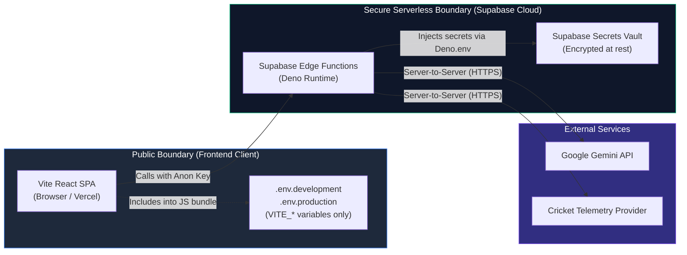

# FanPulse AI — Environment Setup & Secret Management Guide

> Comprehensive operational guide for configuring local development and production environments.
> Companion to [SYSTEM_ARCHITECTURE.md](file:///U:/Fanpulse_AI/docs/SYSTEM_ARCHITECTURE.md) and [SUPABASE_ARCHITECTURE.md](file:///U:/Fanpulse_AI/docs/SUPABASE_ARCHITECTURE.md).

---

## 1. Architecture Overview & Environment Boundary

FanPulse AI enforces a strict boundary between public frontend parameters and server-side secrets:



### Parameter Classification & Security Rules

| Variable Name | Scope / Target | Exposure Risk | Purpose |
| :--- | :--- | :--- | :--- |
| **`VITE_APP_NAME`** | Frontend (`frontend/.env.*`) | **Public** | App brand name displayed in header and page title |
| **`VITE_SUPABASE_URL`** | Frontend (`frontend/.env.*`) | **Public** | Supabase Project API endpoint |
| **`VITE_SUPABASE_ANON_KEY`** | Frontend (`frontend/.env.*`) | **Public** | Public client anonymous key (guarded by Row Level Security) |
| **`VITE_API_BASE_URL`** | Frontend (`frontend/.env.*`) | **Public** | Gateway URL to Supabase Edge Functions (`/functions/v1`) |
| **`SUPABASE_SERVICE_ROLE_KEY`** | Edge Functions / Vault | **CRITICAL SECRET** | Bypasses Row Level Security for deterministic score calculation |
| **`GEMINI_API_KEY`** | Edge Functions / Vault | **CRITICAL SECRET** | Authenticates with Google Gemini API for grounded cricket insights |
| **`CRICKET_DATA_API_KEY`** | Edge Functions / Vault | **CRITICAL SECRET** | Authenticates with future cricket match telemetry data provider |
| **`POSTGRES_PASSWORD`** | Supabase Cloud / Vault | **CRITICAL SECRET** | Direct database administrator password for migrations and DDL |

> [!CAUTION]
> **Zero Client Secret Rule:** Never prefix secrets with `VITE_`. Any variable prefixed with `VITE_` is compiled directly into static JavaScript files during `vite build` and can be inspected by anyone using browser developer tools.

---

## 2. Environment Templates (`.env.example`)

The codebase includes three version-controlled templates:
1. [`.env.example`](file:///U:/Fanpulse_AI/.env.example): Root repository overview.
2. [`frontend/.env.example`](file:///U:/Fanpulse_AI/frontend/.env.example): Frontend React client configuration.
3. [`supabase/.env.example`](file:///U:/Fanpulse_AI/supabase/.env.example): Backend database connection strings, pooling URLs, and Edge Function secrets.

---

## 3. Local Development Configuration

### Step 1: Configure Frontend Environment
1. Navigate to the `frontend/` directory.
2. Copy the template to `.env.development`:
   ```bash
   cd frontend
   cp .env.example .env.development
   ```
3. Populate `.env.development` with your Supabase development project parameters:
   ```env
   VITE_APP_NAME=FanPulse AI (Dev)
   VITE_SUPABASE_URL=https://your-dev-project.supabase.co
   VITE_SUPABASE_ANON_KEY=your-dev-anon-key
   VITE_API_BASE_URL=https://your-dev-project.supabase.co/functions/v1
   ```

### Step 2: Configure Supabase Backend & Database
1. Copy `supabase/.env.example` to `supabase/.env.local`:
   ```bash
   cp supabase/.env.example supabase/.env.local
   ```
2. Populate local database and API credentials (remember: `supabase/.env.local` is ignored by Git).

### Step 3: Run the Local Development Servers
```bash
# Start Frontend SPA (Runs on http://localhost:3000)
cd frontend
npm run dev
```

---

## 4. Production Deployment Configuration

### A. Frontend on Vercel
1. Link your GitHub repository to **Vercel**.
2. Set the **Root Directory** to `frontend`.
3. In the Vercel Project Dashboard under **Settings &rarr; Environment Variables**, add:
   - `VITE_APP_NAME`: `FanPulse AI`
   - `VITE_SUPABASE_URL`: `https://your-prod-project.supabase.co`
   - `VITE_SUPABASE_ANON_KEY`: `your-production-anon-key`
   - `VITE_API_BASE_URL`: `https://your-prod-project.supabase.co/functions/v1`
4. Deploy the project. The build command will execute `vite build`.

### B. Supabase Cloud Configuration
1. In the Supabase Dashboard, navigate to **Authentication &rarr; URL Configuration**:
   - **Site URL**: `https://fanpulse-ai.vercel.app`
   - **Redirect URLs**:
     - `http://localhost:3000/**` (for local development auth redirects)
     - `https://fanpulse-ai.vercel.app/**` (for production redirects)

---

## 5. Configuring Supabase Edge Function Secrets

Supabase Edge Functions do not read secrets from client bundles or Git repositories. Instead, secrets are securely managed in the encrypted **Supabase Secrets Vault** and exposed to functions at runtime via `Deno.env.get('SECRET_NAME')`.

### CLI Commands for Managing Secrets

#### 1. Authenticate Supabase CLI
```bash
npx supabase login
```

#### 2. Set Secrets for Remote Project
Deploy secrets directly to your Supabase project:
```bash
# Set Gemini API Key
npx supabase secrets set GEMINI_API_KEY="AIzaSy..." --project-ref <your-project-id>

# Set Service Role Key (if overriding default internal injection)
npx supabase secrets set SUPABASE_SERVICE_ROLE_KEY="eyJhbGci..." --project-ref <your-project-id>

# Set Cricket Data API Credentials
npx supabase secrets set CRICKET_DATA_API_KEY="cric_live_..." --project-ref <your-project-id>
npx supabase secrets set CRICKET_DATA_API_BASE_URL="https://api.cricapi.com/v1" --project-ref <your-project-id>

# Set Environment Tag
npx supabase secrets set ENVIRONMENT="production" --project-ref <your-project-id>
```

#### 3. View Existing Secrets
```bash
npx supabase secrets list --project-ref <your-project-id>
```
*(Values are masked for security).*

#### 4. Unset a Secret
```bash
npx supabase secrets unset CRICKET_DATA_API_KEY --project-ref <your-project-id>
```

### Accessing Secrets in Edge Functions
Within any Edge Function (e.g. `supabase/functions/ai-assistant/index.ts`):
```typescript
const geminiApiKey = Deno.env.get('GEMINI_API_KEY');
if (!geminiApiKey) {
  throw new Error('Missing GEMINI_API_KEY secret');
}
```

---

## 6. Git Ignore Verification & Protection Rules

The repository strictly enforces secret isolation via `.gitignore`:
- Any file matching `.env`, `.env.*`, `frontend/.env.*`, `supabase/.env.*` is ignored.
- Only `.env.example`, `frontend/.env.example`, and `supabase/.env.example` are committed as clean reference templates.
- Run `git status` before committing to verify that no `.env.local` or credential files appear in the staging area.
