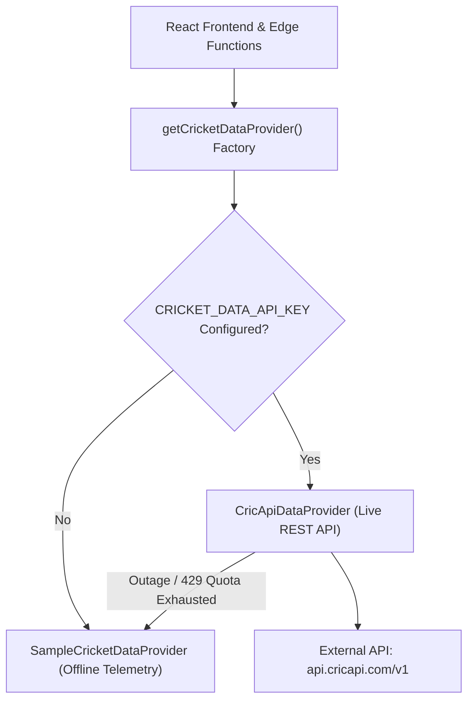

# FanPulse AI — External Cricket Data Provider Architecture & Integration Design

**Document ID:** `DOC-EXT-01`  
**Version:** `1.0.0`  
**Status:** Approved  
**Author:** Senior Integration Architect  
**References:** [DATABASE_DESIGN.md](file:///u:/Fanpulse_AI/docs/DATABASE_DESIGN.md), [API_DESIGN.md](file:///u:/Fanpulse_AI/docs/API_REFERENCE.md), [SYSTEM_ARCHITECTURE.md](file:///u:/Fanpulse_AI/docs/SYSTEM_ARCHITECTURE.md#L711-L716), [ENVIRONMENT_SETUP.md](file:///u:/Fanpulse_AI/docs/ENVIRONMENT_SETUP.md#L142-L143)

---

## 1. Executive Summary & Architectural Objectives

FanPulse AI requires real-time and scheduled cricket telemetry to power live match center views, deterministic fantasy scoring recalculations, and grounded AI match commentary. 

In accordance with architectural principles:
1. **Dependency Inversion Principle**: The core application, scoring engine, and database layer must remain completely decoupled from any single external API vendor.
2. **Grounded Sample Fallback**: If an external provider key is not configured, or if the upstream provider experiences network outages or quota exhaustion, the system automatically falls back to the deterministic sample data provider with zero service degradation.
3. **Strict Licensing & Anti-Scraping Compliance**: Scraping HTML from restricted platforms (e.g. Cricbuzz, ESPNcricinfo) or circumventing paywalls is strictly prohibited. Integration is implemented exclusively through authorized, licensed REST API endpoints.
4. **Credential Isolation**: Upstream provider API keys are managed exclusively within server-side Edge Functions (`CRICKET_DATA_API_KEY`) and are never exposed to the client or leaked in logs.

---

## 2. Pre-Implementation Due Diligence & Provider Evaluation

### 2.1 Provider Selected: CricketData.org (formerly CricAPI)
Official Documentation: `https://cricketdata.org` and `https://cricapi.com`  
API Base URL: `https://api.cricapi.com/v1`

### 2.2 Permissions & Licensing
- **Authentication Model**: API key authenticated via HTTP query parameter (`apikey`) or authorization header.
- **Licensing Terms**: Developer and commercial tiers grant programmatic access to structured JSON data. Re-distribution of raw API responses as an upstream data broker is prohibited; usage within end-user applications, fantasy platforms, and AI synthesis is explicitly permitted.
- **Anti-Scraping Guarantee**: Communicates exclusively via documented REST endpoints. No DOM parsing, session spoofing, or HTML scraping is employed.

### 2.3 Pricing & Rate Limits
| Plan Tier | Pricing | Daily Request Quota ("Hits") | Deduplication Cache Window |
| :--- | :--- | :--- | :--- |
| **Lifetime Free** | `$0.00 / mo` | 100 hits / day | 10 seconds ("Free Hits") |
| **Plan S** | `$5.99 / mo` | 2,000 hits / day | 10 seconds |
| **Plan M** | `$12.99 / mo` | 10,000 hits / day | 10 seconds |
| **Plan L** | `$29.99 / mo` | 100,000 hits / day | 10 seconds |
| **Plan U** | `$64.99 / mo` | Unlimited hits / day | 10 seconds |

- **Header / Body Rate-Limit Telemetry**:
  - `info.hitsLimit`: Maximum daily quota.
  - `info.hitsToday` / `info.hitsUsed`: Requests consumed in the current 24-hour UTC cycle.
  - `info.hitsRemaining`: Calculated as $\max(0, \text{hitsLimit} - \text{hitsUsed})$.
- **Throttling Behavior**: When the daily quota is exhausted, the API returns HTTP 429 or `{ status: "failure", reason: "API rate limit reached" }`.

### 2.4 Available Endpoints Evaluated
1. **`/currentMatches`**:
   - *Query Parameters*: `apikey`, `offset`
   - *Payload*: Array of live, scheduled, and recently completed fixtures with current scores, teams, format, venue, and status.
2. **`/match_info`**:
   - *Query Parameters*: `apikey`, `id`
   - *Payload*: Granular match fixture metadata, toss decision, participating squads, and officials.
3. **`/match_scorecard`**:
   - *Query Parameters*: `apikey`, `id`
   - *Payload*: Full innings scorecard containing individual batter statistics (runs, balls, 4s, 6s, strike rate, dismissal text) and bowler statistics (overs, maidens, runs, wickets, economy).
4. **`/series`**:
   - *Query Parameters*: `apikey`, `offset`
   - *Payload*: List of bilateral series and international/domestic tournaments.
5. **`/players`**:
   - *Query Parameters*: `apikey`, `offset`, `search`
   - *Payload*: Athlete biographical data, batting style, bowling style.

### 2.5 Data Update Frequency & Polling Strategy
- **Live In-Play Matches**: Polled on an adaptive interval between **15 seconds and 30 seconds** during active innings (comfortably exceeding CricAPI's 10-second deduplication cache window while conserving daily hits).
- **Scheduled & Completed Matches**: Polled on-demand or on a 1-hour to 6-hour refresh interval.

---

## 3. Vendor-Agnostic Abstraction Architecture

The integration follows the Dependency Inversion Principle using a shared provider interface:



### 3.1 Core Interface Definition ([`types.ts`](file:///u:/Fanpulse_AI/supabase/functions/_shared/cricketProvider/types.ts))
```typescript
export interface CricketDataProvider {
  readonly name: string;
  readonly isLive: boolean;

  getMatches(options?: {
    status?: string;
    format?: string;
    limit?: number;
    offset?: number;
  }): Promise<NormalizedMatch[]>;

  getMatchDetail(matchId: string): Promise<NormalizedMatch | null>;

  getMatchScorecard(matchId: string): Promise<NormalizedScorecard | null>;

  getMetadata(): ProviderMetadata;
}
```

### 3.2 Concrete Implementations
1. **[`SampleCricketDataProvider`](file:///u:/Fanpulse_AI/supabase/functions/_shared/cricketProvider/sampleProvider.ts)**:
   - Returns deterministic, grounded sample data matching `DATABASE_DESIGN.md` fixtures (`m-ind-aus-t20`, `m-eng-sa-odi`, `m-nz-pak-t20`).
   - Acts as the baseline and emergency fallback during upstream outages.
2. **[`CricApiDataProvider`](file:///u:/Fanpulse_AI/supabase/functions/_shared/cricketProvider/cricApiProvider.ts)**:
   - Manages authorized HTTPS communication with CricketData.org.
   - Normalizes raw vendor JSON payloads into internal FanPulse AI domain models.
3. **[`providerFactory.ts`](file:///u:/Fanpulse_AI/supabase/functions/_shared/cricketProvider/providerFactory.ts)**:
   - Instantiates `CricApiDataProvider` when a valid key is present in `Deno.env.get('CRICKET_DATA_API_KEY')`.
   - Defaults cleanly to `SampleCricketDataProvider` otherwise.

---

## 4. Resilience, Retries, and Secret Sanitization

### 4.1 Timeout Handling
All external HTTP requests are guarded by an `AbortController` with an 8-second timeout (`timeoutMs: 8000`), preventing lingering connections from blocking Edge Function isolates.

### 4.2 Exponential Backoff Retry Strategy
- **Transient Failures (HTTP 5xx, Network Drops)**: Retried up to 2 times with exponential backoff and jitter:
  $$\text{Delay} = 300\text{ms} \times 2^{\text{attempt} - 1} + \text{random}(0, 150)\text{ms}$$
- **Non-Transient Failures (HTTP 4xx)**: Client errors (400 Bad Request, 401 Unauthorized, 404 Not Found) are **never** retried, avoiding quota waste.
- **Rate-Limit Handling (HTTP 429)**: Quota limits trigger an immediate circuit-breaker fallback to `SampleCricketDataProvider` without retrying.

### 4.3 Secret Sanitization in Logs
To prevent credential leaks, [`sanitizeUrlForLogging`](file:///u:/Fanpulse_AI/supabase/functions/_shared/cricketProvider/cricApiProvider.ts) redacts API keys before any URL string is passed to logging sinks:
```typescript
url.searchParams.set('apikey', '***REDACTED***');
```

---

## 5. Supabase Edge Function Integration ([`sync-cricket-data`](file:///u:/Fanpulse_AI/supabase/functions/sync-cricket-data/index.ts))

The `sync-cricket-data` Edge Function serves as the secure backend proxy:
- **`provider-status`**: Returns health metadata, active provider name, and rate limit statistics.
- **`get-live-matches`**: Returns normalized matches from the active provider.
- **`get-match-scorecard`**: Returns innings scorecard telemetry.
- **`sync-to-database`**: Restricted strictly to users holding the `ADMIN` role (`verifyAuth(req, { requiredRole: 'ADMIN' })`), upserting external fixtures directly into PostgreSQL `public.matches`.
