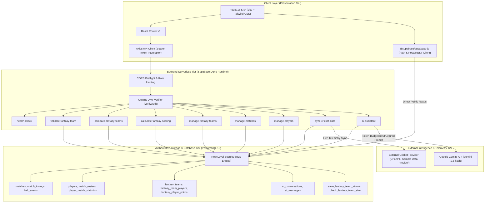
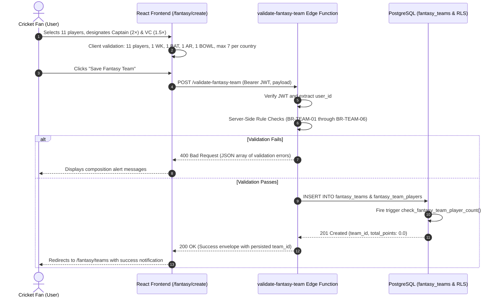
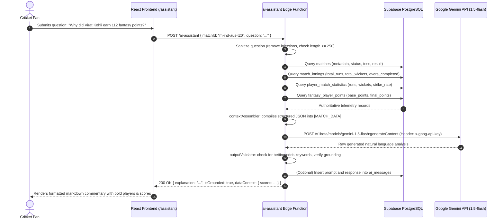

# FanPulse AI — System Architecture & Engineering Blueprint

**Project Title:** FanPulse AI — AI-Powered Cricket Match Intelligence and Fantasy Companion  
**Live URL:** [https://fanpulseai-nine.vercel.app/dashboard](https://fanpulseai-nine.vercel.app/dashboard)  
**Primary Stack:** React 18 (Vite) + Tailwind CSS + Supabase Edge Functions (Deno) + PostgreSQL 16 + Google Gemini API (`gemini-1.5-flash`)

---

## 1. High-Level Architectural Decomposition

FanPulse AI is structured around a decoupled, serverless micro-services paradigm designed to solve cricket fan fragmentation.

---

## 2. Decoupled Subsystem Architecture

The platform separates arithmetic evaluation from natural language processing to guarantee factual integrity:

### Subsystem A: Deterministic Fantasy Scoring Engine
* **Rule:** Fantasy points, multipliers, and leaderboards are **never** generated or predicted by LLMs.
* **Mechanism:** All point calculations are computed strictly by server-side business logic in [`calculate-fantasy-scoring`](file:///U:/Fanpulse_AI/supabase/functions/calculate-fantasy-scoring/index.ts) and [`_shared/scoring/index.ts`](file:///U:/Fanpulse_AI/supabase/functions/_shared/scoring/index.ts).
* **Mathematical Formula:**
  $$\text{Final Points} = \text{Multiplier} \times \left( \sum \text{Batting Points} + \sum \text{Bowling Points} + \sum \text{Fielding Points} \right)$$
* **Multipliers:** Designated Captain receives **2.0×** points; designated Vice-Captain receives **1.5×** points; all other players receive **1.0×**.
* **Audit Trail:** Every point calculation is saved in `public.fantasy_player_points` with a full JSON breakdown (`breakdown_json`) and logged in `scoring_audit_logs`.

### Subsystem B: AI Match Assistant (Grounded Gemini Integration)
* **Rule:** The LLM does not speculate on fantasy rules, invent numbers, or guess unrecorded statistics.
* **Mechanism:** When a query arrives, [`contextAssembler.ts`](file:///U:/Fanpulse_AI/supabase/functions/_shared/ai/contextAssembler.ts) queries authoritative PostgreSQL tables (`matches`, `match_innings`, `player_match_statistics`, `fantasy_player_points`) and injects them into a structured `[MATCH_DATA]` envelope.
* **Model Configuration:**
  - Model: `gemini-1.5-flash`
  - Temperature: `0.2` (low temperature eliminates creative extrapolation)
  - Max Output Tokens: `800`
  - Timeout: `12,000ms` with circuit breaker protection
* **Guardrails:** Pre-prompt query sanitation rejects prompt injections. Post-generation validation via [`outputValidator.ts`](file:///U:/Fanpulse_AI/supabase/functions/_shared/ai/outputValidator.ts) sanitizes betting/gambling terminology.

---

## 3. Detailed Data Flow Sequence Diagrams

### 3.1 Fantasy Team Drafting & Server-Side Validation Flow

### 3.2 AI Match Assistant Grounded Telemetry Flow

---

## 4. Supabase Edge Functions Catalog

All 9 Edge Functions reside in `supabase/functions/` and are built for the Deno Edge Runtime with native TypeScript and ESM imports mapped via `import_map.json`:

| # | Function Name | Method | Public / Protected | Primary Tables Accessed | Purpose |
|:---:|:---|:---:|:---:|:---|:---|
| 1 | `health-check` | `GET` | Public (`--no-verify-jwt`) | `matches` (read probe) | Service heartbeat, environment check, database latency probe. |
| 2 | `validate-fantasy-team` | `POST` | Public / Hybrid Auth | `fantasy_teams`, `fantasy_team_players` | Validates 11-player lineup rules (BR-TEAM-01 to 06) and persists team if authenticated. |
| 3 | `compare-fantasy-teams` | `GET, POST` | Protected (JWT) | `fantasy_teams`, `fantasy_team_players`, `fantasy_player_points` | Batched side-by-side squad differential comparison. |
| 4 | `calculate-fantasy-scoring` | `POST, GET` | Admin / Service Role | `matches`, `scoring_rules`, `player_match_statistics`, `fantasy_player_points` | Deterministic recalculation of player & team points for a match fixture. |
| 5 | `manage-fantasy-teams` | `GET, POST, PUT, DELETE` | Protected (JWT) | `fantasy_teams`, `fantasy_team_players` | Full CRUD operations for user fantasy squads. |
| 6 | `manage-matches` | `POST, PUT, PATCH` | Admin Only | `matches`, `teams` | Fixture creation, score updates, and match status lifecycle. |
| 7 | `manage-players` | `POST, PUT, PATCH` | Admin Only | `players`, `player_career_statistics` | Master athlete registry management. |
| 8 | `sync-cricket-data` | `POST, GET` | Admin / Internal | `matches`, `player_match_statistics`, `match_innings` | External provider polling with sample provider fallback. |
| 9 | `ai-assistant` | `POST` | Public / Hybrid Auth | `matches`, `match_innings`, `player_match_statistics`, `ai_conversations`, `ai_messages` | Context-grounded Gemini conversational query engine. |

---

## 5. Security & Boundary Enforcement

1. **Zero Credential Exposure:**
   - `GEMINI_API_KEY` is injected exclusively into the `ai-assistant` Deno environment via Supabase Secrets.
   - Frontend client uses only `VITE_SUPABASE_ANON_KEY` (public publishable key). Service-role keys and database passwords never leave the serverless runtime.
2. **Row-Level Security (RLS):**
   - Direct PostgREST queries from the frontend are governed by PostgreSQL policies (`auth.uid() = user_id`). Users cannot read, modify, or delete another user's fantasy squads.
3. **Transport Security:**
   - All client-to-edge and edge-to-database communication occurs over TLS 1.3.
4. **Anti-Injection & Guardrails:**
   - All user prompts undergo input sanitization to strip control characters and block prompt injection patterns (e.g., `"ignore previous instructions"`, `"system prompt"`).
