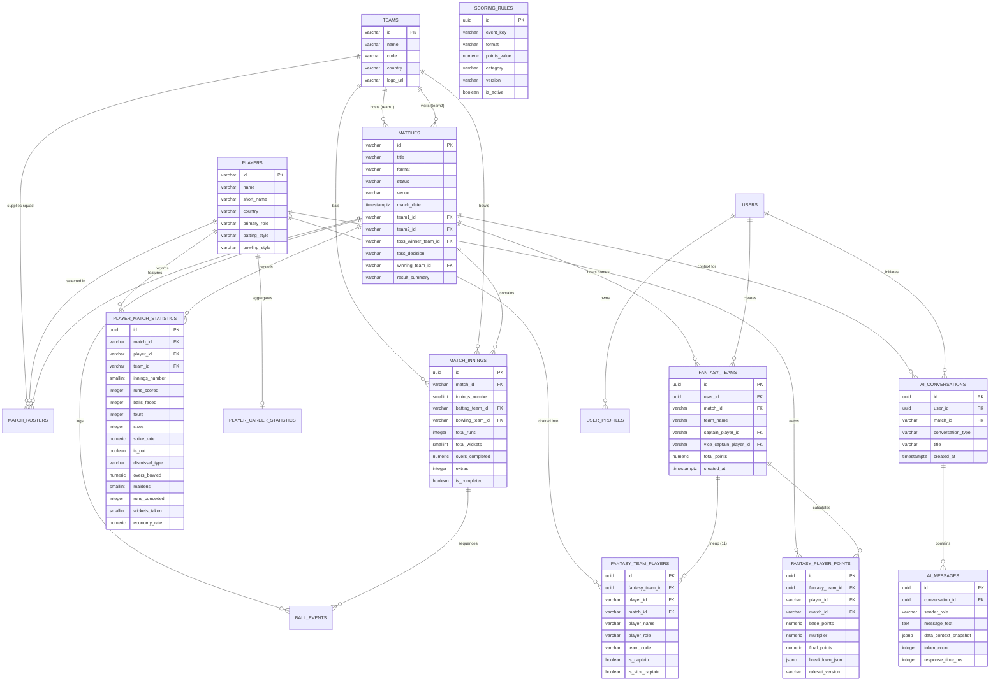

# FanPulse AI — Database Schema & Relational Design

**Database Engine:** PostgreSQL 16 (Supabase Managed Cloud)  
**Schema Definition:** 9 Sequential Applied Migrations (`supabase/migrations/`)  
**Project ID:** `zovgiiqamqfbqiopkooc`  
**Security Model:** PostgREST API with PostgreSQL Row-Level Security (RLS)

---

## 1. Architectural Overview

The FanPulse AI database design prioritizes:
1. **Strict Relational Integrity:** Enforces primary and foreign key constraints across all cricket telemetry and fantasy structures with explicit cascade and restrict delete rules.
2. **Domain Decoupling:** Separates official cricket telemetry (`matches`, `innings`, `stats`) from user fantasy assets (`fantasy_teams`, `fantasy_player_points`) and AI conversational threads (`ai_conversations`, `ai_messages`).
3. **Optimized Query Performance:** Uses composite indexes for sorted match/status queries and a GIN trigram index on player names for fast substring searches.
4. **Row-Level Security (RLS):** Guarantees zero cross-tenant data leakage by enforcing user ownership checks at the PostgreSQL engine level.

---

## 2. Entity-Relationship (ER) Diagram

---

## 3. Table Catalog & Detailed DDL Analysis

### 3.1 `teams` (Master Team Entity)
* **Purpose:** Stores national and franchise cricket teams.
* **Primary Key:** `id` (VARCHAR(100), e.g., `'team-ind'`, `'team-aus'`).
* **Columns:** `name` (VARCHAR(100)), `code` (VARCHAR(10)), `country` (VARCHAR(100)), `logo_url` (VARCHAR(500)), `created_at` (TIMESTAMPTZ).
* **Constraints:** `UNIQUE(code)`.

### 3.2 `players` (Master Athlete Catalog)
* **Purpose:** Authoritative cricket player registry.
* **Primary Key:** `id` (VARCHAR(100), e.g., `'p-virat-k'`).
* **Columns:** `name` (VARCHAR(100)), `short_name` (VARCHAR(50)), `country` (VARCHAR(100)), `primary_role` (VARCHAR(30)), `batting_style` (VARCHAR(50)), `bowling_style` (VARCHAR(50)), `image_url` (VARCHAR(500)), `created_at` (TIMESTAMPTZ).
* **Constraints:** `CHECK (primary_role IN ('BATTER', 'BOWLER', 'ALL_ROUNDER', 'WICKET_KEEPER'))`.
* **Indexes:** GIN Trigram index `idx_players_name_trgm` on `name` for substring search; composite B-Tree `idx_players_role_name` on `(primary_role, name ASC)`.

### 3.3 `matches` (Match Fixture Records)
* **Purpose:** Schedules, statuses, and live outcomes of cricket fixtures.
* **Primary Key:** `id` (VARCHAR(100), e.g., `'m-ind-aus-t20'`).
* **Foreign Keys:**
  - `team1_id` → `teams(id)`
  - `team2_id` → `teams(id)`
  - `toss_winner_team_id` → `teams(id)`
  - `winning_team_id` → `teams(id)`
* **Columns:** `title` (VARCHAR(200)), `format` (VARCHAR(20) CHECK `'T20' | 'ODI' | 'TEST'`), `status` (VARCHAR(20) CHECK `'UPCOMING' | 'LIVE' | 'COMPLETED' | 'ABANDONED'`), `venue` (VARCHAR(200)), `match_date` (TIMESTAMPTZ), `toss_decision` (VARCHAR(10) CHECK `'BAT' | 'FIELD'`), `result_summary` (VARCHAR(255)).
* **Indexes:** Composite `idx_matches_status_date` on `(status, match_date DESC)`.

### 3.4 `match_rosters` (Official Match Squads)
* **Purpose:** Pre-declared 11-to-15 player match squads for competing teams.
* **Primary Key:** `id` (UUID DEFAULT `gen_random_uuid()`).
* **Foreign Keys:** `match_id` → `matches(id)`, `player_id` → `players(id)`, `team_id` → `teams(id)`.
* **Constraints:** `UNIQUE(match_id, player_id)`.

### 3.5 `match_innings` (Innings Telemetry)
* **Purpose:** Scoreboard totals and run rates for completed or ongoing innings.
* **Primary Key:** `id` (UUID DEFAULT `gen_random_uuid()`).
* **Foreign Keys:** `match_id` → `matches(id)`, `batting_team_id` → `teams(id)`, `bowling_team_id` → `teams(id)`.
* **Columns:** `innings_number` (SMALLINT CHECK 1–4), `total_runs` (INTEGER >= 0), `total_wickets` (SMALLINT CHECK 0–10), `overs_completed` (NUMERIC(4,1) >= 0.0), `extras` (INTEGER >= 0), `is_declared` (BOOLEAN), `is_completed` (BOOLEAN).
* **Constraints:** `UNIQUE(match_id, innings_number)`.

### 3.6 `player_match_statistics` (Scorecard Details)
* **Purpose:** Batting, bowling, and fielding metrics recorded per player per match.
* **Primary Key:** `id` (UUID DEFAULT `gen_random_uuid()`).
* **Foreign Keys:** `match_id` → `matches(id)`, `player_id` → `players(id)`, `team_id` → `teams(id)`.
* **Columns:** `innings_number` (SMALLINT), `runs_scored` (INT), `balls_faced` (INT), `fours` (INT), `sixes` (INT), `strike_rate` (NUMERIC(6,2)), `is_out` (BOOL), `dismissal_type` (VARCHAR(30)), `overs_bowled` (NUMERIC(4,1)), `maidens` (SMALLINT), `runs_conceded` (INT), `wickets_taken` (SMALLINT), `economy_rate` (NUMERIC(5,2)), `catches` (SMALLINT), `stumpings` (SMALLINT), `run_outs` (SMALLINT).
* **Constraints:** `UNIQUE(match_id, player_id, innings_number)`. `CHECK (dismissal_type IN ('BOWLED', 'CAUGHT', 'LBW', 'RUN_OUT', 'STUMPED', 'NOT_OUT', 'RETIRED_HURT') OR dismissal_type IS NULL)`.

### 3.7 `ball_events` (Ball-by-Ball Feed)
* **Purpose:** Granular ball-by-ball telemetry stream.
* **Primary Key:** `id` (UUID).
* **Foreign Keys:** `match_id` → `matches(id)`, `batsman_id` → `players(id)`, `bowler_id` → `players(id)`.
* **Columns:** `over_number` (SMALLINT), `ball_number` (SMALLINT), `runs_scored` (SMALLINT), `extras` (SMALLINT), `is_wicket` (BOOL), `is_four` (BOOL), `is_six` (BOOL), `commentary` (TEXT).

### 3.8 `scoring_rules` (Deterministic Configuration)
* **Purpose:** Version-controlled point weights for cricket events.
* **Primary Key:** `id` (UUID).
* **Columns:** `event_key` (VARCHAR(50)), `format` (VARCHAR(20) DEFAULT `'ALL'`), `points_value` (NUMERIC(6,2)), `category` (VARCHAR(30) CHECK `'BATTING' | 'BOWLING' | 'FIELDING' | 'BONUS'`), `version` (VARCHAR(20) DEFAULT `'v1.0'`), `is_active` (BOOLEAN).
* **Constraints:** `UNIQUE(event_key, format, version)`.

### 3.9 `fantasy_teams` (User Fantasy Squads)
* **Purpose:** Custom fantasy rosters submitted by fans.
* **Primary Key:** `id` (UUID DEFAULT `gen_random_uuid()`).
* **Foreign Keys:**
  - `user_id` → `auth.users(id)` ON DELETE CASCADE
  - `match_id` → `matches(id)` ON DELETE CASCADE
  - `captain_player_id` → `players(id)` ON DELETE RESTRICT
  - `vice_captain_player_id` → `players(id)` ON DELETE RESTRICT
* **Columns:** `team_name` (VARCHAR(100)), `total_points` (NUMERIC(8,2) DEFAULT 0.0), `created_at` (TIMESTAMPTZ), `updated_at` (TIMESTAMPTZ).
* **Constraints:** `UNIQUE(user_id, match_id, team_name)`. `CHECK (captain_player_id != vice_captain_player_id)`.

### 3.10 `fantasy_team_players` (Squad Lineup Elements)
* **Purpose:** Join entity binding 11 athletes into a user's fantasy team.
* **Primary Key:** `id` (UUID).
* **Foreign Keys:** `fantasy_team_id` → `fantasy_teams(id)` ON DELETE CASCADE, `player_id` → `players(id)` ON DELETE RESTRICT, `match_id` → `matches(id)` ON DELETE CASCADE.
* **Columns:** `player_name` (VARCHAR(100)), `player_role` (VARCHAR(30)), `team_code` (VARCHAR(10)), `is_captain` (BOOL), `is_vice_captain` (BOOL).
* **Trigger:** `trg_check_fantasy_team_size` fires after insert/update to strictly enforce `COUNT(*) <= 11`.

### 3.11 `fantasy_player_points` (Authoritative Point Ledger)
* **Purpose:** Audit-logged, pre-calculated points per athlete per user fantasy team.
* **Primary Key:** `id` (UUID).
* **Foreign Keys:** `fantasy_team_id` → `fantasy_teams(id)` ON DELETE CASCADE, `player_id` → `players(id)`, `match_id` → `matches(id)`.
* **Columns:** `base_points` (NUMERIC(7,2)), `multiplier` (NUMERIC(3,1) CHECK IN `1.0, 1.5, 2.0`), `final_points` (NUMERIC(7,2)), `breakdown_json` (JSONB), `ruleset_version` (VARCHAR(20)), `calculated_at` (TIMESTAMPTZ).

### 3.12 `ai_conversations` & `ai_messages` (AI Intelligence Storage)
* **Purpose:** Chat threads and message exchanges between users and the AI Assistant.
* **Foreign Keys:**
  - `ai_conversations.user_id` → `auth.users(id)`
  - `ai_conversations.match_id` → `matches(id)`
  - `ai_messages.conversation_id` → `ai_conversations(id)` ON DELETE CASCADE
* **Columns:** `data_context_snapshot` (JSONB containing exact match state), `token_count` (INT), `response_time_ms` (INT).

---

## 4. Row Level Security (RLS) Policy Matrix

| Table Name | Operation | Policy Definition (PostgreSQL `USING` / `WITH CHECK`) | Target Role |
|:---|:---:|:---|:---:|
| `matches`, `teams`, `players` | `SELECT` | `true` (Publicly readable by all users) | `anon`, `authenticated` |
| `matches`, `teams`, `players` | `INSERT/UPDATE/DELETE` | `auth.jwt() ->> 'role' = 'ADMIN'` or `service_role` | `service_role` |
| `fantasy_teams` | `SELECT` | `auth.uid() = user_id` | `authenticated` |
| `fantasy_teams` | `INSERT/UPDATE/DELETE` | `auth.uid() = user_id` | `authenticated` |
| `fantasy_team_players` | `SELECT` | `EXISTS (SELECT 1 FROM fantasy_teams ft WHERE ft.id = fantasy_team_players.fantasy_team_id AND ft.user_id = auth.uid())` | `authenticated` |
| `fantasy_player_points` | `SELECT` | `EXISTS (SELECT 1 FROM fantasy_teams ft WHERE ft.id = fantasy_player_points.fantasy_team_id AND ft.user_id = auth.uid())` | `authenticated` |
| `ai_conversations` | `ALL` | `auth.uid() = user_id` | `authenticated` |
| `ai_messages` | `ALL` | `EXISTS (SELECT 1 FROM ai_conversations c WHERE c.id = ai_messages.conversation_id AND c.user_id = auth.uid())` | `authenticated` |
