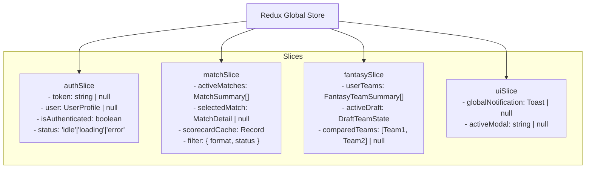

# FanPulse AI — Frontend UI/UX & Architecture Specification

> Comprehensive React, TypeScript, and Tailwind CSS frontend system design for FanPulse AI.
> Derived from [PROJECT_VISION.md](file:///U:/Fanpulse_AI/docs/PROJECT_VISION.md), [REQUIREMENTS.md](file:///U:/Fanpulse_AI/docs/REQUIREMENTS.md), [SYSTEM_ARCHITECTURE.md](file:///U:/Fanpulse_AI/docs/SYSTEM_ARCHITECTURE.md), [TECHNOLOGY_STACK.md](file:///U:/Fanpulse_AI/docs/TECHNOLOGY_STACK.md), and [API_DESIGN.md](file:///u:/Fanpulse_AI/docs/API_REFERENCE.md).

---

## 1. Design System & Brand Identity

FanPulse AI adopts a **dark-mode first, high-performance athletic aesthetic** tailored for modern sports enthusiasts. It combines deep slate surfaces with high-energy cricket green accents, electric amber multipliers, and crisp typography to deliver real-time data clarity without visual clutter.

### 1.1 Color Palette

```
Surface Backgrounds:  [#0B0F19] Midnight Pitch  ->  [#111827] Card Surface  ->  [#1F2937] Elevated Card
Brand Primary:        [#10B981] Emerald 500     ->  [#059669] Pitch Green   ->  [#047857] Deep Green
Brand Secondary:      [#F59E0B] Electric Amber  ->  [#D97706] Gold Glow     ->  [#B45309] Bronze
Status Accents:       [#EF4444] Live Red        ->  [#3B82F6] Info Blue     ->  [#6B7280] Muted Grey
```

| Token Name | Hex Code | Tailwind Utility | UI Usage |
|---|---|---|---|
| `bg-pitch-dark` | `#0B0F19` | `bg-slate-950` | Root background across all views. |
| `bg-card-dark` | `#111827` | `bg-gray-900` | Primary container cards, scorecards, and panels. |
| `bg-card-hover` | `#1F2937` | `bg-gray-800` | Card hover states, modal bodies, table headers. |
| `border-subtle` | `#374151` | `border-gray-700` | Borders for cards, dividers, input outlines. |
| `primary-accent` | `#10B981` | `text-emerald-500` / `bg-emerald-600` | Primary CTAs, active tabs, winning team badge. |
| `primary-hover` | `#059669` | `bg-emerald-700` | Primary button hover state. |
| `secondary-gold`| `#F59E0B` | `text-amber-500` / `bg-amber-500` | Captain (2x) badge, high scores, key awards. |
| `secondary-silver`| `#94A3B8` | `text-slate-400` / `bg-slate-400` | Vice-Captain (1.5x) badge. |
| `status-live` | `#EF4444` | `bg-red-500` / `text-red-400` | "LIVE" pulsing badge on match cards. |
| `status-upcoming`| `#3B82F6` | `bg-blue-500` / `text-blue-400` | "UPCOMING" scheduled match badges. |
| `status-completed`| `#10B981`| `bg-emerald-500` / `text-emerald-400`| "FINAL" match result badges. |
| `text-primary` | `#F9FAFB` | `text-gray-50` | Primary headings, match titles, player names. |
| `text-secondary`| `#D1D5DB` | `text-gray-300` | Body text, scorecard figures, tabular statistics. |
| `text-muted` | `#9CA3AF` | `text-gray-400` | Captions, dates, venues, secondary labels. |

---

### 1.2 Typography Hierarchy

* **Primary Font Family:** `Inter`, system-ui, sans-serif (exceptional legibility for compact data tables and mobile screens).
* **Display / Athletic Score Font:** `Oswald` or `Outfit` (condensed, high-impact numbers for overs, runs, and fantasy points).

| Role | Size | Weight | Line Height | CSS / Tailwind Classes |
|---|---|---|---|---|
| **Display Score** | 36px (2.25rem) | 800 (Extrabold) | 1.1 | `font-display text-4xl font-extrabold text-white` |
| **Page Title (H1)** | 28px (1.75rem) | 700 (Bold) | 1.25 | `text-2xl md:text-3xl font-bold text-white tracking-tight` |
| **Section Title (H2)**| 20px (1.25rem) | 600 (Semibold) | 1.3 | `text-xl font-semibold text-gray-100` |
| **Card Header (H3)** | 16px (1.0rem) | 600 (Semibold) | 1.4 | `text-base font-semibold text-gray-200` |
| **Body Standard** | 14px (0.875rem)| 400 (Regular) | 1.5 | `text-sm font-normal text-gray-300` |
| **Metric / Stat** | 14px (0.875rem)| 600 (Semibold) | 1.2 | `text-sm font-semibold text-white tabular-nums` |
| **Caption / Label** | 12px (0.75rem) | 500 (Medium) | 1.4 | `text-xs font-medium text-gray-400 uppercase tracking-wider`|

---

### 1.3 Elevation, Borders & Glassmorphism

* **Border Radius:** Default `rounded-xl` (12px) for cards and modals; `rounded-lg` (8px) for buttons and form inputs; `rounded-full` for badges and avatars.
* **Border Styling:** 1px solid border (`border border-gray-800 hover:border-gray-700`) across all elevated surfaces.
* **Card Glow:** Active/Live cards feature a subtle ambient glow: `shadow-lg shadow-emerald-950/20`.
* **Sticky Navigation Glass:** `backdrop-blur-md bg-gray-950/80 border-b border-gray-800`.

---

## 2. Reusable Component System

The frontend component library resides in `src/components/common/` and strictly avoids business logic:

```
src/components/common/
├── Button/          # Primary, Secondary, Outline, Danger, Ghost variants with loading states
├── Input/           # Labelled text, password, and search inputs with Zod error binding
├── Select/          # Styled dropdown selection with options
├── Card/            # Base container with optional hover elevation and header slot
├── Badge/           # Status chips (LIVE, UPCOMING, COMPLETED, Role tags)
├── Modal/           # Accessible portal modal with backdrop blur and escape key hook
├── Tabs/            # Controlled tabs bar with animated indicator
├── Table/           # Striped, accessible tabular data wrapper with responsive overflow
├── Skeleton/        # Shimmer skeleton loader cards, text lines, and tables
├── AlertBanner/     # Informative, warning, and error callout boxes
├── EmptyState/      # Contextual placeholder with icon, header, text, and action CTA
└── StatCard/        # Reusable metric card with title, big value, and delta indicator
```

---

## 3. Global Architecture & State Management

### 3.1 Redux Toolkit Store Topology

The Redux store (`src/app/store.ts`) handles global, multi-view session data, while ephemeral form drafts and modal toggles remain in React local state:



### 3.2 Axios Interceptor Pipeline

All API calls flow through a single Axios instance (`src/utils/apiClient.ts`):
1. **Request Interceptor:** Checks `store.getState().auth.token`. If present, injects `Authorization: Bearer <token>`.
2. **Response Interceptor:** 
   * On `2xx`: Returns data directly.
   * On `401 Unauthorized`: Dispatches `authSlice.actions.logout()`, clears `localStorage`, and triggers client redirect to `/login` with `returnUrl`.
   * On `403 Forbidden`: Emits notification "Access Denied: You do not have permission for this action."
   * On `503 Service Unavailable`: Specifically for AI endpoints, formats a friendly retryable error message without crashing surrounding UI (`NFR-REL-01`).

---

## 4. Component Hierarchy & Layout Shells

```mermaid
flowchart TD
    App["App Root (React Router Provider)"]
    
    subgraph Layouts
        MainLayout["MainLayout\n(Navbar + Sub-header + Content Outlet + Footer)"]
        AuthLayout["AuthLayout\n(Clean Centered Pitch Card Shell)"]
        AdminLayout["AdminLayout\n(Sidebar + Topbar + Admin Content Outlet)"]
    end

    App --> MainLayout
    App --> AuthLayout
    App --> AdminLayout

    subgraph MainPages["Main Pages"]
        Dashboard["Dashboard (Home)"]
        MatchCenter["Match Center (/matches)"]
        MatchDetails["Match Details (/matches/:id)"]
        PlayerDetails["Player Details (/players/:id)"]
        FantasyBuilder["Fantasy Team Builder (/matches/:id/fantasy/create)"]
        MyTeams["My Fantasy Teams (/my-teams)"]
        Comparison["Fantasy Comparison (/my-teams/compare)"]
        AiAssistant["AI Match Assistant (/matches/:id/ai-assistant)"]
        Profile["User Profile (/profile)"]
    end

    subgraph AuthPages["Auth Pages"]
        Login["Login (/login)"]
        Register["Registration (/register)"]
    end

    subgraph AdminPages["Admin Pages"]
        AdminDashboard["Admin Dashboard (/admin)"]
    end

    MainLayout --> Dashboard
    MainLayout --> MatchCenter
    MainLayout --> MatchDetails
    MainLayout --> PlayerDetails
    MainLayout --> FantasyBuilder
    MainLayout --> MyTeams
    MainLayout --> Comparison
    MainLayout --> AiAssistant
    MainLayout --> Profile

    AuthLayout --> Login
    AuthLayout --> Register

    AdminLayout --> AdminDashboard
```



---

## 5. Detailed Page Specifications

---

### Page 1: Login

* **Route:** `/login`
* **Layout:** `AuthLayout` (Clean, centered card with subtle cricket pitch background motif).
* **Access Level:** Public (Redirects to `/` if already authenticated).
* **Requirement Mapped:** `FR-AUTH-03`, `FR-AUTH-04`, `UC-02`.

#### 1. Purpose
Provides a secure authentication gateway for returning users to access their fantasy teams, drafting tools, and AI match insights.

#### 2. Main Components
* `AuthCard`: Centered container with FanPulse AI logo and welcome text.
* `LoginForm`: React Hook Form bound with Zod schema (`email`, `password`).
* `EmailInput`: Controlled input with auto-complete `username`.
* `PasswordInput`: Input with toggleable show/hide eye icon.
* `SubmitButton`: Full-width primary CTA with loading spinner.
* `RegisterLink`: Navigation link pointing to `/register`.

#### 3. User Interactions
* User types email and password; inputs validate on blur.
* Submitting triggers `POST /api/v1/auth/login`.
* On success: JWT is stored in Redux + `localStorage`, and user is redirected to the `returnUrl` (or `/`).
* On failure: Inline banner displays "Invalid email or password."

#### 4. API Dependencies
* `POST /api/v1/auth/login` (`LoginRequest` -> `AuthResponse`).

#### 5. States
* **Loading State:** Button disables, displays spinner and text "Authenticating...". Inputs are disabled.
* **Error State:** Red alert banner above inputs: "Invalid email or password. Please try again."
* **Empty State:** N/A (Form defaults with clean, empty inputs).
* **Responsive Behavior:** 
  * Mobile (<768px): Card fills 100% viewport width with 16px side padding.
  * Desktop (>=1024px): Max-width `420px` floating centered card with elevated drop shadow.

---

### Page 2: Registration

* **Route:** `/register`
* **Layout:** `AuthLayout`.
* **Access Level:** Public.
* **Requirement Mapped:** `FR-AUTH-01`, `FR-AUTH-02`, `FR-AUTH-05`, `UC-01`.

#### 1. Purpose
Enables new cricket fans to create an account with email, password, and chosen display name.

#### 2. Main Components
* `RegisterCard`: Centered branded card with step indicator.
* `RegisterForm`: React Hook Form with Zod validation.
* `DisplayNameInput`: Screen name input (2–50 chars).
* `EmailInput`: Email format validated input.
* `PasswordInput`: Password input with real-time strength checklist (8+ chars, 1 letter, 1 number).
* `SubmitButton`: "Create Account" CTA.
* `LoginLink`: Navigation link pointing to `/login`.

#### 3. User Interactions
* Real-time password strength checklist turns green as user types.
* Submitting dispatches `POST /api/v1/auth/register`.
* On success: Redirects to `/login` with an alert: "Account created successfully! Please sign in."
* On duplicate email: Inline error highlights the email input: "An account with this email already exists."

#### 4. API Dependencies
* `POST /api/v1/auth/register` (`RegisterRequest` -> `AuthResponse`).

#### 5. States
* **Loading State:** Button shows spinner "Creating Account...".
* **Error State:** Inline validation error tags beneath each invalid field.
* **Empty State:** N/A.
* **Responsive Behavior:** Identical to Login page (responsive max-w-md container).

---

### Page 3: Dashboard (Home)

* **Route:** `/`
* **Layout:** `MainLayout`.
* **Access Level:** Public (Personalized fantasy widgets displayed if authenticated).
* **Requirement Mapped:** `FR-MATCH-01`, `FR-FANTASY-07`, `PROJECT_VISION.md §4`.

#### 1. Purpose
The central landing hub of FanPulse AI. Surfaces featured live and upcoming matches, quick links to user fantasy teams, and entry points into AI match explanations.

#### 2. Main Components
* `FeaturedMatchBanner`: Hero carousel spotlighting the top live match with animated score updates and "Create Team" / "AI Insights" quick buttons.
* `MatchRowSection`: Filterable horizontal scroll/grid of matches (Live, Upcoming, Completed).
* `MyQuickTeamsWidget` (Auth-only): Sidebar or grid showing user's top fantasy teams and current point totals.
* `AIInsightTeaser`: Prompt box enticing user to explore AI match explanations for completed fixtures.
* `QuickStatsLeaderboard`: Top run scorers and wicket takers across featured tournaments.

#### 3. User Interactions
* Clicking a match card navigates to `/matches/:matchId`.
* Clicking "Create Fantasy Team" navigates to `/matches/:matchId/fantasy/create`.
* Clicking "Explain Match" navigates to `/matches/:matchId/ai-assistant`.

#### 4. API Dependencies
* `GET /api/v1/matches?size=6`
* `GET /api/v1/fantasy-teams` (if authenticated)

#### 5. States
* **Loading State:** Skeleton hero banner with shimmering player avatars and placeholder scorecards.
* **Error State:** Banner with "Unable to load live dashboard feeds. [Retry]" button.
* **Empty State:** If no matches exist: "No matches scheduled today. Check back soon!" with a calendar illustration.
* **Responsive Behavior:**
  * Mobile (<768px): Single column stacked layout. Quick teams widget moves below match cards.
  * Tablet (768–1024px): 2-column card grid.
  * Desktop (>=1024px): 3-column layout (2 cols matches, 1 col user fantasy summary & AI teasers).

---

### Page 4: Match Center

* **Route:** `/matches`
* **Layout:** `MainLayout`.
* **Access Level:** Public.
* **Requirement Mapped:** `FR-MATCH-01`, `FR-MATCH-03`, `FR-MATCH-04`, `UC-03`.

#### 1. Purpose
Comprehensive catalog of all matches across formats (T20, ODI, Test) with real-time status filtering and search.

#### 2. Main Components
* `FilterBar`: Format pills (`ALL`, `T20`, `ODI`, `TEST`) and status tabs (`ALL`, `LIVE`, `UPCOMING`, `COMPLETED`).
* `SearchInput`: Search by country, franchise name, or venue.
* `MatchCardGrid`: Responsive grid of match summary cards.
  * Team logos, names, current scores, overs completed, status badge, venue, and start time.
  * "Scorecard" button and "Draft Team" action button.
* `PaginationControls`: Next/Previous page buttons with total match counters.

#### 3. User Interactions
* Clicking a status pill updates URL query params (`/matches?status=UPCOMING`) and triggers re-fetch.
* Search query debounces by 300ms before querying API.
* Clicking any card navigates to `/matches/:matchId`.

#### 4. API Dependencies
* `GET /api/v1/matches?status={}&format={}&page={}&size=12`

#### 5. States
* **Loading State:** 6-card shimmer skeleton grid maintaining layout integrity.
* **Error State:** Centered card with warning icon and retry trigger.
* **Empty State:** "No matches found matching your filters. [Reset Filters]".
* **Responsive Behavior:**
  * Mobile (<768px): Single-column cards with condensed scores.
  * Tablet (768–1024px): 2-column grid.
  * Desktop (>=1024px): 3-column grid with hover elevation and border illumination.

---

### Page 5: Match Details & Scorecard

* **Route:** `/matches/:matchId`
* **Layout:** `MainLayout`.
* **Access Level:** Public.
* **Requirement Mapped:** `FR-MATCH-02`, `FR-STATS-04`, `UC-03`.

#### 1. Purpose
The definitive single-match hub containing full 2-innings batting/bowling scorecards, ball-by-ball delivery timelines, and direct shortcuts to the AI Assistant and Fantasy Team Builder.

#### 2. Main Components
* `MatchHeader`: Deep score banner featuring both teams, flags, toss outcome, current run rate, and final match result string.
* `NavigationSubTabs`: Switching between `Scorecard`, `Ball-by-Ball`, `Squads`, and `Fantasy & AI`.
* `InningsAccordion / Tabs`: Toggle between 1st Innings and 2nd Innings.
* `BattingTable`: Runs, balls, 4s, 6s, strike rate, dismissal mode, fielder involvement. Clicking player opens modal or navigates to `/players/:playerId`.
* `BowlingTable`: Overs, maidens, runs conceded, wickets, economy rate.
* `FallOfWicketsTimeline`: Graphical or badge progression of wickets fallen.
* `BallByBallStream`: Reverse chronological stream of commentary and boundaries.

#### 3. User Interactions
* User switches between Innings 1 and Innings 2 using tab headers.
* User clicks on a player name in the scorecard to view player statistics.
* User clicks floating or embedded CTA "Draft Fantasy Team for this Match" or "AI Match Summary".

#### 4. API Dependencies
* `GET /api/v1/matches/{matchId}`
* `GET /api/v1/matches/{matchId}/scorecard`
* `GET /api/v1/matches/{matchId}/innings/{num}/balls`

#### 5. States
* **Loading State:** Skeleton table layout with pulsing rows and header banner placeholder.
* **Error State:** "Failed to load match scorecard. [Reload]".
* **Empty State:** For upcoming matches before toss: Scorecard section displays "Match has not started yet. Team lineups will appear once announced." with a countdown timer.
* **Responsive Behavior:**
  * Mobile (<768px): Scorecard tables enable horizontal scrolling (`overflow-x-auto`) with fixed player name column; sticky match score header stays pinned at top.
  * Desktop (>=1024px): Full-width tables with clear spacing, hover highlights on individual rows.

---

### Page 6: Player Details & Statistics

* **Route:** `/players/:playerId`
* **Layout:** `MainLayout`.
* **Access Level:** Public.
* **Requirement Mapped:** `FR-STATS-01`, `FR-STATS-02`, `FR-STATS-03`, `FR-STATS-05`, `UC-04`.

#### 1. Purpose
Displays an athlete's demographic profile, career batting and bowling aggregates, and recent match performance breakdowns.

#### 2. Main Components
* `PlayerHeroHeader`: Profile picture, full name, country emblem, primary playing role badge (`BATTER`, `BOWLER`, `ALL_ROUNDER`, `WICKET_KEEPER`), batting style, and bowling style.
* `CareerStatsCards`: Grid of 4 key metrics (Total Runs, Batting Average, Wickets, Economy Rate).
* `BattingStatsTable`: Matches, Innings, Runs, Highest Score, Average, Strike Rate, 100s, 50s.
* `BowlingStatsTable`: Matches, Overs, Wickets, Average, Economy, Best Bowling Figures.
* `RecentMatchesList`: Compact list of recent matches featuring this player with their individual match points and scores.

#### 3. User Interactions
* User toggles between Formats (`T20`, `ODI`, `TEST`) to view format-specific career stats.
* Clicking a recent match row navigates to `/matches/:matchId`.

#### 4. API Dependencies
* `GET /api/v1/players/{playerId}`
* `GET /api/v1/players/{playerId}/matches/{matchId}`

#### 5. States
* **Loading State:** Shimmering avatar circle, placeholder stat boxes, and skeleton tables.
* **Error State:** "Player profile not found. [Return to Players]".
* **Empty State:** If bowling stats are zero (e.g. pure batter): Bowling section displays "No international bowling records for this player."
* **Responsive Behavior:**
  * Mobile (<768px): Avatar centers above name; stat cards collapse to a 2x2 grid.
  * Desktop (>=1024px): Horizontal hero layout with career stat cards lined along the right side.

---

### Page 7: Fantasy Team Builder (Draft Wizard)

* **Route:** `/matches/:matchId/fantasy/create` and `/matches/:matchId/fantasy/edit/:teamId`
* **Layout:** `MainLayout`.
* **Access Level:** Authenticated (`ROLE_USER` or `ROLE_ADMIN`).
* **Requirement Mapped:** `FR-FANTASY-01` through `FR-FANTASY-06`, `BR-TEAM-01` through `BR-TEAM-06`, `UC-05`.

#### 1. Purpose
The core fantasy creation workspace where users draft an 11-player lineup from both competing squads adhering to strict composition constraints, and assign their Captain and Vice-Captain.

#### 2. Main Components
* `DraftProgressHeader`: Sticky top banner displaying:
  * Selected Count counter: **`X / 11 Players`** with circular progress bar.
  * Team distribution counter (e.g. `IND: 6 | AUS: 5`).
  * Role requirement checklist badges (`WK >= 1`, `BAT >= 1`, `AR >= 1`, `BOWL >= 1`). Turns green when satisfied.
* `RoleFilterTabs`: Tabs to filter pool by `WK`, `BAT`, `AR`, `BOWL`.
* `AvailablePlayerPool`: List/grid of eligible players with selection checkboxes/buttons, player team badge, credit/stats indicator, and selection status.
* `SelectedTeamDrawer / PitchView`: Visual cricket field view showing chosen 11 players in their field positions.
* `CaptainSelectorModal / Step`: Triggered when 11 players are picked. Allows user to select Captain (2.0x points badge) and Vice-Captain (1.5x points badge). Enforces `captain <> viceCaptain`.
* `TeamNameInput`: Form input for naming the squad (`teamName`).
* `SaveTeamButton`: Primary CTA, disabled until all 11 players and roles are fully valid.

#### 3. User Interactions
* User clicks "+" on a player row to add them to draft; selected count increments.
* If user attempts to add a 12th player, system displays a toast: "Team full: You can only select 11 players."
* If user attempts to pick all players from one team, validation warns: "Must include players from both teams."
* Clicking "Next: Choose Captain" opens role selection view.
* User clicks (C) and (VC) radio pills on distinct players.
* Submitting dispatches `POST /api/v1/fantasy-teams` or `PUT /api/v1/fantasy-teams/:id`.
* On success: Redirects to `/my-teams` with success toast.

#### 4. API Dependencies
* `GET /api/v1/matches/{matchId}` (fetches official match rosters)
* `POST /api/v1/fantasy-teams` (Create)
* `PUT /api/v1/fantasy-teams/{teamId}` (Update)

#### 5. States
* **Loading State:** Skeleton player pool rows with loading shimmer.
* **Error State:** If match is not `UPCOMING`: Screen locks with alert: "Team creation is closed. This match has already commenced."
* **Validation Failure:** Specific error banner listing unmet constraints (e.g., "Select at least 1 Wicket-Keeper").
* **Responsive Behavior:**
  * Mobile (<768px): Sticky bottom drawer displays current player count (`7/11`) and "View Lineup" button; clicking expands full-screen pitch view sheet.
  * Desktop (>=1024px): Split view — left 60% shows filterable player selection pool; right 40% shows sticky visual pitch preview with live role counters.

---

### Page 8: My Fantasy Teams

* **Route:** `/my-teams`
* **Layout:** `MainLayout`.
* **Access Level:** Authenticated (`ROLE_USER` or `ROLE_ADMIN`).
* **Requirement Mapped:** `FR-FANTASY-07`, `FR-SCORE-03`, `FR-SCORE-04`, `UC-06`.

#### 1. Purpose
Management dashboard allowing fans to review all their created fantasy teams, track live/final fantasy points, and trigger team comparisons.

#### 2. Main Components
* `MatchGroupingAccordion`: Groups fantasy teams under their respective match fixture.
* `FantasyTeamCard`:
  * Custom team name, match status badge (`LOCKED`, `EDITABLE`, `COMPLETED`).
  * Big Total Score badge (`412.50 pts`).
  * Captain and Vice-Captain chips with their individual points.
  * Action buttons: "View Breakdown", "Edit Lineup" (hidden if locked), "Delete" (with confirm dialog), and "Compare".
* `TeamDetailsModal`: Modal revealing all 11 players, base points, multipliers, and total contribution.

#### 3. User Interactions
* Clicking "Edit Lineup" on an upcoming match navigates to `/matches/:matchId/fantasy/edit/:teamId`.
* Clicking "Delete" opens a confirmation modal and triggers `DELETE /api/v1/fantasy-teams/:id`.
* Selecting two teams and clicking "Compare Selected" navigates to `/my-teams/compare?team1Id={id}&team2Id={id}`.

#### 4. API Dependencies
* `GET /api/v1/fantasy-teams`
* `DELETE /api/v1/fantasy-teams/{teamId}`
* `GET /api/v1/fantasy-teams/{teamId}/points`

#### 5. States
* **Loading State:** 3 shimmer cards with placeholder badges.
* **Error State:** "Failed to load your fantasy teams. [Retry]".
* **Empty State:** If user has created 0 teams:
  * Graphic of a cricket bat and jersey.
  * Header: "No Fantasy Teams Created Yet".
  * Subtext: "Select an upcoming match from the Match Center and build your dream XI!"
  * Primary CTA Button: "Browse Matches" (links to `/matches`).
* **Responsive Behavior:**
  * Mobile (<768px): Stacked vertical cards; action buttons accessible via bottom kebab menu.
  * Desktop (>=1024px): 2-column card layout with instant modal preview.

---

### Page 9: Fantasy Team Comparison

* **Route:** `/my-teams/compare`
* **Layout:** `MainLayout`.
* **Access Level:** Authenticated (`ROLE_USER` or `ROLE_ADMIN`).
* **Requirement Mapped:** `FR-COMPARE-01` through `FR-COMPARE-04`, `UC-07`.

#### 1. Purpose
Side-by-side comparative analysis of two fantasy teams created for the same match, highlighting shared players, unique differentials, and point advantages.

#### 2. Main Components
* `ComparisonHeader`: Scoreboard showing Team 1 name & total score vs. Team 2 name & total score, with a glowing green banner over the winning/leading team.
* `NetPointsVarianceCard`: Large metric showing point differential (`+28.5 pts`) and key deciding factors.
* `TeamDropdownSelectors`: Quick selectors allowing user to switch compared teams on the fly.
* `SideBySidePlayerTable`: 3-section table:
  1. **Shared Players Section:** Players common to both teams, showing identical baseline points.
  2. **Team 1 Differentials:** Players selected exclusively in Team 1 with points gained.
  3. **Team 2 Differentials:** Players selected exclusively in Team 2 with points gained.
* `CaptainMultiplierComparison`: Dedicated card highlighting how captain choices influenced the point delta.

#### 3. User Interactions
* Changing either team dropdown automatically refreshes URL params and re-executes comparison.
* Hovering over a player reveals their itemized scoring breakdown tooltip.

#### 4. API Dependencies
* `GET /api/v1/fantasy-teams/compare?team1Id={id}&team2Id={id}`

#### 5. States
* **Loading State:** Dual-column skeleton comparison card with pulsing metric boxes.
* **Error State:** If teams belong to different matches: Red alert banner: "Invalid Comparison: Teams must belong to the exact same match fixture." with a button to select compatible teams.
* **Empty State:** "Select two teams from the dropdowns above to view their side-by-side breakdown."
* **Responsive Behavior:**
  * Mobile (<768px): Stacked toggle view with "Team 1" / "Team 2" tab switchers rather than cramped side-by-side columns.
  * Desktop (>=1024px): True split-screen side-by-side columns with color-coded differential rows.

---

### Page 10: AI Match Assistant & Insights

* **Route:** `/matches/:matchId/ai-assistant`
* **Layout:** `MainLayout`.
* **Access Level:** Authenticated (`ROLE_USER` or `ROLE_ADMIN`).
* **Requirement Mapped:** `FR-AI-01` through `FR-AI-06`, `FR-INSIGHT-01` through `FR-INSIGHT-03`, `BR-AI-01` through `BR-AI-03`, `UC-08`, `UC-09`, `UC-10`.

#### 1. Purpose
Interactive AI sports companion providing grounded match summaries, player performance evaluations, and turning-point narratives derived exclusively from verified match data.

#### 2. Main Components
* `AssistantHeader`: Active match banner with live score badge and AI grounding assurance notice ("Grounded in verified match statistics. No predictions or betting advice.").
* `PresetPromptPills`: One-click prompt chips:
  * "Summarize Match Situation"
  * "Explain Key Turning Points"
  * "Analyze Jasprit Bumrah's Impact"
  * "Why did the required rate spike?"
* `ConversationFeed`: Thread of user questions and AI explanations with Markdown rendering, bullet points, and highlighted player metrics.
* `DataContextBadge`: Attached to every AI response, showing the exact match snapshot used (`Data context: IND 186/5 (19.2 overs) at 20:00 UTC`).
* `QueryInputBar`: Text input with character counter (max 250 chars) and send button.

#### 3. User Interactions
* Clicking a preset prompt pill immediately sends the request.
* Typing a custom query (e.g. "How did India handle Australia's spinners?") and pressing Enter submits the question.
* User clicks "Copy Explanation" to share text.

#### 4. API Dependencies
* `POST /api/v1/ai/match-summary`
* `POST /api/v1/ai/player-insight`
* `POST /api/v1/ai/key-moments`

#### 5. States
* **Loading State:** Typing indicator / shimmer bubble with animated dots and text: "Analyzing match scorecards and momentum shifts...".
* **Graceful Degradation (503 Error):** If external LLM API fails, inline amber card displays: "Match explanation is temporarily unavailable. All match scorecards and fantasy points remain fully operational." with a [Retry] button (`NFR-REL-01`).
* **Upcoming Match State:** If match is not yet started: "AI Assistant is available once match play begins."
* **Responsive Behavior:**
  * Mobile (<768px): Chat window fills viewport with sticky bottom input bar above mobile navigation.
  * Desktop (>=1024px): Max-width `840px` centered editorial feed with clean typography and right-hand match summary panel.

---

### Page 11: User Profile

* **Route:** `/profile`
* **Layout:** `MainLayout`.
* **Access Level:** Authenticated (`ROLE_USER` or `ROLE_ADMIN`).
* **Requirement Mapped:** `FR-AUTH-08`.

#### 1. Purpose
Allows users to manage account information, change their public screen name, and review lifetime fantasy performance.

#### 2. Main Components
* `ProfileHeader`: User avatar, email address, role badge (`ROLE_USER`), and member registration date.
* `EditProfileForm`: Form to update `displayName` with Zod validation.
* `FantasyLifetimeSummary`: Card showing total teams drafted, total fantasy points accumulated, and best team finish.
* `SecurityCard`: Password update shortcut and active session indicator.
* `LogoutButton`: Danger outline button triggering logout confirmation modal.

#### 3. User Interactions
* User edits display name and clicks "Save Changes"; dispatches `PUT /api/v1/users/me`.
* Clicking "Log Out" dispatches `POST /api/v1/auth/logout`, clears tokens, and redirects to `/login`.

#### 4. API Dependencies
* `GET /api/v1/users/me`
* `PUT /api/v1/users/me`
* `POST /api/v1/auth/logout`

#### 5. States
* **Loading State:** Shimmering avatar and placeholder input boxes.
* **Success State:** Green toast: "Profile updated successfully."
* **Error State:** Validation error if display name is blank or invalid.
* **Responsive Behavior:** Standard responsive container (`max-w-2xl mx-auto`).

---

### Page 12: Admin Dashboard

* **Route:** `/admin`
* **Layout:** `AdminLayout` (Dedicated administrative sidebar with quick metrics).
* **Access Level:** Restricted (`ROLE_ADMIN` only; non-admins receive 403 Forbidden).
* **Requirement Mapped:** `ROLE-02`, `FR-MATCH-05`, `FR-STATS-06`, `FR-SCORE-05`.

#### 1. Purpose
Internal operational control center for managing matches, triggering scoring recalculations, and updating player rosters (MVP API-connected management hub).

#### 2. Main Components
* `AdminMetricsRow`: Total Users, Seeded Matches, Active Players, Fantasy Teams Drafted.
* `MatchManagementTable`: Table of matches with status toggles (`UPCOMING` -> `IN_PROGRESS` -> `COMPLETED`).
* `ManualScoreTriggerCard`: Quick tool to trigger `POST /api/v1/matches/:id/scoring/calculate` after data corrections.
* `SeedDataNotice`: Displays database seed status (`Supabase seed.sql active`).
* `PlayerManagementModal`: Modal to edit player roles or injury statuses.

#### 3. User Interactions
* Admin selects a match and clicks "Trigger Points Recalculation"; displays success notification with evaluated team count.
* Admin changes match status from dropdown; saves with instant table update.

#### 4. API Dependencies
* `GET /api/v1/matches`
* `POST /api/v1/matches/{matchId}/scoring/calculate`
* `POST /api/v1/matches` / `PUT /api/v1/matches/{matchId}`
* `POST /api/v1/players` / `PUT /api/v1/players/{playerId}`

#### 5. States
* **Access Denied State:** If a regular user navigates to `/admin`, the `AdminRoute` guard intercepts and renders a clean 403 Error Page with a "Return to Home" button.
* **Loading State:** Full admin table shimmer.
* **Responsive Behavior:**
  * Desktop (>=1024px): Primary intended viewport with full data tables and side management panel.
  * Mobile (<768px): Horizontal scrolling warning with condensed card views.

---

## 6. Routing Architecture & Route Guard Matrix

```tsx
// Declarative React Router Structure
<Routes>
  {/* Public / Auth Layout Routes */}
  <Route element={<AuthLayout />}>
    <Route path="/login" element={<PublicRoute><LoginPage /></PublicRoute>} />
    <Route path="/register" element={<PublicRoute><RegisterPage /></PublicRoute>} />
  </Route>

  {/* Main Layout Routes */}
  <Route element={<MainLayout />}>
    <Route path="/" element={<DashboardPage />} />
    <Route path="/matches" element={<MatchCenterPage />} />
    <Route path="/matches/:matchId" element={<MatchDetailsPage />} />
    <Route path="/players/:playerId" element={<PlayerDetailsPage />} />

    {/* Protected User Routes */}
    <Route path="/my-teams" element={<ProtectedRoute><MyTeamsPage /></ProtectedRoute>} />
    <Route path="/my-teams/compare" element={<ProtectedRoute><FantasyComparisonPage /></ProtectedRoute>} />
    <Route path="/matches/:matchId/fantasy/create" element={<ProtectedRoute><FantasyBuilderPage /></ProtectedRoute>} />
    <Route path="/matches/:matchId/fantasy/edit/:teamId" element={<ProtectedRoute><FantasyBuilderPage /></ProtectedRoute>} />
    <Route path="/matches/:matchId/ai-assistant" element={<ProtectedRoute><AiAssistantPage /></ProtectedRoute>} />
    <Route path="/profile" element={<ProtectedRoute><UserProfilePage /></ProtectedRoute>} />
  </Route>

  {/* Admin Restricted Layout Routes */}
  <Route element={<AdminLayout />}>
    <Route path="/admin" element={<AdminRoute><AdminDashboardPage /></AdminRoute>} />
  </Route>

  {/* Catch-all 404 */}
  <Route path="*" element={<NotFoundPage />} />
</Routes>
```

### Route Guard Verification Matrix

| Route Path | Page Component | Layout | Access Guard | Redirect on Failure |
|---|---|---|---|---|
| `/login` | `LoginPage` | `AuthLayout` | `PublicRoute` | Redirects to `/` if logged in |
| `/register` | `RegisterPage` | `AuthLayout` | `PublicRoute` | Redirects to `/` if logged in |
| `/` | `DashboardPage` | `MainLayout` | Public | None |
| `/matches` | `MatchCenterPage` | `MainLayout` | Public | None |
| `/matches/:matchId` | `MatchDetailsPage` | `MainLayout` | Public | None |
| `/players/:playerId`| `PlayerDetailsPage`| `MainLayout` | Public | None |
| `/my-teams` | `MyTeamsPage` | `MainLayout` | `ProtectedRoute` | Redirects to `/login?returnUrl=/my-teams` |
| `/my-teams/compare` | `FantasyComparisonPage`| `MainLayout`| `ProtectedRoute` | Redirects to `/login` |
| `/matches/:id/fantasy/create` | `FantasyBuilderPage` | `MainLayout` | `ProtectedRoute` | Redirects to `/login` |
| `/matches/:id/ai-assistant` | `AiAssistantPage` | `MainLayout` | `ProtectedRoute` | Redirects to `/login` |
| `/profile` | `UserProfilePage` | `MainLayout` | `ProtectedRoute` | Redirects to `/login` |
| `/admin` | `AdminDashboardPage` | `AdminLayout`| `AdminRoute` | Renders 403 Forbidden Page |

---

*This specification completes the complete frontend UI/UX and React architectural design for FanPulse AI. No React component implementation code has been generated.*

