# FanPulse AI — Product & Architectural Overview

> **An AI-powered cricket intelligence and fantasy companion platform that unifies live match dashboards, deterministic fantasy team management, and contextual match explanations.**

---

## 1. Product Vision

Following live cricket today has become an exhausting, fragmented experience. Fans frequently juggle three to five distinct applications during a single match: one for live scores, another for fantasy team tracking, a third for historical statistics, and social platforms for tactical analysis. 

**FanPulse AI** bridges this divide. It provides a single, cohesive, web-based intelligence companion that combines:
1. **Real-time Match Intelligence:** Up-to-the-minute match telemetry, situational summaries, and innings scorecards.
2. **Deterministic Fantasy Engine:** Transparent, rule-based fantasy squad creation, lineup validation, and side-by-side team comparisons.
3. **Grounded AI Assistant:** Conversational match analysis powered by Google's Gemini 1.5 Flash, strictly anchored to structured match data to eliminate hallucinations.

---

## 2. Target Audience & Personas

| Persona | Primary Needs & Pain Points | FanPulse AI Solution |
| :--- | :--- | :--- |
| **Active Fantasy Managers** | Needs quick roster validation (role limits, credit caps) and wants to compare their squad against rivals without manual spreadsheet math. | Automated validation against budget/role constraints and an interactive Team Comparison tool with differential badges. |
| **Cricket Enthusiasts** | Wants deeper insights into game momentum, pitch behavior, and player contributions beyond raw strike rates. | Grounded conversational AI assistant capable of breaking down match phases, bowling spells, and tactical decisions. |
| **Casual & Cross-Format Viewers** | Overwhelmed by complex statistics across T20, ODI, and Test matches; struggles to keep track of match situations. | Clean, accessible dashboard with situation summaries, top performers, and plain-English AI explanations. |

---

## 3. The Core Fan Problem

Modern digital cricket coverage suffers from severe vertical siloization:

```
[ Traditional Fan Routine ]
  Scoreboard App (Cricbuzz) ──> Fantasy App (Dream11) ──> Analytics Portal (Cricinfo) ──> Social Feeds (X / Reddit)
                                      │
                         [ Fragmented Experience ]
                         - Constant context-switching
                         - Mismatched player names & stats
                         - Zero contextual explanation of fantasy points
                         - Cognitive overload during high-pressure match phases
```

### Key Dimensions of the Problem:
1. **Data Fragmentation:** Scorecards and fantasy points live in separate apps. Fans cannot see *how* a bowler's 2-wicket spell impacted their fantasy rank within the match scorecard.
2. **Lack of Contextual Understanding:** Raw numbers (e.g., `184/4 in 19.2 ov`) tell *what* happened, but not *why* it happened or *how* the momentum shifted during the death overs.
3. **Fantasy Uncertainty:** Before lockouts, managers struggle to evaluate risk/reward tradeoffs between differential picks and common chalk picks.
4. **App Fatigue:** Switching back and forth between 4 apps causes fans to miss critical live ball-by-ball moments.

---

## 4. Product Solution & Core Pillars

FanPulse AI converges these disconnected verticals into four unified product pillars:

```mermaid
flowchart TD
    subgraph COMPANION["FanPulse AI Companion"]
        A[Live Match Center & Scorecards]
        B[Player Intelligence & Stats]
        C[Deterministic Fantasy Engine]
        D[Grounded AI Match Assistant]
    end

    A <--> C
    A <--> D
    B <--> C
    B <--> D
```



### Pillar 1: Cricket Match Dashboard & Match Center
- Multi-format fixtures across T20, ODI, and Test cricket.
- Status filters: `All`, `Live`, `Upcoming`, and `Completed`.
- Featured match spotlight displaying live run rate (CRR), required run rate (RRR), venue details, toss decisions, and top performers.
- Detailed innings scorecards with batting strike rates, bowling economies, extras, and fall-of-wickets (FOW).

### Pillar 2: Player Intelligence & Profiles
- Comprehensive player cards covering batting styles, bowling arms, and primary playing roles (WK, BAT, AR, BOWL).
- Historical match statistics and career aggregate metrics.
- Fantasy credit valuation based on player form and tier rating.

### Pillar 3: Deterministic Fantasy Engine
- **Squad Builder:** Handpick an 11-player squad across competing teams adhering to strict fantasy rules:
  - 100 Credit Budget cap.
  - Role constraints: 1–4 Wicket-Keepers, 3–6 Batters, 1–4 All-Rounders, 3–6 Bowlers.
  - Max 7 players from any single competing team.
  - Mandatory Captain (2.0x multiplier) and Vice-Captain (1.5x multiplier) designations.
- **Team Comparison Dashboard:** Side-by-side squad comparison displaying total points, point differentials, common picks, and differential player breakdowns.
- **Strict Determinism:** Fantasy points are computed exclusively by backend business logic, ensuring 100% mathematical integrity.

### Pillar 4: Grounded AI Match Assistant
- Powered by **Google Gemini 1.5 Flash** integrated through serverless Supabase Edge Functions.
- **Context Injection:** Structured database telemetry (innings scores, player statistics, venue conditions) is serialized and injected into the prompt context.
- **Strict Grounding Guardrails:** System prompts forbid ungrounded speculation or hallucination. If a stat is not in the telemetry, the assistant explicitly declines to guess.
- **Pre-Built Queries:** One-click contextual prompts for quick situational analysis, momentum breakdown, and bowling analysis.

---

## 5. End-to-End User Workflows

### Workflow A: Match Tracking & AI Analysis
1. Fan navigates to `/dashboard` or `/matches` and selects an active match (e.g., *India vs Australia 3rd T20I*).
2. Fan reviews the live situation (`184/4 in 19.2 ov`, Target 179).
3. Fan navigates to the **AI Assistant** tab.
4. Fan submits a question: *"Explain how India chased down the target and who bowled the key death overs."*
5. The Edge Function fetches the match context from PostgreSQL, constructs a bounded prompt, queries Gemini 1.5 Flash, and returns an explanation grounded strictly in the verified match telemetry.

### Workflow B: Fantasy Squad Creation & Validation
1. Authenticated user navigates to `/matches/:matchId/fantasy/create`.
2. The user selects 11 players while monitoring the live budget counter (100 credits) and role indicators.
3. Client-side Zod validation provides instant feedback if role limits or team caps are breached.
4. User assigns Captain (C) and Vice-Captain (VC).
5. User clicks **Save Fantasy Team**. The payload is validated server-side and persisted to `fantasy_teams` and `fantasy_team_players` with Row-Level Security tenancy (`auth.uid() = user_id`).

### Workflow C: Fantasy Squad Comparison
1. Authenticated user navigates to `/fantasy/compare`.
2. User selects two registered squads for the fixture.
3. The comparison engine computes total points, identifies common vs. differential picks, highlights Captain/Vice-Captain impact, and breaks down points by role.

---

## 6. Honest Limitations & Operational Boundary Disclosures

To maintain absolute technical integrity, the following limitations are explicitly stated:

1. **Sample / Seeded Cricket Telemetry:** Current match fixtures and scorecards are populated via verified, realistic sample seed data (`supabase/seed.sql`). Real-time live feed streaming requires an active commercial licensing agreement with a licensed cricket data provider (e.g., Sportradar, EntitySport, or CricAPI).
2. **Deterministic vs. Generative Boundary:** The AI model is strictly restricted to narrative and tactical explanations. It is **never** used to compute fantasy scores, modify database records, or predict future gambling/betting odds.
3. **Authentication Boundary:** Public visitors can browse match scorecards, player profiles, and dashboard statistics. Fantasy team creation, team comparison, and user-specific AI conversations require an authenticated session.
4. **Non-Zero Model Uncertainty:** While system prompts enforce strict grounding, generative language models may occasionally exhibit stylistic variations. All analytical claims must be verified against the scorecard telemetry.

---

*Related Documentation:*
- [System Architecture](SYSTEM_ARCHITECTURE.md)
- [Database Schema](DATABASE_SCHEMA.md)
- [API Reference](API_REFERENCE.md)
- [AI Implementation](AI_IMPLEMENTATION.md)
- [Fantasy Scoring](FANTASY_SCORING.md)

