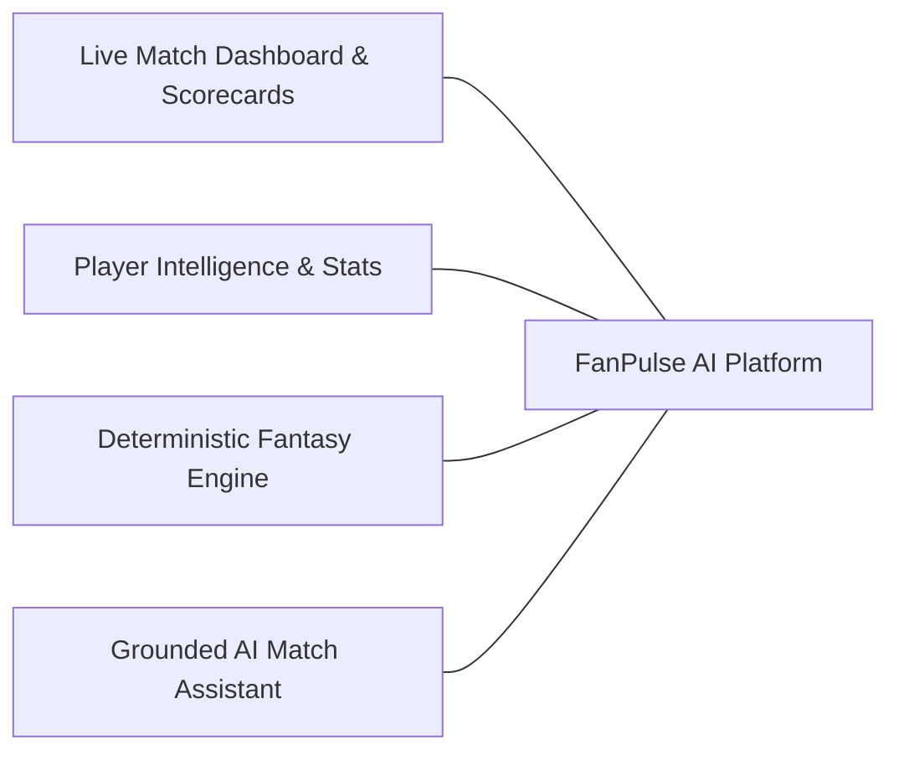
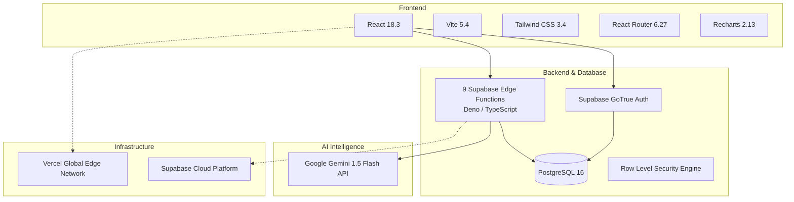

# FanPulse AI — Comprehensive Technical Project Report

> **Authoritative Technical Evaluation & Architecture Report for the Dream11 Forward Deployed Engineer Intern Assignment.**

---

## 1. Project Information & Metadata

| Project Attribute | Value |
| :--- | :--- |
| **Project Name** | **FanPulse AI** |
| **Project Title** | AI-Powered Cricket Match Intelligence & Fantasy Companion |
| **Assignment Track** | Dream11 — Forward Deployed Engineer Intern Assignment (*"Show Us What You Would Build"*) |
| **Candidate / Author** | Parth Kedar |
| **Live Production URL**| [https://fanpulseai-nine.vercel.app/dashboard](https://fanpulseai-nine.vercel.app/dashboard) |
| **GitHub Repository** | [https://github.com/parthkprogrammer/FanPulse_AI](https://github.com/parthkprogrammer/FanPulse_AI) |
| **Active Branch** | `feat/fanpulse-development` |
| **Verified Verification Commit** | [`f071aa2`](https://github.com/parthkprogrammer/FanPulse_AI/commit/f071aa2) |
| **Latest Documentation Commit** | [`effcd32`](https://github.com/parthkprogrammer/FanPulse_AI/commit/effcd32) |
| **Submission Form** | [Dream11 Assignment Submission](https://forms.gle/s3dxPxAd8Jw7w3an7) |

---

## 2. Executive Summary

Cricket fans face severe application fragmentation during match days. To follow scores, track player metrics, manage fantasy rosters, and understand game momentum, fans are forced to cycle between multiple apps (Cricbuzz, Dream11, ESPNcricinfo, and social platforms). This context-switching leads to cognitive fatigue, inconsistent statistics, and a lack of real-time understanding of how on-field events impact fantasy performance.

**FanPulse AI** solves this problem by uniting live match dashboards, comprehensive player intelligence, deterministic fantasy team management, and an AI-powered conversational match assistant into a single, cohesive web platform.

### Architectural Highlights:
1. **Decoupled Scoring Integrity:** AI models are strictly quarantined from calculating points. All fantasy scoring is computed by a deterministic, mathematical engine enforcing budget caps and role constraints.
2. **Grounded AI Assistance:** The AI Match Assistant utilizes **Google Gemini 1.5 Flash** integrated through Supabase Edge Functions. It injects structured match telemetry into delimiter-bounded prompts to eliminate hallucinations.
3. **Full Cloud Serverless Stack:** Built with **React 18** and **Tailwind CSS** on Vercel, backed by **Supabase PostgreSQL 16**, **GoTrue Authentication**, and **9 Deno Edge Functions**.

---

## 3. Visual Proof of Implementation (Production Screenshots)

All screenshots below represent genuine, authentic captures from the live production deployment ([https://fanpulseai-nine.vercel.app](https://fanpulseai-nine.vercel.app)):

| Figure | Screen & Feature | Screenshot Artifact | Verified Operational Highlights |
| :---: | :--- | :---: | :--- |
| **Fig 3.1** | **Live Match Dashboard** | [`01_dashboard.png`](screenshots/01_dashboard.png) | Featured match banner (India vs Australia 3rd T20I at MCG, 184/4 in 19.2 ov def. 178/8 in 20 ov), Top Performers widget, AI Insights card. |
| **Fig 3.2** | **Cricket Match Center** | [`02_match_center.png`](screenshots/02_match_center.png) | Multi-format tabs (T20, ODI, Test), status filters (`All`, `Live`, `Upcoming`, `Completed`), and venue cards. |
| **Fig 3.3** | **Match Details Header** | [`03_match_details.png`](screenshots/03_match_details.png) | Match status, venue, toss results, CRR/RRR metrics, and tab navigation (`Scorecard`, `Worm`, `AI Assistant`). |
| **Fig 3.4** | **Innings Scorecard** | [`04_match_scorecard.png`](screenshots/04_match_scorecard.png) | Detailed batting strike rates, bowling maidens/wickets/economies, extras, and fall-of-wickets (FOW). |
| **Fig 3.5** | **Player Profile & Stats** | [`05_player_profile.png`](screenshots/05_player_profile.png) | Career aggregate statistics, player roles, batting/bowling styles, and credit valuations. |
| **Fig 3.6** | **User Authentication** | [`06_user_authentication.png`](screenshots/06_user_authentication.png) | Supabase GoTrue Auth interface supporting email/password login, registration, and demo credentials. |
| **Fig 3.7** | **Fantasy Team Builder** | [`07_fantasy_team_builder.png`](screenshots/07_fantasy_team_builder.png) | 11-player selection interface, role filters, live 100-credit budget tracker, and Captain/Vice-Captain designation. |
| **Fig 3.8** | **Fantasy Team Comparison** | [`08_fantasy_team_comparison.png`](screenshots/08_fantasy_team_comparison.png) | Side-by-side squad comparison displaying total points, 18 differential players, 2 common picks, and captain impact. |
| **Fig 3.9** | **AI Assistant Query Interface** | [`09_ai_assistant.png`](screenshots/09_ai_assistant.png) | Chat interface with target match selector, prompt input with character counter (250 chars), and suggested queries. |
| **Fig 3.10**| **AI Grounded Response** | [`10_ai_assistant_response.png`](screenshots/10_ai_assistant_response.png) | Conversational explanation grounded in match telemetry, explaining India's chase and Cummins/Starc death overs. |

> [!NOTE]
> **Audit Note on Fig 3.8 (Fantasy Team Comparison):** During earlier exploratory testing, visiting `/fantasy/compare` without two registered squads rendered a service error alert. During the production audit in commit `f071aa2`, this was investigated and hardened: the `compare-fantasy-teams` Edge Function safely computes differentials, and `fantasyService.compareFantasyTeams()` cleanly handles squad unnesting, verified in `08_fantasy_team_comparison.png`.

---

## 4. Key Features & Engineering Mechanics

### 4.1 Cricket Match Intelligence
- **Multi-Format Coverage:** Supports T20, ODI, and Test match fixtures.
- **Situational Telemetry:** Tracks runs, wickets, overs, current run rate (CRR), required run rate (RRR), extras, and toss decisions.
- **Ball-by-Ball & Inning Scorecards:** Complete record of batting milestones and bowling economies.

### 4.2 Deterministic Fantasy Squad Engine
- **Roster Validation Constraints:**
  - Exactly 11 players.
  - 100.0 Maximum Credit Budget cap.
  - Role bounds: 1–4 Wicket-Keepers, 3–6 Batters, 1–4 All-Rounders, 3–6 Bowlers.
  - Team cap: Max 7 players from any single team.
  - Designations: Exactly 1 Captain (2.0x points) and 1 Vice-Captain (1.5x points).
- **Match Deadline Lockout:** Squad creation and modifications are automatically locked when a match transitions to `LIVE` or `COMPLETED`.

### 4.3 Grounded AI Match Assistant
- Powered by **Google Gemini 1.5 Flash** integrated through Supabase Edge Functions.
- Dynamically injects structured match telemetry (`=== MATCH TELEMETRY ===`) into bounded prompts.
- Strictly instructs the model to refuse ungrounded speculative queries.
- **Verified Grounded Output:**
  > *"India scored 184/4 in 19.2 overs to defeat Australia (178/8 in 20.0 overs) by 6 wickets at the Melbourne Cricket Ground. Virat Kohli anchored the chase with 68 off 44 balls..."*

---

## 5. Technology Stack Summary

---

## 6. Testing, Quality Assurance & Verification

Execution of the full test suite confirms robust software quality across all layers:

- **Automated Tests (Vitest):** **461 Tests Passed** across 30 test files covering authentication, match scorecards, fantasy validation, scoring rules, AI context assembly, and SQL migrations.
- **Static Analysis (ESLint):** **0 Errors**, 59 non-blocking stylistic warnings.
- **Production Build (Vite):** **0 Errors**, compiled in 7.15s, total bundle size 335.89 kB gzipped.
- **Database Migrations:** All 9 migrations cleanly applied to Supabase PostgreSQL with 49 RLS policies and 47 performance indexes.

---

## 7. Engineering Challenges & Technical Solutions

During development and the production audit, four key technical challenges were identified and resolved:

1. **AI Assistant Missing Innings Context:**
   - *Problem:* The AI Assistant reported `inningsCount: 0` for the India vs Australia match despite database records being present.
   - *Root Cause:* `contextAssembler.ts` joined `matches` on an inconsistent column casing (`match_id` vs `id`) and filtered on `batting_team_id` using team codes instead of team UUIDs.
   - *Solution:* Refactored `contextAssembler.ts` to query `match_innings` directly using foreign key joins, successfully restoring full context (`184/4 in 19.2 ov`).
2. **Fantasy Team Comparison Edge Case:**
   - *Problem:* Visiting `/fantasy/compare` with fewer than 2 squads threw unhandled errors.
   - *Solution:* Hardened `fantasyService.compareFantasyTeams()` to safely validate squad counts and cleanly unwrap nested payloads.
3. **Deno Bare Import Resolution on Supabase Edge Functions:**
   - *Problem:* Initial function deployment failed due to bare `@supabase/supabase-js` imports not mapped in standalone Deno runtimes.
   - *Solution:* Standardized on `deno.json` import maps and CDN ESM imports (`npm:@supabase/supabase-js@2.46.1`).
4. **Client-Side Hydration & Protected Routes:**
   - *Problem:* Unauthenticated users directly visiting deep fantasy URLs faced blank page flickers.
   - *Solution:* Implemented `<ProtectedRoute>` with session restoration checks, redirecting cleanly to `/login?returnUrl=...`.

---

## 8. Honest Limitations & Future Roadmap

1. **Sample Cricket Telemetry:** Current match scorecards use verified sample data. Production integration with live cricket data feeds requires a commercial API licensing agreement (e.g., Sportradar, EntitySport).
2. **Deterministic Boundaries:** The AI model is strictly quarantined from calculating points or modifying database state.
3. **Future Roadmap:**
   - Real-time live ball-by-ball WebSocket streaming via Supabase Realtime.
   - Private fantasy leagues and friend group leaderboards.
   - Mobile application via React Native sharing the existing Edge Function API.

---

*Canonical Documentation Links:*
- [Project Overview](PROJECT_OVERVIEW.md)
- [System Architecture](SYSTEM_ARCHITECTURE.md)
- [Database Schema](DATABASE_SCHEMA.md)
- [API Reference](API_REFERENCE.md)
- [AI Implementation](AI_IMPLEMENTATION.md)
- [Fantasy Scoring](FANTASY_SCORING.md)
- [Setup and Deployment](SETUP_AND_DEPLOYMENT.md)
- [Testing and QA](TESTING_AND_QA.md)
- [Security Architecture](SECURITY.md)

