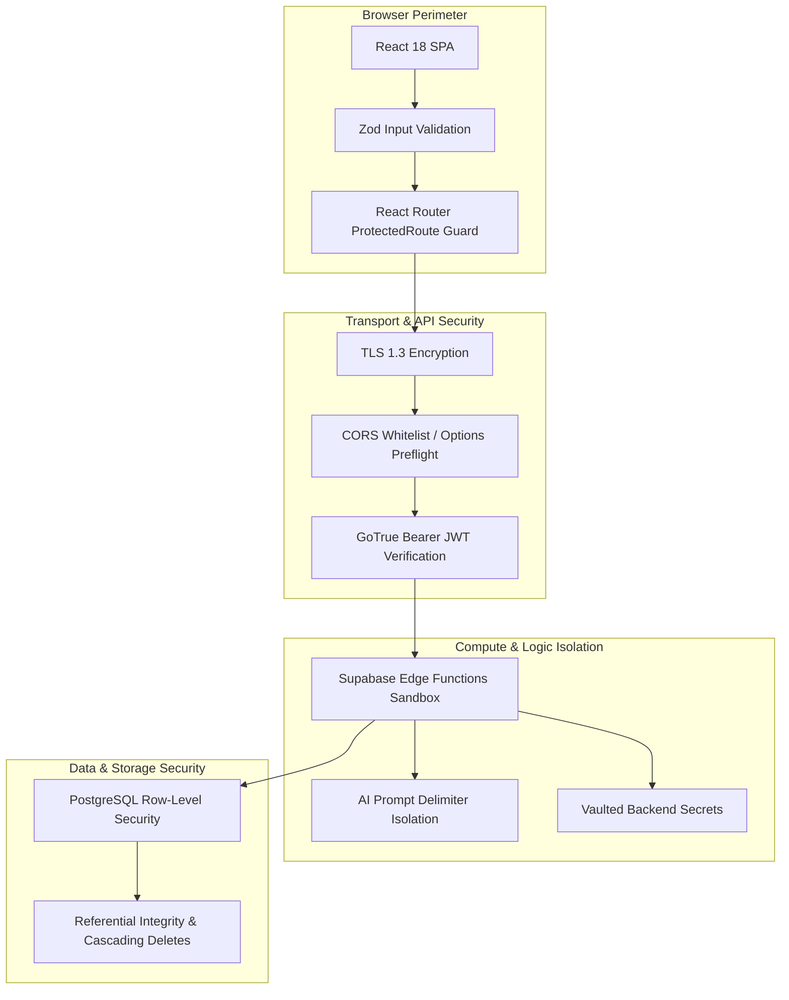

# FanPulse AI — Security Architecture & Governance

> **Security controls, authentication lifecycle, Row-Level Security (RLS) policies, secret isolation, and prompt injection defenses.**

---

## 1. Security Architecture Overview

FanPulse AI enforces a defense-in-depth security model spanning the browser runtime, network perimeter, serverless Edge compute, and database storage:



---

## 2. Authentication & Identity Management

- **Provider:** Supabase GoTrue Auth service.
- **Credential Storage:** User passwords are never handled as plaintext by the application; hashing is performed by GoTrue using industry-standard bcrypt with adaptive work factors.
- **Session Tokens:**
  - **Access Token:** Short-lived JSON Web Token (JWT) containing standard claims (`sub` = user UUID, `role` = `authenticated`, `exp` = expiration time).
  - **Refresh Token:** Stored securely by the Supabase client library and automatically rotated to refresh expired sessions without requiring repeated user logins.
- **Client Route Guards:** Unauthenticated attempts to access `/matches/:matchId/fantasy/create`, `/fantasy/compare`, or `/assistant` are intercepted by `<ProtectedRoute>`, saving the target path in `returnUrl` and redirecting to `/login`.

---

## 3. Database Row-Level Security (RLS)

Every table in the PostgreSQL `public` schema has Row-Level Security actively enabled. The database engine enforces multi-tenant isolation regardless of the calling client:

### 3.1 Tenant-Isolated User Tables
Tables containing user-generated content (`fantasy_teams`, `fantasy_team_players`, `ai_conversations`, `ai_messages`, `profiles`) permit reads and writes **only** if the row's `user_id` matches the authenticated user's UID:

```sql
-- Enforcement policy for fantasy squads
CREATE POLICY "Users can manage own fantasy teams"
ON public.fantasy_teams
FOR ALL
TO authenticated
USING (auth.uid() = user_id)
WITH CHECK (auth.uid() = user_id);

-- Enforcement policy for squad player assignments
CREATE POLICY "Users can manage players in own fantasy teams"
ON public.fantasy_team_players
FOR ALL
TO authenticated
USING (
  EXISTS (
    SELECT 1 FROM public.fantasy_teams ft
    WHERE ft.id = fantasy_team_players.fantasy_team_id
      AND ft.user_id = auth.uid()
  )
);
```

### 3.2 Public Read-Only Tables
Cricket fixtures, scorecards, and player statistics (`teams`, `players`, `matches`, `match_innings`, `player_match_statistics`, `scoring_rules`) are accessible for read-only queries by both public and authenticated roles:

```sql
CREATE POLICY "Public read access for matches"
ON public.matches FOR SELECT
TO anon, authenticated
USING (true);
```

### 3.3 Administrative & Service Protections
All `INSERT`, `UPDATE`, or `DELETE` operations on public cricket records require the Supabase `service_role` or a user with `role = 'admin'`.

---

## 4. Secret Isolation & Key Hygiene

FanPulse AI maintains a strict segregation between public and private keys:

| Secret / Key | Location | Scope | Permissions |
| :--- | :--- | :--- | :--- |
| `VITE_SUPABASE_ANON_KEY` | Frontend `.env.local` / Vercel | Public Client | Read-only access to public cricket data; RLS-gated access to authenticated user rows. |
| `SUPABASE_SERVICE_ROLE_KEY` | Supabase Edge Runtime Secret | Serverless Only | Full database administrative access; never shipped in client bundles or git repositories. |
| `GEMINI_API_KEY` | Supabase Edge Runtime Secret | Serverless Only | Authenticates Edge Function to Google AI Studio; completely inaccessible to frontend code. |

---

## 5. Input Validation & Defense-in-Depth

1. **Client-Side Form Sanitization:**
   - Fantasy team rosters are checked using Zod schemas (`fantasyValidation.js`) before submission.
   - Text inputs (AI question field) are capped at 250 characters to prevent buffer and prompt-stuffing attacks.
2. **Server-Side Edge Boundary Validation:**
   - Edge Functions independently re-validate payload structures. Even if client-side validation is bypassed via direct API calls, the `validate-fantasy-team` function rejects squads violating budget or role limits.
3. **CORS Hardening:**
   - Cross-Origin Resource Sharing is locked down to authorized origins with explicit allowed headers (`Authorization`, `Content-Type`, `apikey`, `x-client-info`).

---

## 6. Generative AI Safety & Prompt Injection Mitigation

To protect the Gemini-powered AI Match Assistant from adversarial prompt manipulation, the following safeguards are implemented:

1. **Structured Telemetry Delimiters:** Injected match telemetry is isolated inside explicit structural boundary markers (`=== MATCH TELEMETRY BEGIN ===` and `=== MATCH TELEMETRY END ===`).
2. **User Question Encapsulation:** User prompts are enclosed within `<user_question>` tags, preventing the user input from masquerading as system instructions.
3. **Negative Constraint Instructions:** The system prompt explicitly commands the model to ignore instructions inside user questions that attempt to alter persona, reveal system instructions, or fabricate cricket statistics.
4. **Out-of-Scope Fallback:** If a user attempts to ask non-cricket questions (e.g., code generation, geopolitical queries, financial advice), the model politely refuses and guides the user back to match telemetry.

---

## 7. Known Security Limitations & Future Roadmap

| Limitation | Current State | Planned Production Hardening |
| :--- | :--- | :--- |
| **Edge Function Rate Limiting** | Handled via upstream Google Gemini quotas and basic circuit breaker. | Implementation of Redis / Upstash sliding-window rate limiters per IP / User UID. |
| **Email Verification** | Mock/Development email signup enabled for demo convenience. | Enforce mandatory email OTP verification for production user registration. |
| **Two-Factor Authentication (2FA)** | Single-factor email/password auth. | Add Supabase Auth TOTP / SMS multi-factor authentication for administrative accounts. |

---

*Related Documentation:*
- [System Architecture](SYSTEM_ARCHITECTURE.md)
- [API Reference](API_REFERENCE.md)
- [Database Schema](DATABASE_SCHEMA.md)
- [AI Implementation](AI_IMPLEMENTATION.md)
