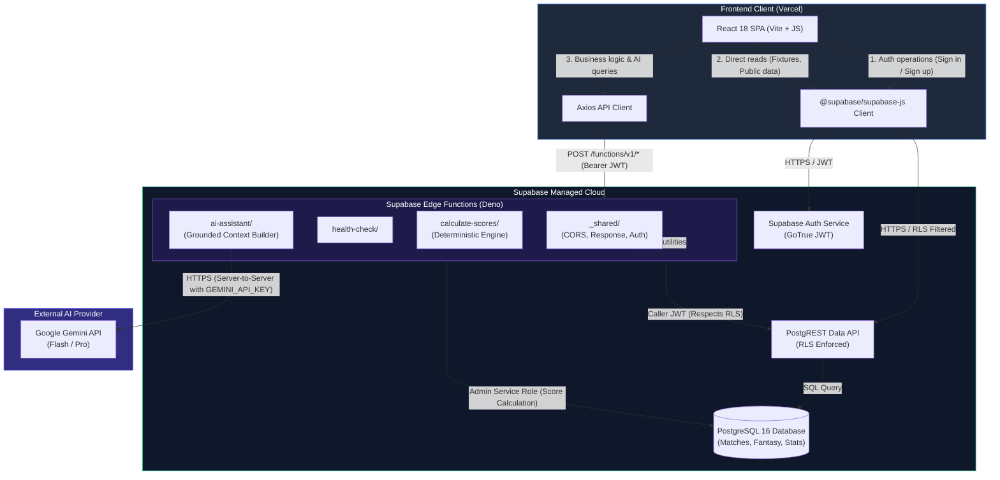

# FanPulse AI — Supabase Backend Architecture & Integration Guide

> Architectural design and operational specification for the Supabase backend infrastructure.
> Companion to [SYSTEM_ARCHITECTURE.md](file:///U:/Fanpulse_AI/docs/SYSTEM_ARCHITECTURE.md) and [DATABASE_DESIGN.md](file:///U:/Fanpulse_AI/docs/DATABASE_DESIGN.md).

---

## 1. Executive Summary & Technology Alignment

FanPulse AI utilizes **Supabase** as the unified backend and database platform:
- **Database:** Supabase PostgreSQL 16+ with extensions (`uuid-ossp`, `pgcrypto`, `pg_trgm`).
- **Authentication:** Supabase Auth (JWT-based session management, password hashing, user metadata).
- **Serverless Compute:** Supabase Edge Functions running on Deno Edge Runtime.
- **AI Integration:** Google Gemini API accessed strictly server-side through Supabase Edge Functions.
- **Frontend Integration:** React 18 SPA (JavaScript, Vite) communicating via `@supabase/supabase-js` and `axios`.

---

## 2. System Architecture & Communication Flow



### Communication Contracts

| Interaction Path | Protocol / Client | Authentication | Primary Purpose |
| :--- | :--- | :--- | :--- |
| **Frontend &rarr; Supabase Auth** | `@supabase/supabase-js` | `anon` key | User sign-up, sign-in, session refresh, and token management. |
| **Frontend &rarr; PostgREST** | `@supabase/supabase-js` | Caller JWT (Bearer) | Reading fixtures, players, user profiles, and fantasy team rosters. Row Level Security guarantees data isolation. |
| **Frontend &rarr; Edge Functions** | `Axios` / `fetch` | Caller JWT (Bearer) | Invoking complex calculations (fantasy point processing, squad validation) and AI assistant queries. |
| **Edge Functions &rarr; Gemini API** | Server `fetch()` | `GEMINI_API_KEY` (Vault Secret) | Generating grounded, natural-language cricket match summaries and fantasy explanations. |

---

## 3. Reusable Edge Function Server Structure

All backend serverless logic is organized under `/supabase/functions/` following a modular, reusable pattern:

```
supabase/functions/
├── _shared/                   # Shared modules ignored as endpoints
│   ├── cors.ts               # Standardized CORS headers and preflight handling
│   ├── response.ts           # Standardized success/error JSON response builders
│   └── supabaseClient.ts     # Client factories (Caller Client vs Admin Client)
├── health-check/              # Endpoint: /functions/v1/health-check
│   ├── deno.json             # Deno configuration & import maps
│   └── index.ts              # Health check handler
```

### Core Shared Utilities

1. **`_shared/cors.ts`**: Provides consistent cross-origin resource sharing headers allowing the React frontend (running locally on `localhost:3000` or deployed on Vercel) to interact with Edge Functions without CORS errors.
2. **`_shared/response.ts`**: Enforces unified API responses containing `status` (`success` | `error`), `data`, `message`, `error`, and UTC `timestamp`.
3. **`_shared/supabaseClient.ts`**:
   - `createCallerClient(req)`: Passes the calling user's JWT to PostgREST, ensuring queries obey Row Level Security (RLS) rules.
   - `createAdminClient()`: Uses the internal `SUPABASE_SERVICE_ROLE_KEY` for privileged backend operations (such as ingestion of verified match ball telemetry).

---

## 4. Environment Separation Strategy

FanPulse AI enforces strict isolation between **Local/Development** and **Remote/Production** environments:

### Environment Configurations

| Setting | Local / Development | Production (Cloud) |
| :--- | :--- | :--- |
| **Frontend Hosting** | `http://localhost:3000` (Vite dev server) | Vercel (`https://fanpulse-ai.vercel.app`) |
| **VITE_SUPABASE_URL** | Configured in `frontend/.env.development` | Configured in Vercel Environment Variables |
| **VITE_SUPABASE_ANON_KEY** | Public anon key for dev project | Public anon key for prod project |
| **VITE_API_BASE_URL** | Dev Edge Functions URL | Prod Edge Functions URL |
| **Edge Function Secrets** | Set in `supabase/.env.local` | Set via `supabase secrets set --project-ref <prod-ref>` |
| **Database Migrations** | Local SQL files in `supabase/migrations/` | Applied via `supabase db push` / CI/CD pipeline |

### Secret Management Rules
1. **Never commit secrets:** The root `.gitignore` and `supabase/.gitignore` strictly ignore all `.env`, `.env.local`, `.env.*.local`, and credential files.
2. **Only Anon Key in Frontend:** The frontend is only provisioned with `VITE_SUPABASE_ANON_KEY`.
3. **Service Role Key Isolation:** `SUPABASE_SERVICE_ROLE_KEY` and `GEMINI_API_KEY` are provisioned strictly as server-side environment secrets in Supabase Edge Functions.

---

## 5. Database Schema & Migration Management

- Migrations are stored chronologically in [`/supabase/migrations/`](file:///U:/Fanpulse_AI/supabase/migrations/) with UTC timestamp prefixes:
  ```
  supabase/migrations/20261103075030_initial_schema_baseline.sql
  ```
- **CLI Commands for Deployment**:
  ```bash
  # Check migration status
  npx supabase migration list

  # Create a new incremental migration
  npx supabase migration new <migration_name>

  # Deploy pending migrations to remote Supabase project
  npx supabase db push
  ```

---

## 6. Verification & Health Monitoring

The Edge Functions tier includes a baseline `health-check` function:
- **Endpoint**: `/functions/v1/health-check`
- **Output Schema**:
  ```json
  {
    "status": "success",
    "data": {
      "status": "UP",
      "service": "fanpulse-ai-edge-functions",
      "version": "0.1.0",
      "timestamp": "2026-11-03T13:21:21.000Z",
      "environment": "development",
      "runtime": {
        "platform": "Deno Edge Runtime",
        "denoVersion": "1.45.0"
      }
    },
    "timestamp": "2026-11-03T13:21:21.000Z"
  }
  ```
