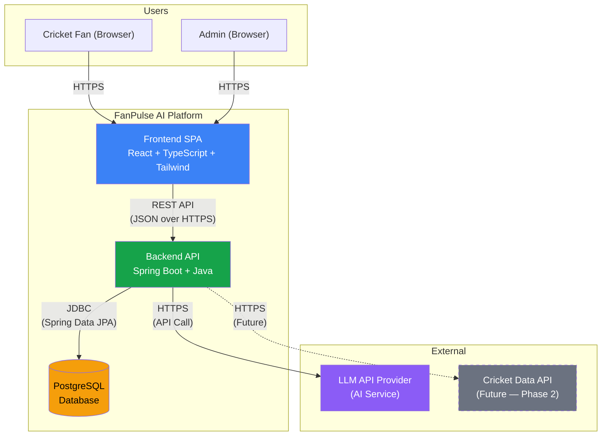
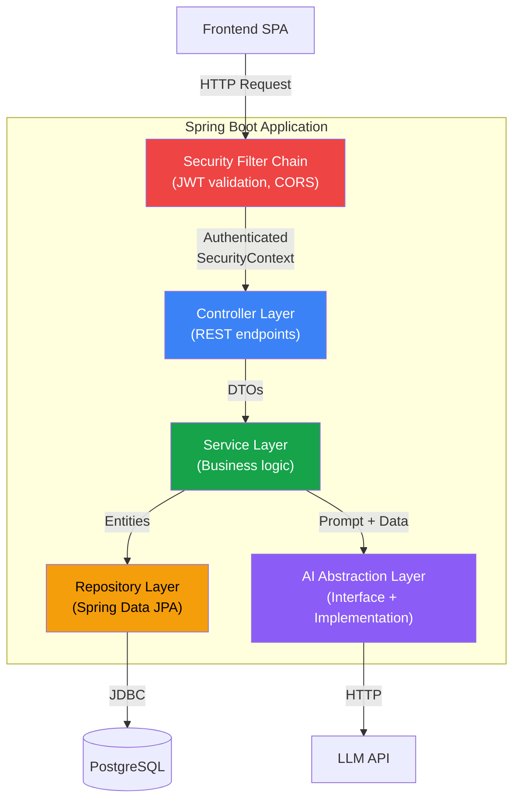
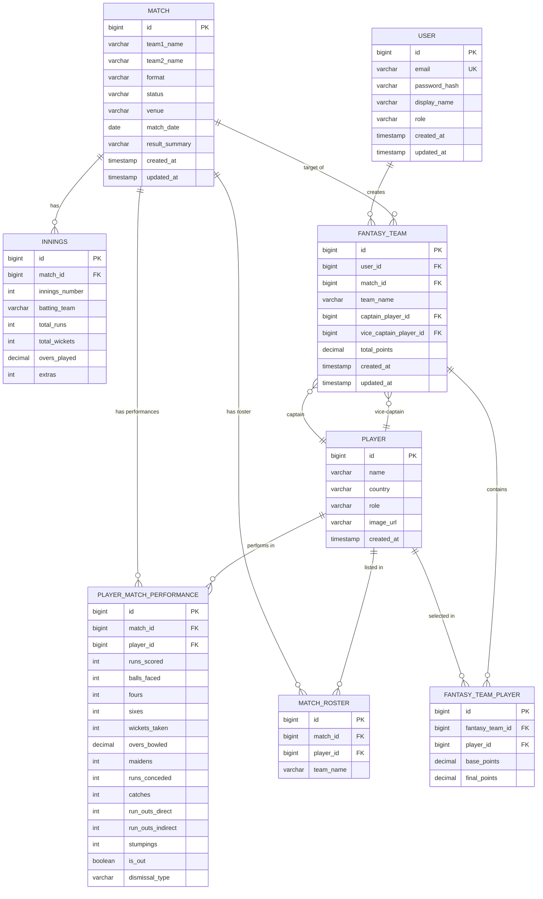
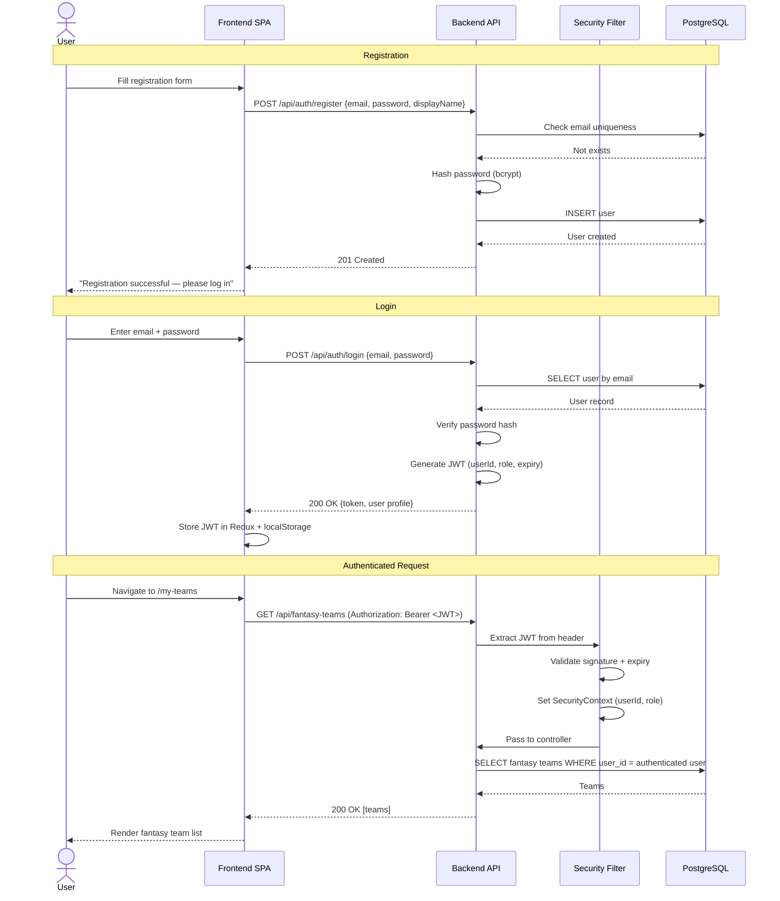
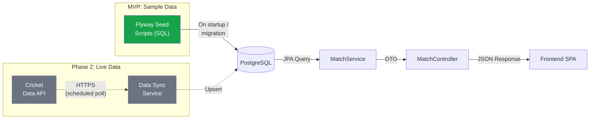
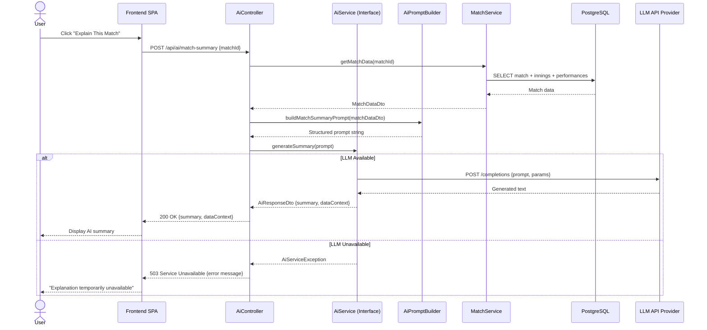

# FanPulse AI — System Architecture

> Derived from [PROJECT_VISION.md](file:///U:/Fanpulse_AI/docs/PROJECT_VISION.md), [COMPETITOR_ANALYSIS.md](file:///U:/Fanpulse_AI/docs/COMPETITOR_ANALYSIS.md), and [REQUIREMENTS.md](file:///U:/Fanpulse_AI/docs/REQUIREMENTS.md).

---

## 1. Architectural Decisions

Before describing the architecture, the key structural decisions and their rationale:

| Decision | Choice | Rationale | Alternatives Considered |
|----------|--------|-----------|------------------------|
| **Deployment topology** | Modular monolith (single deployable backend) | The MVP has a single team, modest data volume, and no independent scaling requirements per domain. A monolith reduces operational complexity (one deployment, one database, one CI pipeline). Modular package structure allows future extraction if needed. | Microservices — rejected: premature for MVP; adds network hops, distributed transactions, and DevOps overhead without a scaling justification. |
| **Frontend–backend split** | Separate applications communicating via REST API | Enables independent development, testing, and deployment. Aligns with `NFR-MAINT-01`. The frontend is a static SPA; the backend is a Spring Boot JAR. | Server-side rendering — rejected: the team's stated tech stack is React SPA + Spring Boot API. |
| **Authentication mechanism** | Stateless JWT tokens | Supports horizontal backend scaling (`NFR-SCALE-01`) without server-side session storage. Tokens are issued on login and validated on every request via a Spring Security filter. | Server-side sessions — rejected: would require sticky sessions or a shared session store, adding infrastructure complexity for the MVP. |
| **Database** | Single PostgreSQL instance | Relational data (matches, players, teams, users) is naturally tabular with strong referential integrity needs. PostgreSQL is specified in the vision document. | NoSQL — rejected: cricket data is structured and relational; fantasy team validation requires joins and foreign key constraints. |
| **AI integration** | Backend-mediated, behind an abstraction interface | The backend constructs the prompt from match data, calls the LLM API, and returns the result. The frontend never contacts the AI provider directly. This enforces `BR-AI-01` (data grounding) and `FR-AI-05` (provider swappability). | Direct frontend → LLM — rejected: would expose the API key to the client and bypass data-grounding controls. |
| **Containerization** | Docker Compose (3 services: frontend, backend, database) | Reproducible local development and deployment. Each service has its own Dockerfile. | Kubernetes — rejected: overengineered for MVP; Docker Compose is sufficient. |

---

## 2. High-Level Architecture

### 2.1 System Context Diagram



### 2.2 Component Responsibilities

| Component | Responsibility | Why It Exists |
|-----------|---------------|---------------|
| **Frontend SPA** | Renders UI, manages client-side state, handles routing, makes API calls to the backend. | Provides the user-facing experience. Separated from backend for independent deployment (`NFR-MAINT-01`). |
| **Backend API** | Business logic, authentication, data access, fantasy scoring, AI prompt construction, REST endpoint exposure. | Single source of truth for all business rules. Centralizes security enforcement and data validation. |
| **PostgreSQL** | Persistent storage for users, matches, players, performances, fantasy teams, and scoring data. | Relational data with strong integrity requirements (foreign keys, transactions). |
| **LLM API Provider** | External AI service that generates natural-language text from structured prompts. | Fulfills AI explanation features (`FR-AI-*`, `FR-INSIGHT-*`) without building a custom ML model. |
| **Cricket Data API** | *Future (Phase 2).* External data provider replacing sample match data. | Enables live/real match data. Out of scope for MVP but the architecture accommodates it via a data-source abstraction. |

---

## 3. Frontend Architecture

### 3.1 Technology Stack

| Technology | Purpose |
|------------|---------|
| **React 18+** | Component-based UI rendering |
| **TypeScript** | Static typing for reliability and developer experience |
| **Tailwind CSS** | Utility-first styling; responsive design (`NFR-USE-01`) |
| **Redux Toolkit** | Global state management for auth state, match data cache, and fantasy team state |
| **React Router v6+** | Client-side routing (SPA navigation) |
| **Axios** (or `fetch` wrapper) | HTTP client for backend API calls with interceptors for auth tokens and error handling |

### 3.2 Frontend Module Structure

```
frontend/
├── public/
├── src/
│   ├── app/              # App entry, Redux store configuration, root router
│   ├── features/
│   │   ├── auth/         # Login, registration, auth slice, auth API
│   │   ├── matches/      # Match list, match detail, match slice, match API
│   │   ├── players/      # Player list, player profile, player slice, player API
│   │   ├── fantasy/      # Team creation, team list, team detail, fantasy slice, fantasy API
│   │   ├── comparison/   # Team comparison view, comparison API
│   │   └── ai/           # AI summary display, AI insight display, AI API
│   ├── components/       # Shared UI components (Button, Card, Modal, Spinner, ErrorBanner)
│   ├── hooks/            # Custom React hooks (useAuth, useApiCall, useDebounce)
│   ├── layouts/          # Page layout shells (MainLayout, AuthLayout)
│   ├── types/            # Shared TypeScript interfaces and type definitions
│   ├── utils/            # Utility functions (formatDate, formatScore, api client setup)
│   └── styles/           # Tailwind config, global CSS
├── package.json
├── tsconfig.json
├── tailwind.config.js
└── Dockerfile
```

**Why feature-based structure:** Each feature directory encapsulates its own components, Redux slice, and API calls. This co-location makes it easy to find all code related to a domain concept, and supports future extraction if a feature grows large. Shared UI components live in `components/` to avoid duplication.

### 3.3 State Management Strategy

| State Category | Location | Rationale |
|----------------|----------|-----------|
| **Auth state** (token, user profile, isAuthenticated) | Redux store (persisted to `localStorage`) | Global — needed by the API client interceptor and route guards across all features. |
| **Match list / detail data** | Redux store (cache) + RTK Query or thunks | Shared across match dashboard, fantasy team creation, and AI views. Caching avoids re-fetching on navigation. |
| **Fantasy team draft state** | Local component state (React `useState`) | Ephemeral — only needed during the team creation workflow. Discarded after submission. |
| **AI response text** | Local component state | Ephemeral — displayed on-demand, no need for global persistence. |
| **UI state** (modals, filters, loading flags) | Local component state | Scoped to individual components; no cross-component sharing needed. |

### 3.4 Routing Structure

| Route | Component | Auth Required | Requirement |
|-------|-----------|:-------------:|-------------|
| `/` | Match list (dashboard) | No | `FR-MATCH-01` |
| `/matches/:id` | Match detail / scorecard | No | `FR-MATCH-02` |
| `/players` | Player list | No | `FR-STATS-05` |
| `/players/:id` | Player profile | No | `FR-STATS-01`–`03` |
| `/login` | Login form | No | `FR-AUTH-03` |
| `/register` | Registration form | No | `FR-AUTH-01` |
| `/my-teams` | User's fantasy team list | Yes | `FR-FANTASY-07` |
| `/my-teams/create/:matchId` | Fantasy team creation wizard | Yes | `FR-FANTASY-01` |
| `/my-teams/:teamId` | Fantasy team detail + points | Yes | `FR-SCORE-04` |
| `/my-teams/compare` | Fantasy team comparison | Yes | `FR-COMPARE-01` |
| `/profile` | User profile view/edit | Yes | `FR-AUTH-08` |

**Auth guard:** A `ProtectedRoute` wrapper component checks Redux auth state. If unauthenticated, it redirects to `/login` with a return URL.

---

## 4. Backend Architecture

### 4.1 Technology Stack

| Technology | Purpose |
|------------|---------|
| **Java 17+** | Application language |
| **Spring Boot 3+** | Application framework, auto-configuration, embedded server |
| **Spring Security** | Authentication (JWT), authorization (role-based), CSRF protection |
| **Spring Data JPA** | Data access layer with repository pattern |
| **Hibernate** | ORM for entity-to-table mapping |
| **Flyway** | Database migration management (`NFR-MAINT-04`) |
| **Jackson** | JSON serialization/deserialization |
| **Bean Validation (Jakarta)** | Request payload validation |
| **Maven** | Build and dependency management |

### 4.2 Layered Architecture



### 4.3 Layer Responsibilities

| Layer | Responsibility | Rules |
|-------|---------------|-------|
| **Security Filter Chain** | JWT token extraction, validation, and `SecurityContext` population. CORS configuration. | No business logic. Only authentication and request filtering. |
| **Controller** | Accept HTTP requests, validate input DTOs (`@Valid`), delegate to services, return response DTOs with appropriate HTTP status codes. | No business logic. No direct repository access (`NFR-MAINT-02`). No entity objects in request/response — use DTOs. |
| **Service** | All business logic: fantasy team validation (`BR-TEAM-*`), fantasy scoring (`BR-SCORE-*`), match lifecycle enforcement (`BR-MATCH-*`), AI prompt construction. Transaction boundaries (`@Transactional`). | May call multiple repositories and the AI abstraction layer. Owns all validation rules beyond input format (e.g., team composition). |
| **Repository** | Data access via Spring Data JPA interfaces. Custom query methods where needed. | No business logic. Returns entity objects to the service layer. |
| **AI Abstraction Layer** | An interface (`AiService`) with methods like `generateMatchSummary(MatchDataDto)`. Implementations call specific LLM providers. | Isolated from business logic. The service layer calls the interface; the implementation is injected via Spring's DI. Swapping providers requires only a new implementation class and configuration change (`FR-AI-05`, `NFR-MAINT-03`). |

### 4.4 Backend Package Structure

```
backend/
├── src/main/java/com/fanpulse/
│   ├── FanPulseApplication.java          # Spring Boot entry point
│   ├── config/
│   │   ├── SecurityConfig.java           # Spring Security configuration
│   │   ├── CorsConfig.java               # CORS policy
│   │   ├── JwtConfig.java                # JWT secret, expiration settings
│   │   └── AiConfig.java                 # AI provider configuration
│   ├── security/
│   │   ├── JwtTokenProvider.java         # Token generation and validation
│   │   ├── JwtAuthenticationFilter.java  # Extracts and validates JWT from requests
│   │   └── UserDetailsServiceImpl.java   # Loads user details from DB
│   ├── auth/
│   │   ├── AuthController.java           # /api/auth/** endpoints
│   │   ├── AuthService.java
│   │   └── dto/                          # LoginRequest, RegisterRequest, AuthResponse
│   ├── user/
│   │   ├── UserController.java           # /api/users/me endpoint
│   │   ├── UserService.java
│   │   ├── UserRepository.java
│   │   ├── User.java                     # Entity
│   │   └── dto/
│   ├── match/
│   │   ├── MatchController.java          # /api/matches/** endpoints
│   │   ├── MatchService.java
│   │   ├── MatchRepository.java
│   │   ├── Match.java                    # Entity
│   │   ├── Innings.java                  # Entity
│   │   └── dto/
│   ├── player/
│   │   ├── PlayerController.java         # /api/players/** endpoints
│   │   ├── PlayerService.java
│   │   ├── PlayerRepository.java
│   │   ├── Player.java                   # Entity
│   │   ├── PlayerMatchPerformance.java   # Entity
│   │   └── dto/
│   ├── fantasy/
│   │   ├── FantasyTeamController.java    # /api/fantasy-teams/** endpoints
│   │   ├── FantasyTeamService.java       # Team validation (BR-TEAM-*)
│   │   ├── FantasyTeamRepository.java
│   │   ├── FantasyTeam.java              # Entity
│   │   ├── FantasyTeamPlayer.java        # Entity (join table with captain/vc flag)
│   │   └── dto/
│   ├── scoring/
│   │   ├── ScoringService.java           # Fantasy point calculation (BR-SCORE-*)
│   │   ├── ScoringRules.java             # Point value constants / configuration
│   │   └── dto/
│   ├── comparison/
│   │   ├── ComparisonController.java     # /api/fantasy-teams/compare endpoint
│   │   ├── ComparisonService.java
│   │   └── dto/
│   ├── ai/
│   │   ├── AiController.java             # /api/ai/** endpoints
│   │   ├── AiService.java                # Interface (abstraction layer)
│   │   ├── AiPromptBuilder.java          # Constructs prompts from match data
│   │   ├── impl/
│   │   │   └── LlmAiServiceImpl.java     # Concrete implementation (calls LLM API)
│   │   └── dto/
│   └── common/
│       ├── exception/                    # Global exception handler, custom exceptions
│       ├── dto/                          # Shared DTOs (ErrorResponse, PageResponse)
│       └── util/                         # Shared utilities
├── src/main/resources/
│   ├── application.yml                   # App configuration
│   ├── application-dev.yml               # Dev profile overrides
│   ├── db/migration/                     # Flyway migration scripts
│   └── data/                             # Sample data SQL seed scripts
├── pom.xml
└── Dockerfile
```

**Why domain-based packages:** Each domain (match, player, fantasy, scoring, ai) is a self-contained package with its own controller, service, repository, entities, and DTOs. This aligns with the modular monolith approach — each package could be extracted into a separate service in the future if scaling demands it, but for the MVP they share a single deployment and database.

### 4.5 REST API Structure

| Endpoint | Method | Auth | Role | Description | Requirement |
|----------|--------|:----:|------|-------------|-------------|
| `/api/auth/register` | POST | No | — | Register a new user | `FR-AUTH-01` |
| `/api/auth/login` | POST | No | — | Authenticate and receive JWT | `FR-AUTH-03` |
| `/api/auth/logout` | POST | Yes | USER | Invalidate token (client-side discard) | `FR-AUTH-06` |
| `/api/users/me` | GET | Yes | USER | Get current user profile | `FR-AUTH-08` |
| `/api/users/me` | PUT | Yes | USER | Update display name | `FR-AUTH-08` |
| `/api/matches` | GET | No | — | List matches (with optional `?status=` filter) | `FR-MATCH-01`, `03` |
| `/api/matches/:id` | GET | No | — | Get match detail with scorecard | `FR-MATCH-02` |
| `/api/matches` | POST | Yes | ADMIN | Create match | `FR-MATCH-05` |
| `/api/matches/:id` | PUT | Yes | ADMIN | Update match | `FR-MATCH-05` |
| `/api/matches/:id` | DELETE | Yes | ADMIN | Delete match | `FR-MATCH-05` |
| `/api/players` | GET | No | — | List players (with optional filters) | `FR-STATS-05` |
| `/api/players/:id` | GET | No | — | Get player profile with stats | `FR-STATS-01`–`03` |
| `/api/players/:id/matches/:matchId` | GET | No | — | Get player match performance | `FR-STATS-04` |
| `/api/players` | POST | Yes | ADMIN | Create player | `FR-STATS-06` |
| `/api/players/:id` | PUT | Yes | ADMIN | Update player | `FR-STATS-06` |
| `/api/players/:id` | DELETE | Yes | ADMIN | Delete player | `FR-STATS-06` |
| `/api/fantasy-teams` | GET | Yes | USER | List current user's fantasy teams | `FR-FANTASY-07` |
| `/api/fantasy-teams` | POST | Yes | USER | Create fantasy team | `FR-FANTASY-01` |
| `/api/fantasy-teams/:id` | GET | Yes | USER | Get fantasy team detail with points | `FR-SCORE-04` |
| `/api/fantasy-teams/:id` | PUT | Yes | USER | Edit fantasy team | `FR-FANTASY-08` |
| `/api/fantasy-teams/:id` | DELETE | Yes | USER | Delete fantasy team | `FR-FANTASY-09` |
| `/api/fantasy-teams/compare` | GET | Yes | USER | Compare two teams (`?team1=&team2=`) | `FR-COMPARE-01` |
| `/api/ai/match-summary` | POST | Yes | USER | Generate AI match summary | `FR-AI-01` |
| `/api/ai/player-insight` | POST | Yes | USER | Generate AI player performance insight | `FR-INSIGHT-01` |
| `/api/ai/key-moments` | POST | Yes | USER | Generate AI key moments analysis | `FR-INSIGHT-02` |

---

## 5. Database Architecture

### 5.1 Entity-Relationship Diagram



### 5.2 Key Design Decisions

| Decision | Rationale |
|----------|-----------|
| **Separate `MATCH_ROSTER` table** | Decouples the roster for a specific match from the global player table. A player exists in the system once but can appear in multiple match rosters. This supports `BR-TEAM-05` (validation that selected players are in the match roster). |
| **`PLAYER_MATCH_PERFORMANCE` stores granular stats** | Stores all scoring-relevant events per player per match in one row. This is the input to the fantasy scoring engine. Supports `FR-STATS-04` and `FR-SCORE-01`. |
| **`FANTASY_TEAM_PLAYER` join table with points** | Stores per-player base and final points (after captain/VC multiplier). Avoids recalculating on every read. Points are recomputed when match data changes (`FR-SCORE-05`). |
| **`total_points` on `FANTASY_TEAM`** | Denormalized for fast reads on team list views. Recomputed with individual player points. |
| **Flyway migrations** | All tables are created through versioned SQL migration scripts, not Hibernate `ddl-auto`. Ensures reproducible, auditable schema evolution (`NFR-MAINT-04`). |

### 5.3 Indexing Strategy

| Index | Table | Columns | Purpose |
|-------|-------|---------|---------|
| Unique | `USER` | `email` | Fast login lookup; enforce uniqueness (`FR-AUTH-02`) |
| Index | `MATCH` | `status` | Support filtered match listing (`FR-MATCH-03`) |
| Composite | `MATCH_ROSTER` | `(match_id, player_id)` UNIQUE | Prevent duplicate roster entries; fast roster lookup |
| Composite | `PLAYER_MATCH_PERFORMANCE` | `(match_id, player_id)` UNIQUE | One performance record per player per match |
| Index | `FANTASY_TEAM` | `user_id` | Fast lookup of a user's teams (`FR-FANTASY-07`) |
| Composite | `FANTASY_TEAM_PLAYER` | `(fantasy_team_id, player_id)` UNIQUE | Prevent duplicate player selections in a team |
| Index | `PLAYER` | `country`, `role` | Support player list filtering (`FR-STATS-05`) |

---

## 6. Authentication Flow

### 6.1 JWT Authentication Sequence



### 6.2 Security Boundaries

| Boundary | Enforcement | Requirements |
|----------|-------------|-------------|
| **Public endpoints** | Match list, match detail, player list, player profile, registration, login | No JWT required. Available to all visitors. |
| **USER endpoints** | Fantasy team CRUD, team comparison, AI endpoints, user profile | Valid JWT required with role `USER` or `ADMIN`. |
| **ADMIN endpoints** | Match CRUD, player CRUD | Valid JWT required with role `ADMIN`. `USER` role receives HTTP 403. |
| **Ownership boundary** | Fantasy team operations check `user_id` matches the authenticated user | Prevents cross-user data access (`NFR-SEC-03`). |

### 6.3 JWT Structure

```
Header:  { "alg": "HS256", "typ": "JWT" }
Payload: { "sub": "<userId>", "role": "USER|ADMIN", "iat": <timestamp>, "exp": <timestamp> }
Signature: HMACSHA256(header + payload, secret)
```

- **Expiration:** Configurable, default 30 minutes (`NFR-SEC-06`).
- **Refresh strategy (MVP):** No refresh tokens. User re-authenticates after expiry. Refresh tokens can be added in a future phase.
- **Storage:** `localStorage` on the client. The frontend's Axios interceptor attaches the token to every request's `Authorization` header.
- **Logout:** Client-side — the frontend deletes the token from Redux and `localStorage`. The backend does not maintain a token blocklist in the MVP (trade-off: a stolen token remains valid until expiry; acceptable for MVP scope).

> [!WARNING]
> **Trade-off: `localStorage` for JWT.** Storing JWTs in `localStorage` is vulnerable to XSS attacks. For the MVP, this is acceptable given input sanitization (`NFR-SEC-05`) and the scope of the application. A future enhancement could move to `httpOnly` cookies with CSRF protection for stronger security.

---

## 7. Match Data Flow

### 7.1 Data Pipeline



### 7.2 MVP Data Loading

1. **Flyway migrations** create the schema (tables, constraints, indexes).
2. **Seed migration scripts** (e.g., `V100__seed_sample_matches.sql`) insert sample match, player, roster, and performance data.
3. The backend reads from PostgreSQL via Spring Data JPA repositories.
4. ADMIN endpoints allow manual data management via the API (no admin UI in MVP).

### 7.3 Phase 2 Live Data Integration

When an authorized cricket data API is integrated:

1. A **`DataSyncService`** (new service class) polls the external API on a configurable schedule.
2. It maps the external API's data format to FanPulse AI's internal entity model.
3. It upserts match, innings, roster, and performance records in PostgreSQL.
4. The rest of the application (services, controllers, frontend) is unaffected — it reads from the same database tables regardless of data source.

**Why this approach:** The data source (seed scripts vs. live API) is an infrastructure concern, not a business logic concern. By keeping the data-source boundary at the database level, all business logic (scoring, validation, AI prompts) works identically with both sample and live data.

---

## 8. Fantasy Scoring Flow

### 8.1 Scoring Pipeline

```
1. ADMIN updates match performance data
       ↓
2. MatchService saves PlayerMatchPerformance entities
       ↓
3. ScoringService.calculatePoints(matchId) is triggered
       ↓
4. For each FantasyTeam associated with the match:
   a. For each FantasyTeamPlayer in the team:
      i.   Load the player's PlayerMatchPerformance
      ii.  Apply batting rules (BR-SCORE-BAT-01 through 06)
      iii. Apply bowling rules (BR-SCORE-BOWL-01 through 06)
      iv.  Apply fielding rules (BR-SCORE-FIELD-01 through 04)
      v.   Sum → basePoints
      vi.  If Captain → finalPoints = basePoints × 2.0
           If Vice-Captain → finalPoints = basePoints × 1.5
           Else → finalPoints = basePoints
      vii. Save basePoints and finalPoints to FantasyTeamPlayer
   b. Sum all finalPoints → totalPoints for the FantasyTeam
   c. Save totalPoints to FantasyTeam
       ↓
5. Updated points are returned on next GET request
```

### 8.2 Scoring Engine Design

The `ScoringService` is a stateless, deterministic function (`NFR-DATA-02`):

```
Input:  PlayerMatchPerformance + ScoringRules
Output: basePoints (decimal)
```

- **`ScoringRules`** is a configuration object (not hardcoded constants) loaded from `application.yml` or a database table. This allows point value changes without code changes (`PD-01`).
- The scoring engine has **no side effects** — it receives data, computes a number, and returns it. Persistence is handled by the calling service.
- **Testability:** Because the engine is a pure function, it is trivially unit-testable. Each scoring rule maps to a test case (`NFR-TEST-04`).

### 8.3 Recalculation Trigger

- **MVP:** Scoring is recalculated on-demand when fantasy team data is requested, or explicitly triggered after a match data update (`FR-SCORE-05`). This avoids background job infrastructure in the MVP.
- **Future (with live data):** An event-driven trigger could recalculate scores whenever `PlayerMatchPerformance` is updated. This can be implemented with Spring's `@EventListener` or a message queue without changing the scoring engine itself.

---

## 9. AI Request and Response Flow

### 9.1 AI Integration Architecture



### 9.2 Component Responsibilities

| Component | Responsibility |
|-----------|---------------|
| **`AiController`** | Receives the request, coordinates data gathering and AI call, returns the response. Handles `AiServiceException` → HTTP 503 (`FR-AI-04`). |
| **`MatchService`** | Provides structured match data. The AI layer does not access the database directly. |
| **`AiPromptBuilder`** | Transforms `MatchDataDto` into a structured prompt string. Contains the prompt template, system instructions (e.g., "use only the data provided," "do not predict"), and data formatting logic. Enforces `BR-AI-01` and `BR-AI-02`. |
| **`AiService` (interface)** | Defines the contract: `generateSummary(prompt) → AiResponseDto`. The interface is the abstraction layer (`FR-AI-05`, `NFR-MAINT-03`). |
| **`LlmAiServiceImpl`** | Concrete implementation that calls a specific LLM API (e.g., Gemini API, OpenAI API). Uses `RestTemplate` or `WebClient` to make the HTTP call. Handles retries, timeouts, and error mapping. |

### 9.3 Prompt Construction Strategy

The `AiPromptBuilder` constructs prompts using a template approach:

```
System: You are a cricket match analyst. Explain the match situation using 
        ONLY the data provided below. Do not invent statistics. Do not make 
        predictions. Do not provide betting advice.

Data:
  Match: {team1} vs {team2}, {format}, {date}, {venue}
  Status: {status}
  1st Innings: {battingTeam} {runs}/{wickets} ({overs} overs)
    Top scorers: {player1 runs (balls)}, {player2 runs (balls)}
    Key bowlers: {bowler1 wickets/runs (overs)}, ...
  2nd Innings: ...
  Result: {resultSummary}

Task: Provide a concise match summary covering the overall match narrative,
      key batting and bowling performances, and the match outcome.
```

- **Data grounding:** The prompt explicitly contains match data and instructs the model to use only that data (`BR-AI-01`).
- **No predictions:** The system prompt explicitly prohibits predictions and betting advice (`BR-AI-02`).
- **`dataContext` field:** The response DTO includes a reference to the match ID and a timestamp, so the frontend can indicate what data the AI used (`FR-AI-06`).

### 9.4 AI Provider Swappability

```
AiService (Interface)
├── LlmAiServiceImpl (e.g., calls Gemini API)
├── OpenAiServiceImpl (alternative — calls OpenAI API)
└── MockAiServiceImpl (for testing — returns canned responses)
```

- The active implementation is selected via Spring profile or configuration property.
- **Testing:** `MockAiServiceImpl` returns deterministic, canned responses for integration tests, removing external API dependency from the test suite.

---

## 10. External Cricket API Integration (Phase 2)

This section describes the architecture for future live data integration. It is **not implemented in the MVP** but the architecture is designed to accommodate it.

### 10.1 Integration Pattern

| Aspect | Design |
|--------|--------|
| **Pattern** | Scheduled polling (not webhook) |
| **Component** | `CricketDataSyncService` — a new service class added in Phase 2 |
| **Schedule** | Configurable polling interval via `@Scheduled` (e.g., every 30 seconds during live matches) |
| **Data mapping** | A `CricketDataMapper` class converts the external API's JSON format to FanPulse AI's internal entity model |
| **Idempotency** | Upsert logic ensures re-processing the same data doesn't create duplicates |
| **Error handling** | API failures are logged and retried; the system continues to serve cached data from PostgreSQL |

### 10.2 Data Source Abstraction

```
MatchDataProvider (Interface)
├── SampleDataProvider (MVP — reads from seeded database)
└── LiveApiDataProvider (Phase 2 — polls external API and syncs to database)
```

Both providers write to the same PostgreSQL tables. The rest of the application reads from the database and is unaware of the data source.

---

## 11. Error-Handling Architecture

### 11.1 Backend Error Strategy

| Layer | Strategy | Implementation |
|-------|----------|----------------|
| **Controller** | Delegates all error mapping to a global exception handler. Never catches exceptions locally (except for control flow in the controller itself). | `@RestControllerAdvice` with `@ExceptionHandler` methods |
| **Service** | Throws domain-specific exceptions for business rule violations. | Custom exception classes: `ResourceNotFoundException`, `DuplicateEmailException`, `FantasyTeamValidationException`, `MatchLockedException`, `AiServiceException` |
| **Repository** | Spring Data JPA exceptions propagate up. Constraint violations (e.g., unique email) are caught at the service layer and translated to domain exceptions. | Standard JPA exception hierarchy |
| **AI Layer** | Catches all external API failures (timeout, HTTP errors, malformed responses) and wraps them in `AiServiceException`. | Try-catch in `LlmAiServiceImpl`, mapped to HTTP 503 |

### 11.2 Standard Error Response Format

All API errors return a consistent JSON structure:

```json
{
  "status": 400,
  "error": "Bad Request",
  "message": "Fantasy team must contain exactly 11 players. Received: 9.",
  "timestamp": "2026-11-02T18:30:00Z",
  "path": "/api/fantasy-teams"
}
```

### 11.3 Exception-to-HTTP Mapping

| Exception | HTTP Status | When |
|-----------|:-----------:|------|
| `ResourceNotFoundException` | 404 | Match, player, or team not found |
| `DuplicateEmailException` | 409 | Registration with existing email |
| `FantasyTeamValidationException` | 400 | Team composition rules violated |
| `MatchLockedException` | 403 | Attempt to modify team for non-upcoming match |
| `UnauthorizedAccessException` | 403 | User accessing another user's team |
| `AiServiceException` | 503 | AI provider unavailable or errored |
| `AuthenticationException` | 401 | Invalid or expired JWT |
| `AccessDeniedException` | 403 | Insufficient role (USER accessing ADMIN endpoint) |
| `MethodArgumentNotValidException` | 400 | Input DTO validation failure (`@Valid`) |
| Unhandled exceptions | 500 | Catch-all; logged with full stack trace |

### 11.4 Frontend Error Handling

| Scenario | Handling | Requirement |
|----------|----------|-------------|
| **API returns 401** | Axios interceptor clears auth state and redirects to `/login` | `FR-AUTH-07` |
| **API returns 400** | Display validation errors inline near the relevant field | `NFR-USE-02` |
| **API returns 403** | Display "Access denied" message | `NFR-SEC-03`, `04` |
| **API returns 503** (AI) | Display "temporarily unavailable" with retry button | `NFR-REL-01`, `NFR-USE-04` |
| **Network error** | Display "Connection error" with retry button | `NFR-USE-04` |
| **Loading state** | Show spinner/skeleton during pending requests | `NFR-USE-03` |

---

## 12. Deployment Architecture

### 12.1 Docker Compose Topology

```
docker-compose.yml
├── frontend     (Nginx serving built React SPA)  → Port 3000
├── backend      (Spring Boot JAR)                 → Port 8080
└── db           (PostgreSQL 16)                   → Port 5432 (internal)
```

| Service | Base Image | Build | Notes |
|---------|-----------|-------|-------|
| `frontend` | `node:20-alpine` (build) → `nginx:alpine` (runtime) | Multi-stage: `npm run build` → copy `dist/` to Nginx | Nginx proxies `/api/*` requests to the backend container. |
| `backend` | `eclipse-temurin:17-jre-alpine` | Multi-stage: `mvn package` → copy JAR to runtime image | Starts with `java -jar`. Flyway runs migrations on startup. |
| `db` | `postgres:16-alpine` | None (official image) | Volume-mounted for data persistence. Init scripts can seed data. |

### 12.2 Environment Configuration

| Variable | Service | Purpose |
|----------|---------|---------|
| `DATABASE_URL` | backend | PostgreSQL connection string |
| `DB_USERNAME` / `DB_PASSWORD` | backend | Database credentials |
| `JWT_SECRET` | backend | HMAC signing key for JWTs |
| `JWT_EXPIRATION_MS` | backend | Token expiry duration |
| `AI_PROVIDER_API_KEY` | backend | API key for the LLM provider |
| `AI_PROVIDER_BASE_URL` | backend | LLM API endpoint URL |
| `VITE_API_BASE_URL` | frontend (build-time) | Backend API URL for Axios |

> [!CAUTION]
> Secrets (`JWT_SECRET`, `DB_PASSWORD`, `AI_PROVIDER_API_KEY`) must not be committed to version control. Use Docker secrets, `.env` files excluded via `.gitignore`, or a secrets manager in production.

---

## 13. Cross-Cutting Concerns

### 13.1 Logging

| Aspect | Approach |
|--------|----------|
| **Framework** | SLF4J with Logback (Spring Boot default) |
| **Request logging** | Log every incoming request with method, path, response status, and duration |
| **Error logging** | Full stack trace for 5xx errors; message only for 4xx (`NFR-REL-03`) |
| **AI call logging** | Log prompt (or a hash), provider, response time, and success/failure (no full response text to avoid log bloat) |
| **Correlation** | A request-scoped correlation ID (UUID) in the MDC context, included in all log lines for a request |

### 13.2 CORS

| Policy | Value |
|--------|-------|
| **Allowed origins** | `http://localhost:3000` (dev), configurable for production |
| **Allowed methods** | `GET`, `POST`, `PUT`, `DELETE`, `OPTIONS` |
| **Allowed headers** | `Authorization`, `Content-Type` |
| **Exposed headers** | None |
| **Credentials** | `true` (to allow JWT in Authorization header) |

### 13.3 Input Validation

| Layer | Validation Type |
|-------|----------------|
| **Frontend** | Client-side validation for UX (email format, required fields, team count = 11). Not a security measure. |
| **Controller** | Jakarta Bean Validation (`@Valid`, `@NotBlank`, `@Email`, `@Size`) on request DTOs. Returns 400 on failure. |
| **Service** | Business rule validation (team composition, match status checks, ownership checks). Returns domain exceptions. |
| **Database** | Constraints (unique, not-null, foreign keys) as the last line of defense. |

---

## 14. Architectural Trade-Offs Summary

| Trade-Off | Decision | Benefit | Cost | Mitigation |
|-----------|----------|---------|------|------------|
| Monolith vs. microservices | Monolith | Simpler development, deployment, and debugging; single transaction context; no inter-service networking. | Cannot scale domains independently; all code in one deployment. | Modular package structure allows future extraction. |
| JWT in `localStorage` vs. `httpOnly` cookies | `localStorage` | Simpler SPA implementation; no CSRF concerns; works across subdomains. | Vulnerable to XSS (JS can read the token). | Input sanitization (`NFR-SEC-05`); CSP headers; move to `httpOnly` cookies in a future security hardening phase. |
| On-demand scoring vs. background scoring | On-demand (MVP) | No background job infrastructure needed; simpler deployment. | Scoring computation on every read of a team detail page. | Cache computed points in `FANTASY_TEAM_PLAYER` table; only recompute on data change (`FR-SCORE-05`). |
| Polling external API vs. webhooks | Polling (Phase 2) | Works with any API provider; no inbound network configuration needed. | Higher latency; wasted requests when no updates. | Configurable polling interval; idempotent upserts; can switch to webhooks if the API provider supports them. |
| SQL seed scripts vs. programmatic seeding | SQL seed scripts via Flyway | Declarative; version-controlled; runs automatically on startup. | Less flexible than Java-based seeding for complex data generation. | Sufficient for sample data; can add a `DataLoader` `@Component` if needed. |
| Single PostgreSQL vs. read replicas | Single instance | Simple; sufficient for MVP sample data volumes. | Cannot scale reads independently. | PostgreSQL supports read replicas; add when traffic warrants it (Phase 2+). |

---

## 15. Requirements Traceability

| Architecture Component | Requirements Addressed |
|------------------------|----------------------|
| Frontend SPA (React/TS/Tailwind) | `NFR-MAINT-01`, `NFR-USE-01`–`04`, `NFR-PERF-04` |
| Redux Toolkit state management | `FR-AUTH-03` (token storage), `FR-MATCH-01` (cached data) |
| React Router + ProtectedRoute | `FR-AUTH-07`, `NFR-SEC-02` |
| Spring Security + JWT | `FR-AUTH-01`–`08`, `NFR-SEC-01`–`07` |
| Layered backend (controller → service → repo) | `NFR-MAINT-02` |
| Domain packages (match, player, fantasy, scoring, ai) | `NFR-MAINT-01`, modularity for future extraction |
| `AiService` interface + implementations | `FR-AI-05`, `NFR-MAINT-03` |
| `AiPromptBuilder` | `FR-AI-02`, `BR-AI-01`, `BR-AI-02` |
| `ScoringService` (pure function) | `FR-SCORE-01`–`06`, `NFR-DATA-02`, `NFR-TEST-04` |
| `FantasyTeamService` validation | `BR-TEAM-01`–`06`, `FR-FANTASY-01`–`11` |
| PostgreSQL + Flyway | `NFR-MAINT-04`, `NFR-SCALE-02`, `NFR-REL-02`, `NFR-DATA-01`–`04` |
| Global exception handler | `FR-AI-04`, `NFR-REL-01`, `NFR-REL-03` |
| Docker Compose | Deployment reproducibility, `NFR-SCALE-01` (stateless backend) |

---

*Document created: November 2, 2026*
*Status: Draft — pending team review. AI provider selection (`PD-05`) and live API provider choice remain open.*

