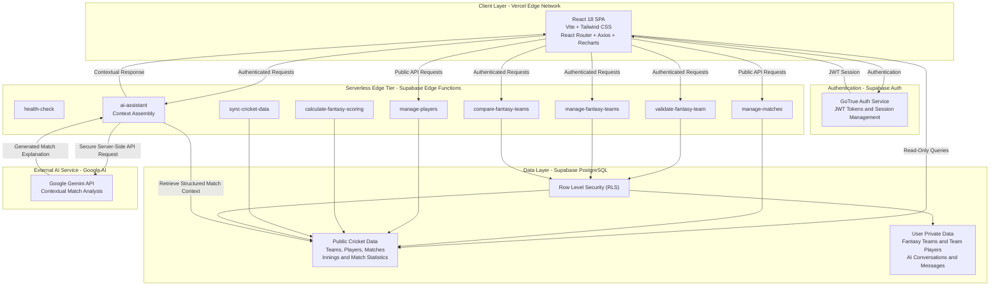
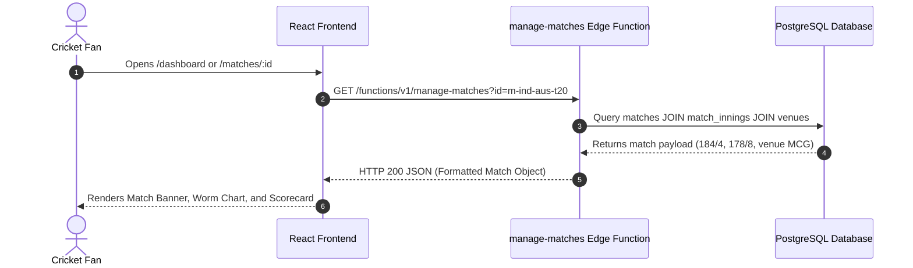
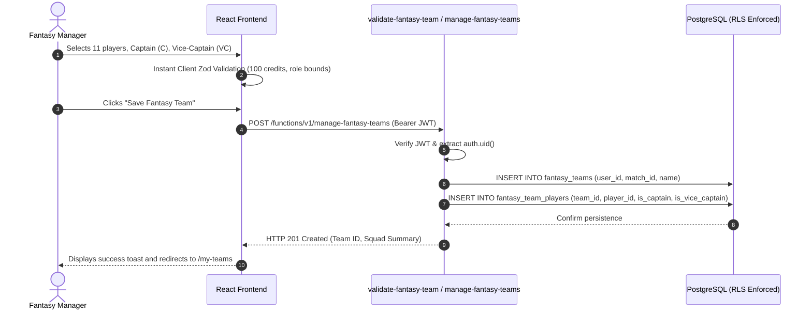
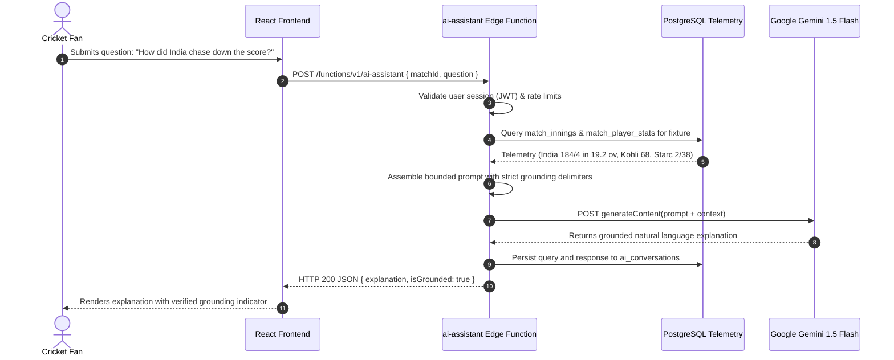

# FanPulse AI — System Architecture & Engineering Blueprint

> **Production Architectural Specification for the FanPulse AI Cricket Intelligence & Fantasy Platform.**

---

## 1. Executive Architectural Summary

FanPulse AI is structured as a modern, decoupled cloud application combining a high-performance **React Single-Page Application (SPA)** deployed on Vercel with a serverless **Supabase Cloud Backend** powered by PostgreSQL 16, Supabase Edge Functions (Deno / TypeScript runtime), and Google Gemini 1.5 Flash.



---

## 2. Architectural Evolution & Prototype History

> [!NOTE]
> **Architectural Transition:** During initial Phase 0 planning, a Java 17 / Spring Boot 3 monolith was considered as a prospective backend. However, during Phase 2 technical evaluation, the system pivoted to **Supabase Edge Functions (Deno/TypeScript) and Supabase PostgreSQL** to achieve:
> 1. Zero server management and automated sub-100ms cold starts via global Edge deployment.
> 2. Unified TypeScript/JavaScript contracts between frontend services and Edge handlers.
> 3. Native Row-Level Security (RLS) policies directly enforceable in the database engine.
> 4. Out-of-the-box JWT authentication via GoTrue.
> 
> *Historical Spring Boot specifications have been archived for reference in [`docs/archive/`](archive/).*

---

## 3. Tiered System Architecture

### 3.1 Client Layer (Frontend SPA)
- **Framework & Build:** React 18.3.1 with Vite 5.4.10 for fast hot module replacement and optimized Rollup production bundling.
- **Styling & Design System:** Tailwind CSS 3.4 with custom cricket dark-theme palettes, accessible contrast ratios, and responsive mobile-first layouts.
- **Client Routing:** React Router v6.27.0 with protected route boundaries (`<ProtectedRoute>`) ensuring unauthenticated users cannot access sensitive fantasy builder or conversation flows.
- **Data Visualization:** Recharts 2.13.0 for interactive role distribution charts, run-rate worms, and fantasy points differentials.
- **Component Primitives:** Reusable UI components (`Card`, `Badge`, `Button`, `Alert`, `StatCard`, `SkeletonCard`) with Lucide React iconography.

### 3.2 Authentication & Security Boundary
- **Provider:** Supabase GoTrue Auth providing email/password registration, login, and secure token lifecycle management.
- **Token Handling:** Access tokens (JWT) and refresh tokens stored securely in client storage; transmitted via standard `Authorization: Bearer <token>` headers to backend Edge Functions.
- **Role-Based Access:** Distinction between public visitors (`anon`), authenticated cricket fans (`authenticated`), and administrative maintenance functions.

### 3.3 Serverless Compute Tier (Supabase Edge Functions)
Nine specialized Edge Functions deployed on Supabase's distributed Deno runtime:

| Edge Function | Purpose | Auth Requirement | Upstream Integration |
| :--- | :--- | :--- | :--- |
| `health-check` | Diagnostics, uptime, and database connectivity. | Public (`--no-verify-jwt`) | PostgreSQL `SELECT 1` |
| `manage-matches` | Match listings, live scores, and innings scorecards. | Public (`--no-verify-jwt`) | PostgreSQL `matches`, `match_innings` |
| `manage-players` | Player directory, profile stats, and career averages. | Public (`--no-verify-jwt`) | PostgreSQL `players`, `match_player_stats` |
| `validate-fantasy-team` | Evaluates 11-player squad against roster rules. | Authenticated (JWT) | PostgreSQL `players` |
| `manage-fantasy-teams` | CRUD operations for user fantasy teams. | Authenticated (JWT) | PostgreSQL `fantasy_teams`, RLS |
| `compare-fantasy-teams` | Side-by-side differential analysis of 2 squads. | Authenticated (JWT) | PostgreSQL `fantasy_team_players` |
| `calculate-fantasy-scoring`| Deterministic points engine for batting/bowling/fielding. | Service / Internal | PostgreSQL `match_player_stats` |
| `sync-cricket-data` | Synchronizes telemetry from cricket providers. | Admin / Cron | External Provider / Seed Fallback |
| `ai-assistant` | Context assembly and grounded conversational chat. | Authenticated (JWT) | Google Gemini 1.5 Flash API |

### 3.4 Database & Persistence Tier (PostgreSQL 16)
- **Cloud Infrastructure:** Managed PostgreSQL 16 on Supabase with connection pooling via Supavisor.
- **Data Governance:** Row-Level Security (RLS) enabled on all public schema tables.
- **Relational Integrity:** Foreign key constraints, cascading deletes where appropriate, and composite unique keys to prevent duplicate entries (e.g., duplicate player in the same fantasy squad).

### 3.5 External AI Intelligence Tier
- **Model:** Google Gemini 1.5 Flash (`gemini-1.5-flash`).
- **Integration Boundary:** Server-side only via `ai-assistant` Edge Function. The Gemini API key is securely stored in Supabase secrets (`GEMINI_API_KEY`) and **never** exposed to client bundles.
- **Grounding Pipeline:**
  1. User asks question about a specific match fixture.
  2. Edge Function queries PostgreSQL for match status, innings totals, bowling spells, and top performers.
  3. Structured telemetry is injected into a delimiter-bounded prompt (`=== MATCH TELEMETRY ===`).
  4. Gemini generates an explanation strictly referencing the provided numbers.

---

## 4. End-to-End Request & Response Flows

### 4.1 Match Tracking & Scorecard Flow


### 4.2 Fantasy Squad Creation & Validation Flow


### 4.3 Grounded AI Match Query Flow


---

## 5. Security & Isolation Boundaries

1. **Client Isolation:** The React frontend runs in the user's browser sandbox and communicates exclusively via HTTPS/TLS 1.3.
2. **Network Perimeter:** Direct database write access from the browser is blocked. All sensitive state mutations flow through authenticated Edge Functions or RLS-gated Supabase clients.
3. **Secret Segregation:**
   - Public credentials (`VITE_SUPABASE_URL`, `VITE_SUPABASE_ANON_KEY`) only have read permissions granted by RLS.
   - Private credentials (`SUPABASE_SERVICE_ROLE_KEY`, `GEMINI_API_KEY`) reside exclusively within Supabase Edge runtime environment variables.
4. **Tenant Isolation:** Enforced via PostgreSQL Row-Level Security:
   ```sql
   CREATE POLICY "Users can only manage their own fantasy teams"
   ON public.fantasy_teams
   FOR ALL
   USING (auth.uid() = user_id);
   ```

---

*Related Specifications:*
- [Project Overview](PROJECT_OVERVIEW.md)
- [Database Schema](DATABASE_SCHEMA.md)
- [API Reference](API_REFERENCE.md)
- [AI Implementation](AI_IMPLEMENTATION.md)
- [Security Architecture](SECURITY.md)
