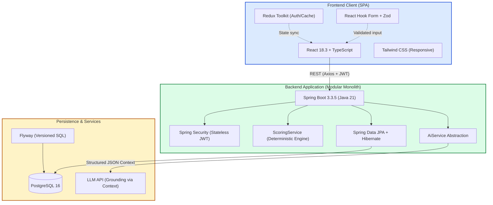

# FanPulse AI — Technology Stack Specification

> Architectural evaluation, dependency matrix, and rationale for the FanPulse AI platform.
> Derived from [PROJECT_VISION.md](file:///U:/Fanpulse_AI/docs/PROJECT_VISION.md), [REQUIREMENTS.md](file:///U:/Fanpulse_AI/docs/REQUIREMENTS.md), and [SYSTEM_ARCHITECTURE.md](file:///U:/Fanpulse_AI/docs/SYSTEM_ARCHITECTURE.md).

---

## 1. Stack Overview & Version Compatibility Matrix

The FanPulse AI architecture follows a decoupled, modular monolith model featuring a **TypeScript + React Single Page Application (SPA)** and a **Java + Spring Boot REST API**, backed by a relational **PostgreSQL** database and containerized via **Docker**.

### 1.1 Verified Stable Version Matrix

All selected versions have been cross-checked against official documentation for production stability, active Long-Term Support (LTS), and mutual dependency alignment.

| Layer | Technology | Stable Version | Lifecycle / Compatibility Notes |
|---|---|---|---|
| **Runtime** | Java | **21 (LTS)** (or 17 LTS) | Modern LTS release. Native virtual thread support (Project Loom) compatible with Spring Boot 3.3+. |
| **Runtime** | Node.js | **20.x (LTS)** / **22.x (LTS)** | Active LTS runtime for frontend build tooling and local development. |
| **Backend Core** | Spring Boot | **3.3.5** | Baseline framework. Manages unified Bill of Materials (BOM) for Spring ecosystem and testing libraries. |
| **Backend Web** | Spring Web (MVC) | **6.1.14** (via Boot BOM) | Non-reactive RESTful API foundation; Jakarta EE 10 baseline (`jakarta.*` namespace). |
| **Backend Security** | Spring Security | **6.3.4** (via Boot BOM) | Stateless JWT authentication filter chain, role-based authorization, BCrypt hashing. |
| **Backend Persistence**| Spring Data JPA | **3.3.5** (via Boot BOM) | Repository abstraction layer, transaction management. |
| **Backend ORM** | Hibernate ORM | **6.5.3.Final** (via Boot BOM)| Enterprise JPA provider with dialect-level PostgreSQL optimizations. |
| **Backend Validation** | Jakarta Bean Validation / Hibernate Validator | **3.0.2** / **8.0.1.Final** | Declarative DTO input constraints (`@Valid`, `@NotNull`, `@Size`). |
| **Backend Build** | Apache Maven | **3.9.x** | Industry standard declarative build, dependency mediation, and plugin execution. |
| **Database** | PostgreSQL | **16.4** | Production-ready ACID relational database with advanced indexing and JSONB capabilities. |
| **DB Migrations** | Flyway | **10.15.x** (`flyway-database-postgresql`) | Versioned schema migrations, deterministic database state tracking. |
| **Frontend Core** | React & React DOM | **18.3.1** | Rock-solid production stability, full ecosystem compatibility with RTK, React Router, and RTL. |
| **Frontend Language** | TypeScript | **5.5.4** | Static type safety, strict null checking, contract sharing with backend DTOs. |
| **Frontend Tooling** | Vite | **5.4.10** | Lightning-fast ESM dev server and Rollup production bundling. |
| **Frontend Styling** | Tailwind CSS | **3.4.14** | Utility-first styling engine, zero runtime overhead, responsive design system. |
| **Frontend State** | Redux Toolkit | **2.2.8** (`react-redux` 9.1.2) | Centralized state management for Auth, match caching, and predictable state transitions. |
| **Frontend Routing** | React Router | **6.27.0** (`react-router-dom`) | Declarative client-side routing, route guards (`ProtectedRoute`), layout routing. |
| **Frontend HTTP** | Axios | **1.7.7** | Promise-based HTTP client with request/response interceptors for JWT injection and error handling. |
| **Frontend Forms** | React Hook Form | **7.53.1** | Uncontrolled form state management, zero unnecessary re-renders. |
| **Frontend Validation**| Zod | **3.23.8** (`@hookform/resolvers` 3.9.0) | Schema validation with TypeScript inference for client-side forms. |
| **Backend Unit Testing**| JUnit 5 (Jupiter) | **5.10.3** (via Boot BOM) | Modern testing engine for isolated service-layer unit tests. |
| **Backend Mocking** | Mockito | **5.11.0** (via Boot BOM) | Stubbing and verification framework for dependency isolation. |
| **Backend Integration**| Spring Boot Test & Testcontainers | **3.3.5** / **1.20.2** | Full Spring context testing; containerized disposable PostgreSQL instances. |
| **Frontend Testing** | Vitest | **2.1.3** | Vite-native fast unit/component test runner using JSDOM. |
| **Frontend DOM Test** | React Testing Library | **16.0.1** (`@testing-library/react`) | User-centric DOM testing ensuring accessible component behavior. |
| **VCS & CI/CD** | Git / GitHub Actions | **Git 2.46+** / Actions v4 | Distributed version control; automated CI pipelines for linting, testing, and Docker builds. |
| **Containerization** | Docker & Docker Compose | Engine **27.x** / Compose **v2.29+** | Container isolation, reproducible builds across dev and production environments. |

---

## 2. Frontend Technologies

### 2.1 React

* **Stable Version:** `18.3.1`
* **1. Purpose:**  
  Serves as the foundational UI rendering library for constructing modular, reactive, component-based user interfaces.
* **2. Why Selected:**  
  React provides a declarative programming model and rich ecosystem support. Version 18.3.1 offers rock-solid production stability and total compatibility with the selected ecosystem (Redux Toolkit 2.x, React Router 6.x, and React Testing Library 16.x). Its concurrent rendering capabilities ensure smooth UI updates even during dense live match data rendering.
* **3. Where It Will Be Used:**  
  The entire client-side Single Page Application (SPA), including Match Scorecards, Fantasy Team Draft wizard, Side-by-Side Team Comparison views, and AI Insight panels.
* **4. Alternatives Considered:**  
  * *Vue 3:* Excellent reactivity and SFC ergonomics, but smaller enterprise talent pool for high-complexity fantasy draft tooling.
  * *Angular:* Highly structured full framework, but overly opinionated and heavier overhead for our specific lightweight SPA needs.
  * *React 19:* While modern, early library peer-dependency friction across select UI ecosystem tools makes 18.3.1 the more conservative, stable choice for immediate implementation.
* **5. Trade-offs:**  
  * *Pros:* Enormous ecosystem, extensive community troubleshooting, declarative component lifecycle.
  * *Cons:* Requires assembling an ecosystem of companion libraries (routing, state, forms) unlike all-in-one frameworks like Angular.

---

### 2.2 TypeScript

* **Stable Version:** `5.5.4`
* **1. Purpose:**  
  Provides static type checking and modern ECMAScript compilation to ensure code correctness and maintainability.
* **2. Why Selected:**  
  Cricket performance metrics and fantasy team scoring contain intricate data structures (e.g., batting rates, bowling economy, captain multipliers, role counts). TypeScript prevents entire classes of runtime errors (e.g., `undefined is not a function`, null dereferences, missing DTO properties) and delivers autocomplete developer productivity.
* **3. Where It Will Be Used:**  
  Every frontend source file (`.ts`, `.tsx`), Redux state slices, API request/response DTO interfaces, and form validation schemas.
* **4. Alternatives Considered:**  
  * *Plain JavaScript (ES6+):* Rapid initial prototyping, but severely compromises long-term maintainability and refactoring confidence.
  * *JSDoc with TypeScript checking:* Less invasive, but lacks the developer ergonomics and strict compile-time enforcement of native TypeScript.
* **5. Trade-offs:**  
  * *Pros:* Self-documenting code, refactoring confidence, contract consistency between frontend and Spring Boot DTOs.
  * *Cons:* Adds build-time compilation step; initial learning curve for advanced generic types.

---

### 2.3 Vite

* **Stable Version:** `5.4.10`
* **1. Purpose:**  
  Modern frontend build tool and development server providing native ES modules (ESM) serving and optimized Rollup production packaging.
* **2. Why Selected:**  
  Replaces legacy bundlers (like Webpack/Create React App) with sub-second cold starts and instant Hot Module Replacement (HMR). Its build pipeline produces lean, tree-shaken static assets ready for deployment via Nginx containers.
* **3. Where It Will Be Used:**  
  Local frontend development environment, HMR server, asset pipeline, production production builds (`vite build`), and test harness execution via Vitest.
* **4. Alternatives Considered:**  
  * *Webpack (via Create React App):* Deprecated, slow build times, heavy configuration debt.
  * *Turbopack / Next.js:* Tailored for Server-Side Rendering (SSR); introduces unnecessary node server deployment complexity for an API-backed SPA.
* **5. Trade-offs:**  
  * *Pros:* Exceptional developer experience, instant feedback loop, seamless integration with Vitest and PostCSS.
  * *Cons:* Requires specific ESM-aware dependency configurations for older CommonJS packages (minimal in modern stacks).

---

### 2.4 Tailwind CSS

* **Stable Version:** `3.4.14`
* **1. Purpose:**  
  Utility-first CSS framework for rapid UI styling, custom design system implementation, and responsive layout management.
* **2. Why Selected:**  
  Eliminates stylesheet context-switching and bloated CSS files. Tailwind compiles only the exact classes utilized into a minified, lightweight stylesheet (~10–20 KB). It effortlessly satisfies non-functional usability requirements (`NFR-USE-01`) for mobile, tablet (768px+), and desktop (1024px+) viewports.
* **3. Where It Will Be Used:**  
  All UI components, dashboards, scorecards, responsive grids, and design elements (typography, modals, badges, color-coded points indicators).
* **4. Alternatives Considered:**  
  * *Material UI (MUI) / Ant Design:* Pre-built components accelerate initial build, but inject heavy runtime styling overhead and enforce rigid opinions hard to customize for custom cricket layouts.
  * *CSS Modules:* Scoped CSS without utility acceleration; requires authoring voluminous custom CSS rules.
* **5. Trade-offs:**  
  * *Pros:* Zero runtime CSS-in-JS performance penalty, enforced spacing/color consistency, rapid responsive styling.
  * *Cons:* Can lead to verbose HTML/JSX class strings if component extraction is neglected.

---

### 2.5 Redux Toolkit (RTK)

* **Stable Version:** `2.2.8` (with `react-redux` `9.1.2`)
* **1. Purpose:**  
  Standardized, opinionated state management library for managing global application state, asynchronous API interactions, and state caching.
* **2. Why Selected:**  
  Eliminates historic Redux boilerplate using `createSlice` and `createAsyncThunk`. Redux Toolkit integrates Immer out of the box for safe immutable mutations. It cleanly separates auth session state (`token`, `userProfile`, `isAuthenticated`) from ephemeral component state, ensuring seamless access across API interceptors and route guards.
* **3. Where It Will Be Used:**  
  * `authSlice`: JWT token, user credentials, login/logout session state.
  * `matchSlice`: Match list and scorecard caching to prevent redundant backend round-trips.
  * `fantasySlice`: Active user fantasy teams and draft selections.
* **4. Alternatives Considered:**  
  * *Zustand:* Extremely clean and lightweight, but lacks the formal architectural conventions and enterprise debugging tooling (Redux DevTools) beneficial for complex state flows.
  * *React Context API:* Good for static themes, but triggers sweeping component re-renders when managing frequently updated collections or auth states.
* **5. Trade-offs:**  
  * *Pros:* Predictable unidirectional data flow, Redux DevTools time-travel debugging, structured action patterns.
  * *Cons:* Slight architectural ceremony compared to simple hook-based state stores.

---

### 2.6 React Router

* **Stable Version:** `6.27.0` (`react-router-dom`)
* **1. Purpose:**  
  Client-side routing library enabling declarative navigation, nested page layouts, and deep-linking in a Single Page Application.
* **2. Why Selected:**  
  React Router v6 provides lightweight, performant routing hooks (`useNavigate`, `useParams`, `useLocation`) and nested routing via `<Outlet />`. It enables clean encapsulation of protected routes (`ProtectedRoute`) to enforce authentication requirements (`FR-AUTH-07`).
* **3. Where It Will Be Used:**  
  Root routing definition (`App.tsx`), route protection guards, parameter parsing (`/matches/:id`, `/my-teams/:teamId`), and layout nesting (MainLayout vs. AuthLayout).
* **4. Alternatives Considered:**  
  * *TanStack Router:* Fully type-safe search parameters, but steeper learning curve and larger footprint for standard URL structures.
  * *Wouter:* Ultra-minimalist (1.5 KB), but lacks advanced nested layout routes and loader patterns needed for multi-page application feel.
* **5. Trade-offs:**  
  * *Pros:* Industry-standard pattern, straightforward nested route configuration, robust browser history integration.
  * *Cons:* Major version migrations in the React Router ecosystem have historically required architectural refactoring.

---

### 2.7 Axios

* **Stable Version:** `1.7.7`
* **1. Purpose:**  
  Promise-based HTTP client for executing asynchronous REST API requests from the browser to the backend service.
* **2. Why Selected:**  
  Axios provides out-of-the-box request and response interceptors. This enables automatic injection of JWT Bearer tokens into the `Authorization` header for all protected endpoints, centralized 401 Unauthorized handling (session eviction and login redirect), and unified timeout handling (`NFR-PERF-01`).
* **3. Where It Will Be Used:**  
  Centralized API client (`src/utils/apiClient.ts`), auth API calls, match data querying, fantasy team mutation calls, and AI trigger endpoints.
* **4. Alternatives Considered:**  
  * *Native `fetch`:* Built into modern browsers with zero bundle weight, but requires manual boilerplate for interceptors, timeout cancellation, and JSON error parsing.
  * *Ky:* Modern fetch-wrapper, but less prevalent in enterprise TypeScript patterns than Axios.
* **5. Trade-offs:**  
  * *Pros:* Automatic JSON transform, unified error handling, robust interceptor architecture.
  * *Cons:* Adds small external bundle footprint (~13 KB gzipped) compared to native `fetch`.

---

### 2.8 React Hook Form

* **Stable Version:** `7.53.1`
* **1. Purpose:**  
  High-performance, lightweight form management library leveraging uncontrolled inputs via React refs.
* **2. Why Selected:**  
  Constructing a fantasy team draft form involves manipulating an 11-player lineup with role filters, captain selections, and vice-captain selections. Traditional controlled form components re-render the entire view on every keystroke or checkbox toggle. React Hook Form isolates re-renders to the specific field changing, maintaining high responsiveness (`NFR-USE-01`).
* **3. Where It Will Be Used:**  
  User Registration form (`UC-01`), User Login form (`UC-02`), and the Fantasy Team Creation & Edit form (`UC-05`).
* **4. Alternatives Considered:**  
  * *Formik:* Widely used historically, but relies heavily on controlled component state leading to noticeable lag on complex forms; maintenance has slowed.
  * *Custom React `useState`:* Leads to excessive boilerplate, manual validation wiring, and error-handling fragmentation.
* **5. Trade-offs:**  
  * *Pros:* Minimal re-renders, zero external dependencies, native integration with schema validation resolvers.
  * *Cons:* Requires understanding uncontrolled input behavior when integrating custom UI wrappers.

---

### 2.9 Zod

* **Stable Version:** `3.23.8` (with `@hookform/resolvers` `3.9.0`)
* **1. Purpose:**  
  TypeScript-first schema declaration and validation library with static type inference.
* **2. Why Selected:**  
  Allows defining validation rules once (email format, password complexity, team composition limits) in a declarative schema. Zod infers the TypeScript static type directly from the schema (`z.infer<typeof schema>`), eliminating type/validation drift. Coupled with `@hookform/resolvers`, it delivers immediate inline form feedback (`NFR-USE-02`).
* **3. Where It Will Be Used:**  
  Client-side validation of registration/login inputs (`FR-AUTH-01`), fantasy team draft constraints (validating 11 players, role minimums) before submitting API requests.
* **4. Alternatives Considered:**  
  * *Yup:* Popular schema validator, but historically weaker TypeScript type inference and looser schema typing than Zod.
  * *Joi:* Primarily designed for Node.js backends; heavier bundle overhead in the browser.
* **5. Trade-offs:**  
  * *Pros:* Eliminates duplicate interface definitions, expressive validation rules, zero client-side dependencies.
  * *Cons:* Adds minor runtime bundle footprint (~12 KB minified).

---

## 3. Backend Technologies

### 3.1 Java

* **Stable Version:** `21 (LTS)` (Baseline minimum: `17 LTS`)
* **1. Purpose:**  
  Primary object-oriented backend programming language running on the Java Virtual Machine (JVM).
* **2. Why Selected:**  
  Java 21 LTS brings modern developer features including Records (ideal for immutable DTOs and API requests), Pattern Matching, Sealed Classes, and Virtual Threads (Project Loom). It provides enterprise stability, strong memory management, and first-class typing for high-precision business logic like fantasy points calculations (`FR-SCORE-01`).
* **3. Where It Will Be Used:**  
  The entire backend application code base: controllers, business logic services, security filters, data entities, DTOs, and utility algorithms.
* **4. Alternatives Considered:**  
  * *Kotlin:* Highly expressive with native null safety, but introduces additional language runtime dependencies and requires specialized JVM developer familiarity.
  * *Node.js / TypeScript:* Unified language across stack, but less mature transactional enterprise frameworks compared to Spring Boot/PostgreSQL.
* **5. Trade-offs:**  
  * *Pros:* Long-term enterprise support, massive ecosystem, top-tier performance, thread-safe memory model.
  * *Cons:* More verbose syntax than scripting languages (though significantly alleviated by Java 21 records and var).

---

### 3.2 Spring Boot

* **Stable Version:** `3.3.5`
* **1. Purpose:**  
  Application framework providing opinionated auto-configuration, dependency injection, and embedded web server management.
* **2. Why Selected:**  
  Spring Boot 3 eliminates boilerplate configuration, standardizes dependency versions via curated starters, and embeds an optimized Tomcat web container. It enables rapid development of production-grade microservices or modular monoliths while seamlessly orchestrating data access, security, and transaction boundaries.
* **3. Where It Will Be Used:**  
  Core application bootstrap (`FanPulseApplication.java`), application configuration properties (`application.yml`), dependency injection container, and lifecycle management.
* **4. Alternatives Considered:**  
  * *Micronaut:* Near-instant startup and low memory footprint via ahead-of-time (AOT) compilation, but smaller community and fewer pre-integrated libraries.
  * *Quarkus:* Tailored for Kubernetes/GraalVM native deployments, but less widespread in standard relational enterprise setups than Spring.
* **5. Trade-offs:**  
  * *Pros:* Vast documentation, seamless ecosystem integration, standardized production actuator monitoring.
  * *Cons:* Heavier initial startup time and memory footprint compared to lightweight Go or Node runtimes.

---

### 3.3 Spring Web (Spring MVC)

* **Stable Version:** `6.1.14` (managed via Spring Boot 3.3.5)
* **1. Purpose:**  
  Web framework for building RESTful web services using the Model-View-Controller design pattern.
* **2. Why Selected:**  
  Provides declarative, annotation-driven REST endpoint mapping (`@RestController`, `@GetMapping`, `@PostMapping`). It automatically handles HTTP parameter binding, JSON serialization via Jackson, and integrates directly with Spring's central exception handling mechanisms (`@RestControllerAdvice`).
* **3. Where It Will Be Used:**  
  All API controllers: `AuthController`, `MatchController`, `PlayerController`, `FantasyTeamController`, `ComparisonController`, and `AiController`.
* **4. Alternatives Considered:**  
  * *Spring WebFlux (Reactive):* Non-blocking reactive streams, but adds substantial debugging complexity and is incompatible with traditional blocking JDBC / JPA transactions without reactive drivers (R2DBC).
  * *JAX-RS (Jersey):* Standard Java specification, but requires additional integration glue code when hosted within Spring Boot.
* **5. Trade-offs:**  
  * *Pros:* Mature, synchronous thread-per-request model that is straightforward to reason about and debug; enhanced by Java 21 virtual threads.
  * *Cons:* Synchronous blocking I/O model (mitigated through proper connection pooling and virtual thread capabilities).

---

### 3.4 Spring Security

* **Stable Version:** `6.3.4` (managed via Spring Boot 3.3.5)
* **1. Purpose:**  
  Comprehensive authentication, authorization, and attack mitigation framework for Java applications.
* **2. Why Selected:**  
  Enforces role-based access control (`ROLE_USER`, `ROLE_ADMIN`) and declarative method security (`@PreAuthorize`). Spring Security's filter chain architecture cleanly hosts custom JWT authentication filters, CSRF mitigations, CORS management, and industry-standard password hashing using BCrypt (`NFR-SEC-01`, `NFR-SEC-04`).
* **3. Where It Will Be Used:**  
  Security configuration (`SecurityConfig.java`), `JwtAuthenticationFilter`, route authorization rules, BCrypt password encoder bean, and current user context resolution.
* **4. Alternatives Considered:**  
  * *Apache Shiro:* Simpler security model, but lacks the deep, automated configuration alignment provided natively by Spring Boot.
  * *Custom Security Interceptors:* Prone to subtle authentication bypass vulnerabilities and improper handling of security contexts.
* **5. Trade-offs:**  
  * *Pros:* Industry-standard security hardening, active vulnerability patching, highly customizable filter chain.
  * *Cons:* Steep learning curve and complex internal abstraction layers.

---

### 3.5 Spring Data JPA

* **Stable Version:** `3.3.5` (managed via Spring Boot 3.3.5)
* **1. Purpose:**  
  Data access abstraction framework reducing data persistence boilerplate through repository interfaces.
* **2. Why Selected:**  
  Generates data access queries automatically from method signatures (e.g., `findByEmail`, `findByMatchIdAndUserId`). It provides built-in pagination, sorting, and seamless declarative transaction management via `@Transactional` to guarantee atomicity for fantasy team creation (`NFR-REL-02`).
* **3. Where It Will Be Used:**  
  Repository interfaces (`UserRepository`, `MatchRepository`, `PlayerRepository`, `FantasyTeamRepository`, `PlayerMatchPerformanceRepository`).
* **4. Alternatives Considered:**  
  * *MyBatis:* High query control with raw SQL mapping, but requires authoring tedious boilerplate mapping code for standard CRUD operations.
  * *jOOQ:* Type-safe SQL builder, but requires a pre-existing schema and extra build steps without the automated entity lifecycle management of JPA.
* **5. Trade-offs:**  
  * *Pros:* Drastically reduces data-layer code volume, standardizes CRUD patterns, handles entity relationships natively.
  * *Cons:* Can hide query complexity, requiring developer vigilance to prevent N+1 query performance pitfalls.

---

### 3.6 Hibernate ORM

* **Stable Version:** `6.5.3.Final` (managed via Spring Boot 3.3.5)
* **1. Purpose:**  
  Underlying Object-Relational Mapping (ORM) engine implementing the JPA specification to map Java entities to PostgreSQL relational tables.
* **2. Why Selected:**  
  Hibernate manages entity state transitions, lazy loading of complex relationships (e.g., Match to Innings, Team to Players), and second-level caching. Hibernate 6 includes major performance overhauls, transforming HQL/JPQL directly into clean, optimized native SQL dialect queries.
* **3. Where It Will Be Used:**  
  Entity models (`User`, `Match`, `Innings`, `Player`, `FantasyTeam`, `PlayerMatchPerformance`) and relational mapping logic (`@OneToMany`, `@ManyToOne`, `@JoinColumn`).
* **4. Alternatives Considered:**  
  * *EclipseLink:* Compliant JPA provider, but has a smaller community and fewer optimizations within the Spring Boot ecosystem than Hibernate.
  * *Raw JDBC (JdbcTemplate):* Maximum execution speed, but requires manual mapping of hundreds of table columns to Java domain models.
* **5. Trade-offs:**  
  * *Pros:* Automatic dirty checking, relational mapping, connection session management.
  * *Cons:* Misconfigured fetch types (`FetchType.EAGER`) can severely degrade performance; requires strict use of `FetchType.LAZY` and join-fetching.

---

### 3.7 Jakarta Bean Validation & Hibernate Validator

* **Stable Version:** API `3.0.2` / Implementation `8.0.1.Final`
* **1. Purpose:**  
  Standardized declarative constraint validation framework for Java beans and REST payload DTOs.
* **2. Why Selected:**  
  Guarantees that invalid or malformed data is rejected at the controller boundary before reaching the service or persistence layer. Annotations like `@NotBlank`, `@Email`, `@Size`, and `@Min` enforce input sanitization and boundary checks (`NFR-SEC-05`), returning standard HTTP 400 responses.
* **3. Where It Will Be Used:**  
  Incoming request DTOs (`RegisterRequest`, `LoginRequest`, `CreateFantasyTeamRequest`, `UpdateProfileRequest`).
* **4. Alternatives Considered:**  
  * *Manual Imperative Validation in Services:* Writing procedural `if-else` blocks in business services clutters domain logic and leads to inconsistent error formats.
  * *Spring Validator Interface:* Functional, but more verbose than standard declarative annotations.
* **5. Trade-offs:**  
  * *Pros:* Declarative, readable, standardized error code generation, clean separation from domain logic.
  * *Cons:* Validates field structures effectively, but cannot replace complex multi-entity business rule validation (which remains in the Service layer).

---

### 3.8 Apache Maven

* **Stable Version:** `3.9.9` (configured with Maven Wrapper `mvnw`)
* **1. Purpose:**  
  Declarative build automation, dependency resolution, and lifecycle management tool for the backend application.
* **2. Why Selected:**  
  Maven is the enterprise standard for Java and Spring Boot ecosystems. Its Project Object Model (`pom.xml`) ensures deterministic dependency trees through the Spring Boot starter parent BOM. The included Maven Wrapper guarantees identical builds across all developer workstations and GitHub Actions CI runners without manual local installation.
* **3. Where It Will Be Used:**  
  Backend project build, dependency resolution, test execution (`mvn test`), and Docker multi-stage artifact packaging (`mvn package`).
* **4. Alternatives Considered:**  
  * *Gradle:* Faster incremental builds via build caching, but more complex Groovy/Kotlin DSL scripting and greater likelihood of build drift across teams.
* **5. Trade-offs:**  
  * *Pros:* Highly standardized conventions, predictable lifecycle, zero-configuration dependency management via Spring BOM.
  * *Cons:* XML configuration can be verbose; slower cold builds compared to Gradle.

---

## 4. Database Technologies

### 4.1 PostgreSQL

* **Stable Version:** `16.4`
* **1. Purpose:**  
  Enterprise-grade, open-source object-relational database management system (RDBMS) serving as the single source of truth for persistent data.
* **2. Why Selected:**  
  Cricket data and fantasy leagues require strict ACID guarantees, multi-table transactional consistency (such as atomic team drafting), and rigorous foreign-key constraints. PostgreSQL 16 delivers outstanding query optimization, rock-solid concurrency via MVCC, and native JSONB data types (useful for storing raw match data snapshots or AI data contexts).
* **3. Where It Will Be Used:**  
  Persisting all system data: Users, Matches, Innings, Rosters, Players, Match Performances, Fantasy Teams, and Scoring Rules.
* **4. Alternatives Considered:**  
  * *MySQL / MariaDB:* Widely adopted, but historically less robust with complex joins, advanced indexing, and JSON data transformations.
  * *MongoDB (NoSQL):* Document model fits hierarchical match scorecards, but lacks the rigid schema integrity, relational joins, and ACID transactional enforcement required for fantasy team validations and user accounts.
* **5. Trade-offs:**  
  * *Pros:* Proven reliability, rich SQL standard compliance, strong data integrity constraints, native JSON support.
  * *Cons:* Requires active connection pool sizing and index optimization for large datasets.

---

### 4.2 Flyway

* **Stable Version:** `10.15.2` (via `flyway-database-postgresql`)
* **1. Purpose:**  
  Open-source database migration and schema version control tool.
* **2. Why Selected:**  
  Replaces error-prone manual DDL execution and unstable ORM auto-generation (`ddl-auto: update`). Flyway executes sequential, immutable SQL migration scripts (`V1__initial_schema.sql`, `V2__seed_sample_data.sql`), recording execution hashes in a `flyway_schema_history` table. This guarantees identical schema states across development, testing, and production environments (`NFR-MAINT-04`).
* **3. Where It Will Be Used:**  
  `backend/src/main/resources/db/migration/` directory; executed automatically on Spring Boot application startup.
* **4. Alternatives Considered:**  
  * *Liquibase:* Highly capable XML/YAML/JSON/SQL format support, but significantly more verbose and complex than Flyway's straightforward plain-SQL migration files.
  * *Hibernate Schema Generation (`ddl-auto: create/update`):* Unsuitable for production; frequently alters schemas unexpectedly and cannot handle safe data migrations.
* **5. Trade-offs:**  
  * *Pros:* Plain SQL script authoring, version-controlled audit trail, zero developer friction.
  * *Cons:* Applied migrations are immutable; schema changes require creating a new sequential migration script.

---

## 5. Testing Technologies

### 5.1 JUnit 5 (JUnit Jupiter)

* **Stable Version:** `5.10.3` (managed via Spring Boot 3.3.5)
* **1. Purpose:**  
  Modern test execution framework for writing and running unit and integration tests on the JVM.
* **2. Why Selected:**  
  Provides expressive test lifecycles, parameterized testing (`@ParameterizedTest`), and clean test naming (`@DisplayName`). Parameterized tests are especially critical for testing cricket fantasy scoring rules (`BR-SCORE-*`), allowing dozens of scoring boundary scenarios (runs, wickets, economy rates) to run against a single test method.
* **3. Where It Will Be Used:**  
  All backend unit tests, service tests, scoring engine verification, and integration tests.
* **4. Alternatives Considered:**  
  * *JUnit 4:* Legacy runner architecture; lacks modern extensions and parameterized test capabilities.
  * *TestNG:* Capable, but not the primary native standard supported by the modern Spring Boot starter ecosystem.
* **5. Trade-offs:**  
  * *Pros:* First-class IDE and Maven integration, modular architecture, extensive assertion library support.
  * *Cons:* None; it is the universal testing standard for modern Java.

---

### 5.2 Mockito

* **Stable Version:** `5.11.0` (managed via Spring Boot 3.3.5)
* **1. Purpose:**  
  Java mocking framework for creating test doubles, stubs, and mocks in unit tests.
* **2. Why Selected:**  
  Enables isolated testing of the service layer without spinning up real databases or external network services (`NFR-TEST-01`). Allows precise verification of method interactions (e.g., verifying `UserRepository.save()` was invoked with the hashed password, or stubbing `AiService` to return predictable text).
* **3. Where It Will Be Used:**  
  Service-level unit tests (`AuthServiceTest`, `FantasyTeamServiceTest`, `AiPromptBuilderTest`).
* **4. Alternatives Considered:**  
  * *EasyMock:* Functional, but exhibits clunkier syntax and record-replay conventions compared to Mockito's clean `given-when-then` style.
  * *WireMock:* Used for HTTP stubbing rather than internal Java class mocking (WireMock can complement Mockito for external LLM API testing).
* **5. Trade-offs:**  
  * *Pros:* Clean API, seamless integration with `@ExtendWith(MockitoExtension.class)`, clear verification errors.
  * *Cons:* Overusing mocks can lead to brittle tests that test implementation details rather than business behavior.

---

### 5.3 Spring Boot Test & Testcontainers

* **Stable Version:** `3.3.5` (Spring Boot Test) / `1.20.2` (Testcontainers)
* **1. Purpose:**  
  Integration testing suite providing Spring ApplicationContext caching, web test client utilities (`MockMvc`), and containerized real dependency testing.
* **2. Why Selected:**  
  Unit tests cannot catch subtle SQL errors, transaction rollback failures, or JPA mapping bugs. Testcontainers spins up a real, temporary PostgreSQL 16 container via Docker during test runs. Flyway migrations execute against the real database, validating actual SQL constraints and repositories (`NFR-TEST-02`).
* **3. Where It Will Be Used:**  
  Backend integration test suite: testing REST endpoints via `MockMvc`, database transactions, and security filter enforcement.
* **4. Alternatives Considered:**  
  * *H2 In-Memory Database:* Fast and lightweight, but does not use the PostgreSQL dialect; hides syntax errors, casing mismatches, and JSONB incompatibilities.
  * *Static Pre-Shared Test Database:* Prone to data collisions and state contamination between parallel test runs.
* **5. Trade-offs:**  
  * *Pros:* Absolute fidelity to production PostgreSQL; zero environment-specific discrepancies.
  * *Cons:* Requires local Docker daemon; increases cold test suite execution time by several seconds.

---

### 5.4 Vitest

* **Stable Version:** `2.1.3`
* **1. Purpose:**  
  Next-generation, Vite-native unit and component test runner.
* **2. Why Selected:**  
  Shares the exact same configuration, plugins, and transformation pipeline as the Vite development build (`vite.config.ts`). It is dramatically faster than Jest, provides out-of-the-box TypeScript execution without separate compilation pipelines, and offers Jest-compatible APIs (`describe`, `it`, `expect`).
* **3. Where It Will Be Used:**  
  Frontend unit testing of utility functions, Redux reducers, Zod schema validation logic, and custom React hooks (`NFR-TEST-03`).
* **4. Alternatives Considered:**  
  * *Jest:* The historical standard, but notoriously difficult to configure with modern ESM and Vite, requiring heavy Babel/ts-jest conversion layers.
  * *Karma / Mocha:* Deprecated or cumbersome compared to modern integrated runners.
* **5. Trade-offs:**  
  * *Pros:* Blazing speed, instant watch-mode feedback, native ESM and TypeScript support.
  * *Cons:* Slightly newer ecosystem than Jest (though fully API compatible in practical usage).

---

### 5.5 React Testing Library (RTL)

* **Stable Version:** `16.0.1` (`@testing-library/react` with `@testing-library/jest-dom` `6.5.0`)
* **1. Purpose:**  
  UI component testing utility designed to test components from the perspective of an end-user.
* **2. Why Selected:**  
  Discourages testing implementation details (such as internal component state or private methods). Instead, tests query the DOM using accessible roles, labels, and text (e.g., `screen.getByRole('button', { name: /create fantasy team/i })`). This ensures tests remain resilient to internal refactoring while verifying actual user-facing flows (`NFR-TEST-03`).
* **3. Where It Will Be Used:**  
  Component-level integration tests for registration/login forms, match scorecard rendering, and fantasy team selection interactions.
* **4. Alternatives Considered:**  
  * *Enzyme:* Deprecated; focused heavily on inspecting component internals and shallow rendering.
  * *Cypress / Playwright (Component Testing):* Powerful, but heavier to run in continuous unit testing loops than RTL + JSDOM.
* **5. Trade-offs:**  
  * *Pros:* Promotes accessible markup, resilient test assertions, mirrors user interaction patterns.
  * *Cons:* Requires understanding DOM accessibility tree querying instead of simple CSS class selectors.

---

## 6. Development & DevOps Technologies

### 6.1 Git

* **Stable Version:** `2.46.x+`
* **1. Purpose:**  
  Distributed version control system for tracking source code revisions and coordinating collaborative engineering.
* **2. Why Selected:**  
  Universal industry standard. Facilitates atomic commits, structured branching strategies (e.g., GitHub Flow), and safe code rollback capabilities.
* **3. Where It Will Be Used:**  
  Entire project repository (`U:\Fanpulse_AI`), tracking all documentation, build configurations, and source code.
* **4. Alternatives Considered:**  
  * *Subversion / Mercurial:* Centralized or niche systems with obsolete tooling support.
* **5. Trade-offs:**  
  * *Pros:* Complete offline history, universal tooling support, cryptographic commit integrity.
  * *Cons:* Merge conflicts require disciplined branch lifecycles and frequent rebasing/merging.

---

### 6.2 GitHub

* **Stable Version:** Cloud Service (Enterprise / Standard)
* **1. Purpose:**  
  Cloud-hosted repository platform providing source control hosting, code review workflows, issue tracking, and CI/CD integration.
* **2. Why Selected:**  
  De facto standard for software development. Provides Pull Request reviews with required status checks, branch protection rules to safeguard `main`, and tightly integrated automation via GitHub Actions.
* **3. Where It Will Be Used:**  
  Remote origin repository, team code reviews, security advisory alerts (Dependabot), and milestone tracking.
* **4. Alternatives Considered:**  
  * *GitLab:* Comprehensive DevOps platform, but heavier to maintain if self-hosted.
  * *Bitbucket:* Deep Jira integration, but less active community ecosystem and third-party action marketplace.
* **5. Trade-offs:**  
  * *Pros:* Unmatched developer familiarity, native CI/CD integration, rich third-party marketplace.
  * *Cons:* Hosted third-party service dependency.

---

### 6.3 Docker

* **Stable Version:** `27.2.0` (Docker Engine)
* **1. Purpose:**  
  Operating-system-level container virtualization platform for packaging software and its dependencies into lightweight, portable container images.
* **2. Why Selected:**  
  Eliminates "works on my machine" inconsistencies by bundling runtime dependencies (JDK 21, Node runtime, Nginx) inside immutable images. Multi-stage Dockerfiles keep production images lean by discarding compiler tools and intermediate build artifacts.
* **3. Where It Will Be Used:**  
  * `frontend/Dockerfile`: Multi-stage build (`node:20-alpine` build -> `nginx:alpine` runtime).
  * `backend/Dockerfile`: Multi-stage build (`maven:3.9-eclipse-temurin-21` build -> `eclipse-temurin:21-jre-alpine` runtime).
* **4. Alternatives Considered:**  
  * *Bare-metal / Local Installation:* Prone to local environment drift, incompatible runtime versions, and complex onboarding.
  * *Podman:* Daemonless OCI alternative, but Docker remains the most widely documented standard for cross-platform team environments.
* **5. Trade-offs:**  
  * *Pros:* Identical environments across development and production, encapsulated network boundaries, rapid spin-up.
  * *Cons:* Requires local virtualization resources (RAM/CPU allocation).

---

### 6.4 Docker Compose

* **Stable Version:** `v2.29.2`
* **1. Purpose:**  
  Multi-container orchestration utility for defining and running multi-container Docker applications via declarative YAML configurations.
* **2. Why Selected:**  
  Enables any developer to spin up the entire FanPulse AI stack (React frontend, Spring Boot backend, and PostgreSQL database) with a single command (`docker compose up --build`). Manages internal container networking, persistent volume mounting, and environment variable injection.
* **3. Where It Will Be Used:**  
  Project root `docker-compose.yml` defining the three primary services (`frontend`, `backend`, `db`), local persistent data volumes, and health-check dependencies.
* **4. Alternatives Considered:**  
  * *Kubernetes (Minikube / Kind):* Drastically overengineered for an MVP with single-instance components; introduces excessive manifest management overhead.
  * *Manual Multi-Container Docker run scripts:* Fragile, difficult to network together, and lacks automated teardown.
* **5. Trade-offs:**  
  * *Pros:* Single-command local environment bootstrap, declarative networking and volume management.
  * *Cons:* Designed for single-host deployments; not suitable for multi-node production clustering without container orchestration (e.g., ECS or Kubernetes).

---

### 6.5 GitHub Actions

* **Stable Version:** Continuous Runner (`actions/checkout@v4`, `actions/setup-java@v4`, `actions/setup-node@v4`)
* **1. Purpose:**  
  Continuous Integration and Continuous Deployment (CI/CD) automation platform directly integrated into the GitHub repository.
* **2. Why Selected:**  
  Automates quality gates on every Pull Request. Runs automated linting, executes backend JUnit tests, runs frontend Vitest suites, and verifies that Docker container builds succeed before allowing code to merge into the `main` branch.
* **3. Where It Will Be Used:**  
  `.github/workflows/ci.yml` pipeline executing on every push and pull request.
* **4. Alternatives Considered:**  
  * *Jenkins:* Self-hosted CI server requiring dedicated maintenance, patching, and infrastructure management.
  * *CircleCI / Travis CI:* Capable hosted alternatives, but require external account management and lack native GitHub repository context.
* **5. Trade-offs:**  
  * *Pros:* Zero external infrastructure to manage, fast execution with hosted runners, declarative YAML workflow syntax.
  * *Cons:* Free tier limits build minutes for private repositories; runner cold starts can introduce minor latency.

---

## 7. AI Strategy & Implementation Architecture

### 7.1 LLM API Integration

* **Implementation:** Backend-mediated REST client via Spring Boot using an abstraction interface (`AiService`).
* **Target Model Categories:** Cost-effective, high-reasoning instruction-following models (e.g., Google Gemini 1.5 Flash / Pro, or OpenAI GPT-4o-mini).
* **1. Purpose:**  
  Transforms raw cricket match scorecards and player performance statistics into fluent, coherent, human-readable match situation summaries and player evaluations (`FR-AI-01`, `FR-INSIGHT-01`).
* **2. Why Selected:**  
  Building and training an in-house Natural Language Generation (NLG) model is cost-prohibitive and impractical for our scope. Commercial LLM APIs provide state-of-the-art narrative summarization capabilities via simple API calls. Routing requests strictly through the backend preserves API key confidentiality, controls usage quotas, and enforces strict input grounding.
* **3. Where It Will Be Used:**  
  * `AiPromptBuilder.java`: Assembles structured data and system instructions.
  * `LlmAiServiceImpl.java`: Dispatches HTTP calls to the LLM API provider.
  * `AiController.java`: Exposes `/api/ai/match-summary`, `/api/ai/player-insight`, and `/api/ai/key-moments`.
* **4. Alternatives Considered:**  
  * *Self-Hosted Open-Source LLM (e.g., Llama 3 on local GPU):* Eliminates API subscription costs, but introduces massive operational complexity, GPU infrastructure expenses, and high latency.
  * *Direct Frontend-to-LLM Calls:* Catastrophic security vulnerability (exposes proprietary API keys to the browser client and bypasses backend data validation).
* **5. Trade-offs:**  
  * *Pros:* Immediate access to cutting-edge natural language generation, zero machine learning training overhead, pay-per-token economics.
  * *Cons:* External network latency (2–5 seconds per generation), token cost per request, dependence on third-party service availability.

---

### 7.2 Prompt Engineering Architecture

* **1. Purpose:**  
  Defines the deterministic templates, role personas, constraints, and data formatting passed to the LLM to govern its generation behavior.
* **2. Why Selected:**  
  Cricket terminology is nuanced (e.g., strike rates, maiden overs, run chases, Duckworth-Lewis considerations). Explicit prompt engineering prevents hallucinations, ensures the model adopts an authoritative yet accessible sports analyst persona, and strictly enforces business rules `BR-AI-01` and `BR-AI-02` (no predictions, no betting advice, no fabricated statistics).
* **3. Where It Will Be Used:**  
  Backend `AiPromptBuilder` service.
* **4. Prompt Construction Design:**
  * **System Role Definition:**
    > *"You are an expert, impartial cricket analyst for FanPulse AI. Your task is to explain the match situation concisely for cricket fans using ONLY the verified match data provided. Never fabricate statistics, extrapolate unrecorded events, or offer match predictions or betting advice."*
  * **Few-Shot Exemplars (Optional):** Short, curated input-output examples demonstrating the expected tone, density, and formatting.
  * **Negative Constraints:** Explicitly prohibiting gambling terminology, speculative outcomes, or references to external data outside the supplied prompt.
* **5. Trade-offs:**  
  * *Pros:* Low implementation complexity, highly adaptable to different LLM providers, completely verifiable output formats.
  * *Cons:* Requires ongoing tuning and automated regression evaluation to prevent prompt drift across LLM version updates.

---

### 7.3 Structured Match Context

* **1. Purpose:**  
  The programmatic extraction and formatting of relational database entities into a concise, token-efficient JSON or structured YAML payload supplied inside the LLM prompt.
* **2. Why Selected:**  
  Language models perform with significantly higher factual precision when presented with clearly delineated, hierarchical data structures rather than unstructured prose. Supplying pre-calculated figures (e.g., "required run rate: 8.4", "fall of wickets: 45/1, 89/2") prevents the LLM from making basic arithmetic errors during generation.
* **3. Where It Will Be Used:**  
  `MatchService` and `PlayerService` data assemblers feeding `AiPromptBuilder`.
* **4. Context Structure Specification:**
  ```json
  {
    "match": {
      "teams": { "batting": "India", "bowling": "Australia" },
      "format": "T20",
      "target": 185,
      "currentScore": "142/4",
      "overs": "16.2",
      "requiredRunRate": 11.72
    },
    "keyPerformances": [
      { "player": "Virat Kohli", "role": "Batter", "stats": "68 runs (42 balls, 5x4, 2x6), dismissed" },
      { "player": "Pat Cummins", "role": "Bowler", "stats": "3.2-0-24-2" }
    ],
    "turningPoints": [
      { "event": "Wicket of Rohit Sharma", "over": "4.1", "score": "32/1" },
      { "event": "50-run partnership", "overs": "5.2-11.4", "runs": 54 }
    ]
  }
  ```
* **5. Trade-offs:**  
  * *Pros:* 100% data grounding, minimal token consumption, zero hallucination of player names or score figures.
  * *Cons:* Requires backend logic to filter and distill dense database tables into a compact context object.

---

### 7.4 Architectural Evaluation: RAG (Retrieval-Augmented Generation)

> [!IMPORTANT]
> **Architectural Ruling:** Traditional RAG (Vector Database + Text Chunking + Embedding Retrieval) is **NOT JUSTIFIED for the FanPulse AI MVP**, but is architecturally preserved for future historical analysis phases.

#### Detailed Justification Analysis

| Evaluation Dimension | Direct Structured Context (Chosen for MVP) | Traditional Vector RAG (Deferred to Phase 3+) |
|---|---|---|
| **Data Volume per Request** | A single cricket match's complete scorecard and stats constitute ~15–30 KB of structured JSON (approx. **1,500 to 3,500 tokens**). | Tens of thousands of documents requiring chunking and high-dimensional vector embeddings. |
| **LLM Context Window Capacity** | Modern LLM context windows (Gemini: 1M+ tokens, GPT-4o: 128k tokens) can ingest the entire match dataset effortlessly in a single prompt. | Vector retrieval is required when the source corpus drastically exceeds context limits. |
| **Information Completeness** | The LLM receives the **entire ground truth** of the match at once, enabling holistic situational understanding across all innings. | Semantic chunking risks isolating related events (e.g., separating an opening bowler's spell from a death-overs batting collapse). |
| **System Complexity & Cost** | Zero extra infrastructure: no vector database (e.g., Pinecone, pgvector), no embedding model API costs, no chunking pipeline. | Adds significant architectural overhead: embedding generation, vector indexing, similarity search tuning, and latency. |
| **Data Freshness** | Zero indexing latency: structured context is queried directly from PostgreSQL in real-time. | Vector ingestion pipelines require asynchronous chunking and indexing before new data becomes searchable. |

#### When RAG Will Be Justified in the Future (Phase 3+ Road Map)
RAG will be formally incorporated into the FanPulse AI platform only when addressing capabilities that exceed standard context injection:
1. **Historical Cross-Decade Queries (`FE-04`):** If users want to ask comparative historical questions across 50 years of international cricket records (e.g., *"How does this run chase compare to all successful fourth-innings chases in England since 1990?"*).
2. **Official Cricket Rulebooks & Laws:** Retrieval over the exhaustive Marylebone Cricket Club (MCC) Laws of Cricket and tournament-specific playing conditions (e.g., complex DLS rain-rule technicalities).

For the MVP's defined scope—summarizing specific matches, explaining player match performances, and narrating key moments—**direct structured context injection is faster, strictly deterministic, cheaper, and architecturally superior**.

---

## 8. Summary of Architectural Alignment

The selected technology stack directly addresses the quality attributes and functional mandates established across the FanPulse AI documentation:



* This specification provides the complete technical baseline required to proceed into interface design, database DDL generation, and system implementation without architectural ambiguity.

