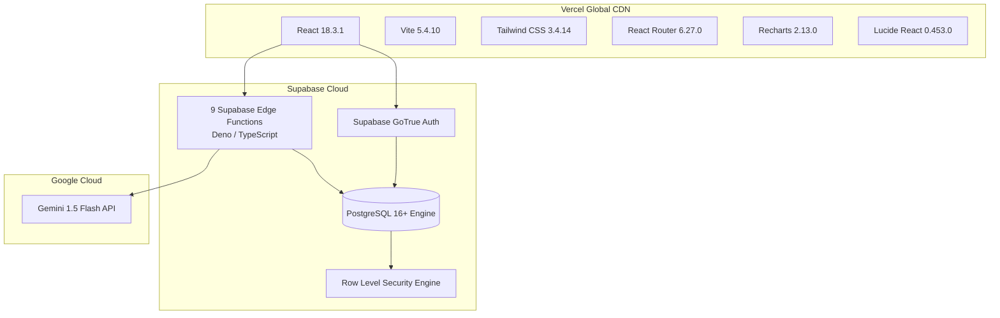

# FanPulse AI — Production Technology Stack & Architectural Evaluation

> **Authoritative technology stack specification, dependency matrix, and architectural evolution history for FanPulse AI.**

---

## 1. Executive Stack Overview

FanPulse AI is built as a serverless, decoupled cloud platform combining a high-performance **React 18 Single Page Application (SPA)** hosted on Vercel with a **Supabase Cloud Backend** (PostgreSQL 16, GoTrue Auth, Row-Level Security, and 9 Deno Edge Functions) and **Google Gemini 1.5 Flash**.

---

## 2. Production Technology Matrix

All versions documented below reflect the active, installed packages verified from `package.json`, `package-lock.json`, and deployment manifests:

| Architecture Tier | Technology Component | Active Production Version | Primary Technical Role |
| :--- | :--- | :--- | :--- |
| **Frontend Framework** | **React** | `18.3.1` | Declarative component UI, Concurrent Mode, Virtual DOM rendering. |
| **Frontend Tooling** | **Vite** | `5.4.10` | Fast ESM development server, Rollup production bundling, code-splitting. |
| **Styling Engine** | **Tailwind CSS** | `3.4.14` | Utility-first CSS, responsive dark theme, zero runtime overhead. |
| **Client Routing** | **React Router DOM** | `6.27.0` | Client-side routing, protected route boundaries (`<ProtectedRoute>`). |
| **HTTP Client** | **Axios** | `1.7.7` | Promise-based API transport with Bearer token injection and error interception. |
| **Data Visualization** | **Recharts** | `2.13.0` | Interactive worm charts, role distribution rings, point differentials. |
| **UI Iconography** | **Lucide React** | `0.453.0` | Modern, lightweight SVG iconography with tree-shaking support. |
| **Form Management** | **React Hook Form** | `7.53.1` | Performant uncontrolled form state management with minimal re-renders. |
| **Client Validation** | **Zod** | `3.23.8` / `4.6.7` | Declarative schema validation for fantasy rosters and login credentials. |
| **Database Engine** | **PostgreSQL** | `16+` (Supabase) | 3NF relational persistence, ACID compliance, 49 RLS policies, 47 indexes. |
| **Backend Compute** | **Supabase Edge Functions** | `Deno / TS Runtime` | 9 serverless micro-endpoints distributed across global Edge regions. |
| **Identity & Auth** | **Supabase GoTrue** | `@supabase/supabase-js 2.46.1` | JWT session issuance, refresh tokens, tenant isolation. |
| **Artificial Intelligence**| **Google Gemini API** | `1.5 Flash` | Grounded match analysis, situation summaries, death-over breakdowns. |
| **Test Runner** | **Vitest** | `4.1.12` | 30 test suites, 461 unit/component/integration tests. |
| **DOM Testing** | **Testing Library** | `16.3.3` | Accessible user interaction simulation and DOM assertions. |
| **Linter & Quality** | **ESLint** | `10.14.0` | Static analysis, code consistency, and syntax validation. |
| **Hosting & Delivery** | **Vercel** | Edge Network | Global HTTP/2 Edge delivery, automated SSL, Brotli compression. |

---

## 3. Architectural Evolution & Prototype History

> [!NOTE]
> **Phase 0 Prototype vs. Production Architecture:**
> During the initial project exploration phase (Phase 0), an enterprise Java 21 / Spring Boot 3 monolith was considered as a prospective backend. 
> 
> However, during technical evaluation and prototyping (Phase 2), the system pivoted to **Supabase Edge Functions (Deno/TypeScript) and Supabase PostgreSQL**. This transition delivered significant advantages:
> 1. **Serverless Scalability:** Instant sub-100ms cold starts without running persistent cloud containers or virtual machines.
> 2. **Native Row-Level Security (RLS):** Security is enforced directly by PostgreSQL rather than requiring custom Spring Security filter chains.
> 3. **Unified TypeScript Ecosystem:** Shared data models and validation logic between frontend React services and backend Deno Edge Functions.
> 4. **Cost & Operational Simplicity:** High-availability serverless architecture perfectly suited for cloud deployment on Vercel and Supabase.
> 
> The initial Spring Boot specifications have been archived for historical evaluation in [`docs/archive/`](archive/).

---

## 4. Frontend Technology Justification

### 4.1 React 18.3.1 + Vite 5.4.10
- **Why React 18:** Established standard for single-page applications with comprehensive ecosystem support for modern charting, routing, and form libraries.
- **Why Vite:** Replaces legacy Webpack architectures with native ES module loading during development and highly optimized Rollup bundles for production, achieving sub-8s full builds.

### 4.2 Tailwind CSS 3.4.14
- Eliminates context-switching between component logic and external CSS files.
- Custom dark-theme cricket palette (`#070a13`, `#0b0f19`, `#1e293b`, `#f59e0b`) tailored for cricket telemetry readability.
- Clean purge mechanism resulting in a minimal 37.07 kB CSS footprint (7.08 kB gzipped).

### 4.3 Recharts 2.13.0
- Declarative SVG charting optimized for React's component tree.
- Powers the **Fantasy Comparison differential chart** and **Match Worm chart**.

---

## 5. Backend & Storage Technology Justification

### 5.1 Supabase PostgreSQL 16+
- **ACID Relational Integrity:** Enforces relational constraints between matches, innings, players, rosters, and fantasy teams.
- **Row-Level Security (RLS):** Multi-tenant isolation at the database layer ensures users cannot read or mutate other managers' fantasy teams.
- **PgBouncer / Supavisor Pooling:** Manages high-concurrency connection pooling, preventing connection exhaustion during traffic surges.

### 5.2 Supabase Edge Functions (Deno / TypeScript)
- **Global Edge Deployment:** Deployed across distributed edge locations close to end users, minimizing round-trip API latency.
- **Isolated Sandbox:** Runs on Deno's secure runtime with granular permission controls.
- **Direct Gemini Integration:** Securely brokers user prompts to Google AI Studio using server-side environment secrets.

---

## 6. Artificial Intelligence Layer

- **Model:** **Google Gemini 1.5 Flash** (`gemini-1.5-flash`).
- **Rationale:** High-speed inference (sub-1.5s latency), cost-efficiency, and strong natural language grounding capability when provided with structured tabular telemetry.
- **Quarantine Boundary:** Generative AI is strictly decoupled from mathematical fantasy scoring. Scoring is executed deterministically; the AI provides narrative explanations and contextual breakdowns.

---

*Related Documentation:*
- [System Architecture](SYSTEM_ARCHITECTURE.md)
- [Database Schema](DATABASE_SCHEMA.md)
- [API Reference](API_REFERENCE.md)
- [Setup and Deployment](SETUP_AND_DEPLOYMENT.md)
- [Testing and QA](TESTING_AND_QA.md)
