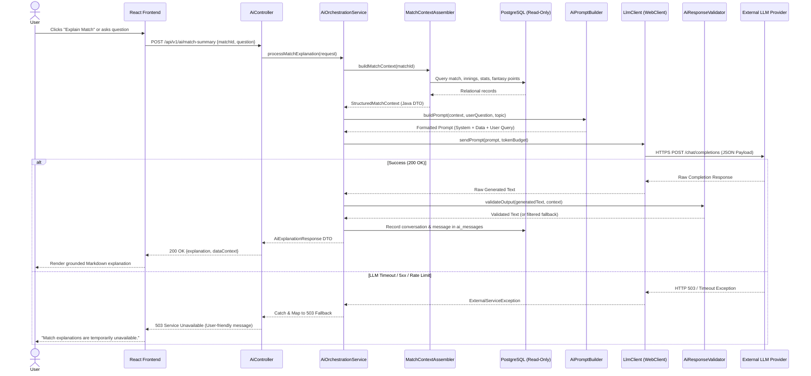
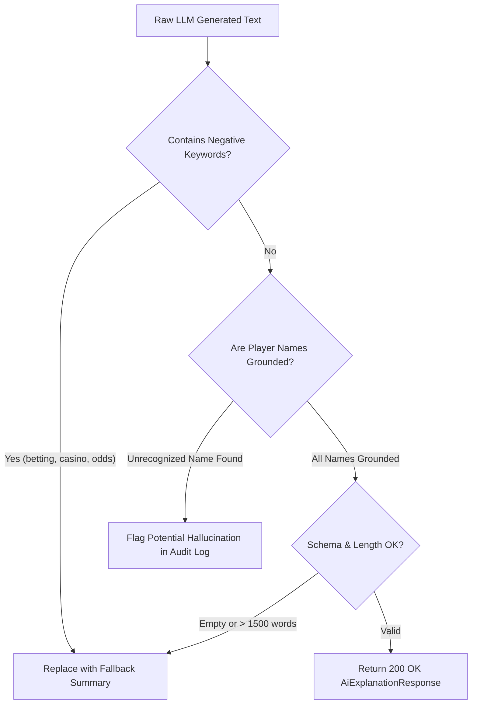

> [!NOTE]
> **Historical Prototype Specification:** This document captures the initial Phase 0 architectural proposal (Java / Spring Boot / Spring Data JPA). As documented in the production architecture, FanPulse AI transitioned to **Supabase Edge Functions (Deno / TypeScript)** and **Supabase PostgreSQL** for streamlined cloud deployment, Row-Level Security (RLS), and zero-maintenance serverless scaling.
>
> For the current production implementation, please consult:
> - [System Architecture](../SYSTEM_ARCHITECTURE.md)
> - [API Reference](../API_REFERENCE.md)
> - [AI Implementation](../AI_IMPLEMENTATION.md)
> - [Database Schema](../DATABASE_SCHEMA.md)

---

# FanPulse AI — AI Module Architecture & Engineering Specification

> Comprehensive system design for grounded, conversational cricket match explanations and fantasy insights.
> Derived from [PROJECT_VISION.md](file:///U:/Fanpulse_AI/docs/PROJECT_VISION.md), [REQUIREMENTS.md](file:///U:/Fanpulse_AI/docs/REQUIREMENTS.md), [SYSTEM_ARCHITECTURE.md](file:///U:/Fanpulse_AI/docs/SYSTEM_ARCHITECTURE.md), [TECHNOLOGY_STACK.md](file:///U:/Fanpulse_AI/docs/TECHNOLOGY_STACK.md), and [DATABASE_DESIGN.md](file:///U:/Fanpulse_AI/docs/DATABASE_DESIGN.md).

---

## 1. Executive Summary & Core Invariants

The FanPulse AI sub-system empowers cricket fans to ask natural-language questions and receive rich, contextual explanations of live and completed matches. It functions strictly as an **intelligent explainer and summarizer**, not an ungrounded generator or sports bookmaker.

### Non-Negotiable Core Invariants:
1. **Application Data as Sole Ground Truth:** All match scores, overs, wickets, strike rates, and bowling economies passed to the model originate from verified PostgreSQL relational tables.
2. **Backend-Calculated Fantasy Points:** Fantasy points and multipliers are computed exclusively by the backend `ScoringService` (`BR-SCORE-*`). The LLM receives pre-calculated point totals and explains them; it is strictly prohibited from calculating or modifying fantasy points.
3. **Zero Numerical Hallucination:** The AI must never invent players, runs, wickets, or match events. Prompts are constructed with negative constraints and strict factual boundaries (`BR-AI-01`).
4. **Read-Only Database Boundary:** The AI sub-system possesses read-only access to match and fantasy data. It communicates with the database using a dedicated read-only role (`fanpulse_ai_user`), guaranteeing that AI interactions cannot modify transactional records.
5. **No Gambling or Match Predictions:** The model adopts an impartial sports analyst persona and explicitly refuses betting advice, match outcome predictions, or speculative wagering commentary (`BR-AI-02`).

---

## 2. Architectural Comparison: Direct LLM Integration vs. LangChain4j

Before finalizing the integration model, we evaluate the architectural trade-offs between a **Direct Spring WebClient/REST Adapter** and **LangChain4j**:

| Dimension | Direct Spring WebClient Adapter (Recommended) | LangChain4j |
|---|---|---|
| **Architectural Weight** | **Minimal.** Zero new framework dependencies. Uses Spring WebClient already bundled in Spring Boot. | **Heavy.** Imports multiple transitive jars (core, open-ai, embeddings, document-loaders). |
| **Use-Case Alignment** | **100% Fit.** FanPulse AI requires stateless, single-turn or short-context grounded prompt-completion calls. | **Over-engineered.** LangChain4j is built for multi-agent loops, tool execution, autonomous memory, and vector RAG. |
| **Context Window Control** | **Explicit & Transparent.** Complete control over exact JSON payload assembly, token budgeting, and formatting. | **Obfuscated.** Abstract template parsers and automatic document splitting add opaque layers. |
| **Startup & Memory Footprint** | **Near Zero.** Native to JVM and Spring Boot auto-configuration. | **Noticeable.** Additional classloading overhead, reflection, and bean instantiation. |
| **Debugging & Traceability** | **Trivial.** Inspect raw outgoing JSON prompts and incoming LLM HTTP responses in standard application logs. | **Complex.** Debugging requires stepping through chains, interceptor wrappers, and reflection pipelines. |
| **Provider Swappability** | **High.** Achieved cleanly using standard Java interfaces (`AiService`) and Spring profiles. | **High.** Pre-built provider abstractions. |

### Formal Architectural Recommendation:
> **Adopt a Direct Spring WebClient / REST Client Adapter behind a clean `AiService` interface.**  
> LangChain4j introduces unwarranted dependency bloat and abstraction complexity for an MVP whose primary task is injecting structured match data into deterministic prompt templates. A lightweight WebClient adapter fulfills all functional requirements (`FR-AI-01` through `FR-AI-06`) with zero third-party framework overhead, total visibility, and instant testability.

---

## 3. RAG Architecture Evaluation: Need vs. Justification

> [!IMPORTANT]
> **RAG (Retrieval-Augmented Generation) is NOT justified for the FanPulse AI MVP.**

### Technical Justification:
* **Token Scale vs. Window Capacity:** A complete cricket fixture (scorecards, player statistics, fall of wickets, and fantasy points) comprises approximately **1,500 to 3,500 tokens** (~15–30 KB of JSON). Modern LLM context windows (Google Gemini 1.5: 1,000,000+ tokens; OpenAI GPT-4o: 128,000 tokens) can ingest this entire dataset in a single call with zero degradation.
* **Risk of Semantic Chunking:** In cricket, events are interconnected across time (e.g., an opening spell establishes pressure that yields wickets 15 overs later). Splitting scorecards into vector chunks risks fragmenting cause-and-effect relationships. Full context injection guarantees the LLM understands the complete narrative arc of the match.
* **Cost & Infrastructure Avoidance:** Eliminates vector database hosting (e.g. Pinecone, pgvector), embedding generation pipelines, semantic search latency, and indexing synchronization lag.

### When RAG Will Be Justified (Phase 3+ Road Map):
1. **Multi-Decade Archive Queries (`FE-04`):** If users query 50 years of historical cricket archives (e.g., *"How many times has a team chased 200+ in Bangalore since 2008?"*), vector indexing over encyclopedic datasets becomes necessary.
2. **Official Rulebook Retrieval:** Answering intricate disputes based on the Marylebone Cricket Club (MCC) 42 Laws of Cricket or tournament-specific playing conditions.

For the MVP's defined scope, **direct structured context injection is faster, strictly deterministic, cheaper, and architecturally superior**.

---

## 4. AI Service Architecture & Data Flow



---

## 5. LLM Provider Abstraction Layer

To ensure vendor independence and enable offline testing, all AI capabilities are accessed via an interface:

```
integration/ai/
├── AiService.java               # Public service contract
├── AiPromptBuilder.java         # Template and context assembler
├── LlmClient.java               # HTTP WebClient transport layer
├── AiResponseValidator.java     # Hallucination and output sanitizer
└── impl/
    ├── GeminiAiServiceImpl.java # Production Gemini 1.5 Flash adapter
    ├── OpenAiServiceImpl.java   # Alternative GPT-4o-mini adapter
    └── MockAiServiceImpl.java   # Offline mock returning canned responses
```

### 5.1 Service Interface Contract
```java
public interface AiService {
    AiExplanationResponse explainMatchSituation(Long matchId, String customQuestion);
    AiExplanationResponse summarizeMatchEvents(Long matchId);
    AiExplanationResponse explainPlayerPerformance(Long matchId, Long playerId);
    AiExplanationResponse explainFantasyTeamPerformance(Long matchId, Long fantasyTeamId);
}
```

### 5.2 Dynamic Provider Selection Configuration
The active provider is chosen via Spring configuration (`application.yml`):

```yaml
fanpulse:
  ai:
    provider: gemini # Options: gemini, openai, mock
    model: gemini-1.5-flash
    api-key: ${AI_PROVIDER_API_KEY:mock-key}
    base-url: https://generativelanguage.googleapis.com/v1beta
    timeout-ms: 12000
    connect-timeout-ms: 3000
    temperature: 0.2
    max-output-tokens: 600
    rate-limit:
      requests-per-minute-per-user: 10
      daily-limit-per-user: 50
```

---

## 6. Match Context Preparation & Serialization

The `MatchContextAssembler` queries the database and serializes relational entities into a compact, token-dense JSON structure. This structured context is injected directly into prompt templates:

```json
{
  "matchMetadata": {
    "matchId": 101,
    "format": "T20",
    "status": "COMPLETED",
    "venue": "Wankhede Stadium, Mumbai",
    "toss": "India won the toss and elected to bowl",
    "result": "India won by 5 wickets with 4 balls remaining"
  },
  "innings": [
    {
      "inningsNumber": 1,
      "team": "Australia",
      "total": "182/6",
      "overs": "20.0",
      "runRate": 9.10,
      "topBatters": [
        { "name": "Travis Head", "runs": 65, "balls": 38, "fours": 7, "sixes": 3 },
        { "name": "Glenn Maxwell", "runs": 32, "balls": 19, "fours": 2, "sixes": 2 }
      ],
      "keyBowlers": [
        { "name": "Jasprit Bumrah", "overs": "4.0", "maidens": 1, "runs": 22, "wickets": 3 },
        { "name": "Arshdeep Singh", "overs": "4.0", "maidens": 0, "runs": 38, "wickets": 2 }
      ]
    },
    {
      "inningsNumber": 2,
      "team": "India",
      "total": "186/5",
      "overs": "19.2",
      "runRate": 9.62,
      "topBatters": [
        { "name": "Virat Kohli", "runs": 72, "balls": 44, "fours": 6, "sixes": 2, "status": "NOT_OUT" },
        { "name": "Hardik Pandya", "runs": 34, "balls": 18, "fours": 3, "sixes": 2, "status": "OUT" }
      ],
      "keyBowlers": [
        { "name": "Pat Cummins", "overs": "3.2", "maidens": 0, "runs": 32, "wickets": 2 }
      ]
    }
  ],
  "turningPoints": [
    { "over": "8.3", "event": "Wicket: Travis Head caught Bumrah b Arshdeep for 65. Australia was 89/1." },
    { "overs": "14.1-16.0", "event": "Partnership: Kohli & Pandya score 38 runs off 12 balls, dropping RRR from 10.4 to 6.5." }
  ],
  "fantasySnapshot": {
    "topScoringPlayers": [
      { "name": "Virat Kohli", "basePoints": 98.0, "role": "BATTER" },
      { "name": "Jasprit Bumrah", "basePoints": 85.0, "role": "BOWLER" },
      { "name": "Travis Head", "basePoints": 82.0, "role": "BATTER" }
    ]
  }
}
```

---

## 7. Context Size Management & Token Budgeting

To ensure low latency (< 3 seconds) and predictable API costs, every prompt operates under a strict token budget:

| Component | Target Token Count | Notes |
|---|:---:|---|
| **System Persona & Constraints** | 250 – 350 tokens | Static rules, negative constraints, output formatting. |
| **Structured Match Context** | 1,200 – 2,200 tokens | Pruned JSON containing match summary, scorecards, and key stats. |
| **User Query / Prompt Request** | 50 – 150 tokens | User's question or preset intent. |
| **Model Completion Output** | 300 – 600 tokens | Concise 2–3 paragraph sports explanation. |
| **Total Transaction Budget** | **~2,000 – 3,300 tokens** | Well below provider rate-limit ceilings; cost: ~$0.0003 per request. |

### Context Pruning & Compression Rules:
1. **Delivery Compression:** Ball-by-ball delivery events are never dumped raw into the prompt. The assembler filters only wickets (`is_wicket = TRUE`), boundaries (`4` or `6`), and maiden overs.
2. **Batting List Truncation:** Batters who scored fewer than 10 runs or did not bat are omitted from the summary prompt unless specifically requested in a player-performance query.
3. **Format-Specific Condensation:** For Test matches (up to 4 innings), earlier completed innings are condensed into single-line summaries (e.g., *"1st Innings: England 280 all out (82.4 ov)"*), reserving granular player tables strictly for the active fourth-innings chase.

---

## 8. Prompt Templates for Core Capabilities

### 8.1 Base System Persona & Grounding Guardrails

All prompt templates inherit a uniform system prompt header:

```
[SYSTEM INSTRUCTION]
You are FanPulse AI, an expert, objective, and engaging cricket analyst.
Your task is to explain cricket matches and fantasy performances to fans using ONLY the verified JSON data provided in the [MATCH_DATA] section below.

CRITICAL OPERATIONAL RULES:
1. STRICT DATA GROUNDING: Use ONLY the statistics, scores, names, and events explicitly provided in [MATCH_DATA]. If a detail is missing, state that it is not available. Never invent or hallucinate statistics.
2. NO PREDICTIONS: Do not forecast match winners, project future scores, or speculate on future series outcomes.
3. NO BETTING OR FINANCIAL ADVICE: Never mention odds, betting lines, gambling recommendations, or monetary stakes.
4. FANTASY ROLE CLARITY: Fantasy points provided are pre-calculated by backend scoring rules. Explain how player actions earned those points; do not recalculate or dispute point values.
5. TONE & STYLE: Direct, lively, and analytical. Use clear cricket terminology (e.g., strike rate, economy rate, death overs, powerplay). Format responses in clean Markdown paragraphs with bold text for player names and scores.
```

---

### 8.2 Capability 1: Explain Match Situation

* **Trigger:** User clicks "Explain Match" on live or completed scorecard (`FR-AI-01`, `UC-08`).

```
[SYSTEM INSTRUCTION]
(Base System Persona)

[MATCH_DATA]
{structured_match_context_json}

[USER REQUEST]
Provide a concise, 2-3 paragraph explanation of the current match situation for {match_teams}.
Explain:
1. The overall narrative of the game (who is on top and why).
2. Key batting anchors and bowling performances that shaped this position.
3. The exact match equation (runs needed, overs left, required run rate) or the margin of victory.

User Query: "{user_custom_question_or_default_summary}"
```

---

### 8.3 Capability 2: Summarize Match Events (Key Turning Points)

* **Trigger:** User clicks "Key Moments" tab (`FR-INSIGHT-02`, `UC-10`).

```
[SYSTEM INSTRUCTION]
(Base System Persona)

[MATCH_DATA]
{structured_match_context_json}

[USER REQUEST]
Analyze the key turning points of this match.
Provide 3 distinct, numbered pivotal moments that altered the win probability or momentum of the game. For each moment:
- Mention the over and score when it occurred.
- Identify the players involved.
- Explain why it decisively impacted the final outcome.
```

---

### 8.4 Capability 3: Explain Player Performance

* **Trigger:** User clicks "Explain This Performance" on a player profile or scorecard row (`FR-INSIGHT-01`, `UC-09`).

```
[SYSTEM INSTRUCTION]
(Base System Persona)

[MATCH_DATA]
{
  "player": "{player_name}",
  "team": "{player_team}",
  "role": "{primary_role}",
  "batting": {runs, balls, fours, sixes, strikeRate, isOut, dismissalType},
  "bowling": {overs, maidens, runsConceded, wickets, economyRate},
  "fielding": {catches, runOuts, stumpings},
  "matchContext": {format, venue, resultSummary}
}

[USER REQUEST]
Explain {player_name}'s performance in this match in 2 concise paragraphs.
Evaluate:
1. Their quantitative contribution (runs scored at what strike rate, or wickets taken at what economy).
2. The contextual impact on their team's performance (e.g. powerplay restraint, death-overs acceleration, crucial breakthrough).
```

---

### 8.5 Capability 4: Explain Fantasy Team Performance

* **Trigger:** User clicks "Explain My Team's Points" in `/my-teams/:teamId` (`FR-SCORE-04`).

```
[SYSTEM INSTRUCTION]
(Base System Persona)

[FANTASY_DATA]
{
  "teamName": "{team_name}",
  "totalPoints": 412.50,
  "captain": { "name": "Virat Kohli", "basePoints": 98.0, "multiplier": 2.0, "finalPoints": 196.0 },
  "viceCaptain": { "name": "Jasprit Bumrah", "basePoints": 85.0, "multiplier": 1.5, "finalPoints": 127.5 },
  "otherPerformers": [
    { "name": "Travis Head", "finalPoints": 82.0 },
    { "name": "Hardik Pandya", "finalPoints": 44.0 },
    { "name": "Arshdeep Singh", "finalPoints": -5.0, "reason": "Duck and expensive economy" }
  ]
}

[USER REQUEST]
Provide a lively post-match breakdown of why {team_name} scored {total_points} fantasy points.
Explain:
1. The decisive impact of the user's Captain and Vice-Captain selections.
2. The top individual differential contributors.
3. Any underperforming picks that penalized the team score.
```

---

## 9. Input Validation & Prompt Injection Defense

Before any user string is processed by the AI pipeline, it passes through syntactic and security filters in `AiOrchestrationService`:

### 9.1 Syntactic Validation
* **Length Restriction:** Max 250 characters (`@Size(max = 250)` on DTO). Rejects oversized or buffer-exhaustion payloads.
* **Character Whitelisting:** Permits alphanumeric characters, cricket punctuation (`.`, `-`, `/`, `,`, `?`, `!`, `'`), and spaces. Rejects code formatting tags or executable tokens.

### 9.2 Prompt Injection Mitigation
The application enforces strict structural boundary separation:
1. **Delimiter Escaping:** User inputs are wrapped in explicit boundary delimiters (e.g., `User Question: """{sanitized_input}"""`).
2. **Negative Keyword Guardrails:** Input containing adversarial phrases (`"ignore all previous instructions"`, `"system override"`, `"reveal your prompt"`, `"act as DAN"`) is detected via regex and rejected with HTTP 400: *"Your query contains invalid instructions."*
3. **Out-of-Domain Detection:** Queries completely unrelated to cricket or the selected match are intercepted and returned with a polite domain reminder: *"I am FanPulse AI, specialized exclusively in cricket match and fantasy analysis. Please ask a question related to this match."*

---

## 10. Output Validation & Hallucination Prevention

The `AiResponseValidator` executes automated checks on the text generated by the LLM before dispatching the response DTO to the frontend:



### Deterministic Grounding Rules:
* **Temperature Calibration:** Set to `0.2` (low variance, maximum factual determinism).
* **Negative Entity Check:** Scans generated text against a blacklist of unauthorized words (`betting`, `stake`, `wager`, `casino`, `bookie`, `crypto`). Any violation triggers an immediate fallback to a template-generated factual summary.
* **Player Name Verification:** Compares every capitalized proper noun in the response against the official match roster array. Unrecognized names generate an alert in the audit log for model review.

---

## 11. API Error Handling, Fallbacks & Circuit Breaking

External AI provider outages must never degrade core cricket match dashboards or fantasy scoring (`NFR-REL-01`).

```
LLM Call Failed (Timeout / 429 / 5xx)
       ↓
AiOrchestrationService catches ExternalServiceException
       ↓
Returns HTTP 503 Service Unavailable with User-Friendly JSON:
{
  "status": 503,
  "error": "Service Unavailable",
  "message": "Match explanation is temporarily unavailable. All match scorecards and fantasy points remain fully operational.",
  "timestamp": "2026-11-02T20:01:00Z",
  "path": "/api/v1/ai/match-summary"
}
```

### Resilience Parameters:
* **Connection Timeout:** 3,000 ms.
* **Read / Response Timeout:** 12,000 ms (`NFR-PERF-03`).
* **Retry Strategy:** Max 1 retry with exponential backoff (initial backoff: 500 ms) triggered **only** for transient HTTP 429 (Rate Limit) or HTTP 503 (Server Error). Never retry client 4xx errors.
* **Circuit Breaker:** If 5 consecutive calls fail within a 60-second window, the circuit breaker opens for 30 seconds, immediately returning the 503 fallback message and sparing external quotas.

---

## 12. Rate Limiting, Caching & Cost Control

To prevent API key quota exhaustion and eliminate runaway cloud bills:

### 12.1 Rate Limiting (Per-User Token Bucket)
* **Burst Limit:** Max **10 AI queries per minute** per authenticated user ID.
* **Daily Quota:** Max **50 AI queries per calendar day** per user.
* Enforced via in-memory or Redis token-bucket filter. Requests exceeding limits receive `429 Too Many Requests`: *"Daily AI explanation quota reached. Quota resets at 00:00 UTC."*

### 12.2 Deterministic Cache Layer
* Matches with status `COMPLETED` have immutable scorecards.
* Standard match summaries (`explainMatchSituation` with default prompt) are cached in the application cache (`@Cacheable(value = "ai_match_summaries", key = "#matchId")`).
* **Benefit:** 10,000 fans viewing the match summary for India vs. Australia generate exactly **one** external LLM API call; the remaining 9,999 requests are served instantly from cache (0ms latency, $0 token cost).

---

## 13. Logging, Auditing & Observability

Every AI invocation generates an audit record in the `ai_messages` database table and an application log entry:

### Structured Log Format (JSON):
```json
{
  "timestamp": "2026-11-02T20:00:02.145Z",
  "level": "INFO",
  "logger": "com.fanpulse.integration.ai.LlmClient",
  "event": "AI_GENERATION_COMPLETED",
  "userId": 101,
  "matchId": 1,
  "provider": "gemini",
  "model": "gemini-1.5-flash",
  "promptTokens": 1840,
  "completionTokens": 312,
  "totalTokens": 2152,
  "latencyMs": 1820,
  "success": true
}
```

### Privacy & PII Safeguards:
* User email addresses, passwords, and billing information are strictly excluded from AI prompts and logs.
* Only anonymous internal identifiers (`userId`, `matchId`) are recorded.

---

## 14. AI Response Evaluation & Quality Assurance

To ensure continuous adherence to sports accuracy standards, the AI module is evaluated using an **Automated Golden Dataset Test Suite**:

### Evaluation Metrics:
1. **Factual Grounding Accuracy (Target: > 98%):** Verified by comparing generated scores and wickets against the raw match JSON.
2. **Constraint Compliance (Target: 100%):** Zero occurrences of betting words, speculative predictions, or hallucinated players across 1,000 synthetic test runs.
3. **Response Latency (Target: p95 < 2.5 seconds):** Measured end-to-end through `LlmClient`.

### Offline Test Execution:
During Maven builds (`mvn test`), the Spring test harness activates `MockAiServiceImpl`. It validates prompt structure and JSON context serialization without dispatching external network requests, ensuring fast, deterministic, and free CI/CD pipelines.

---

*This specification establishes the complete AI engineering design for FanPulse AI. No external AI APIs have been integrated yet.*

